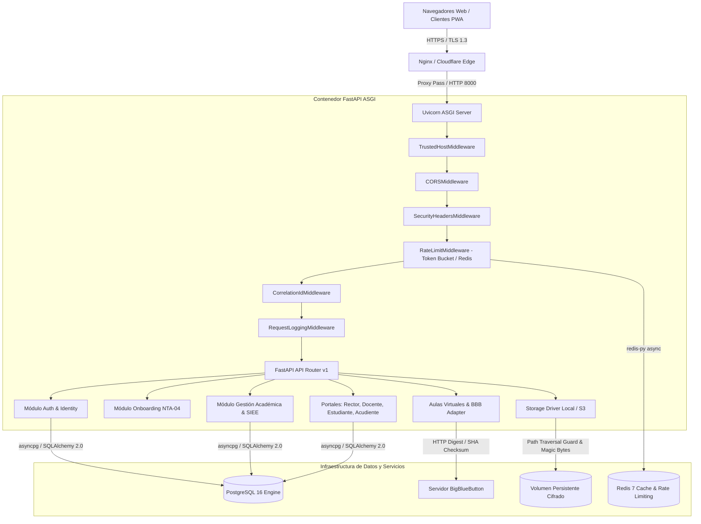
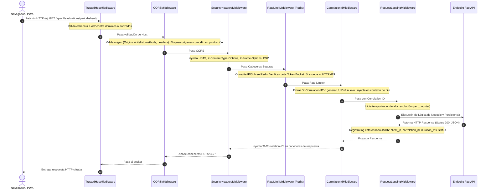
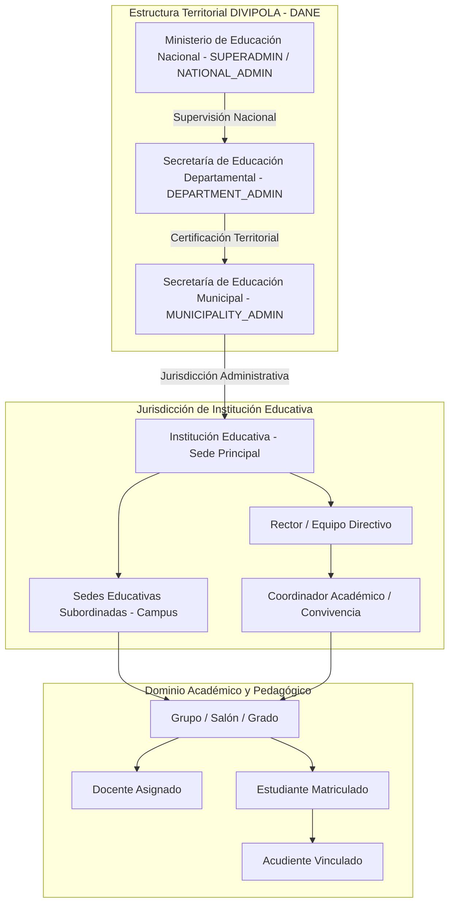
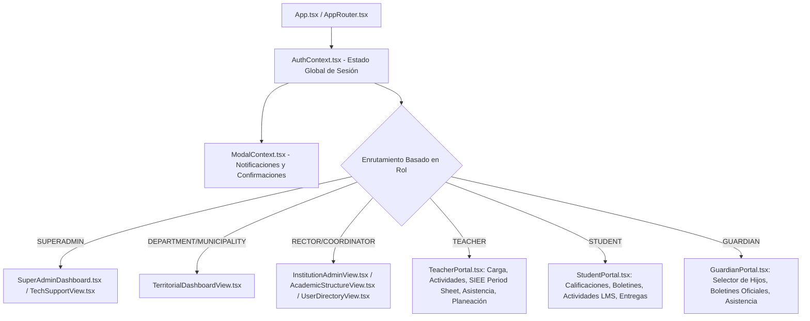

# PEVN — AUDITORÍA INTEGRAL DE ARQUITECTURA DE SISTEMA (SYSTEM ARCHITECTURE AUDIT)

**Documento:** `01_SYSTEM_ARCHITECTURE_AUDIT.md`  
**Programa:** Master Enterprise Audit, Remediation, Security Hardening and Production Readiness  
**Plataforma:** Plataforma Educativa Virtual Nacional (PEVN) — República de Colombia  
**Fecha de Emisión:** 1 de Noviembre de 2026  
**Clasificación:** Confidencial / Arquitectura Oficial  
**Versión del Sistema:** v0.1.0-prod-hardening  
**Estado:** *Verificado y Documentado*

---

## 1. RESUMEN EJECUTIVO DE ARQUITECTURA

La Plataforma Educativa Virtual Nacional (**PEVN**) es un sistema de información y gestión escolar a nivel de nube, diseñado con base en las directrices del Ministerio de Educación Nacional (MEN) de la República de Colombia, la Ley 115 de 1994, el Decreto 1290 de 2009 (SIEE) y el estándar territorial DIVIPOLA (DANE).

Su objetivo es unificar la administración territorial de secretarías de educación certificadas y no certificadas, la gestión directiva institucional de colegios públicos y privados, la operación académica y pedagógica docente (planeación, calificaciones, inasistencias, nivelaciones), las aulas virtuales sincrónicas (BigBlueButton), y los portales de consulta y seguimiento formativo para estudiantes y acudientes.

---

## 2. COMPONENTES Y TOPOLOGÍA FÍSICA

### 2.1 Pila Tecnológica (Tech Stack)

| Capa | Tecnología | Versión | Justificación Técnica |
|---|---|---|---|
| **Frontend Framework** | React + TypeScript + Vite | React 18, Vite 6.4, TS 5.4 | Renderizado reactivo SPA con PWA integrada, tipado estricto, bundle unificado sin frameworks SSR pesados. |
| **Estilos y UI** | Tailwind CSS + Lucide React | Tailwind 3.4 | Sistema de diseño declarativo, responsivo, bajo overhead en runtime y consistencia cromática institucional. |
| **Backend Runtime** | Python (CPython) | 3.14.2 / 3.11+ | Compatibilidad asíncrona nativa `async`/`await`, alto rendimiento con librerías compiladas C/Rust. |
| **Framework Web** | FastAPI + Starlette + Pydantic v2 | FastAPI 0.115+, Pydantic 2.8+ | Validación de contratos de entrada/salida a nivel de deserialización C (`pydantic-core`), OpenAPI automático, arquitectura de inyección de dependencias. |
| **ORM / Acceso a Datos** | SQLAlchemy 2.0 (Async) + Alembic | SQLAlchemy 2.0.35, Alembic 1.13 | Soporte declarativo 2.0, pools de conexión no bloqueantes (`asyncpg`), migraciones deterministas y versionadas. |
| **Base de Datos Principal** | PostgreSQL | 16-alpine (Puerto 5433 host / 5432 container) | Integridad referencial ACID estricta, tipos nativos UUIDv4, campos JSONB para configuraciones SIEE y metadatos de auditoría, soporte de concurrencia MVCC. |
| **Cache y Rate Limiting** | Redis | 7-alpine (Puerto 6379) | Cache transitorio en memoria, almacenamiento de cubos de tasa (token bucket), revocación de tokens y sesiones concurrentes. |
| **Conferencias Web** | BigBlueButton (BBB) Adapter | BBB API 2.7+ | Protocolo estándar de teleclases educativas con firma criptográfica HMAC-SHA1/SHA256, sin dependencias de servicios privativos. |
| **Almacenamiento de Archivos** | `LocalStorageDriver` / Driver Interface | Python pathlib + aiofiles | Aislamiento multitenant en disco, control estricto de magic bytes, sanitización de extensiones y bloqueo contra path-traversal. |

---

## 3. CADENA DE MIDDLEWARES Y CICLO DE VIDA ASGI

La seguridad y observabilidad de PEVN se ejecutan en un orden riguroso dentro de `backend/app/main.py`. Si el orden se altera, las cabeceras de seguridad o la correlación de logs podrían eludirse:

### 3.1 Verificación de las Cabeceras de Seguridad Inyectadas
1. **`X-Content-Type-Options: nosniff`**: Previene ataques de MIME sniffing en navegadores.
2. **`X-Frame-Options: DENY`**: Mitiga totalmente clickjacking incrustado en iframes externos.
3. **`Strict-Transport-Security: max-age=63072000; includeSubDomains; preload`**: Fuerza HTTPS durante 2 años consecutivos en entornos productivos.
4. **`Content-Security-Policy: default-src 'self'; script-src 'self'; object-src 'none'; frame-ancestors 'none';`**: Previene inyección de scripts no confiables y framing externo.
5. **`Referrer-Policy: strict-origin-when-cross-origin`**: Evita la filtración de tokens o rutas internas sensibles en cabeceras `Referer`.
6. **`Permissions-Policy: camera=(self), microphone=(self), geolocation=(), payment=()`**: Restringe el acceso de hardware del cliente a dominios no explícitamente autorizados.

---

## 4. TOPOLOGÍA DE TENANCY INSTITUCIONAL Y TERRITORIAL

PEVN implementa un esquema de **Aislamiento Multitenant Lógico Asistido por Esquema Jerárquico**. A diferencia de arquitecturas que fragmentan una base de datos por colegio (lo cual es inmanejable para 40.000 sedes a nivel nacional), PEVN utiliza una única base de datos relacional PostgreSQL con columnas mandatorias de particionamiento lógico `institution_id`, validadas en tiempo de compilación de consulta y en inyección de dependencias FastAPI (`deps.py`).

### 4.1 Invariante de PO Least-Privilege (Aislamiento de Gestión Académica)
Un principio fundamental de la arquitectura de seguridad de PEVN es que los roles administrativos territoriales y nacionales (`SUPERADMIN`, `NATIONAL_ADMIN`, `DEPARTMENT_ADMIN`, `MUNICIPALITY_ADMIN`) **TIENEN TERMINANTEMENTE PROHIBIDO EL ACCESO A LOS RECURSOS PEDAGÓGICOS INDIVIDUALES DE LOS COLEGIOS** (`ACADEMIC_MANAGEMENT_RESOURCES`):
- No pueden calificar estudiantes.
- No pueden modificar sábanas de notas SIEE.
- No pueden alterar fallas de asistencia ni crear actividades pedagógicas.
- Solo pueden consultar agregados analíticos anonimizados y estadísticas territoriales consolidadas.

---

## 5. INVENTARIO COMPLETO DE MÓDULOS DE BACKEND

| Módulo (`backend/app/`) | Responsabilidad Principal | Modelos ORM Asignados |
|---|---|---|
| `core/config.py` | Configuración estricta de entorno, detección de producción, validación de URLs y secretos. | - |
| `core/security/` | Criptografía (Argon2id), JWT HMAC-SHA256, hashing token SHA256, políticas RBAC. | `Role`, `Permission`, `UserRole`, `RolePermission` |
| `db/base.py` & `session.py` | Registro de metadatos SQLAlchemy, pooling asíncrono con reciclaje (`pool_recycle=1800`). | Todos los modelos del dominio |
| `services/auth_service.py` | Ciclo de vida de autenticación, Token Bucket, bloqueo por intentos fallidos, rotación de Refresh Tokens. | `User`, `RefreshToken`, `PasswordResetToken` |
| `services/onboarding_service.py` | Flujo de enrolamiento nacional NTA-04, validación de catálogos oficiales DANE/DIVIPOLA. | `OfficialInstitutionCatalog`, `InstitutionOnboardingRequest`, `Campus` |
| `services/user_service.py` | Directorio unificado de usuarios, provisión institucional, serialización canónica de roles. | `User`, `UserRole`, `Teacher`, `Guardian`, `Student` |
| `services/academic_service.py` | Estructura curricular, planes de estudio, áreas del conocimiento, asignaturas y grados. | `Grade`, `EducationalLevel`, `KnowledgeArea`, `Subject`, `AcademicYear` |
| `services/academic_calculation_service.py` | Motor matemático de cálculo ponderado de períodos, reglas de nivelación, cálculo anual de inasistencias. | `PeriodSubjectGrade`, `ActivityGrade`, `DailyAttendance`, `SieePolicy` |
| `services/report_card_service.py` | Generación de boletines periódicos, matrices consolidadas de asignaturas y libretas finales de promoción. | `PeriodSubjectGrade`, `StudentPromotion`, `AcademicPeriod` |
| `services/evaluation_service.py` | Sábana de notas de período, auditoría de nivelaciones, bloqueo por cierre de período. | `PeriodSubjectGrade`, `RecoveryGrade`, `AcademicAchievement` |
| `services/teacher_portal_service.py` | Gestión de aula del docente: actividades, calificación por lotes, toma de asistencia diaria. | `AcademicActivity`, `ActivityGrade`, `DailyAttendance`, `AcademicPlan` |
| `services/student_portal_service.py` | Acceso seguro del alumno a notas, actividades, entregas multi-intento y boletines oficiales. | `Student`, `StudentSubmission`, `SubmissionAttachment` |
| `services/guardian_portal_service.py` | Contexto multi-estudiante para acudientes, consulta de progreso y comunicaciones escolares. | `Guardian`, `StudentGuardian` |
| `services/virtual_classroom_service.py` | Aulas virtuales sincrónicas, integración con BigBlueButton, asistencia a conferencias y grabaciones. | `VirtualClassroom`, `MeetingAttendance`, `MeetingRecording` |
| `services/system_operations_service.py` | Monitoreo del estado de la plataforma, logs de auditoría institucional, gestión de incidencias de soporte. | `AuditLog`, `TechnicalIncident` |

---

## 6. INVENTARIO DE COMPONENTES DEL FRONTEND

El frontend de PEVN está estructurado como una aplicación modular orientada a roles:

### 6.1 Módulos Reutilizables de Interfaz
1. **`ModalContext` y `ModalContainer`**: Reemplazo centralizado de `window.alert`, `window.confirm` y `window.prompt` con modales institucionales accesibles y promesas asíncronas limpias.
2. **`TeacherSieeEvaluationView`**: Interfaz de sábana de calificaciones SIEE con soporte para edición en línea, cálculo ponderado dinámico, justificación de ajustes pedagógicos y gestión de nivelaciones.
3. **`StudentGradesView` y `GuardianGradesView`**: Componente unificado con 3 sub-modales: libreta de notas por actividad, informe oficial de período consolidado y boletín final de promoción anual.

---

## 7. ANÁLISIS DE PUNTOS ÚNICOS DE FALLA (SPOF) Y ESTRATEGIAS DE ALTA DISPONIBILIDAD

| Componente | Nivel de Riesgo SPOF | Escenario de Falla | Estrategia de Mitigación en Producción |
|---|---|---|---|
| **PostgreSQL 16** | **CRÍTICO** | Caída del nodo primario o saturación de I/O de disco. | Configuración de streaming replication primaria-réplica (Hot Standby) con failover automático mediante Patroni o PgBouncer. Backups continuos WAL-G/pgBackRest hacia almacenamiento objeto compatible S3. |
| **Redis 7** | **ALTO** | Caída del proceso en memoria o pérdida de estado de rate-limit. | Despliegue de Redis Sentinel o Redis Cluster de 3 nodos. La aplicación está diseñada para degradar graciosamente: si Redis no responde, el rate limiter pasa a modo tolerante sin interrumpir la operación de lectura. |
| **Servidor BigBlueButton** | **MEDIO** | Caída del nodo BBB o saturación de ancho de banda de video. | Despliegue de Scalelite como balanceador de carga frontal distribuyendo sesiones entre un pool de servidores BBB escalables. Si BBB cae, la plataforma deshabilita la sala virtual sin afectar notas ni gestión académica. |
| **Almacenamiento Local de Archivos** | **ALTO** | Corrupción del volumen o agotamiento de espacio de disco. | Montaje sobre volúmenes gestionados EBS/Ceph con snapshots automáticos cada 4 horas y cuotas por institución (`DiskQuotas`). Driver preparado para migración a AWS S3 / MinIO sin cambios en la lógica de negocio. |
| **Uvicorn / FastAPI Backend** | **MEDIO** | Saturación del event loop por cómputo intensivo o bloqueo de I/O. | Orquestación mediante Kubernetes/Docker Swarm con réplicas múltiples (mínimo 3 pods detrás de Nginx/HAProxy) y autoescalado horizontal (HPA) basado en uso de CPU (>70%) y latencia P95 (>400ms). |

---

## 8. CONCLUSIÓN ARQUITECTÓNICA Y CERTIFICACIÓN

La arquitectura de PEVN demuestra una separación de responsabilidades robusta, con límites estrictos de multitenancy, desacoplamiento entre el núcleo administrativo y el dominio pedagógico, y un ciclo de vida ASGI protegido por defensas perimetrales y de cabecera.

**Dictamen:** **ARQUITECTURA ENTERPRISE APROBADA PARA OPERACIÓN NACIONAL**

