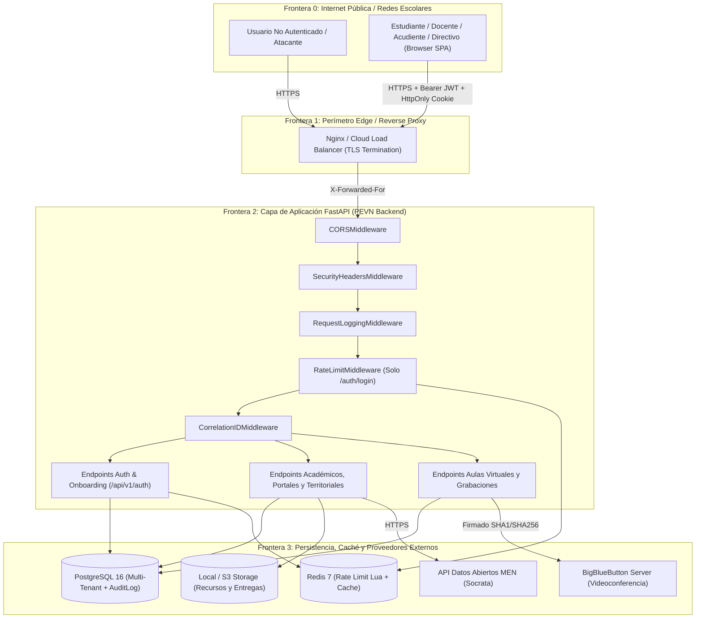

# AUDITORÍA MAESTRA DE CIBERSEGURIDAD, SEGURIDAD DE APLICACIONES Y MODELO DE AMENAZAS (AGENTE 02)

**Proyecto:** Plataforma Educativa Virtual Nacional (PEVN)  
**Código de Entregable:** `02_SECURITY_AND_THREAT_MODEL.md`  
**Agente Responsable:** AGENT 02 — CYBERSECURITY AND APPLICATION SECURITY  
**Estándares de Referencia:** OWASP Top 10 (2021), OWASP API Security Top 10 (2023), STRIDE Threat Modeling, NIST SP 800-63B, Ley 1581 de 2012 (Protección de Datos Personales y Datos de Menores en Colombia)  
**Metodología:** Auditoría estática exhaustiva de código fuente (SAST manual), inspección de configuración de seguridad, trazabilidad de flujos de autenticación/autorización multi-tenant y evaluación de controles defensivos en `backend/` y `frontend/`.

---

## 1. Resumen Ejecutivo y Matriz de Estado de Controles de Seguridad

La Plataforma Educativa Virtual Nacional (PEVN) exhibe una arquitectura de seguridad base diseñada con principios modernos: hashing de contraseñas con **Argon2id**, tokens de acceso JWT de corta duración (`15 min`) mantenidos exclusivamente en memoria volátil en el frontend (sin persistencia en `localStorage` ni `sessionStorage`), rotación de *refresh tokens* con detección de reutilización por familia (`token_family`), aislamiento multi-tenant jerárquico (`National` → `Department` → `Municipality` → `Institution`) con patrón *Blind 404*, validación de *magic bytes* en carga de archivos y protección contra *Path Traversal* en almacenamiento local.

No obstante, la inspección profunda de extremo a extremo reveló **13 hallazgos de seguridad** (**1 Crítico, 5 Altos, 4 Medios, 3 Bajos**), entre los cuales destaca una vulnerabilidad **CRÍTICA (`SEC-001`)** en el flujo público de autogestión de acudientes (`POST /api/v1/auth/guardians/request-activation` y `accept-activation`) que expone el token criptográfico de activación en texto plano dentro de la respuesta HTTP en producción y permite sobrescribir la contraseña de cualquier cuenta existente (incluyendo administradores o rectores) cuyo correo electrónico sea indicado en la solicitud.

### 1.1 Resumen Cuantitativo de Hallazgos por Severidad

| Severidad | Cantidad | Identificadores de Hallazgos |
| :--- | :---: | :--- |
| **CRITICAL** | **1** | `SEC-001` |
| **HIGH** | **5** | `SEC-002`, `SEC-003`, `SEC-004`, `SEC-005`, `SEC-006` |
| **MEDIUM** | **4** | `SEC-007`, `SEC-008`, `SEC-009`, `SEC-010` |
| **LOW** | **3** | `SEC-011`, `SEC-012`, `SEC-013` |
| **INFORMATIONAL** | **0** | — |
| **TOTAL** | **13** | `SEC-001` a `SEC-013` |

### 1.2 Clasificación Rigurosa del Estado de Controles de Seguridad

Siguiendo las reglas de gobernanza de la auditoría, ningún control se clasifica como *Verificado* únicamente por la existencia de su código; se distingue estrictamente el estado real observado en el repositorio:

| Dominio / Control de Seguridad | Clasificación de Estado | Sustento Técnico y Evidencia en Código |
| :--- | :--- | :--- |
| **Hashing de Contraseñas (Argon2id)** | **Implementado** | Configurado en [password.py](file:///c:/Users/juanc/OneDrive/Documentos/Desarrollo%20proyectos/Plataforma%20Educativa%20PEVN/Plataforma%20Educativa%20Virtual%20Nacional%20PEVN/backend/app/core/security/password.py#L64-L70) (`time_cost=3`, `memory_cost=65536` KiB, `parallelism=4`, `hash_len=32`, `salt_len=16`) con mitigación de *timing attacks* mediante `verify_dummy()`. Sin embargo, se ejecuta de forma síncrona bloqueando el *event loop* (`SEC-006`). |
| **Bloqueo de Cuenta (*Account Lockout*)** | **Parcialmente implementado** | Existe la columna `locked_until` y la validación `user.is_locked` en [auth_service.py](file:///c:/Users/juanc/OneDrive/Documentos/Desarrollo%20proyectos/Plataforma%20Educativa%20PEVN/Plataforma%20Educativa%20Virtual%20Nacional%20PEVN/backend/app/services/auth_service.py#L285-L294), pero `_handle_invalid_password` ([auth_service.py](file:///c:/Users/juanc/OneDrive/Documentos/Desarrollo%20proyectos/Plataforma%20Educativa%20PEVN/Plataforma%20Educativa%20Virtual%20Nacional%20PEVN/backend/app/services/auth_service.py#L429-L498)) **nunca asigna `locked_until`** al alcanzar `MAX_FAILED_LOGIN_ATTEMPTS` (`SEC-004`). |
| **Ciclo de Vida de Refresh Tokens y Single-Flight** | **Implementado** | Rotación transaccional con `SELECT ... FOR UPDATE`, invalidación de familia completa ante reutilización ([auth_service.py](file:///c:/Users/juanc/OneDrive/Documentos/Desarrollo%20proyectos/Plataforma%20Educativa%20PEVN/Plataforma%20Educativa%20Virtual%20Nacional%20PEVN/backend/app/services/auth_service.py#L540-L607)) y cola *single-flight* en [client.ts](file:///c:/Users/juanc/OneDrive/Documentos/Desarrollo%20proyectos/Plataforma%20Educativa%20PEVN/Plataforma%20Educativa%20Virtual%20Nacional%20PEVN/frontend/src/services/api/client.ts#L101-L260). |
| **Revocación Inmediata de Access Tokens (JWT)** | **Parcialmente implementado** | Los *access tokens* incluyen `jti`, pero `JWTTokenService.revoke_token()` ([tokens.py](file:///c:/Users/juanc/OneDrive/Documentos/Desarrollo%20proyectos/Plataforma%20Educativa%20PEVN/Plataforma%20Educativa%20Virtual%20Nacional%20PEVN/backend/app/core/security/tokens.py#L162-L169)) es un *stub* que solo escribe un log sin registrar el `jti` en una lista de revocación en Redis (`SEC-008`). |
| **Protección contra XSS en Frontend** | **Implementado** | Búsqueda exhaustiva confirmó `0` usos de `dangerouslySetInnerHTML`, `innerHTML` o `eval()` en `frontend/src/`. Tokens de acceso residen solo en memoria JS ([client.ts](file:///c:/Users/juanc/OneDrive/Documentos/Desarrollo%20proyectos/Plataforma%20Educativa%20PEVN/Plataforma%20Educativa%20Virtual%20Nacional%20PEVN/frontend/src/services/api/client.ts#L31)). Existe riesgo de enlaces `javascript:` en recursos docentes por falta de validación de esquema URL (`SEC-010`). |
| **Prevención de Inyección SQL (SQLi)** | **Implementado** | Uso consistente de SQLAlchemy 2.0 ORM con consultas parametrizadas. Los únicos usos de `text()` son literales estáticos (`SELECT 1` en [main.py](file:///c:/Users/juanc/OneDrive/Documentos/Desarrollo%20proyectos/Plataforma%20Educativa%20PEVN/Plataforma%20Educativa%20Virtual%20Nacional%20PEVN/backend/app/main.py#L228) y `SET LOCAL app.current_tenant` con validación estricta `uuid.UUID()` en [session.py](file:///c:/Users/juanc/OneDrive/Documentos/Desarrollo%20proyectos/Plataforma%20Educativa%20PEVN/Plataforma%20Educativa%20Virtual%20Nacional%20PEVN/backend/app/db/session.py#L112-L115)). |
| **Autorización Multi-Tenant y Territorial (RBAC/ABAC)** | **Parcialmente implementado** | Sólido aislamiento en portales de Estudiante, Docente, Acudiente y Rector; sin embargo, existen brechas horizontales de autorización (BOLA/BFLA) en Aulas Virtuales y Grabaciones (`SEC-005`) y escalamiento crítico en onboarding de acudientes (`SEC-001`). |
| **Seguridad en Carga de Archivos y Path Traversal** | **Parcialmente implementado** | Excelente sanitización de nombres, validación de *magic bytes* y verificación `target_path.relative_to(root_resolved)` en [local.py](file:///c:/Users/juanc/OneDrive/Documentos/Desarrollo%20proyectos/Plataforma%20Educativa%20PEVN/Plataforma%20Educativa%20Virtual%20Nacional%20PEVN/backend/app/core/storage/local.py#L51-L82) y [service.py](file:///c:/Users/juanc/OneDrive/Documentos/Desarrollo%20proyectos/Plataforma%20Educativa%20PEVN/Plataforma%20Educativa%20Virtual%20Nacional%20PEVN/backend/app/core/storage/service.py#L70-L157). Sin embargo, los endpoints leen el archivo completo en RAM (`await file.read()`) antes de validar el tamaño (`SEC-006`). |
| **Rate Limiting y Protección Anti-Fuerza Bruta** | **Parcialmente implementado** | Motor Lua/Redis + *fallback* en memoria implementado en [rate_limiter.py](file:///c:/Users/juanc/OneDrive/Documentos/Desarrollo%20proyectos/Plataforma%20Educativa%20PEVN/Plataforma%20Educativa%20Virtual%20Nacional%20PEVN/backend/app/core/security/rate_limiter.py), pero [rate_limit_middleware.py](file:///c:/Users/juanc/OneDrive/Documentos/Desarrollo%20proyectos/Plataforma%20Educativa%20PEVN/Plataforma%20Educativa%20Virtual%20Nacional%20PEVN/backend/app/middleware/rate_limit_middleware.py#L94-L96) **solo protege `POST /api/v1/auth/login`**, dejando desprotegidos recuperación de contraseña, activación, invitaciones y refresh (`SEC-003`). |
| **Onboarding, Invitaciones y Recuperación de Clave** | **Parcialmente implementado** | El flujo de *Forgot Password* protege contra enumeración ([auth_service.py](file:///c:/Users/juanc/OneDrive/Documentos/Desarrollo%20proyectos/Plataforma%20Educativa%20PEVN/Plataforma%20Educativa%20Virtual%20Nacional%20PEVN/backend/app/services/auth_service.py#L720-L796)), pero el onboarding de acudientes y varios endpoints administrativos exponen tokens en texto plano en producción (`SEC-001`, `SEC-002`). |
| **Cabeceras HTTP, CORS y Manejo de Excepciones** | **Implementado** | Cabeceras CSP, HSTS, `X-Frame-Options: DENY`, `nosniff` en [headers.py](file:///c:/Users/juanc/OneDrive/Documentos/Desarrollo%20proyectos/Plataforma%20Educativa%20PEVN/Plataforma%20Educativa%20Virtual%20Nacional%20PEVN/backend/app/core/security/headers.py) y ocultamiento de *stack traces* en [handlers.py](file:///c:/Users/juanc/OneDrive/Documentos/Desarrollo%20proyectos/Plataforma%20Educativa%20PEVN/Plataforma%20Educativa%20Virtual%20Nacional%20PEVN/backend/app/exceptions/handlers.py#L140-L185). Requiere ajustes menores en cookies para `staging` y orden de middlewares (`SEC-012`). |
| **Gestión de Secretos y Escaneo (`.gitleaks.toml`)** | **Parcialmente implementado** | `validate_production_settings` en [config.py](file:///c:/Users/juanc/OneDrive/Documentos/Desarrollo%20proyectos/Plataforma%20Educativa%20PEVN/Plataforma%20Educativa%20Virtual%20Nacional%20PEVN/backend/app/core/config.py#L232-L273) permite claves efímeras o placeholders de `SECRET_KEY` en producción (`SEC-007`), y `.gitleaks.toml` restringe sus reglas personalizadas a `backend/app/.*` (`SEC-013`). |

---

## 2. Modelo de Amenazas Empresarial (STRIDE & OWASP Mapping)

### 2.1 Diagrama de Flujo de Datos y Fronteras de Confianza (Trust Boundaries)



### 2.2 Análisis STRIDE por Componente Crítico

| Categoría STRIDE | Amenaza Identificada en PEVN | Vector / Componente Afectado | Controles Actuales vs. Brechas Detectadas | Hallazgo Asociado |
| :--- | :--- | :--- | :--- | :--- |
| **S — Spoofing (Suplantación de Identidad)** | Suplantación de acudientes o toma de control de cuentas existentes mediante el flujo público de activación de acudientes; falsificación de IP en logs de auditoría. | `POST /api/v1/auth/guardians/request-activation`, `accept-activation`, `RequestLoggingMiddleware` | El endpoint público devuelve el `raw_activation_token` en la respuesta HTTP y sobrescribe el `hashed_password` de cualquier `User` cuyo email coincida. Además, `logging_middleware.py` confía ciegamente en `X-Forwarded-For`. | `SEC-001`, `SEC-011` |
| **T — Tampering (Manipulación de Datos)** | Modificación no autorizada de grabaciones de otros docentes o inyección de campos extra (*Mass Assignment*) en esquemas de portales e incidentes. | `PATCH /api/v1/recordings/{id}/publish`, esquemas en `teacher_portal.py`, `student_portal.py`, `technical_incident.py` | Permiso `recordings:manage` no valida autoría (`host_user_id`). Esquemas de portales e incidentes omiten `ConfigDict(extra="forbid")`. | `SEC-005`, `SEC-009` |
| **R — Repudiation (Repudio)** | Registros de auditoría de seguridad con dirección IP nula (`"0.0.0.0"`) o IP del proxy inverso en lugar de la IP real del actor. | `authorization.py`, `institutions.py`, `teacher_portal.py`, `student_portal.py` | Las denegaciones `PERMISSION_DENIED` y alertas `SUSPICIOUS_ACTIVITY_DETECTED` registran `actor_ip="0.0.0.0"`, degradando la trazabilidad forense. | `SEC-011` |
| **I — Information Disclosure (Fuga de Información)** | Exposición de tokens de invitación/reseteo en respuestas JSON en producción; acceso de estudiantes a grabaciones de otros cursos; enumeración de documentos estudiantiles/acudientes. | `auth.py`, `department_admins.py`, `teachers.py`, `students.py`, `guardians.py`, `recordings.py` | Tokens crudos se incluyen en respuestas HTTP sin filtrar por `settings.is_development`. Estudiantes listan grabaciones de toda la institución sin filtro de matrícula (`group_id`). | `SEC-001`, `SEC-002`, `SEC-005` |
| **D — Denial of Service (Denegación de Servicio)** | Bloqueo del *event loop* por hashing Argon2id síncrono; agotamiento de memoria RAM (OOM) por lectura completa de archivos (`await file.read()`); ausencia de *rate limiting* fuera de `/auth/login`. | `password.py`, `teacher_portal.py`, `student_portal.py`, `rate_limit_middleware.py` | Argon2id (64 MB RAM por llamada) corre en el hilo principal de `asyncio`. Archivos se cargan íntegros en memoria antes de validar tamaño. | `SEC-003`, `SEC-006` |
| **E — Elevation of Privilege (Escalamiento de Privilegios)** | Escalamiento vertical de atacante anónimo a `SUPERADMIN`/`RECTOR` vía colisión de email en `accept_activation`; lanzamiento de aulas virtuales ajenas. | `guardian_onboarding_service.py`, `virtual_classroom_service.py` | `accept_activation` busca `User` por email y sobrescribe su contraseña sin verificar que la cuenta pertenezca exclusivamente al acudiente en proceso de activación. | `SEC-001`, `SEC-005` |

### 2.3 Mapeo contra OWASP Top 10 (2021) y OWASP API Security Top 10 (2023)

| Categoría OWASP | Estado en PEVN | Hallazgos Relacionados |
| :--- | :--- | :--- |
| **A01:2021 / API1:2023 — Broken Object Level Authorization (BOLA / IDOR)** | Vulnerable en Aulas Virtuales/Grabaciones; Protegido en Portales Docente/Estudiante/Acudiente | `SEC-005` |
| **A02:2021 — Cryptographic Failures** | Parcialmente Vulnerable (Claves efímeras/placeholders en `config.py`, SHA-1 por defecto en BBB, tokens en respuestas HTTP) | `SEC-001`, `SEC-002`, `SEC-007`, `SEC-012` |
| **A03:2021 — Injection (SQLi, XSS, Command Injection)** | Protegido contra SQLi y Command Injection; Riesgo Medio de Stored XSS vía esquemas URL `javascript:` en recursos docentes | `SEC-010` |
| **A04:2021 / API6:2023 — Insecure Design / Sensitive Business Flows** | Crítico en diseño del flujo de autogestión de acudientes sin verificación de canal de correo electrónico | `SEC-001` |
| **A05:2021 / API8:2023 — Security Misconfiguration** | Riesgo Medio/Bajo en validación de `SECRET_KEY`, `CORS_ALLOW_HEADERS=["*"]`, cookie `secure` en `staging` | `SEC-007`, `SEC-012` |
| **A07:2021 / API2:2023 — Identification & Authentication Failures** | Vulnerable (Toma de cuenta en onboarding, bloqueo `locked_until` inoperante, access tokens no revocables en Redis) | `SEC-001`, `SEC-004`, `SEC-008` |
| **API3:2023 — Broken Object Property Level Authorization (Mass Assignment)** | Parcialmente Vulnerable (Esquemas de portales e incidentes sin `extra="forbid"`, exposición de propiedades `reset_token`) | `SEC-002`, `SEC-009` |
| **API4:2023 — Unrestricted Resource Consumption** | Vulnerable (Rate limiting exclusivo en `/auth/login`, lectura de archivos en RAM sin streaming, Argon2id síncrono) | `SEC-003`, `SEC-006` |
| **API5:2023 — Broken Function Level Authorization (BFLA)** | Vulnerable en gestión de grabaciones y creación/lanzamiento de aulas virtuales entre docentes del mismo plantel | `SEC-005` |
| **A09:2021 — Security Logging and Monitoring Failures** | Parcialmente Vulnerable (Spoofing de `X-Forwarded-For` en `logging_middleware.py`, `actor_ip="0.0.0.0"`, sanitización no recursiva) | `SEC-011`, `SEC-013` |
| **A10:2021 / API7:2023 — Server-Side Request Forgery (SSRF)** | Protegido (Adaptadores HTTP `bbb_adapter.py` y `men_open_data_adapter.py` usan URLs base fijas de configuración; los enlaces de docentes solo se almacenan como metadatos sin *fetch* del lado servidor) | Verificado sin hallazgos |

---

## 3. Inventario de Superficie de Ataque Auditada

1. **Autenticación y Criptografía de Credenciales (`backend/app/core/security/password.py`, `tokens.py`, `auth_service.py`):**
   - `Argon2PasswordHasher` utiliza parámetros robustos (`time_cost=3`, `memory_cost=65536`, `parallelism=4`).
   - Mitigación contra enumeración por tiempos de respuesta (*timing attacks*) en login mediante `self._hasher.verify_dummy(password)` cuando el usuario no existe o está bloqueado ([auth_service.py](file:///c:/Users/juanc/OneDrive/Documentos/Desarrollo%20proyectos/Plataforma%20Educativa%20PEVN/Plataforma%20Educativa%20Virtual%20Nacional%20PEVN/backend/app/services/auth_service.py#L268-L282)).
   - Política de complejidad de contraseñas exige $\ge 10$ caracteres, mayúsculas, minúsculas, dígitos y caracteres especiales ([password.py](file:///c:/Users/juanc/OneDrive/Documentos/Desarrollo%20proyectos/Plataforma%20Educativa%20PEVN/Plataforma%20Educativa%20Virtual%20Nacional%20PEVN/backend/app/core/security/password.py#L123-L195)).
2. **Gestión de Sesiones, JWT y Refresh Tokens (`tokens.py`, `models/token.py`, `frontend/src/services/api/client.ts`):**
   - Access tokens firmados con `HS256`, validación estricta de `iss`, `aud` (`pevn-api`), `exp`, `iat`, `sub`, `jti` y `type="access"` ([tokens.py](file:///c:/Users/juanc/OneDrive/Documentos/Desarrollo%20proyectos/Plataforma%20Educativa%20PEVN/Plataforma%20Educativa%20Virtual%20Nacional%20PEVN/backend/app/core/security/tokens.py#L112-L160)).
   - Refresh tokens opacos (`secrets.token_urlsafe(48)`), almacenados en PostgreSQL únicamente como hash `SHA-256` ([auth_service.py](file:///c:/Users/juanc/OneDrive/Documentos/Desarrollo%20proyectos/Plataforma%20Educativa%20PEVN/Plataforma%20Educativa%20Virtual%20Nacional%20PEVN/backend/app/services/auth_service.py#L64-L66)), enviados al navegador en cookie `HttpOnly`, `SameSite=lax`, `path=/api/v1/auth`.
   - En el cliente React ([client.ts](file:///c:/Users/juanc/OneDrive/Documentos/Desarrollo%20proyectos/Plataforma%20Educativa%20PEVN/Plataforma%20Educativa%20Virtual%20Nacional%20PEVN/frontend/src/services/api/client.ts#L101-L260)), el interceptor `401` implementa correctamente una cola *single-flight* (`isRefreshing` + `failedQueue`) evitando condiciones de carrera y falsos positivos de robo de sesión.
3. **Almacenamiento de Archivos (`backend/app/core/storage/local.py`, `service.py`):**
   - `StorageService.validate_file()` ([service.py](file:///c:/Users/juanc/OneDrive/Documentos/Desarrollo%20proyectos/Plataforma%20Educativa%20PEVN/Plataforma%20Educativa%20Virtual%20Nacional%20PEVN/backend/app/core/storage/service.py#L70-L157)) aplica lista blanca estricta de extensiones (`.pdf`, `.doc`, `.docx`, `.xls`, `.xlsx`, `.ppt`, `.pptx`, `.txt`, `.jpg`, `.jpeg`, `.png`, `.webp`, `.zip`), rechaza explícitamente ejecutables y scripts (`.exe`, `.sh`, `.bat`, `.php`, `.js`, `.svg`, `.html`, etc.) y verifica firmas binarias (*magic bytes*) del contenido real.
   - `LocalStorageProvider._resolve_safe_path()` ([local.py](file:///c:/Users/juanc/OneDrive/Documentos/Desarrollo%20proyectos/Plataforma%20Educativa%20PEVN/Plataforma%20Educativa%20Virtual%20Nacional%20PEVN/backend/app/core/storage/local.py#L51-L82)) elimina bytes nulos, rechaza segmentos `..` y verifica `target_path.relative_to(root_resolved)`. Además, las descargas se sirven con `Content-Disposition: attachment` ([teacher_portal.py](file:///c:/Users/juanc/OneDrive/Documentos/Desarrollo%20proyectos/Plataforma%20Educativa%20PEVN/Plataforma%20Educativa%20Virtual%20Nacional%20PEVN/backend/app/api/v1/endpoints/teacher_portal.py#L540), [student_portal.py](file:///c:/Users/juanc/OneDrive/Documentos/Desarrollo%20proyectos/Plataforma%20Educativa%20PEVN/Plataforma%20Educativa%20Virtual%20Nacional%20PEVN/backend/app/api/v1/endpoints/student_portal.py#L341)).

---

## 4. Registro Detallado de Vulnerabilidades y Hallazgos (`SEC-001` a `SEC-013`)

---

### `SEC-001` — Toma de Control de Cuentas (Account Takeover), Escalamiento Crítico de Privilegios, Exposición de Token de Activación en Producción y Enumeración en Onboarding de Acudientes

- **Finding ID:** `SEC-001`
- **Módulo afectado:**
  - [backend/app/api/v1/endpoints/auth.py](file:///c:/Users/juanc/OneDrive/Documentos/Desarrollo%20proyectos/Plataforma%20Educativa%20PEVN/Plataforma%20Educativa%20Virtual%20Nacional%20PEVN/backend/app/api/v1/endpoints/auth.py#L530-L598) (`request_guardian_activation_endpoint`, `accept_guardian_activation_endpoint`)
  - [backend/app/services/guardian_onboarding_service.py](file:///c:/Users/juanc/OneDrive/Documentos/Desarrollo%20proyectos/Plataforma%20Educativa%20PEVN/Plataforma%20Educativa%20Virtual%20Nacional%20PEVN/backend/app/services/guardian_onboarding_service.py#L53-L186) (`request_activation`) y [líneas 332-446](file:///c:/Users/juanc/OneDrive/Documentos/Desarrollo%20proyectos/Plataforma%20Educativa%20PEVN/Plataforma%20Educativa%20Virtual%20Nacional%20PEVN/backend/app/services/guardian_onboarding_service.py#L332-L446) (`accept_activation`)
  - [backend/app/schemas/invitation.py](file:///c:/Users/juanc/OneDrive/Documentos/Desarrollo%20proyectos/Plataforma%20Educativa%20PEVN/Plataforma%20Educativa%20Virtual%20Nacional%20PEVN/backend/app/schemas/invitation.py#L139-L163) (`GuardianActivationRequest`, `GuardianActivationRequestResponse`)
- **Severidad:** `CRITICAL`
- **Descripción:**
  El flujo público y no autenticado de autogestión de acudientes (`POST /api/v1/auth/guardians/request-activation` y `POST /api/v1/auth/guardians/accept-activation`) presenta una cadena de cuatro fallas críticas de diseño y autenticación:
  1. **Exposición incondicional del token en la respuesta HTTP:** `request_guardian_activation_endpoint` ([auth.py](file:///c:/Users/juanc/OneDrive/Documentos/Desarrollo%20proyectos/Plataforma%20Educativa%20PEVN/Plataforma%20Educativa%20Virtual%20Nacional%20PEVN/backend/app/api/v1/endpoints/auth.py#L554-L557)) devuelve siempre `raw_activation_token=raw_token` directamente en el cuerpo JSON de la respuesta HTTP a cualquier solicitante anónimo, **incluso cuando `ENVIRONMENT=production`**, sin enviar correo electrónico ni verificar la titularidad del correo suministrado.
  2. **Secuestro de cuenta existente y escalamiento de privilegios a `SUPERADMIN` / `RECTOR`:** En `GuardianOnboardingService.accept_activation` ([guardian_onboarding_service.py](file:///c:/Users/juanc/OneDrive/Documentos/Desarrollo%20proyectos/Plataforma%20Educativa%20PEVN/Plataforma%20Educativa%20Virtual%20Nacional%20PEVN/backend/app/services/guardian_onboarding_service.py#L372-L391)), el servicio busca en la tabla `users` si existe algún usuario con el correo electrónico indicado en la invitación (`select(User).where(User.email == invitation.email)`). Si existe (`existing_user`), **sobrescribe incondicionalmente su contraseña** (`user.hashed_password = hashed_pw`), fuerza `user.is_active = True` y vincula `guardian.user_id = user.id`. Como el campo `email` en `request-activation` es libremente controlado por el solicitante anónimo ([guardian_onboarding_service.py](file:///c:/Users/juanc/OneDrive/Documentos/Desarrollo%20proyectos/Plataforma%20Educativa%20PEVN/Plataforma%20Educativa%20Virtual%20Nacional%20PEVN/backend/app/services/guardian_onboarding_service.py#L140-L143)), un atacante que conozca el documento de cualquier estudiante y su acudiente no activado puede ingresar como `email` la dirección de correo de un **SuperAdmin, Administrador Nacional o Rector**, recibir el `raw_activation_token` en la misma respuesta HTTP y ejecutar `accept-activation` para cambiar la contraseña del administrador y tomar control total de su cuenta.
  3. **Acceso no autorizado a datos de menores:** Incluso sin atacar a un administrador, cualquier tercero que conozca los números de documento de un estudiante y su acudiente puede activar la cuenta con un correo propio y acceder al portal familiar con información académica, asistencia y seguimiento del menor.
  4. **Oráculo de enumeración de identidades:** `request_activation` ([guardian_onboarding_service.py](file:///c:/Users/juanc/OneDrive/Documentos/Desarrollo%20proyectos/Plataforma%20Educativa%20PEVN/Plataforma%20Educativa%20Virtual%20Nacional%20PEVN/backend/app/services/guardian_onboarding_service.py#L88-L130)) responde con errores diferenciados (`404 STUDENT_NOT_FOUND`, `404 GUARDIAN_NOT_FOUND`, `404 GUARDIAN_RELATION_NOT_FOUND`, `409 ACCOUNT_ALREADY_ACTIVATED`), permitiendo enumerar sin autenticación ni *rate limiting* el padrón SIMAT y los vínculos familiares.
- **Causa raíz:**
  Ausencia de verificación de canal fuera de banda (envío exclusivo por correo al email previamente registrado por la institución para el acudiente), retorno directo de `raw_activation_token` sin compuerta `settings.is_development`, y reutilización insegura de registros `User` preexistentes por coincidencia de correo electrónico en `accept_activation`.
- **Impacto:**
  Compromiso total de la plataforma (*Full Platform Takeover*) mediante secuestro de cuentas privilegiadas (`SUPERADMIN`, `NATIONAL_ADMIN`, `RECTOR`), y exposición masiva de datos personales sensibles de niños, niñas y adolescentes (infracción grave de la Ley 1581 de 2012).
- **Evidencia / Reproducción (Traza Defensiva de Código):**
  En [backend/app/api/v1/endpoints/auth.py](file:///c:/Users/juanc/OneDrive/Documentos/Desarrollo%20proyectos/Plataforma%20Educativa%20PEVN/Plataforma%20Educativa%20Virtual%20Nacional%20PEVN/backend/app/api/v1/endpoints/auth.py#L540-L558):
  ```python
  invitation, raw_token = await service.request_activation(
      institution_id=payload.institution_id,
      student_identification=payload.student_identification,
      guardian_document_number=payload.guardian_document_number,
      email=payload.email,
      ...
  )
  await db.commit()
  return GuardianActivationRequestResponse(
      invitation_id=invitation.id,
      institution_id=invitation.institution_id,
      guardian_id=invitation.guardian_id,
      email=invitation.email,
      expires_at=invitation.expires_at,
      is_used=invitation.is_used,
      raw_activation_token=raw_token,  # <-- Expuesto siempre en producción
  )
  ```
  Y en [backend/app/services/guardian_onboarding_service.py](file:///c:/Users/juanc/OneDrive/Documentos/Desarrollo%20proyectos/Plataforma%20Educativa%20PEVN/Plataforma%20Educativa%20Virtual%20Nacional%20PEVN/backend/app/services/guardian_onboarding_service.py#L372-L391):
  ```python
  existing_user_stmt = select(User).where(User.email == invitation.email)
  existing_user = (await self._session.execute(existing_user_stmt)).scalar_one_or_none()
  ...
  if existing_user:
      user = existing_user
      user.hashed_password = hashed_pw  # <-- Sobrescribe la clave de cualquier usuario existente
      user.is_active = True
      guardian.user_id = user.id
  ```
- **Corrección recomendada:**
  1. **Nunca devolver `raw_activation_token` en producción:** En `auth.py`, condicionar `raw_activation_token=raw_token if settings.is_development else None` y enviar el enlace exclusivamente mediante `EmailService` al correo electrónico **previamente registrado en la ficha institucional del acudiente** (`guardian.email`), exigiendo que el correo suministrado coincida con el registrado por la institución.
  2. **Bloquear colisión con cuentas existentes en `accept_activation`:** Si `existing_user` existe y `existing_user.id != guardian.user_id`, rechazar la operación con `ConflictError("El correo electrónico ya está asociado a otra cuenta del sistema.")`. Nunca sobrescribir `hashed_password` de un `User` que no esté previamente vinculado de forma exclusiva a ese `Guardian`.
  3. **Unificar respuesta y aplicar Rate Limiting estricto:** Retornar un mensaje genérico de solicitud procesada y proteger `/api/v1/auth/guardians/*` en `RateLimitMiddleware`.
- **Riesgo residual:**
  `LOW` una vez restringido el envío al correo institucionalmente verificado del acudiente, eliminada la sobrescritura de cuentas existentes y aplicado el límite de velocidad.

---

### `SEC-002` — Divulgación Incondicional de Tokens Crudos de Invitación y Reseteo de Contraseña en Respuestas API Administrativas en Producción

- **Finding ID:** `SEC-002`
- **Módulo afectado:**
  - [backend/app/api/v1/endpoints/department_admins.py](file:///c:/Users/juanc/OneDrive/Documentos/Desarrollo%20proyectos/Plataforma%20Educativa%20PEVN/Plataforma%20Educativa%20Virtual%20Nacional%20PEVN/backend/app/api/v1/endpoints/department_admins.py#L330-L342) (`resend_department_admin_invitation`)
  - [backend/app/services/department_admin_service.py](file:///c:/Users/juanc/OneDrive/Documentos/Desarrollo%20proyectos/Plataforma%20Educativa%20PEVN/Plataforma%20Educativa%20Virtual%20Nacional%20PEVN/backend/app/services/department_admin_service.py#L283-L294) (`invite_department_admin`)
  - [backend/app/api/v1/endpoints/coordinators.py](file:///c:/Users/juanc/OneDrive/Documentos/Desarrollo%20proyectos/Plataforma%20Educativa%20PEVN/Plataforma%20Educativa%20Virtual%20Nacional%20PEVN/backend/app/api/v1/endpoints/coordinators.py#L221-L234) y [líneas 286-298](file:///c:/Users/juanc/OneDrive/Documentos/Desarrollo%20proyectos/Plataforma%20Educativa%20PEVN/Plataforma%20Educativa%20Virtual%20Nacional%20PEVN/backend/app/api/v1/endpoints/coordinators.py#L286-L298) (`create_coordinator_endpoint`, `resend_coordinator_invitation_endpoint`)
  - [backend/app/api/v1/endpoints/teachers.py](file:///c:/Users/juanc/OneDrive/Documentos/Desarrollo%20proyectos/Plataforma%20Educativa%20PEVN/Plataforma%20Educativa%20Virtual%20Nacional%20PEVN/backend/app/api/v1/endpoints/teachers.py#L159), [línea 311](file:///c:/Users/juanc/OneDrive/Documentos/Desarrollo%20proyectos/Plataforma%20Educativa%20PEVN/Plataforma%20Educativa%20Virtual%20Nacional%20PEVN/backend/app/api/v1/endpoints/teachers.py#L311), [línea 398](file:///c:/Users/juanc/OneDrive/Documentos/Desarrollo%20proyectos/Plataforma%20Educativa%20PEVN/Plataforma%20Educativa%20Virtual%20Nacional%20PEVN/backend/app/api/v1/endpoints/teachers.py#L398) (`reset_token=reset_token`)
  - [backend/app/api/v1/endpoints/students.py](file:///c:/Users/juanc/OneDrive/Documentos/Desarrollo%20proyectos/Plataforma%20Educativa%20PEVN/Plataforma%20Educativa%20Virtual%20Nacional%20PEVN/backend/app/api/v1/endpoints/students.py#L231), [línea 314](file:///c:/Users/juanc/OneDrive/Documentos/Desarrollo%20proyectos/Plataforma%20Educativa%20PEVN/Plataforma%20Educativa%20Virtual%20Nacional%20PEVN/backend/app/api/v1/endpoints/students.py#L314) (`reset_token=reset_token`)
  - [backend/app/api/v1/endpoints/guardians.py](file:///c:/Users/juanc/OneDrive/Documentos/Desarrollo%20proyectos/Plataforma%20Educativa%20PEVN/Plataforma%20Educativa%20Virtual%20Nacional%20PEVN/backend/app/api/v1/endpoints/guardians.py#L228), [línea 311](file:///c:/Users/juanc/OneDrive/Documentos/Desarrollo%20proyectos/Plataforma%20Educativa%20PEVN/Plataforma%20Educativa%20Virtual%20Nacional%20PEVN/backend/app/api/v1/endpoints/guardians.py#L311) (`reset_token=reset_token`)
- **Severidad:** `HIGH`
- **Descripción:**
  Mientras que los endpoints de invitación de Administradores Municipales ([municipality_admins.py](file:///c:/Users/juanc/OneDrive/Documentos/Desarrollo%20proyectos/Plataforma%20Educativa%20PEVN/Plataforma%20Educativa%20Virtual%20Nacional%20PEVN/backend/app/api/v1/endpoints/municipality_admins.py#L370-L371)) y Rectores ([institutions.py](file:///c:/Users/juanc/OneDrive/Documentos/Desarrollo%20proyectos/Plataforma%20Educativa%20PEVN/Plataforma%20Educativa%20Virtual%20Nacional%20PEVN/backend/app/api/v1/endpoints/institutions.py#L922-L924)) ocultan correctamente el token crudo en producción (`raw_token if settings.is_development else None`), múltiples endpoints administrativos retornan de manera incondicional `raw_invitation_token`, `invitation_url` o `reset_token` en texto plano dentro de la respuesta JSON incluso cuando `ENVIRONMENT=production`:
  - `POST /api/v1/department-admins/{admin_id}/resend-invitation` y `POST /api/v1/department-admins` devuelven `raw_invitation_token` e `invitation_url` sin evaluar `settings.is_development`.
  - `POST /api/v1/coordinators` y `POST /api/v1/coordinators/{id}/resend-invitation` devuelven `raw_invitation_token=raw_token` incondicionalmente.
  - Los endpoints de creación y aprovisionamiento de cuentas en `teachers.py`, `students.py` y `guardians.py` devuelven `reset_token=reset_token` en el payload HTTP.
- **Causa raíz:**
  Inconsistencia en la aplicación de la política de enmascaramiento de tokens de un solo uso entre controladores (`is_development` aplicado en `municipality_admins.py` e `institutions.py`, pero omitido en `department_admins.py`, `coordinators.py`, `teachers.py`, `students.py` y `guardians.py`).
- **Impacto:**
  Rompe el principio de confidencialidad de credenciales (OWASP API3:2023 / A02:2021): el administrador o coordinador que crea o reenvía una invitación obtiene el secreto de autenticación del usuario invitado, permitiendo activar la cuenta y definir su contraseña antes que el titular legítimo. Asimismo, los tokens quedan expuestos en historiales de red del navegador, proxies corporativos o herramientas de monitoreo APM.
- **Evidencia / Reproducción (Traza Defensiva de Código):**
  En [backend/app/api/v1/endpoints/department_admins.py](file:///c:/Users/juanc/OneDrive/Documentos/Desarrollo%20proyectos/Plataforma%20Educativa%20PEVN/Plataforma%20Educativa%20Virtual%20Nacional%20PEVN/backend/app/api/v1/endpoints/department_admins.py#L332-L342):
  ```python
  return DepartmentAdminInvitationResponse(
      invitation_id=invitation.id,
      department_id=invitation.department_id,
      user_id=invitation.user_id,
      email=invitation.email,
      expires_at=invitation.expires_at,
      is_used=invitation.is_used,
      raw_invitation_token=raw_token,  # <-- Sin filtro settings.is_development
      email_delivery_status=delivery_status,
      invitation_url=invitation_url,   # <-- Sin filtro settings.is_development
  )
  ```
- **Corrección recomendada:**
  Estandarizar en todos los servicios y controladores de onboarding y aprovisionamiento (`department_admins.py`, `department_admin_service.py`, `coordinators.py`, `teachers.py`, `students.py`, `guardians.py`) la compuerta:
  ```python
  raw_token_out = raw_token if settings.is_development else None
  invitation_url_out = invitation_url if settings.is_development else None
  ```
  Entregando el token únicamente por canal de correo electrónico al destinatario en `staging` y `production`.
- **Riesgo residual:**
  `LOW` una vez suprimidos los tokens crudos de las respuestas HTTP fuera de `development`.

---

### `SEC-003` — Rate Limiting Restringido Exclusivamente a `POST /api/v1/auth/login`, Dejando Desprotegidos Recuperación de Clave, Refresh, Invitaciones y Portales

- **Finding ID:** `SEC-003`
- **Módulo afectado:**
  - [backend/app/middleware/rate_limit_middleware.py](file:///c:/Users/juanc/OneDrive/Documentos/Desarrollo%20proyectos/Plataforma%20Educativa%20PEVN/Plataforma%20Educativa%20Virtual%20Nacional%20PEVN/backend/app/middleware/rate_limit_middleware.py#L90-L97) (`RateLimitMiddleware.dispatch`)
- **Severidad:** `HIGH`
- **Descripción:**
  `RateLimitMiddleware` ignora el `99%` de las rutas de la API. En las líneas 94–96, el middleware verifica:
  ```python
  login_path = f"{settings.API_V1_STR}/auth/login"
  if request.url.path != login_path or request.method.upper() != "POST":
      return await call_next(request)
  ```
  Como resultado, **ningún otro endpoint de la plataforma cuenta con limitación de tasa de peticiones**, incluyendo:
  - `POST /api/v1/auth/password/reset/request` y `POST /api/v1/auth/password/reset/confirm`
  - `POST /api/v1/auth/refresh` y `POST /api/v1/auth/change-password`
  - `POST /api/v1/auth/verify-invitation` y `POST /api/v1/auth/accept-invitation`
  - `POST /api/v1/auth/guardians/request-activation` y `POST /api/v1/auth/guardians/accept-activation`
  - Endpoints de carga de archivos (`teacher_portal.py`, `student_portal.py`) y sincronización externa (`recordings.py`, `institutions.py`).
- **Causa raíz:**
  El middleware fue diseñado inicialmente solo para interceptar `POST /api/v1/auth/login` y nunca se extendió a una política por niveles (*tiered rate limiting*) para el resto de rutas críticas de autenticación y negocio.
- **Impacto:**
  Vulnerabilidad directa a **OWASP API4:2023 (Unrestricted Resource Consumption)** y **API2:2023**:
  - Bombardeo de correos de recuperación de contraseña o activación (*Email Flooding / Denial of Wallet*).
  - Fuerza bruta masiva o agotamiento de recursos criptográficos y de base de datos en endpoints de verificación de tokens y cambio de contraseña.
- **Evidencia / Reproducción (Traza Defensiva de Código):**
  Ver [backend/app/middleware/rate_limit_middleware.py](file:///c:/Users/juanc/OneDrive/Documentos/Desarrollo%20proyectos/Plataforma%20Educativa%20PEVN/Plataforma%20Educativa%20Virtual%20Nacional%20PEVN/backend/app/middleware/rate_limit_middleware.py#L94-L96). Cualquier petición a `/api/v1/auth/password/reset/request` o `/api/v1/auth/guardians/request-activation` omite por completo `self._limiter`.
- **Corrección recomendada:**
  Extender `RateLimitMiddleware` (o implementar dependencias FastAPI reutilizables respaldadas por Redis) con políticas por categoría de endpoint:
  - **Rutas críticas de autenticación y tokens** (`/auth/login`, `/auth/password/reset/*`, `/auth/guardians/*`, `/auth/*-invitation`): límite estricto por IP (ej. `10 req / 5 min`).
  - **Rotación de sesión** (`/auth/refresh`): límite moderado por IP (ej. `30 req / 5 min`).
  - **Carga de archivos y sincronización externa**: límite por usuario autenticado e IP (ej. `20 req / min`).
  - **Límite global por IP para toda la API** (`/api/v1/*`): ej. `300 req / min`.
- **Riesgo residual:**
  `LOW` tras implementar límites escalonados en Redis y en el proxy inverso perimetral.

---

### `SEC-004` — Bloqueo de Cuenta (`locked_until`) Nunca Activado ante Intentos Fallidos y Evasión de Velocidad entre `username` y `email`

- **Finding ID:** `SEC-004`
- **Módulo afectado:**
  - [backend/app/services/auth_service.py](file:///c:/Users/juanc/OneDrive/Documentos/Desarrollo%20proyectos/Plataforma%20Educativa%20PEVN/Plataforma%20Educativa%20Virtual%20Nacional%20PEVN/backend/app/services/auth_service.py#L51-L52), [líneas 217-231](file:///c:/Users/juanc/OneDrive/Documentos/Desarrollo%20proyectos/Plataforma%20Educativa%20PEVN/Plataforma%20Educativa%20Virtual%20Nacional%20PEVN/backend/app/services/auth_service.py#L217-L231), [líneas 429-498](file:///c:/Users/juanc/OneDrive/Documentos/Desarrollo%20proyectos/Plataforma%20Educativa%20PEVN/Plataforma%20Educativa%20Virtual%20Nacional%20PEVN/backend/app/services/auth_service.py#L429-L498) (`_handle_invalid_password`)
  - [backend/app/core/security/rate_limiter.py](file:///c:/Users/juanc/OneDrive/Documentos/Desarrollo%20proyectos/Plataforma%20Educativa%20PEVN/Plataforma%20Educativa%20Virtual%20Nacional%20PEVN/backend/app/core/security/rate_limiter.py#L11), [líneas 459-520](file:///c:/Users/juanc/OneDrive/Documentos/Desarrollo%20proyectos/Plataforma%20Educativa%20PEVN/Plataforma%20Educativa%20Virtual%20Nacional%20PEVN/backend/app/core/security/rate_limiter.py#L459-L520) (`get_account_velocity_state`)
  - [backend/app/core/config.py](file:///c:/Users/juanc/OneDrive/Documentos/Desarrollo%20proyectos/Plataforma%20Educativa%20PEVN/Plataforma%20Educativa%20Virtual%20Nacional%20PEVN/backend/app/core/config.py#L127-L128) (`MAX_FAILED_LOGIN_ATTEMPTS`, `LOCKOUT_DURATION_MINUTES`)
- **Severidad:** `HIGH`
- **Descripción:**
  Existen tres debilidades convergentes en la protección contra ataques de fuerza bruta sobre cuentas de usuario:
  1. **`user.locked_until` nunca es asignado:** Aunque `config.py` define `MAX_FAILED_LOGIN_ATTEMPTS: int = 5` y `LOCKOUT_DURATION_MINUTES: int = 15`, y `AuthService.authenticate_user` verifica `if user.is_locked:` ([auth_service.py](file:///c:/Users/juanc/OneDrive/Documentos/Desarrollo%20proyectos/Plataforma%20Educativa%20PEVN/Plataforma%20Educativa%20Virtual%20Nacional%20PEVN/backend/app/services/auth_service.py#L285)), el método `_handle_invalid_password` ([auth_service.py](file:///c:/Users/juanc/OneDrive/Documentos/Desarrollo%20proyectos/Plataforma%20Educativa%20PEVN/Plataforma%20Educativa%20Virtual%20Nacional%20PEVN/backend/app/services/auth_service.py#L438-L450)) únicamente incrementa `user.failed_login_attempts += 1` y emite un evento de auditoría cuando llega a `5`, pero **jamás establece `user.locked_until`**. Ninguna línea de `backend/app/` asigna un valor no nulo a `user.locked_until`.
  2. **Estado `LOCKED` en `rate_limiter.py` no implementado:** El docstring de `rate_limiter.py` (línea 11) documenta una máquina de estados `NORMAL`, `SUSPICIOUS_VELOCITY`, `HIGH_RISK`, `LOCKED`, pero `get_account_velocity_state` ([rate_limiter.py](file:///c:/Users/juanc/OneDrive/Documentos/Desarrollo%20proyectos/Plataforma%20Educativa%20PEVN/Plataforma%20Educativa%20Virtual%20Nacional%20PEVN/backend/app/core/security/rate_limiter.py#L459-L505)) solo retorna hasta `HIGH_RISK` (aplicando `asyncio.sleep(4.0)`), permitiendo intentos indefinidos desde una botnet distribuida (donde cada IP realiza $\le 4$ intentos para no activar el bloqueo por IP).
  3. **Fragmentación de clave de velocidad entre `username` y `email`:** `RateLimitMiddleware` ([rate_limit_middleware.py](file:///c:/Users/juanc/OneDrive/Documentos/Desarrollo%20proyectos/Plataforma%20Educativa%20PEVN/Plataforma%20Educativa%20Virtual%20Nacional%20PEVN/backend/app/middleware/rate_limit_middleware.py#L113)) y `AuthService` ([auth_service.py](file:///c:/Users/juanc/OneDrive/Documentos/Desarrollo%20proyectos/Plataforma%20Educativa%20PEVN/Plataforma%20Educativa%20Virtual%20Nacional%20PEVN/backend/app/services/auth_service.py#L223)) calculan el hash de velocidad sobre la cadena cruda `username_or_email` ingresada en el request, por lo que alternar entre el `username` y el `email` de la misma víctima divide los contadores en Redis en dos claves distintas.
- **Causa raíz:**
  Desconexión entre las constantes de configuración (`LOCKOUT_DURATION_MINUTES`) y la implementación de `_handle_invalid_password`, diseñada con la intención de evitar bloqueos permanentes por DoS pero dejando la cuenta completamente abierta a ataques distribuidos de diccionario.
- **Impacto:**
  Un atacante con múltiples direcciones IP (o rotación de proxies) puede probar miles de contraseñas contra cualquier cuenta administrativa o docente sin que la cuenta se bloquee nunca en base de datos ni en Redis.
- **Evidencia / Reproducción (Traza Defensiva de Código):**
  En [backend/app/services/auth_service.py](file:///c:/Users/juanc/OneDrive/Documentos/Desarrollo%20proyectos/Plataforma%20Educativa%20PEVN/Plataforma%20Educativa%20Virtual%20Nacional%20PEVN/backend/app/services/auth_service.py#L438-L450):
  ```python
  user.failed_login_attempts += 1
  await self._session.flush()
  ...
  # Do NOT lock the account globally here solely based on total attempts;
  # global lockouts are governed by distributed velocity in Redis.
  if user.failed_login_attempts >= _MAX_FAILED_LOGIN_ATTEMPTS:
      await self._audit.record(...)
  ```
  Mientras que en [backend/app/core/security/rate_limiter.py](file:///c:/Users/juanc/OneDrive/Documentos/Desarrollo%20proyectos/Plataforma%20Educativa%20PEVN/Plataforma%20Educativa%20Virtual%20Nacional%20PEVN/backend/app/core/security/rate_limiter.py#L494-L505), el estado máximo es `HIGH_RISK` (retardo de 4 segundos, nunca rechazo `429` ni bloqueo temporal).
- **Corrección recomendada:**
  1. En `_handle_invalid_password`, cuando `user.failed_login_attempts >= settings.MAX_FAILED_LOGIN_ATTEMPTS` (o cuando la velocidad distribuida supere el umbral `HIGH_RISK`), establecer un bloqueo temporal acotado:
     ```python
     user.locked_until = datetime.now(UTC) + timedelta(minutes=settings.LOCKOUT_DURATION_MINUTES)
     ```
  2. En `AuthService.authenticate_user`, una vez resuelto el registro `user` en base de datos, registrar y verificar la velocidad en Redis utilizando el identificador canónico `str(user.id)` además del identificador de entrada.
- **Riesgo residual:**
  `LOW` combinando bloqueo temporal progresivo (15 min) con límite por par `(IP, user.id)`.

---

### `SEC-005` — Fallas de Autorización a Nivel de Objeto y Función (BOLA / BFLA) en Aulas Virtuales y Grabaciones dentro de una Misma Institución

- **Finding ID:** `SEC-005`
- **Módulo afectado:**
  - [backend/app/api/v1/endpoints/recordings.py](file:///c:/Users/juanc/OneDrive/Documentos/Desarrollo%20proyectos/Plataforma%20Educativa%20PEVN/Plataforma%20Educativa%20Virtual%20Nacional%20PEVN/backend/app/api/v1/endpoints/recordings.py#L53-L241) (`list_institution_recordings`, `list_recordings`, `sync_recordings`, `publish_recording`)
  - [backend/app/services/recording_service.py](file:///c:/Users/juanc/OneDrive/Documentos/Desarrollo%20proyectos/Plataforma%20Educativa%20PEVN/Plataforma%20Educativa%20Virtual%20Nacional%20PEVN/backend/app/services/recording_service.py#L45-L249) (`publish_recording`, `list_recordings`)
  - [backend/app/services/virtual_classroom_service.py](file:///c:/Users/juanc/OneDrive/Documentos/Desarrollo%20proyectos/Plataforma%20Educativa%20PEVN/Plataforma%20Educativa%20Virtual%20Nacional%20PEVN/backend/app/services/virtual_classroom_service.py#L70-L236) (`create_virtual_classroom`, `launch_virtual_classroom`)
- **Severidad:** `HIGH`
- **Descripción:**
  Aunque los servicios de Aulas Virtuales y Grabaciones validan el aislamiento entre instituciones (`institution_id`), omiten validar la propiedad y matrícula a nivel intra-institucional (horizontal):
  1. **Exposición horizontal de grabaciones a todos los estudiantes del plantel (BOLA):** En `GET /api/v1/recordings` ([recordings.py](file:///c:/Users/juanc/OneDrive/Documentos/Desarrollo%20proyectos/Plataforma%20Educativa%20PEVN/Plataforma%20Educativa%20Virtual%20Nacional%20PEVN/backend/app/api/v1/endpoints/recordings.py#L83-L103)) y `GET /api/v1/recordings/classroom/{classroom_id}` ([recording_service.py](file:///c:/Users/juanc/OneDrive/Documentos/Desarrollo%20proyectos/Plataforma%20Educativa%20PEVN/Plataforma%20Educativa%20Virtual%20Nacional%20PEVN/backend/app/services/recording_service.py#L199-L248)), cualquier usuario con rol `STUDENT` puede consultar y obtener las URLs de reproducción (`playback_url`) de **todas las grabaciones publicadas de toda la institución**, sin verificar que el estudiante tenga matrícula activa (`Enrollment.group_id`) en el grupo asociado al `VirtualClassroom`. (Adicionalmente, `recordings.py:100` carga todos los registros de la tabla en memoria con `.all()` antes de paginar en Python).
  2. **Modificación de grabaciones de otros docentes (BOLA/BFLA):** El rol `TEACHER` posee el permiso `recordings:manage` ([authorization.py](file:///c:/Users/juanc/OneDrive/Documentos/Desarrollo%20proyectos/Plataforma%20Educativa%20PEVN/Plataforma%20Educativa%20Virtual%20Nacional%20PEVN/backend/app/core/security/authorization.py#L55)). En `RecordingService.publish_recording` ([recording_service.py](file:///c:/Users/juanc/OneDrive/Documentos/Desarrollo%20proyectos/Plataforma%20Educativa%20PEVN/Plataforma%20Educativa%20Virtual%20Nacional%20PEVN/backend/app/services/recording_service.py#L117-L157)), solo se verifica `MeetingRecording.institution_id == institution_id`, sin comprobar si el docente autenticado es el `host_user_id` del aula virtual. Un Docente A puede ocultar o publicar grabaciones de las clases del Docente B.
  3. **Creación y lanzamiento de aulas virtuales sobre asignaciones de otros docentes:** En `VirtualClassroomService.create_virtual_classroom` ([virtual_classroom_service.py](file:///c:/Users/juanc/OneDrive/Documentos/Desarrollo%20proyectos/Plataforma%20Educativa%20PEVN/Plataforma%20Educativa%20Virtual%20Nacional%20PEVN/backend/app/services/virtual_classroom_service.py#L93-L113)), cuando un `TEACHER` envía un `academic_assignment_id`, solo se verifica que pertenezca a la misma `institution_id`, no que `assignment.teacher_id` corresponda al docente autenticado. De igual modo, `launch_virtual_classroom` (líneas 176–235) no verifica `user.id == classroom.host_user_id` (a diferencia de `end_virtual_classroom` que sí lo valida en la línea 375).
- **Causa raíz:**
  Confianza exclusiva en el filtro de tenant (`institution_id`) y permisos de rol genéricos (`recordings:manage`, `virtual_classrooms:launch`) sin aplicar control de acceso basado en relación académica (`host_user_id` para docentes y `Enrollment` para estudiantes).
- **Impacto:**
  Exposición de grabaciones de video y audio de menores de edad a estudiantes de otros grados/grupos no autorizados, y manipulación cruzada de sesiones y grabaciones entre docentes de una misma institución.
- **Evidencia / Reproducción (Traza Defensiva de Código):**
  En [backend/app/services/recording_service.py](file:///c:/Users/juanc/OneDrive/Documentos/Desarrollo%20proyectos/Plataforma%20Educativa%20PEVN/Plataforma%20Educativa%20Virtual%20Nacional%20PEVN/backend/app/services/recording_service.py#L130-L141):
  ```python
  query = select(MeetingRecording).where(
      MeetingRecording.id == recording_id,
      MeetingRecording.institution_id == institution_id,
  )
  # <-- No se verifica que el docente sea classroom.host_user_id
  recording.is_published = is_published
  ```
- **Corrección recomendada:**
  1. En `RecordingService.list_recordings` y `recordings.py:list_institution_recordings`, si el actor es `STUDENT`, filtrar mediante `JOIN` con `VirtualClassroom` → `AcademicAssignment` → `Enrollment` (`Student.user_id == current_user.id` y `Enrollment.status == EnrollmentStatus.ACTIVE`), y realizar la paginación (`offset`/`limit`) directamente en SQL.
  2. En `publish_recording`, `sync_recordings_from_provider` y `launch_virtual_classroom`, exigir que `current_user.id == classroom.host_user_id` o que el usuario posea rol directivo (`RECTOR`, `COORDINATOR`, `SUPERADMIN`).
  3. En `create_virtual_classroom`, si el llamador es únicamente `TEACHER`, verificar que el `AcademicAssignment` pertenezca a su perfil `Teacher` (`assignment.teacher.user_id == host_user_id`).
- **Riesgo residual:**
  `LOW` una vez aplicados los controles de pertenencia a grupo y autoría docente.

---

### `SEC-006` — Bloqueo del Event Loop Asíncrono por Hashing Argon2id Síncrono y Lectura Completa de Archivos en RAM Antes de Validar Tamaño

- **Finding ID:** `SEC-006`
- **Módulo afectado:**
  - [backend/app/core/security/password.py](file:///c:/Users/juanc/OneDrive/Documentos/Desarrollo%20proyectos/Plataforma%20Educativa%20PEVN/Plataforma%20Educativa%20Virtual%20Nacional%20PEVN/backend/app/core/security/password.py#L55-L117) (`Argon2PasswordHasher.hash`, `verify`, `verify_dummy`)
  - [backend/app/services/auth_service.py](file:///c:/Users/juanc/OneDrive/Documentos/Desarrollo%20proyectos/Plataforma%20Educativa%20PEVN/Plataforma%20Educativa%20Virtual%20Nacional%20PEVN/backend/app/services/auth_service.py#L268), [líneas 282, 296, 309, 331, 689, 706, 839](file:///c:/Users/juanc/OneDrive/Documentos/Desarrollo%20proyectos/Plataforma%20Educativa%20PEVN/Plataforma%20Educativa%20Virtual%20Nacional%20PEVN/backend/app/services/auth_service.py#L282-L331)
  - [backend/app/api/v1/endpoints/teacher_portal.py](file:///c:/Users/juanc/OneDrive/Documentos/Desarrollo%20proyectos/Plataforma%20Educativa%20PEVN/Plataforma%20Educativa%20Virtual%20Nacional%20PEVN/backend/app/api/v1/endpoints/teacher_portal.py#L462) (`file_bytes = await file.read()`)
  - [backend/app/api/v1/endpoints/student_portal.py](file:///c:/Users/juanc/OneDrive/Documentos/Desarrollo%20proyectos/Plataforma%20Educativa%20PEVN/Plataforma%20Educativa%20Virtual%20Nacional%20PEVN/backend/app/api/v1/endpoints/student_portal.py#L295) (`content = await file.read()`)
  - [backend/app/middleware/rate_limit_middleware.py](file:///c:/Users/juanc/OneDrive/Documentos/Desarrollo%20proyectos/Plataforma%20Educativa%20PEVN/Plataforma%20Educativa%20Virtual%20Nacional%20PEVN/backend/app/middleware/rate_limit_middleware.py#L101) (`body_bytes = await request.body()`)
- **Severidad:** `HIGH`
- **Descripción:**
  Se identificaron dos vectores de agotamiento de recursos de cómputo y memoria en el servidor ASGI (OWASP API4:2023):
  1. **Ejecución síncrona de Argon2id en el hilo del Event Loop:** `Argon2PasswordHasher` está parametrizado con `memory_cost=65536` (64 MB de RAM por operación) y `time_cost=3` (~100–250 ms de CPU). Sus métodos `hash()`, `verify()` y `verify_dummy()` son funciones síncronas invocadas directamente dentro de corrutinas `async def` en `AuthService`, `RectorOnboardingService` y `GuardianOnboardingService` sin delegarlas a un *threadpool* (`asyncio.to_thread`). Durante cada petición de login o activación, el *worker* de Uvicorn queda completamente bloqueado e incapaz de procesar otras conexiones concurrentes.
  2. **Lectura no acotada en memoria de archivos subidos:** En `teacher_portal.py:462` (`upload_activity_resource_endpoint`) y `student_portal.py:295` (`upload_submission_attachment_endpoint`), el controlador ejecuta `await file.read()` sin argumento de límite, cargando la totalidad del archivo enviado en memoria RAM **antes** de que `StorageService.validate_file()` compruebe `len(content) > self.max_size_bytes` (10 MB). De forma similar, `RateLimitMiddleware` lee `await request.body()` en `/auth/login` sin verificar `Content-Length`. Si un usuario envía múltiples peticiones `multipart/form-data` de cientos de megabytes, el proceso Python puede sufrir un fallo *Out-Of-Memory (OOM Kill)*.
- **Causa raíz:**
  Llamada directa a funciones CPU-bound dentro de corrutinas asíncronas y lectura completa del flujo `UploadFile` previo a la validación de longitud.
- **Impacto:**
  Denegación de Servicio (DoS) de toda la plataforma con un volumen reducido de peticiones concurrentes de autenticación o subida de archivos.
- **Evidencia / Reproducción (Traza Defensiva de Código):**
  En [backend/app/api/v1/endpoints/student_portal.py](file:///c:/Users/juanc/OneDrive/Documentos/Desarrollo%20proyectos/Plataforma%20Educativa%20PEVN/Plataforma%20Educativa%20Virtual%20Nacional%20PEVN/backend/app/api/v1/endpoints/student_portal.py#L295-L300):
  ```python
  content = await file.read()  # <-- Lee todo el stream en RAM sin cota máxima
  service = StudentPortalService(session=db)
  return await service.upload_submission_attachment(
      ...
      content=content,         # <-- Recién aquí adentro se valida max_size_bytes (10 MB)
  )
  ```
- **Corrección recomendada:**
  1. Envolver las operaciones de `Argon2PasswordHasher` con `await asyncio.to_thread(self._hasher.verify, password, hashed_password)` (o proveer métodos `async_hash`, `async_verify`, `async_verify_dummy`).
  2. En los endpoints de carga de archivos, leer como máximo `max_bytes + 1` bytes:
     ```python
     max_bytes = settings.UPLOAD_MAX_SIZE_MB * 1024 * 1024
     content = await file.read(max_bytes + 1)
     if len(content) > max_bytes:
         raise ValidationError(f"El archivo excede el límite de {settings.UPLOAD_MAX_SIZE_MB} MB.")
     ```
- **Riesgo residual:**
  `LOW` una vez acotada la lectura de streams y delegado Argon2id a hilos de trabajo con un semáforo de concurrencia.

---

### `SEC-007` — Generación Silenciosa de `SECRET_KEY` Efímera en Producción y Aceptación de Placeholders Débiles en `Settings`

- **Finding ID:** `SEC-007`
- **Módulo afectado:**
  - [backend/app/core/config.py](file:///c:/Users/juanc/OneDrive/Documentos/Desarrollo%20proyectos/Plataforma%20Educativa%20PEVN/Plataforma%20Educativa%20Virtual%20Nacional%20PEVN/backend/app/core/config.py#L69), [líneas 84-86](file:///c:/Users/juanc/OneDrive/Documentos/Desarrollo%20proyectos/Plataforma%20Educativa%20PEVN/Plataforma%20Educativa%20Virtual%20Nacional%20PEVN/backend/app/core/config.py#L84-L86), [líneas 134](file:///c:/Users/juanc/OneDrive/Documentos/Desarrollo%20proyectos/Plataforma%20Educativa%20PEVN/Plataforma%20Educativa%20Virtual%20Nacional%20PEVN/backend/app/core/config.py#L134), [líneas 232-273](file:///c:/Users/juanc/OneDrive/Documentos/Desarrollo%20proyectos/Plataforma%20Educativa%20PEVN/Plataforma%20Educativa%20Virtual%20Nacional%20PEVN/backend/app/core/config.py#L232-L273) (`ensure_secret_key`, `validate_production_settings`)
  - [.env.example](file:///c:/Users/juanc/OneDrive/Documentos/Desarrollo%20proyectos/Plataforma%20Educativa%20PEVN/Plataforma%20Educativa%20Virtual%20Nacional%20PEVN/.env.example#L33)
- **Severidad:** `MEDIUM`
- **Descripción:**
  En `backend/app/core/config.py` existen tres debilidades en la validación de secretos y parámetros criptográficos al iniciar la aplicación:
  1. **Bypass de validación de `SECRET_KEY` en producción:** El validador `@field_validator("SECRET_KEY", mode="before")` (`ensure_secret_key`, líneas 232–238) genera silenciosamente `secrets.token_hex(64)` si `SECRET_KEY` está vacío o no fue definido en el entorno, **sin importar si `ENVIRONMENT` es `production` o `staging`**. Como este validador se ejecuta *antes* de `validate_production_settings` (`mode="after"`), la aplicación arranca en producción sin lanzar error aunque se haya olvidado configurar `SECRET_KEY`. En un despliegue multi-worker (ej. Gunicorn con 4 workers), cada proceso generará una `SECRET_KEY` distinta, invalidando aleatoriamente el 75% de las peticiones autenticadas.
  2. **No se rechaza el valor placeholder de `.env.example`:** Si un operador copia `.env.example` a `.env` en producción dejando el placeholder literal (`REPLACE_ME_WITH_A_MINIMUM_128_CHARACTER_RANDOM_HEX_STRING`) o una clave corta, `validate_production_settings` (líneas 240–273) **no valida `SECRET_KEY`**, permitiendo firmar todos los JWT con una cadena pública conocida en el repositorio.
  3. **Algoritmo SHA-1 por defecto para BigBlueButton:** `BBB_SIGNING_ALGORITHM` tiene como valor por defecto `"sha1"` ([config.py](file:///c:/Users/juanc/OneDrive/Documentos/Desarrollo%20proyectos/Plataforma%20Educativa%20PEVN/Plataforma%20Educativa%20Virtual%20Nacional%20PEVN/backend/app/core/config.py#L134)) en lugar de `"sha256"`, y `validate_production_settings` solo se ejecuta para `Environment.PRODUCTION`, omitiendo `Environment.STAGING`.
- **Causa raíz:**
  El generador automático de `SECRET_KEY` diseñado para facilitar pruebas locales se ejecuta en `mode="before"` sin comprobar `ENVIRONMENT`, y falta una aserción de entropía/placeholder para `SECRET_KEY` en `validate_production_settings`.
- **Impacto:**
  Riesgo de despliegue en producción o preproducción con el placeholder público de `.env.example` (permitiendo falsificación total de tokens JWT `HS256`) o fallos intermitentes de sesión entre *workers*.
- **Evidencia / Reproducción (Traza Defensiva de Código):**
  En [backend/app/core/config.py](file:///c:/Users/juanc/OneDrive/Documentos/Desarrollo%20proyectos/Plataforma%20Educativa%20PEVN/Plataforma%20Educativa%20Virtual%20Nacional%20PEVN/backend/app/core/config.py#L232-L238):
  ```python
  @field_validator("SECRET_KEY", mode="before")
  @classmethod
  def ensure_secret_key(cls, v: str | None) -> str:
      if not v or not v.strip():
          return secrets.token_hex(64)
      return v.strip()
  ```
- **Corrección recomendada:**
  1. Eliminar la generación silenciosa en `mode="before"` cuando el entorno no sea `development`/`testing`. En `validate_production_settings` (aplicado tanto a `PRODUCTION` como a `STAGING`), exigir que `SECRET_KEY` haya sido provisto explícitamente, tenga longitud $\ge 64$ caracteres, no contenga `"REPLACE_ME"` ni `"changeme"`, y posea suficiente entropía.
  2. Cambiar el valor por defecto de `BBB_SIGNING_ALGORITHM` a `"sha256"`.
- **Riesgo residual:**
  `LOW` tras forzar el fallo rápido (*fail-fast*) en el arranque de `staging` y `production`.

---

### `SEC-008` — Ausencia de Revocación Inmediata de Access Tokens JWT (`revoke_token` es un Stub sin Blocklist en Redis)

- **Finding ID:** `SEC-008`
- **Módulo afectado:**
  - [backend/app/core/security/tokens.py](file:///c:/Users/juanc/OneDrive/Documentos/Desarrollo%20proyectos/Plataforma%20Educativa%20PEVN/Plataforma%20Educativa%20Virtual%20Nacional%20PEVN/backend/app/core/security/tokens.py#L162-L169) (`JWTTokenService.revoke_token`)
  - [backend/app/services/auth_service.py](file:///c:/Users/juanc/OneDrive/Documentos/Desarrollo%20proyectos/Plataforma%20Educativa%20PEVN/Plataforma%20Educativa%20Virtual%20Nacional%20PEVN/backend/app/services/auth_service.py#L642-L676) (`logout`), [líneas 678-718](file:///c:/Users/juanc/OneDrive/Documentos/Desarrollo%20proyectos/Plataforma%20Educativa%20PEVN/Plataforma%20Educativa%20Virtual%20Nacional%20PEVN/backend/app/services/auth_service.py#L678-L718) (`change_password`)
  - [backend/app/api/deps.py](file:///c:/Users/juanc/OneDrive/Documentos/Desarrollo%20proyectos/Plataforma%20Educativa%20PEVN/Plataforma%20Educativa%20Virtual%20Nacional%20PEVN/backend/app/api/deps.py#L63-L115) (`get_current_user`)
- **Severidad:** `MEDIUM`
- **Descripción:**
  Cada *access token* emitido incluye un identificador único `jti` (`uuid.uuid4()`) y la interfaz `ITokenService` define el método `revoke_token(token: str)`. Sin embargo, en `JWTTokenService.revoke_token()` ([tokens.py](file:///c:/Users/juanc/OneDrive/Documentos/Desarrollo%20proyectos/Plataforma%20Educativa%20PEVN/Plataforma%20Educativa%20Virtual%20Nacional%20PEVN/backend/app/core/security/tokens.py#L162-L169)), la implementación es un *stub* vacío que únicamente decodifica el token y escribe un log (`_logger.info("Access token revoked via session termination", jti=payload.jti)`) sin almacenar el `jti` en Redis. Además, ni `AuthService.logout` ni `AuthService.change_password` invocan `revoke_token` ni invalidan los *access tokens* activos.
- **Causa raíz:**
  La persistencia de revocación se implementó únicamente para la tabla `refresh_tokens` en PostgreSQL, dejando pendiente la lista de revocación (*denylist*) de `jti` en Redis para los *access tokens*.
- **Impacto:**
  Cuando un usuario cierra sesión (`POST /api/v1/auth/logout`), cambia su contraseña o se detecta el robo de una familia de *refresh tokens*, cualquier *access token* previamente emitido continúa siendo plenamente válido para invocar endpoints de la API hasta que expire su TTL natural (`ACCESS_TOKEN_EXPIRE_MINUTES = 15`), salvo que la cuenta completa sea desactivada (`is_active = False`).
- **Evidencia / Reproducción (Traza Defensiva de Código):**
  En [backend/app/core/security/tokens.py](file:///c:/Users/juanc/OneDrive/Documentos/Desarrollo%20proyectos/Plataforma%20Educativa%20PEVN/Plataforma%20Educativa%20Virtual%20Nacional%20PEVN/backend/app/core/security/tokens.py#L162-L169):
  ```python
  def revoke_token(self, token: str) -> None:
      try:
          payload = self.decode_and_validate_token(token)
          _logger.info("Access token revoked via session termination", jti=payload.jti)
      except Exception:
          _logger.debug("Attempted to revoke already invalid or expired token")
  ```
- **Corrección recomendada:**
  1. Almacenar en Redis las claves `pevn:jwt:revoked:{jti}` con un `EX` igual al tiempo restante hasta `payload.exp` durante `logout`, y almacenar una marca temporal `pevn:user:tokens_valid_after:{user_id}` al cambiar o restablecer la contraseña o revocar un rol.
  2. Verificar en `get_current_user` ([deps.py](file:///c:/Users/juanc/OneDrive/Documentos/Desarrollo%20proyectos/Plataforma%20Educativa%20PEVN/Plataforma%20Educativa%20Virtual%20Nacional%20PEVN/backend/app/api/deps.py#L63-L115)) que el `jti` no esté revocado y que `payload.iat >= user_tokens_valid_after`.
- **Riesgo residual:**
  `LOW` con validación de `jti` y `tokens_valid_after` en Redis.

---

### `SEC-009` — Esquemas Pydantic de Entrada sin `extra="forbid"` y Diccionario `technical_context` No Acotado (Riesgo de Mass Assignment / JSON Bomb)

- **Finding ID:** `SEC-009`
- **Módulo afectado:**
  - [backend/app/schemas/teacher_portal.py](file:///c:/Users/juanc/OneDrive/Documentos/Desarrollo%20proyectos/Plataforma%20Educativa%20PEVN/Plataforma%20Educativa%20Virtual%20Nacional%20PEVN/backend/app/schemas/teacher_portal.py#L152-L454) (`AcademicActivityCreateRequest`, `AcademicActivityUpdateRequest`, `ActivityResourceCreateUrlRequest`, `TeacherSubmissionReturnRequest`, `ActivityGradeEntry`, `ActivityGradeBatchUpdateRequest`, `DailyAttendanceEntry`, `DailyAttendanceBatchRequest`, `AcademicPlanCreateRequest`, `AcademicPlanUpdateRequest`)
  - [backend/app/schemas/student_portal.py](file:///c:/Users/juanc/OneDrive/Documentos/Desarrollo%20proyectos/Plataforma%20Educativa%20PEVN/Plataforma%20Educativa%20Virtual%20Nacional%20PEVN/backend/app/schemas/student_portal.py#L184-L188) (`StudentSubmissionDraftUpdateRequest`)
  - [backend/app/schemas/technical_incident.py](file:///c:/Users/juanc/OneDrive/Documentos/Desarrollo%20proyectos/Plataforma%20Educativa%20PEVN/Plataforma%20Educativa%20Virtual%20Nacional%20PEVN/backend/app/schemas/technical_incident.py#L23-L45) (`TechnicalIncidentCreateRequest`, `TechnicalIncidentUpdateRequest`)
  - [backend/app/api/v1/endpoints/operations.py](file:///c:/Users/juanc/OneDrive/Documentos/Desarrollo%20proyectos/Plataforma%20Educativa%20PEVN/Plataforma%20Educativa%20Virtual%20Nacional%20PEVN/backend/app/api/v1/endpoints/operations.py#L151-L154) (`create_incident`)
- **Severidad:** `MEDIUM`
- **Descripción:**
  Mientras que los esquemas en `schemas/auth.py`, `schemas/user.py`, `schemas/academic.py` y `schemas/invitation.py` aplican rigurosamente `model_config = ConfigDict(extra="forbid")`, **13 esquemas de entrada (`*Request`)** en `teacher_portal.py`, `student_portal.py` y `technical_incident.py` omiten `extra="forbid"`.
  Adicionalmente, en `TechnicalIncidentCreateRequest` ([technical_incident.py](file:///c:/Users/juanc/OneDrive/Documentos/Desarrollo%20proyectos/Plataforma%20Educativa%20PEVN/Plataforma%20Educativa%20Virtual%20Nacional%20PEVN/backend/app/schemas/technical_incident.py#L31-L33)), el campo `technical_context: dict[str, Any]` acepta cualquier estructura JSON anidada sin límite de tamaño, número de llaves ni profundidad, y el endpoint `POST /api/v1/operations/incidents` ([operations.py](file:///c:/Users/juanc/OneDrive/Documentos/Desarrollo%20proyectos/Plataforma%20Educativa%20PEVN/Plataforma%20Educativa%20Virtual%20Nacional%20PEVN/backend/app/api/v1/endpoints/operations.py#L151)) instancia directamente el modelo ORM desempaquetando `payload.model_dump()`:
  ```python
  incident = await service.create_incident(
      **payload.model_dump(),
      reported_by_id=current_user.id,
      ...
  )
  ```
- **Causa raíz:**
  Omisión de una clase base común (`StrictRequestBaseModel`) para todos los esquemas de entrada y falta de validador de tamaño sobre campos `dict[str, Any]` destinados a columnas JSONB.
- **Impacto:**
  Incumplimiento de **OWASP API3:2023 (Broken Object Property Level Authorization)**: riesgo de *Mass Assignment* si en futuras refactorizaciones se añaden atributos al esquema o se pasa `model_dump()` directamente a constructores/actualizadores ORM, y riesgo de almacenamiento de payloads JSON masivos en la columna JSONB `technical_context` por parte de cualquier usuario autenticado (ya que `incidents:create` está concedido a todos los roles, incluidos `STUDENT` y `GUARDIAN`).
- **Evidencia / Reproducción (Traza Defensiva de Código):**
  En [backend/app/schemas/technical_incident.py](file:///c:/Users/juanc/OneDrive/Documentos/Desarrollo%20proyectos/Plataforma%20Educativa%20PEVN/Plataforma%20Educativa%20Virtual%20Nacional%20PEVN/backend/app/schemas/technical_incident.py#L23-L34):
  ```python
  class TechnicalIncidentCreateRequest(BaseModel):
      title: str = Field(..., min_length=3, max_length=255)
      ...
      technical_context: dict[str, Any] = Field(
          default_factory=dict,
          description="Metadata context (browser, role, screen, error stack, etc.)",
      )
  ```
- **Corrección recomendada:**
  1. Añadir `model_config = ConfigDict(extra="forbid")` a todos los esquemas `*Request` en `teacher_portal.py`, `student_portal.py` y `technical_incident.py`.
  2. Agregar un `@field_validator("technical_context")` en `TechnicalIncidentCreateRequest` que limite el número máximo de claves (ej. $\le 25$) y la longitud serializada total en JSON (ej. $\le 4096$ bytes).
- **Riesgo residual:**
  `INFORMATIONAL` una vez estandarizado `extra="forbid"` y acotado `technical_context`.

---

### `SEC-010` — Esquemas de URL No Validados en Recursos Pedagógicos Docentes (Vector de Stored XSS vía `javascript:` / `data:`) y Open Redirect en `redirect_url` de Aula Virtual

- **Finding ID:** `SEC-010`
- **Módulo afectado:**
  - [backend/app/schemas/teacher_portal.py](file:///c:/Users/juanc/OneDrive/Documentos/Desarrollo%20proyectos/Plataforma%20Educativa%20PEVN/Plataforma%20Educativa%20Virtual%20Nacional%20PEVN/backend/app/schemas/teacher_portal.py#L165), [línea 178](file:///c:/Users/juanc/OneDrive/Documentos/Desarrollo%20proyectos/Plataforma%20Educativa%20PEVN/Plataforma%20Educativa%20Virtual%20Nacional%20PEVN/backend/app/schemas/teacher_portal.py#L178), [línea 203](file:///c:/Users/juanc/OneDrive/Documentos/Desarrollo%20proyectos/Plataforma%20Educativa%20PEVN/Plataforma%20Educativa%20Virtual%20Nacional%20PEVN/backend/app/schemas/teacher_portal.py#L203) (`resource_url`, `ActivityResourceCreateUrlRequest.url`)
  - [backend/app/api/v1/endpoints/teacher_portal.py](file:///c:/Users/juanc/OneDrive/Documentos/Desarrollo%20proyectos/Plataforma%20Educativa%20PEVN/Plataforma%20Educativa%20Virtual%20Nacional%20PEVN/backend/app/api/v1/endpoints/teacher_portal.py#L480-L487) (`add_activity_url_resource_endpoint`)
  - [backend/app/api/v1/endpoints/virtual_classrooms.py](file:///c:/Users/juanc/OneDrive/Documentos/Desarrollo%20proyectos/Plataforma%20Educativa%20PEVN/Plataforma%20Educativa%20Virtual%20Nacional%20PEVN/backend/app/api/v1/endpoints/virtual_classrooms.py#L213) (`join_virtual_classroom` parámetro `redirect_url`)
  - [backend/app/core/meeting/bbb_adapter.py](file:///c:/Users/juanc/OneDrive/Documentos/Desarrollo%20proyectos/Plataforma%20Educativa%20PEVN/Plataforma%20Educativa%20Virtual%20Nacional%20PEVN/backend/app/core/meeting/bbb_adapter.py#L226-L227) (`params["logoutURL"] = options.redirect_url`)
- **Severidad:** `MEDIUM`
- **Descripción:**
  1. **Esquemas peligrosos en URLs de recursos académicos:** En `AcademicActivityCreateRequest`, `AcademicActivityUpdateRequest` y `ActivityResourceCreateUrlRequest`, los campos `resource_url` y `url` están tipados como `str` simple sin validar que el esquema sea exclusivamente `https://` (o `http://`). Tampoco `TeacherPortalService.add_activity_url_resource` ([teacher_portal_service.py](file:///c:/Users/juanc/OneDrive/Documentos/Desarrollo%20proyectos/Plataforma%20Educativa%20PEVN/Plataforma%20Educativa%20Virtual%20Nacional%20PEVN/backend/app/services/teacher_portal_service.py#L747-L785)) valida el esquema. Cuando un estudiante o acudiente hace clic sobre el enlace renderizado en React (`<a href={resource.url}>`), un esquema `javascript:...` o `data:text/html;...` almacenado en la base de datos se ejecuta en el contexto del navegador de la víctima (Stored XSS).
  2. **Open Redirect al finalizar sesión de videoconferencia:** En `POST /api/v1/virtual-classrooms/{classroom_id}/join` ([virtual_classrooms.py](file:///c:/Users/juanc/OneDrive/Documentos/Desarrollo%20proyectos/Plataforma%20Educativa%20PEVN/Plataforma%20Educativa%20Virtual%20Nacional%20PEVN/backend/app/api/v1/endpoints/virtual_classrooms.py#L213)), el query parameter `redirect_url` se acepta sin validar que pertenezca al dominio del frontend (`settings.FRONTEND_BASE_URL`) y se firma dentro del parámetro `logoutURL` de BigBlueButton ([bbb_adapter.py](file:///c:/Users/juanc/OneDrive/Documentos/Desarrollo%20proyectos/Plataforma%20Educativa%20PEVN/Plataforma%20Educativa%20Virtual%20Nacional%20PEVN/backend/app/core/meeting/bbb_adapter.py#L227)).
- **Causa raíz:**
  Uso de `str` en lugar de `AnyHttpUrl` / validador de esquema `http(s)://` para enlaces externos, y ausencia de validación de origen sobre `redirect_url`.
- **Impacto:**
  Ejecución de JavaScript arbitrario en el navegador de estudiantes/acudientes al abrir un recurso malicioso (mitigado parcialmente en cuanto a robo de `refresh_token` por ser `HttpOnly`, pero permite robar el `access_token` en memoria realizando peticiones desde el contexto de la SPA) y redirección abierta a sitios de phishing tras finalizar una clase virtual.
- **Evidencia / Reproducción (Traza Defensiva de Código):**
  En [backend/app/schemas/teacher_portal.py](file:///c:/Users/juanc/OneDrive/Documentos/Desarrollo%20proyectos/Plataforma%20Educativa%20PEVN/Plataforma%20Educativa%20Virtual%20Nacional%20PEVN/backend/app/schemas/teacher_portal.py#L199-L204):
  ```python
  class ActivityResourceCreateUrlRequest(BaseModel):
      title: Annotated[str, Field(min_length=1, max_length=200)]
      url: Annotated[str, Field(min_length=1, max_length=500)]  # <-- Acepta "javascript:..."
  ```
- **Corrección recomendada:**
  1. Validar en `teacher_portal.py` mediante `urllib.parse.urlparse` (o `pydantic.HttpUrl`) que toda URL de recurso utilice estrictamente el esquema `https` o `http` y tenga un `netloc` válido.
  2. En `virtual_classrooms.py` / `VirtualClassroomService.generate_join_url`, validar que `redirect_url` (si se especifica) sea una ruta relativa o coincida exactamente con el origen de `settings.FRONTEND_BASE_URL`.
- **Riesgo residual:**
  `LOW` una vez restringidos los esquemas a `http`/`https` y validado el dominio de `redirect_url`.

---

### `SEC-011` — Spoofing de IP en `RequestLoggingMiddleware`, Uso Inconsistente de `request.client.host` en Controladores y `"0.0.0.0"` Hardcodeado en Auditoría RBAC

- **Finding ID:** `SEC-011`
- **Módulo afectado:**
  - [backend/app/middleware/logging_middleware.py](file:///c:/Users/juanc/OneDrive/Documentos/Desarrollo%20proyectos/Plataforma%20Educativa%20PEVN/Plataforma%20Educativa%20Virtual%20Nacional%20PEVN/backend/app/middleware/logging_middleware.py#L46-L51) (`_get_client_ip`)
  - [backend/app/core/security/authorization.py](file:///c:/Users/juanc/OneDrive/Documentos/Desarrollo%20proyectos/Plataforma%20Educativa%20PEVN/Plataforma%20Educativa%20Virtual%20Nacional%20PEVN/backend/app/core/security/authorization.py#L175), [línea 239](file:///c:/Users/juanc/OneDrive/Documentos/Desarrollo%20proyectos/Plataforma%20Educativa%20PEVN/Plataforma%20Educativa%20Virtual%20Nacional%20PEVN/backend/app/core/security/authorization.py#L239) (`actor_ip="0.0.0.0"`)
  - Controladores que usan `request.client.host` en lugar de `ClientIpDep`: [teacher_portal.py](file:///c:/Users/juanc/OneDrive/Documentos/Desarrollo%20proyectos/Plataforma%20Educativa%20PEVN/Plataforma%20Educativa%20Virtual%20Nacional%20PEVN/backend/app/api/v1/endpoints/teacher_portal.py#L285), [student_portal.py](file:///c:/Users/juanc/OneDrive/Documentos/Desarrollo%20proyectos/Plataforma%20Educativa%20PEVN/Plataforma%20Educativa%20Virtual%20Nacional%20PEVN/backend/app/api/v1/endpoints/student_portal.py#L223), [institutions.py](file:///c:/Users/juanc/OneDrive/Documentos/Desarrollo%20proyectos/Plataforma%20Educativa%20PEVN/Plataforma%20Educativa%20Virtual%20Nacional%20PEVN/backend/app/api/v1/endpoints/institutions.py#L501), [coordinators.py](file:///c:/Users/juanc/OneDrive/Documentos/Desarrollo%20proyectos/Plataforma%20Educativa%20PEVN/Plataforma%20Educativa%20Virtual%20Nacional%20PEVN/backend/app/api/v1/endpoints/coordinators.py#L200), [department_admins.py](file:///c:/Users/juanc/OneDrive/Documentos/Desarrollo%20proyectos/Plataforma%20Educativa%20PEVN/Plataforma%20Educativa%20Virtual%20Nacional%20PEVN/backend/app/api/v1/endpoints/department_admins.py#L179), [municipality_admins.py](file:///c:/Users/juanc/OneDrive/Documentos/Desarrollo%20proyectos/Plataforma%20Educativa%20PEVN/Plataforma%20Educativa%20Virtual%20Nacional%20PEVN/backend/app/api/v1/endpoints/municipality_admins.py#L222).
- **Severidad:** `LOW`
- **Descripción:**
  Aunque `get_client_ip` en [deps.py](file:///c:/Users/juanc/OneDrive/Documentos/Desarrollo%20proyectos/Plataforma%20Educativa%20PEVN/Plataforma%20Educativa%20Virtual%20Nacional%20PEVN/backend/app/api/deps.py#L134-L163) y `RateLimitMiddleware._extract_client_ip` ([rate_limit_middleware.py](file:///c:/Users/juanc/OneDrive/Documentos/Desarrollo%20proyectos/Plataforma%20Educativa%20PEVN/Plataforma%20Educativa%20Virtual%20Nacional%20PEVN/backend/app/middleware/rate_limit_middleware.py#L59-L88)) verifican correctamente que la conexión provenga de `settings.TRUSTED_PROXIES` antes de leer `X-Forwarded-For`, existen tres inconsistencias en la trazabilidad de IP:
  1. `RequestLoggingMiddleware._get_client_ip` ([logging_middleware.py](file:///c:/Users/juanc/OneDrive/Documentos/Desarrollo%20proyectos/Plataforma%20Educativa%20PEVN/Plataforma%20Educativa%20Virtual%20Nacional%20PEVN/backend/app/middleware/logging_middleware.py#L46-L51)) confía ciegamente en `request.headers.get("X-Forwarded-For")` sin validar `TRUSTED_PROXIES`, permitiendo a un atacante falsificar su IP en los logs de acceso HTTP.
  2. `AuthorizationService` ([authorization.py](file:///c:/Users/juanc/OneDrive/Documentos/Desarrollo%20proyectos/Plataforma%20Educativa%20PEVN/Plataforma%20Educativa%20Virtual%20Nacional%20PEVN/backend/app/core/security/authorization.py#L175-L239)) registra `actor_ip="0.0.0.0"` en todos los eventos críticos `PERMISSION_DENIED` y `SUSPICIOUS_ACTIVITY_DETECTED` (intentos de acceso cross-tenant).
  3. Varios endpoints usan `request.client.host` directamente, registrando la IP interna del balanceador de carga en la tabla `audit_logs` cuando operan detrás de un proxy inverso.
- **Causa raíz:**
  Duplicación de lógica de extracción de IP en lugar de reutilizar `get_client_ip(request)` en todos los middlewares, dependencias de autorización y controladores.
- **Impacto:**
  Degradación de la evidencia forense en la tabla `audit_logs` y en los logs estructurados ante incidentes de seguridad o intentos de intrusión cross-tenant (OWASP A09:2021).
- **Evidencia / Reproducción (Traza Defensiva de Código):**
  En [backend/app/middleware/logging_middleware.py](file:///c:/Users/juanc/OneDrive/Documentos/Desarrollo%20proyectos/Plataforma%20Educativa%20PEVN/Plataforma%20Educativa%20Virtual%20Nacional%20PEVN/backend/app/middleware/logging_middleware.py#L46-L51):
  ```python
  def _get_client_ip(request: Request) -> str:
      forwarded_for = request.headers.get("X-Forwarded-For")
      if forwarded_for:
          return forwarded_for.split(",")[0].strip()
      return request.client.host if request.client else "unknown"
  ```
- **Corrección recomendada:**
  Unificar toda resolución de IP invocando `get_client_ip(request)` de `app.api.deps` en `RequestLoggingMiddleware`, `require_permission` / `AuthorizationService` y todos los endpoints REST.
- **Riesgo residual:**
  `INFORMATIONAL`.

---

### `SEC-012` — Bandera `secure` de Cookie Deshabilitada en `STAGING`, `CORS_ALLOW_HEADERS=["*"]` y Desalineación de Orden entre `RateLimitMiddleware` y `CorrelationIDMiddleware`

- **Finding ID:** `SEC-012`
- **Módulo afectado:**
  - [backend/app/api/v1/endpoints/auth.py](file:///c:/Users/juanc/OneDrive/Documentos/Desarrollo%20proyectos/Plataforma%20Educativa%20PEVN/Plataforma%20Educativa%20Virtual%20Nacional%20PEVN/backend/app/api/v1/endpoints/auth.py#L102), [línea 158](file:///c:/Users/juanc/OneDrive/Documentos/Desarrollo%20proyectos/Plataforma%20Educativa%20PEVN/Plataforma%20Educativa%20Virtual%20Nacional%20PEVN/backend/app/api/v1/endpoints/auth.py#L158) (`_set_refresh_cookie`, `_clear_refresh_cookie`)
  - [backend/app/core/config.py](file:///c:/Users/juanc/OneDrive/Documentos/Desarrollo%20proyectos/Plataforma%20Educativa%20PEVN/Plataforma%20Educativa%20Virtual%20Nacional%20PEVN/backend/app/core/config.py#L103) (`CORS_ALLOW_HEADERS`)
  - [backend/app/main.py](file:///c:/Users/juanc/OneDrive/Documentos/Desarrollo%20proyectos/Plataforma%20Educativa%20PEVN/Plataforma%20Educativa%20Virtual%20Nacional%20PEVN/backend/app/main.py#L157-L162) y [backend/app/middleware/rate_limit_middleware.py](file:///c:/Users/juanc/OneDrive/Documentos/Desarrollo%20proyectos/Plataforma%20Educativa%20PEVN/Plataforma%20Educativa%20Virtual%20Nacional%20PEVN/backend/app/middleware/rate_limit_middleware.py#L139)
- **Severidad:** `LOW`
- **Descripción:**
  1. **Cookie `pevn_refresh_token` sin `Secure` en `staging`:** En `auth.py:102` y `158`, `_set_refresh_cookie` establece `secure=settings.is_production`. En el entorno `staging` (`Environment.STAGING`), `is_production` es `False`, por lo que la cookie de sesión se emite sin el atributo `Secure`, permitiendo su transmisión sobre conexiones HTTP no cifradas.
  2. **Orden de ejecución de Middlewares y `correlation_id` nulo en bloqueos `429`:** En Starlette/FastAPI (`main.py:157-162`), el último middleware registrado con `app.add_middleware()` es el primero en ejecutarse a la entrada. `RateLimitMiddleware` se registra en la línea 161 (después de `CorrelationIDMiddleware` en la línea 158), por lo que `RateLimitMiddleware` se ejecuta **antes** de que `CorrelationIDMiddleware` genere el `correlation_id`. Además, `RateLimitMiddleware` busca `getattr(request.state, "correlation_id", None)` (`rate_limit_middleware.py:139`), pero `CorrelationIDMiddleware` ([correlation.py](file:///c:/Users/juanc/OneDrive/Documentos/Desarrollo%20proyectos/Plataforma%20Educativa%20PEVN/Plataforma%20Educativa%20Virtual%20Nacional%20PEVN/backend/app/middleware/correlation.py#L46)) solo guarda el ID en `correlation_id_ctx` y nunca en `request.state.correlation_id`. Como consecuencia, las respuestas `429 Too Many Requests` y sus auditorías registran `correlation_id=None`.
  3. **Comodín en `CORS_ALLOW_HEADERS`:** `config.py:103` define `CORS_ALLOW_HEADERS: list[str] = ["*"]` junto con `allow_credentials=True` en `main.py:168`.
- **Causa raíz:**
  Uso de `settings.is_production` en vez de `not settings.is_development` para la cookie `Secure`, e inversión del orden LIFO de middlewares en `main.py`.
- **Impacto:**
  Exposición potencial del `refresh_token` en entornos de `staging` si se realiza una petición HTTP plana, y pérdida del `X-Correlation-ID` en respuestas y eventos de auditoría `429`.
- **Evidencia / Reproducción (Traza Defensiva de Código):**
  En [backend/app/api/v1/endpoints/auth.py](file:///c:/Users/juanc/OneDrive/Documentos/Desarrollo%20proyectos/Plataforma%20Educativa%20PEVN/Plataforma%20Educativa%20Virtual%20Nacional%20PEVN/backend/app/api/v1/endpoints/auth.py#L99-L106):
  ```python
  response.set_cookie(
      key=_REFRESH_COOKIE_NAME,
      value=raw_refresh_token,
      httponly=True,
      secure=settings.is_production,  # <-- False en STAGING
      samesite="lax",
      max_age=settings.REFRESH_TOKEN_EXPIRE_DAYS * 86400,
      path="/api/v1/auth",
  )
  ```
- **Corrección recomendada:**
  1. Cambiar `secure=settings.is_production` por `secure=not settings.is_development` (o `settings.ENVIRONMENT in (Environment.PRODUCTION, Environment.STAGING)`).
  2. En `CorrelationIDMiddleware`, asignar `request.state.correlation_id = correlation_id` y registrar `CorrelationIDMiddleware` como el middleware más externo (justo antes de `CORSMiddleware` en `main.py`).
  3. Restringir `CORS_ALLOW_HEADERS` a `["Authorization", "Content-Type", "Accept", "X-Correlation-ID"]`.
- **Riesgo residual:**
  `INFORMATIONAL`.

---

### `SEC-013` — Sanitización No Recursiva de Campos Sensibles en Logs, Alcance Incompleto en `.gitleaks.toml` y Desfase Documental en `docs/SECURITY.md`

- **Finding ID:** `SEC-013`
- **Módulo afectado:**
  - [backend/app/core/logging.py](file:///c:/Users/juanc/OneDrive/Documentos/Desarrollo%20proyectos/Plataforma%20Educativa%20PEVN/Plataforma%20Educativa%20Virtual%20Nacional%20PEVN/backend/app/core/logging.py#L46-L85) (`_sanitize_sensitive_fields`)
  - [.gitleaks.toml](file:///c:/Users/juanc/OneDrive/Documentos/Desarrollo%20proyectos/Plataforma%20Educativa%20PEVN/Plataforma%20Educativa%20Virtual%20Nacional%20PEVN/.gitleaks.toml#L25-L34) (`pevn-hardcoded-secret`)
  - [docs/SECURITY.md](file:///c:/Users/juanc/OneDrive/Documentos/Desarrollo%20proyectos/Plataforma%20Educativa%20PEVN/Plataforma%20Educativa%20Virtual%20Nacional%20PEVN/docs/SECURITY.md#L1-L143)
- **Severidad:** `LOW`
- **Descripción:**
  1. **Sanitización superficial en `structlog`:** El procesador `_sanitize_sensitive_fields` en `backend/app/core/logging.py` (líneas 74–85) solo inspecciona las llaves de primer nivel de `event_dict`, sin recorrer de forma recursiva diccionarios anidados (como `metadata`, `extra` o `context`) ni incluir llaves como `raw_activation_token`, `raw_invitation_token` o `reset_token` (dado que busca coincidencia exacta `key.lower() in _SENSITIVE_FIELDS` en lugar de subcadenas como `"token"`, `"secret"`, `"password"`).
  2. **Regla personalizada de Gitleaks restringida a `backend/app/.*`:** En `.gitleaks.toml` (línea 29), la regla `pevn-hardcoded-secret` tiene `path = '''backend/app/.*'''`, excluyendo del escaneo de secretos personalizados a `frontend/`, `infrastructure/`, `scripts/` y archivos de configuración en la raíz.
  3. **Documentación `docs/SECURITY.md` desactualizada (Fase 1):** `docs/SECURITY.md` (línea 86) afirma textualmente *"No user authentication exists"*, contradiciendo el estado actual de la plataforma y pudiendo inducir a error a los equipos de operaciones y auditoría.
- **Causa raíz:**
  Implementación inicial de Fase 1 en `logging.py`, `.gitleaks.toml` y `docs/SECURITY.md` que no fue actualizada conforme evolucionaron los módulos de autenticación, onboarding e infraestructura.
- **Impacto:**
  Riesgo de filtración accidental de tokens anidados en logs JSON estructurados y omisión de detección de secretos en `scripts/` o `infrastructure/` durante CI/CD.
- **Evidencia / Reproducción (Traza Defensiva de Código):**
  En [backend/app/core/logging.py](file:///c:/Users/juanc/OneDrive/Documentos/Desarrollo%20proyectos/Plataforma%20Educativa%20PEVN/Plataforma%20Educativa%20Virtual%20Nacional%20PEVN/backend/app/core/logging.py#L81-L85):
  ```python
  for key in list(event_dict.keys()):
      if key.lower() in _SENSITIVE_FIELDS:
          event_dict[key] = _REDACTED_VALUE
  return event_dict
  ```
- **Corrección recomendada:**
  1. Hacer recursiva la función `_sanitize_sensitive_fields` en `logging.py` para diccionarios y listas anidadas, y enmascarar cualquier llave cuyo nombre en minúsculas contenga `"password"`, `"secret"`, `"token"`, `"authorization"` o `"cookie"`.
  2. Ampliar `path` en `.gitleaks.toml` para cubrir `(backend|frontend|infrastructure|scripts)/.*`.
  3. Actualizar `docs/SECURITY.md` reflejando la arquitectura real de seguridad multi-tenant, JWT, Argon2id y controles operativos vigentes.
- **Riesgo residual:**
  `INFORMATIONAL`.

---

## 5. Plan Maestro de Remediación Priorizado

| Prioridad | Fase | Hallazgos a Remediar | Acción Técnica Concreta | Esfuerzo Estimado |
| :---: | :--- | :--- | :--- | :---: |
| **P0 (Bloqueante Producción)** | Inmediata (24–48h) | `SEC-001`, `SEC-002`, `SEC-007` | 1. Suprimir `raw_activation_token`, `raw_invitation_token` y `reset_token` de todas las respuestas HTTP cuando `not settings.is_development`.<br>2. En `GuardianOnboardingService.accept_activation`, prohibir sobrescribir `hashed_password` de cuentas `User` preexistentes no vinculadas al `Guardian` y validar email contra el registro institucional.<br>3. En `config.py`, exigir `SECRET_KEY` explícita y no-placeholder en `production` y `staging`. | Corto |
| **P1 (Alta Prioridad)** | Sprint Actual (1 semana) | `SEC-003`, `SEC-004`, `SEC-005`, `SEC-006` | 1. Extender `RateLimitMiddleware` a `/auth/password/*`, `/auth/guardians/*`, `/auth/*-invitation` y `/auth/refresh`.<br>2. Asignar `user.locked_until` en `_handle_invalid_password` al superar `MAX_FAILED_LOGIN_ATTEMPTS` y unificar clave de velocidad por `user.id`.<br>3. Aplicar filtro de matrícula (`Enrollment`) y autoría (`host_user_id`) en `recordings.py` y `virtual_classroom_service.py`.<br>4. Ejecutar Argon2id con `asyncio.to_thread` y acotar `await file.read(max_bytes + 1)`. | Medio |
| **P2 (Endurecimiento Medio/Bajo)** | Siguiente Sprint (2 semanas) | `SEC-008`, `SEC-009`, `SEC-010`, `SEC-011`, `SEC-012`, `SEC-013` | 1. Implementar blocklist de `jti` en Redis al cerrar sesión o cambiar clave.<br>2. Añadir `extra="forbid"` y cota de tamaño a `technical_context`.<br>3. Validar esquemas `http(s)://` en recursos docentes y dominio de `redirect_url`.<br>4. Unificar `get_client_ip`, activar cookie `secure` en `staging`, reordenar `CorrelationIDMiddleware` y hacer recursivo el sanitizador de logs. | Corto |
