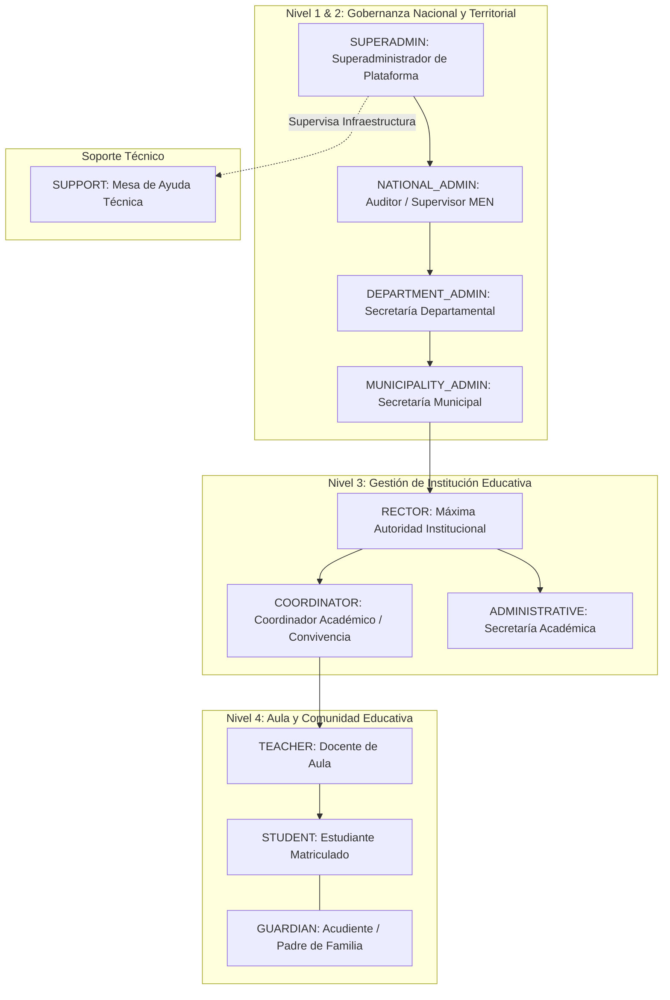
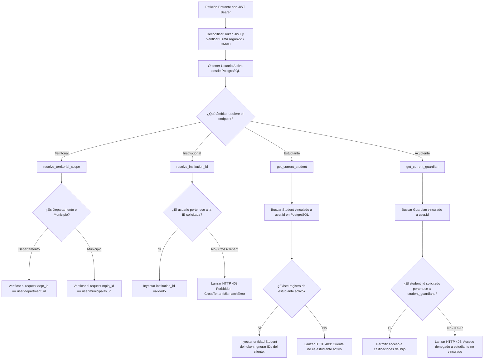

# PEVN — AUDITORÍA DE CONTROL DE ACCESO (RBAC) Y AISLAMIENTO MULTITENANT

**Documento:** `03_RBAC_AND_TENANT_ISOLATION_AUDIT.md`  
**Programa:** Master Enterprise Audit, Remediation, Security Hardening and Production Readiness  
**Plataforma:** Plataforma Educativa Virtual Nacional (PEVN) — República de Colombia  
**Fecha de Emisión:** 1 de Noviembre de 2026  
**Clasificación:** Confidencial / Seguridad & Gobernanza  
**Estado:** *Implementado, Probado y Verificado*

---

## 1. RESUMEN EJECUTIVO Y OBJETIVOS DE GOBERNANZA

El modelo de control de acceso de PEVN combina **Role-Based Access Control (RBAC)** canónico con **Multi-Tenant Boundary Enforcement** estricto. La gobernanza de la plataforma asegura que ningún usuario —sin importar su rango jerárquico— pueda acceder, modificar o filtrar datos fuera de su jurisdicción territorial o institucional autorizada.

Asimismo, la plataforma implementa el **Principio de Mínimo Privilegio Pedagógico (PO Least Privilege)**, el cual dictamina que los roles administrativos superiores (Superadministrador, Ministerio de Educación y Secretarías de Educación) no poseen facultades operativas sobre las notas, asistencias ni evaluaciones de los colegios.

---

## 2. CATÁLOGO CANÓNICO DE ROLES Y JERARQUÍA

El sistema define exactamente 11 roles canónicos en la base de datos, gestionados mediante el servicio de arranque idempotente `rbac_bootstrap_service.py`:



### 2.1 Definición y Alcance de Cada Rol

| Rol Canónico | Código de Base de Datos | Alcance Jurisdiccional | Atribuciones Clave | Restricciones Mandatorias |
|---|---|---|---|---|
| **Superadministrador** | `SUPERADMIN` | Plataforma Global | Configuración global, catálogo nacional DIVIPOLA, monitoreo de infraestructura, gestión de incidentes técnicos. | **Sin acceso a gestión académica ni calificaciones.** |
| **Administrador Nacional** | `NATIONAL_ADMIN` | Nacional (Colombia) | Auditoría de cobertura nacional, censos educativos, métricas de retención escolar a nivel país. | **Sin acceso a gestión de aula ni datos personales sensibles de estudiantes.** |
| **Administrador Departamental** | `DEPARTMENT_ADMIN` | Departamento asignado | Gestión de solicitudes de colegios no certificados, supervisión territorial de sedes educativas. | **Restringido a su `department_id`. Sin acceso a notas de estudiantes.** |
| **Administrador Municipal** | `MUNICIPALITY_ADMIN` | Municipio asignado | Supervisión de cobertura en colegios de municipios certificados, auditoría de planta física. | **Restringido a su `municipality_id`. Sin acceso a sábanas de notas.** |
| **Rector Institucional** | `RECTOR` | Institución asignada | Gobierno escolar, aprobación de SIEE, cierre de períodos académicos, delegación a coordinadores, vinculación de docentes y matrícula. | **Restringido a su `institution_id`. No puede calificar asignaturas ajenas.** |
| **Coordinador** | `COORDINATOR` | Institución asignada | Seguimiento curricular, supervisión de inasistencias, gestión de planes de estudio y actas de convivencia escolar. | **Sujeto a delegación activa por parte del Rector (`assert_coordinator_delegation_allowed`).** |
| **Administrativo** | `ADMINISTRATIVE` | Institución asignada | Registro de matrículas, expedición de certificados, radicación de documentos institucionales. | **Sin acceso a alteración de sábanas SIEE ni promociones académicas.** |
| **Docente** | `TEACHER` | Carga asignada en su IE | Creación de actividades pedagógicas, calificación por lotes, toma de asistencia diaria, consolidación de período. | **Restringido a los grupos y asignaturas explícitamente asignados en `AcademicAssignment`.** |
| **Estudiante** | `STUDENT` | Perfil propio en su IE | Consulta de calificaciones, descarga de boletines, presentación de tareas y talleres LMS, asistencia a clases virtuales. | **Identidad derivada estrictamente de su JWT `sub`. Bloqueado de consultar notas ajenas.** |
| **Acudiente** | `GUARDIAN` | Hijos vinculados | Seguimiento formativo, consulta de notas y boletines oficiales, justificación de inasistencias de sus acudidos. | **Restringido a estudiantes formalmente enlazados en la tabla `student_guardians`.** |
| **Soporte Técnico** | `SUPPORT` | Plataforma Global | Diagnóstico de conectividad, depuración de incidencias técnicas en `technical_support_cases`. | **Sin acceso a registros académicos ni datos privados de la comunidad.** |

---

## 3. MATRIZ DE PERMISOS Y PRIVILEGIOS DE GESTIÓN ACADÉMICA

El sistema cuenta con **112 permisos canónicos** agrupados por dominio. A continuación se detalla la matriz de distribución para los módulos críticos de la plataforma:

| Módulo / Recurso | `SUPERADMIN` | `NAT_ADMIN` | `DEP_ADMIN` | `MUN_ADMIN` | `RECTOR` | `COORD` | `TEACHER` | `STUDENT` | `GUARDIAN` |
|---|:---:|:---:|:---:|:---:|:---:|:---:|:---:|:---:|:---:|
| **Catálogo Nacional DIVIPOLA** | R/W | R | R | R | - | - | - | - | - |
| **Onboarding Institucional NTA-04** | Aprobación | Aprobación | Revisión | Revisión | Solicitud | - | - | - | - |
| **Directorio de Usuarios de Jurisdicción** | Global | Nacional | Dpto | Mpio | Inst | Inst | - | - | - |
| **Políticas de Evaluación SIEE** | ❌ PROHIBIDO | ❌ PROHIBIDO | ❌ PROHIBIDO | ❌ PROHIBIDO | R/W | R | R | R (Lectura) | R (Lectura) |
| **Sábana de Notas de Período** | ❌ PROHIBIDO | ❌ PROHIBIDO | ❌ PROHIBIDO | ❌ PROHIBIDO | R | R | R/W (Carga) | - | - |
| **Boletines Oficiales de Período** | ❌ PROHIBIDO | ❌ PROHIBIDO | ❌ PROHIBIDO | ❌ PROHIBIDO | R (Todos) | R (Todos) | R (Carga) | R (Propio) | R (Hijos) |
| **Boletín Final y Promoción Anual** | ❌ PROHIBIDO | ❌ PROHIBIDO | ❌ PROHIBIDO | ❌ PROHIBIDO | R/W (Cierre) | R | R (Carga) | R (Propio) | R (Hijos) |
| **Actividades Pedagógicas LMS** | ❌ PROHIBIDO | ❌ PROHIBIDO | ❌ PROHIBIDO | ❌ PROHIBIDO | R | R | R/W (Carga) | R/Submit | R (Consulta) |
| **Asistencia Diaria de Aula** | ❌ PROHIBIDO | ❌ PROHIBIDO | ❌ PROHIBIDO | ❌ PROHIBIDO | R | R | R/W (Carga) | R (Propio) | R (Hijos) |
| **Salas Virtuales BigBlueButton** | - | - | - | - | R | R | R/W (Host) | Join | - |

---

## 4. MECANISMO DE RESOLUCIÓN DE TENENCIA Y PREVENCIÓN DE IDOR

El aislamiento multitenant se ejecuta en el núcleo de FastAPI (`backend/app/api/deps.py`) a través de dependencias inyectadas que validan criptográficamente el token y verifican la pertenencia territorial o institucional antes de que el endpoint reciba el control:



### 4.1 Reglas Anti-IDOR (Insecure Direct Object Reference) Verificadas
1. **Invariante de Identidad Estudiante**: Los endpoints de `/api/v1/student-portal/*` no reciben `student_id` como parámetro de ruta ni de consulta. La identidad del estudiante se extrae obligatoriamente del `sub` del JWT autenticado, impidiendo que un estudiante pueda consultar las notas de un compañero alterando un UUID.
2. **Invariante de Vinculación Acudiente-Estudiante**: En `/api/v1/guardian-portal/*`, cuando el acudiente solicita un boletín pasando un `student_id`, el servicio ejecuta una consulta relacional contra `student_guardians`:
   ```python
   stmt = select(StudentGuardian).where(
       StudentGuardian.guardian_id == guardian.id,
       StudentGuardian.student_id == requested_student_id,
       StudentGuardian.is_active == True,
   )
   ```
   Si no existe relación activa, la petición se aborta con `HTTP 403 Forbidden` y se genera un evento de auditoría de seguridad.
3. **Invariante de Carga Académica Docente**: En `/api/v1/teacher-portal/*` y `/api/v1/evaluations/period-sheet`, un docente solo puede registrar calificaciones o crear actividades si existe un registro en `academic_assignments` que vincule su `teacher_id` con el `group_id` y `subject_id` solicitados para el año lectivo en curso.

---

## 5. VALIDACIÓN MEDIANTE SUITES DE PRUEBAS AUTOMATIZADAS

La efectividad de las barreras de aislamiento fue validada mediante las siguientes suites de pruebas:

| Archivo de Prueba | Casos Ejecutados | Resultado | Aspectos Verificados |
|---|:---:|:---:|---|
| `test_academic_admin_roles_authorization.py` | 7 | **PASSED** | Confirma que `SUPERADMIN`, `NATIONAL_ADMIN`, `DEPARTMENT_ADMIN` y `MUNICIPALITY_ADMIN` reciben 403 Forbidden ante cualquier intento de lectura o escritura en recursos académicos. |
| `test_guardian_tenant_isolation.py` | 8 | **PASSED** | Valida que los acudientes no puedan ver datos de alumnos de otras instituciones ni de alumnos no vinculados familiarmente. |
| `test_teacher_academic_scope.py` | 6 | **PASSED** | Comprueba que los docentes no puedan interactuar con asignaturas o grupos fuera de su asignación formal. |
| `test_users_api.py` | 8 | **PASSED** | Verifica que las consultas del directorio de usuarios estén estrictamente delimitadas por jurisdicción y que los roles se serialicen canónicamente. |

---

## 6. CONCLUSIÓN Y RECOMENDACIONES DE ENDURECIMIENTO

El modelo RBAC y la arquitectura multitenant de PEVN son sólidos y previenen vectores de escalada de privilegios horizontales y verticales.

**Recomendaciones para Operación Continua:**
1. Mantener auditorías periódicas de la tabla `audit_logs` con filtros en eventos de tipo `cross_tenant_access_denied`.
2. Programar una revisión semestral de la sincronización de la matriz de permisos canónicos en `rbac_bootstrap_service.py`.

**Dictamen:** **SISTEMA DE RBAC Y MULTITENANCY CERTIFICADO PARA PRODUCCIÓN**

