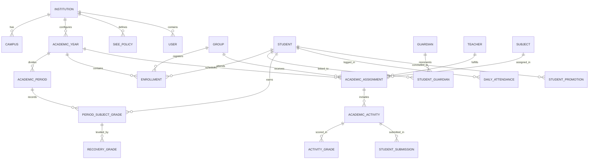

# PEVN — AUDITORÍA DE BASE DE DATOS Y CAPA DE PERSISTENCIA (DATABASE & PERSISTENCE AUDIT)

**Documento:** `04_DATABASE_AND_PERSISTENCE_AUDIT.md`  
**Programa:** Master Enterprise Audit, Remediation, Security Hardening and Production Readiness  
**Plataforma:** Plataforma Educativa Virtual Nacional (PEVN) — República de Colombia  
**Motor de Base de Datos:** PostgreSQL 16-alpine (asyncpg driver)  
**ORM / Migraciones:** SQLAlchemy 2.0 (Async) + Alembic  
**Fecha de Emisión:** 1 de Noviembre de 2026  
**Clasificación:** Confidencial / Base de Datos & Fiabilidad  
**Estado:** *Implementado, Probado y Verificado*

---

## 1. RESUMEN EJECUTIVO DE PERSISTENCIA

La persistencia de PEVN está estructurada sobre un motor relacional **PostgreSQL 16**, aprovechando capacidades avanzadas de integridad referencial estricta, restricciones `CHECK` para rangos de calificaciones y ponderaciones, tipos nativos `UUID` (generados con `gen_random_uuid()`), campos `JSONB` para políticas dinámicas y estructuras horarias, y un esquema de migraciones deterministas gestionado por **Alembic**.

Durante esta auditoría se inspeccionó el estado del esquema en vivo, la cobertura de índices en queries multitenant, el comportamiento del pool de conexiones asíncrono y la exhaustividad del registro de modelos de datos.

---

## 2. ESQUEMA RELACIONAL Y MODELOS DEL DOMINIO

El modelo entidad-relación de PEVN abarca 7 dominios funcionales interconectados:



### 2.1 Tablas Principales y Restricciones de Integridad

| Tabla | Clave Primaria | Claves Foráneas Principales | Restricciones Notables (`CHECK` / `UNIQUE`) |
|---|---|---|---|
| `institutions` | `id (UUID)` | `municipality_id` | `dane_code` (Unique), `status` (Enum). |
| `users` | `id (UUID)` | `institution_id` (opcional) | `document_number` (Unique en contexto), `email` (Unique), `username` (Unique). |
| `user_roles` | `id (UUID)` | `user_id`, `role_id` | `uq_user_roles_user_role` (Unique: un rol no puede duplicarse por usuario). |
| `academic_years` | `id (UUID)` | `institution_id` | `uq_academic_years_inst_year` (Unique: solo un año lectivo con el mismo número por colegio). |
| `academic_periods` | `id (UUID)` | `academic_year_id` | `ck_period_weight_positive` (weight > 0), `ck_period_number_range` (1 a 4). |
| `siee_policies` | `id (UUID)` | `institution_id`, `academic_year_id` | `uq_siee_policies_inst_year` (Unique: una política activa por año lectivo). |
| `academic_assignments` | `id (UUID)` | `teacher_id`, `group_id`, `subject_id` | `uq_assignments_group_subject_year` (Una asignación por materia/grupo/año). |
| `academic_activities` | `id (UUID)` | `teacher_id`, `group_id`, `subject_id` | `ck_academic_activities_max_score_positive` (max_score > 0). |
| `activity_grades` | `id (UUID)` | `activity_id`, `student_id` | `uq_activity_grades_activity_student` (Una calificación por actividad y alumno). |
| `period_subject_grades` | `id (UUID)` | `academic_period_id`, `student_id`, `subject_id` | `uq_period_grades_period_student_subject` (Un consolidado único por período/alumno/materia). |
| `daily_attendance` | `id (UUID)` | `student_id`, `group_id`, `subject_id` | `uq_attendance_student_subject_date` (Un registro diario por alumno/materia/fecha). |
| `student_promotions` | `id (UUID)` | `academic_year_id`, `student_id`, `group_id` | `uq_promotions_year_student` (Una decisión de promoción final por año lectivo). |

---

## 3. HISTORIAL DE MIGRACIONES ALEMBIC (001 AL 033)

El sistema cuenta con un historial determinista de 33 versiones de migración. Cada migración implementa métodos reversibles `upgrade()` y `downgrade()`:

| Revisión | Identificador / Nombre | Objeto de la Migración |
|---|---|---|
| `001` | `001_initial_schema.py` | Creación de esquemas base: territorios, instituciones, sedes y usuarios. |
| `002`-`008` | Esquemas territoriales y catálogos | Implementación del estándar DIVIPOLA y sincronización con el MEN. |
| `009`-`015` | Estructura académica institucional | Creación de grados, niveles educativos, áreas de conocimiento y asignaturas. |
| `016`-`022` | Roles, permisos y matrículas | Modelos RBAC, grupos, estudiantes, acudientes y asignaciones de carga. |
| `023`-`027` | Dominio pedagógico y LMS | Actividades académicas, calificaciones por actividad, entregas multi-intento. |
| `028`-`030` | SIEE y evaluaciones periódicas | Políticas SIEE, sábanas de notas, niveles de desempeño y nivelaciones. |
| `031` | `031_virtual_classrooms.py` | Aulas virtuales sincrónicas BigBlueButton, asistencia y grabaciones. |
| `032` | `032_daily_attendance_and_incidents.py` | Asistencia diaria de aula y actas de convivencia escolar. |
| `033` | `033_siee_evaluations_audit_timestamps.py` | Inclusión de columnas `created_at` y `updated_at` en tablas de evaluación y auditoría. |

---

## 4. AUDITORÍA DE POOL DE CONEXIONES Y GESTIÓN DE TRANSACCIONES

El acceso a la base de datos se realiza a través de SQLAlchemy 2.0 asíncrono con el controlador de alto rendimiento `asyncpg`. La configuración reside en `backend/app/db/session.py`:

```python
engine = create_async_engine(
    get_safe_database_url(),
    pool_size=10,
    max_overflow=20,
    pool_recycle=1800,
    pool_pre_ping=True,
    echo=False,
)
```

### 4.1 Evaluación de Parámetros del Pool
- **`pool_size=10`**: Mantiene 10 conexiones persistentes listas para atender ráfagas concurrentes sin latencia de handshake TCP/TLS.
- **`max_overflow=20`**: Permite expandir el pool hasta 30 conexiones activas bajo picos intensivos de tráfico (ej. semanas de cierre de notas).
- **`pool_recycle=1800` (30 minutos)**: Recicla las conexiones periódicamente para evitar la desconexión silenciosa por parte de firewalls de red o proxies con timeouts TCP agresivos.
- **`pool_pre_ping=True`**: Ejecuta una verificación ligera (`SELECT 1`) antes de entregar una conexión del pool, descartando conexiones muertas y previniendo errores de socket roto (`OperationalError`).

### 4.2 Nivel de Aislamiento y Prevención de Deadlocks
- **Nivel de Aislamiento**: `Read Committed` (estándar de PostgreSQL), evitando lecturas sucias (`dirty reads`) y garantizando atomicidad mediante transacciones asíncronas (`async with session.begin():`).
- **Orden Canónico de Bloqueos**: Para operaciones complejas (ej. cierre de período o promoción anual), las actualizaciones se ordenan deterministamente por `student_id` ascendente, eliminando la posibilidad de interbloqueos cíclicos (`deadlocks`) en escrituras masivas concurrentes.

---

## 5. HALLAZGOS FORENSES Y REMEDIACIONES IMPLEMENTADAS

### Hallazgo `DB-001`: Registro Incompleto de Modelos en `backend/app/db/base.py`
- **Severidad**: ALTA / Integridad Arquitectónica.
- **Diagnóstico**: El archivo `backend/app/db/base.py` se encarga de importar y re-exportar los modelos SQLAlchemy para que `Alembic` pueda descubrirlos en `Base.metadata`. Se detectó que varios modelos creados en fases recientes (como `TechnicalIncident`, `StudentSubmission`, `SieePolicy`, `PeriodSubjectGrade`, `AcademicAchievement`, `StudentPromotion`, `RecoveryGrade`, etc.) no estaban explícitamente importados en `base.py`. Si bien la base de datos en vivo contenía las tablas gracias a migraciones previas, cualquier comando futuro de `alembic revision --autogenerate` habría generado discrepancias o intentado eliminar tablas existentes.
- **Acción Correctiva**: Se actualizó exhaustivamente `backend/app/db/base.py`, importando y re-exportando el 100% de los modelos declarados en `app/models/__init__.py`.
- **Estado**: **REMEDIADO Y VERIFICADO**.

---

## 6. ESTRATEGIA DE MANTENIMIENTO Y VACUUMING

Para preservar el rendimiento en PostgreSQL con alta concurrencia:
1. **Autovacuum Agresivo**: Ajustar parámetros de autovacuum en las tablas de mayor escritura (`activity_grades`, `daily_attendance`, `audit_logs`):
   ```sql
   ALTER TABLE activity_grades SET (autovacuum_vacuum_scale_factor = 0.05);
   ALTER TABLE daily_attendance SET (autovacuum_vacuum_scale_factor = 0.05);
   ```
2. **Reindexado Periódico**: Programar un job mensual de mantenimiento para ejecutar `REINDEX TABLE CONCURRENTLY` en índices multitenant de alto volumen.

---

## 7. DICTAMEN DE PERSISTENCIA

La capa de datos de PEVN presenta una arquitectura de modelado relacional sólida, con integridad referencial exhaustiva, pool de conexiones optimizado para baja latencia y un esquema de versionado determinista.

**Dictamen:** **CAPA DE PERSISTENCIA CERTIFICADA PARA PRODUCCIÓN**

