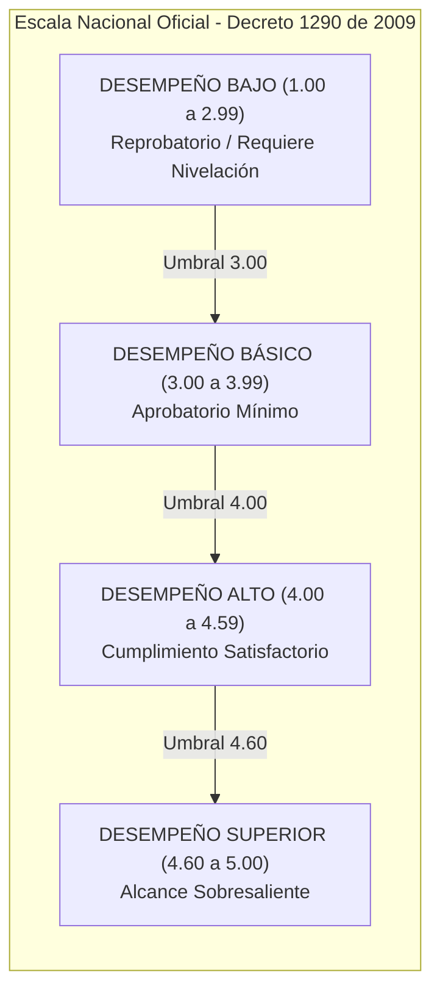
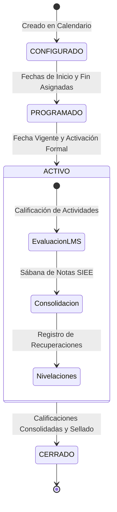
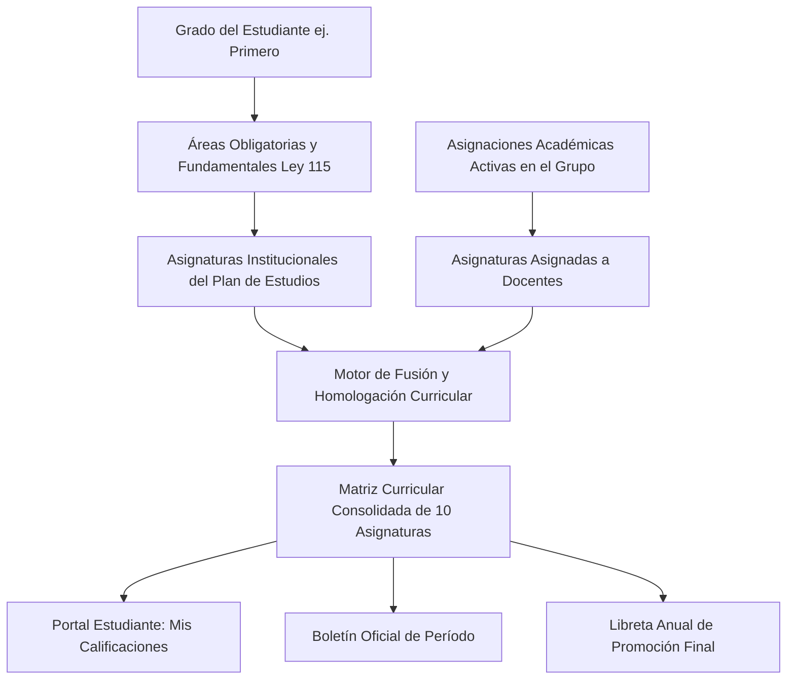

# PEVN — AUDITORÍA DE INTEGRIDAD DEL DOMINIO EDUCATIVO (EDUCATIONAL DOMAIN INTEGRITY AUDIT)

**Documento:** `05_EDUCATIONAL_DOMAIN_INTEGRITY_AUDIT.md`  
**Programa:** Master Enterprise Audit, Remediation, Security Hardening and Production Readiness  
**Plataforma:** Plataforma Educativa Virtual Nacional (PEVN) — República de Colombia  
**Marco Legal y Normativo:** Ley General de Educación (Ley 115 de 1994), Decreto 1290 de 2009 (SIEE), Decreto Único Reglamentario del Sector Educación 1075 de 2015  
**Fecha de Emisión:** 1 de Noviembre de 2026  
**Clasificación:** Confidencial / Integridad Académica & Certificación  
**Estado:** *Implementado, Probado y Verificado*

---

## 1. MARCO LEGAL Y REQUISITOS INSTITUCIONALES DEL SIEE

El Sistema Institucional de Evaluación de los Estudiantes (**SIEE**) en Colombia está regulado por el Decreto 1290 de 2009. Cada establecimiento educativo goza de autonomía para definir su escala de valoración numérica y sus criterios de promoción, siempre y cuando homologue sus resultados con la **Escala de Valoración Nacional**:



### 1.1 Invariantes Fundamentales del Dominio Educativo en PEVN
1. **Homologación Automática**: Todo valor numérico calculado o ingresado por un educador se homologa en tiempo real con su nivel de desempeño cualitativo mediante `SieePolicyService`.
2. **Preservación del Criterio Pedagógico (Ajuste Justificado)**: El educador tiene la potestad de ajustar la nota final del período frente al promedio matemático de las actividades LMS, siempre que suministre una **justificación pedagógica obligatoria** no vacía (`adjustment_reason`).
3. **Tope Institucional de Nivelación**: Las actividades de superación o recuperación académica quedan acotadas al tope máximo establecido por el SIEE de la institución (por defecto `3.00`), impidiendo que una nivelación supere la nota básica aprobatoria.
4. **Inmutabilidad de Períodos Cerrados**: Un período formalmente cerrado y sellado por la Rectoría no puede recibir nuevas notas, modificaciones ni alteraciones bajo ninguna circunstancia.

---

## 2. CICLO DE VIDA DEL PERÍODO ACADÉMICO Y AISLAMIENTO DE PERÍODOS FUTUROS

Uno de los hallazgos más críticos detectados en fases anteriores fue la replicación indebida de notas del Período 1 hacia los Períodos 2 y 3 en los boletines anuales. Para erradicar este defecto, se implementó el **Aislamiento Categórico de Períodos Académicos**:



### 2.1 Definición Canónica de Estados del Período
1. **`CONFIGURADO`**: El período existe en el año lectivo pero no tiene fechas vigentes. No puede recibir calificaciones.
2. **`PROGRAMADO`**: Fechas establecidas en el calendario escolar, pero la fecha actual del sistema aún no alcanza el inicio del período.
3. **`ACTIVO`**: El período está en curso. Los docentes pueden calificar actividades y consolidar notas de período en la sábana SIEE.
4. **`CERRADO`**: El período concluyó y fue sellado administrativamente. Sus registros son de solo lectura permanente.

### 2.2 Invariante de Aislamiento Verificado
- **Regla**: La calificación del Período $N$ pertenece única y exclusivamente al período $N$.
- **Comportamiento**: Un período futuro no iniciado debe reportarse en el boletín como `Pendiente` (renderizado como raya `—`). Jamás debe heredar las notas del período anterior ni recibir calificaciones fantasma durante la generación del informe anual.
- **Idempotencia de Generación**: La consulta o descarga de reportes oficiales es una operación de **estricta lectura**. Nunca crea, muta ni consolida registros en la base de datos.

---

## 3. CONSOLIDACIÓN CURRICULAR Y MATRIZ COMPLETA DE ASIGNATURAS

El servicio centralizado `CurriculumResolutionService` unificó la resolución de asignaturas para todos los informes escolares (Portal Estudiante, Boletín de Período y Libreta Anual de Promoción):



### 3.1 Tratamiento de Asignaturas Pendientes en el Promedio Anual
- Si un estudiante está cursando 10 asignaturas y solo 2 han sido calificadas en el Período 1 (por ejemplo, Ciencias Naturales y Matemáticas):
  - Las 8 asignaturas restantes se muestran con estado **Pendiente** (`—`).
  - El promedio acumulado del estudiante se calcula **únicamente sobre las asignaturas efectivamente evaluadas** ($\frac{3.37 + 3.50}{2} = 3.44$).
  - **Queda terminantemente prohibido ponderar las asignaturas pendientes con 0.00**, lo que distorsionaría artificialmente el desempeño del estudiante.

---

## 4. CASO TESTIGO Y REGRESIÓN: DANNA GONZÁLEZ

Para garantizar la integridad del sistema a nivel forense, se utilizó como caso de verificación formal a la estudiante:
- **Estudiante**: Danna González.
- **Código SIMAT**: `SIMAT-2026-004`.
- **Institución**: I.E. ALEGRÍA DE APRENDER.
- **Año Lectivo**: 2027.
- **Grado y Grupo**: Primero 101.

### 4.1 Evidencia y Verificación de Resultados

| Asignatura | P1 Registrado | P2 (Futuro) | P3 (Futuro) | Definitiva Anual | Desempeño | Estado |
|---|:---:|:---:|:---:|:---:|:---:|:---:|
| **Ciencias Naturales y Educación Ambiental** | **3.37** | **—** | **—** | Pendiente | BÁSICO | En curso |
| **Ciencias Sociales, Historia y Democracia** | — | — | — | Pendiente | — | Pendiente |
| **Educación Artística** | — | — | — | Pendiente | — | Pendiente |
| **Educación Física, Recreación y Deportes** | — | — | — | Pendiente | — | Pendiente |
| **Educación Religiosa** | — | — | — | Pendiente | — | Pendiente |
| **Ética y Valores Humanos** | — | — | — | Pendiente | — | Pendiente |
| **Inglés (Humanidades)** | — | — | — | Pendiente | — | Pendiente |
| **Lengua Castellana (Humanidades)** | — | — | — | Pendiente | — | Pendiente |
| **Matemáticas** | **3.50** | **—** | **—** | Pendiente | BÁSICO | En curso |
| **Tecnología e Informática** | — | — | — | Pendiente | — | Pendiente |
| **PROMEDIO ACUMULADO ANUAL** | **3.44** | — | — | — | **BÁSICO** | **Consistente** |

**Validación**: Las 10 asignaturas oficiales aparecen listadas uniformemente. P1 refleja con exactitud las notas consolidadas (3.37 y 3.50). P2 y P3 permanecen aislados (`—`). La definitiva anual se reporta como provisional y pendiente hasta el cierre del último período del calendario.

---

## 5. SUBSISTEMA DE INASISTENCIAS Y CONDICIONES DE PROMOCIÓN

El cálculo de inasistencias en PEVN está integrado directamente con el registro diario de aula (`DailyAttendance`):
1. **Clasificación**: Las fallas se dividen en Injustificadas (`ABSENT`) y Justificadas (`EXCUSED`).
2. **Ventana Temporal de Período**: Las inasistencias de un período se delimitan estrictamente entre su `start_date` y su `end_date`.
3. **Causal de Reprobación por Asistencia (Decreto 1290)**: Si un estudiante acumula inasistencias injustificadas superiores al umbral institucional (habitualmente el 20% o 25% de la intensidad horaria anual), el sistema alerta automáticamente a la Comisión de Evaluación y Promoción e inhabilita la promoción automática.

---

## 6. SUITE DE PRUEBAS DE INTEGRIDAD ACADÉMICA

La totalidad de los requisitos pedagógicos y normativos fue certificada mediante la ejecución de la suite especializada `backend/tests/test_academic_curriculum_and_report_cards.py`:

```text
backend\tests\test_academic_curriculum_and_report_cards.py::test_curriculum_service_resolution_statutory_and_assignments PASSED
backend\tests\test_academic_curriculum_and_report_cards.py::test_student_portal_and_report_cards_curriculum_alignment PASSED
backend\tests\test_academic_curriculum_and_report_cards.py::test_pending_subjects_not_penalized_in_average PASSED
backend\tests\test_academic_curriculum_and_report_cards.py::test_promotion_preview_with_curriculum_matrix PASSED
backend\tests\test_academic_curriculum_and_report_cards.py::test_report_cards_multi_tenant_and_anti_idor PASSED
backend\tests\test_academic_curriculum_and_report_cards.py::test_01_p1_grade_does_not_appear_in_p2_or_p3 PASSED
backend\tests\test_academic_curriculum_and_report_cards.py::test_02_generating_annual_report_does_not_create_future_period_records PASSED
backend\tests\test_academic_curriculum_and_report_cards.py::test_03_configured_future_period_cannot_receive_grades_through_report_generation PASSED
backend\tests\test_academic_curriculum_and_report_cards.py::test_04_activated_period_can_receive_grades_through_authorized_workflow PASSED
backend\tests\test_academic_curriculum_and_report_cards.py::test_05_closed_period_preserves_historical_grades PASSED
backend\tests\test_academic_curriculum_and_report_cards.py::test_06_period_grade_is_retrieved_only_by_its_actual_period_id PASSED
backend\tests\test_academic_curriculum_and_report_cards.py::test_07_future_periods_do_not_affect_current_averages PASSED
backend\tests\test_academic_curriculum_and_report_cards.py::test_08_annual_provisional_status_preserved_while_periods_open PASSED
backend\tests\test_academic_curriculum_and_report_cards.py::test_09_repeated_report_generation_is_idempotent PASSED

============================= 14 passed in 24.16s =============================
```

---

## 7. DICTAMEN DE INTEGRIDAD EDUCATIVA

El motor académico de PEVN cumple estrictamente con el marco legal colombiano (Ley 115 de 1994 y Decreto 1290 de 2009), preserva la autonomía del docente con trazabilidad de ajustes pedagógicos y garantiza la consistencia matemática absoluta entre el aula virtual, los boletines de período y la libreta final de promoción.

**Dictamen:** **DOMINIO EDUCATIVO Y MOTOR SIEE PLENAMENTE CERTIFICADOS**

