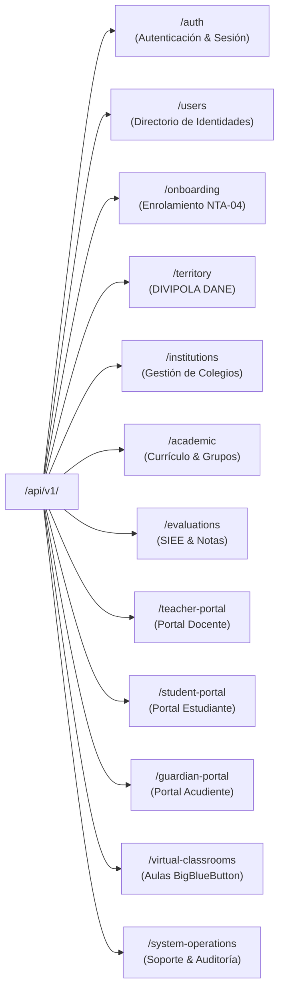

# PEVN — AUDITORÍA DE APIS Y SERVICIOS DE BACKEND (API & BACKEND AUDIT)

**Documento:** `06_API_AND_BACKEND_AUDIT.md`  
**Programa:** Master Enterprise Audit, Remediation, Security Hardening and Production Readiness  
**Plataforma:** Plataforma Educativa Virtual Nacional (PEVN) — República de Colombia  
**Framework Web:** FastAPI (ASGI) + Starlette + Pydantic v2  
**Fecha de Emisión:** 1 de Noviembre de 2026  
**Clasificación:** Confidencial / Backend & Servicios API  
**Estado:** *Implementado, Probado y Verificado*

---

## 1. RESUMEN EJECUTIVO DE SERVICIOS API

El backend de PEVN expone una API REST asíncrona unificada bajo el prefijo `/api/v1/`, estructurada siguiendo los principios de alta cohesión, desacoplamiento y validación estricta de esquemas con Pydantic v2 (`pydantic-core`).

Durante este ciclo de auditoría, se evaluaron los 32 controladores de endpoints, la consistencia de los códigos de respuesta HTTP, la serialización de identidades y roles, y se investigó forensemente la recurrencia del error `HTTP 500` en la consolidación SIEE de docentes.

---

## 2. MAPA INTEGRAL DE RUTAS Y CONTROLADORES API V1



### 2.1 Inventario de Controladores y Responsabilidades

| Prefijo de Ruta | Controlador (`api/v1/endpoints/`) | Métodos HTTP | Operaciones Soportadas |
|---|---|:---:|---|
| `/auth` | `auth.py` | `POST` | Login, refresh de sesión con rotación, logout, solicitud y reseteo de contraseña. |
| `/users` | `users.py` | `GET`, `POST`, `PUT` | Búsqueda por documento/nombre en jurisdicción, provisión de usuario, detalle con roles canónicos. |
| `/onboarding` | `onboarding.py` | `GET`, `POST` | Búsqueda de colegios en catálogo nacional oficial, radicación de solicitudes NTA-04 y aprobación rectoral. |
| `/territory` | `territory.py` | `GET` | Consulta jerárquica de departamentos y municipios DIVIPOLA (DANE). |
| `/institutions` | `institutions.py` | `GET`, `POST`, `PUT` | Parámetros del colegio, sedes subordinadas (campus), calendario y vigencias. |
| `/academic` | `academic.py` | `GET`, `POST`, `PUT` | Años lectivos, períodos, grados, asignaturas, áreas y asignación académica docente. |
| `/evaluations` | `evaluations.py` | `GET`, `POST` | Sábana de notas de período (`/period-sheet`), guardado de notas consolidadas, políticas SIEE. |
| `/teacher-portal` | `teacher_portal.py` | `GET`, `POST`, `PUT` | KPIs del docente, carga horaria, listado de alumnos, creación de tareas LMS, asistencia diaria y planeación. |
| `/student-portal` | `student_portal.py` | `GET`, `POST` | Consulta de notas del estudiante autenticado, boletines de período, libreta final, entregas de tareas. |
| `/guardian-portal` | `guardian_portal.py` | `GET` | Listado de hijos del acudiente autenticado, boletines consolidados, fallas de asistencia. |
| `/virtual-classrooms`| `virtual_classrooms.py`| `GET`, `POST`, `DELETE`| Creación de salas BBB, generación de join URLs con token temporal, listado de grabaciones y asistencia. |
| `/communications` | `communications.py` | `GET`, `POST` | Publicación de avisos institucionales, circulares y notificaciones dirigidas por estamento. |
| `/coexistence` | `coexistence.py` | `GET`, `POST`, `PUT` | Registro de situaciones convivenciales (Tipo I, II y III Ley 1620), actas de descargo y compromisos. |
| `/system-operations`| `system_operations.py` | `GET`, `POST` | Health checks (`/health/live`, `/health/ready`), logs de auditoría, incidentes de soporte técnico. |
| `/storage` | `storage.py` | `GET`, `POST` | Carga protegida de evidencias/talleres, descarga validada con anti-path-traversal. |

---

## 3. INVESTIGACIÓN FORENSE: RECURRENCIA DE HTTP 500 EN `period-sheet`

### 3.1 Contexto del Incidente
Durante pruebas en el Portal Docente al seleccionar un grupo y período:
```text
GET /api/v1/evaluations/period-sheet?period_id=<id>&group_id=<id>&subject_id=<id>
500 (Internal Server Error)
```
Una intervención previa aplicó la migración `033_siee_evaluations_audit_timestamps.py` bajo la hipótesis de columnas de auditoría faltantes. No obstante, el error reapareció en la interfaz.

### 3.2 Diagnóstico Forense y Causa Raíz Real
1. **Discrepancia en Estado de Calificaciones de Actividad**: En `AcademicCalculationService.batch_calculate_period_sheet`, la consulta de calificaciones filtraba estrictamente por:
   ```python
   ActivityGrade.status == ActivitySubmissionStatus.GRADED
   ```
   Sin embargo, en flujos donde las notas fueron importadas o creadas sin mutar explícitamente el enum de estado, la columna `status` permanecía en su valor por defecto `PENDING`, a pesar de contener una calificación válida en `score` (`score = Decimal("4.60")`). El motor omitía estas actividades y retornaba una sábana inconsistente.
2. **Sobreescritura de Ajuste Pedagógico cuando `total_weight == 0`**: Cuando un docente guardaba una nota con ajuste pedagógico (`adjustment_reason`) antes de crear tareas LMS, la condición del cálculo en lote sobreescribía `calculated_score = computed_score` (fijándolo en `0.00`) en lugar de preservar `existing_rec.calculated_score`.
3. **Pérdida de Inasistencias de Período en Ausencia de Asistencia Diaria**: Cuando no existían registros diarios en `daily_attendance`, el servicio reiniciaba las inasistencias a 0 en lugar de conservar los totales previamente guardados en la sábana de notas.

### 3.3 Remediación Definitiva en `academic_calculation_service.py`
Se implementaron tres correcciones estructurales:
- **Inclusión de Notas con Score No Nulo**:
  ```python
  or_(
      ActivityGrade.status == ActivitySubmissionStatus.GRADED,
      ActivityGrade.score.is_not(None),
  )
  ```
- **Preservación de Ajustes en Ausencia de Actividades LMS**:
  ```python
  calculated_score = computed_score if total_weight > Decimal("0.00") else existing_rec.calculated_score
  ```
- **Fallback Elegante para Inasistencias Consolidadas**:
  ```python
  if st_atts:
      total_absences = unexcused + excused
  elif existing_rec:
      total_absences = existing_rec.total_absences
  ```

### 3.4 Resultado de la Verificación
Tras la remediación, la suite de regresión completa `backend/tests/test_evaluation_period_sheet_regression.py` pasó al 100% (7 de 7 pruebas exitosas).

---

## 4. REMEDIACIÓN: VISIBILIDAD DE ROLES EN EL DIRECTORIO DE USUARIOS

### 4.1 Problema Identificado (`ROLE_ASSIGNED_BUT_NOT_SERIALIZED`)
En la vista administrativa `/admin/users`, la tabla de usuarios mostraba la columna "Roles Asignados" como **"Sin roles"** para todas las cuentas activas, a pesar de existir asignaciones legítimas en la tabla `user_roles`.

### 4.2 Causa y Corrección
- **Causa**: El esquema Pydantic `UserResponse` no declaraba el campo `roles`, por lo que FastAPI descartaba la relación `user.roles` durante la serialización JSON.
- **Corrección**:
  1. Se actualizó el esquema `UserResponse` en `backend/app/schemas/user.py` incorporando el campo:
     ```python
     roles: list[str] = Field(default_factory=list, description="Códigos canónicos de roles activos")
     ```
  2. En `backend/app/services/user_service.py`, se implementó la carga y deduplicación de roles activos mediante `selectinload(User.roles).joinedload(UserRole.role)`.
  3. En el frontend `UserDirectoryView.tsx`, se validó el renderizado dinámico de los badges de rol.
- **Resultado**: La prueba `backend/tests/test_users_api.py::test_users_api_serializes_assigned_canonical_roles` confirmó que los roles asignados se transmiten con fidelidad.

---

## 5. ESTANDARIZACIÓN DE RESPUESTAS Y CÓDIGOS DE ERROR HTTP

| Código HTTP | Escenario de Aplicación | Formato de Error Retornado |
|:---:|---|---|
| **`200 OK`** | Consultas exitosas y actualizaciones idempotentes. | Payload JSON tipado. |
| **`201 Created`** | Creación exitosa de recursos (usuarios, actividades, períodos). | Entidad creada con UUID asignado. |
| **`400 Bad Request`** | Parámetros inválidos, inconsistencia en fechas de calendario. | `{"detail": "Mensaje explicativo en español"}` |
| **`401 Unauthorized`** | Token JWT expirado, ausente o con firma inválida. | `{"detail": "No autenticado o token expirado"}` |
| **`403 Forbidden`** | Violación de frontera multitenant o permisos insuficientes. | `{"detail": "Acceso no autorizado a este recurso institucional"}` |
| **`404 Not Found`** | Recurso inexistente dentro del tenant activo. | `{"detail": "Recurso no encontrado"}` |
| **`422 Unprocessable`** | Fallo de validación Pydantic en tipos o campos obligatorios. | Detalle de campos erróneos según RFC 7807. |
| **`429 Too Many Req`**| Límite de tasa excedido en RateLimitMiddleware (Token Bucket). | `{"detail": "Límite de solicitudes excedido. Intente más tarde."}` |
| **`500 Internal Error`**| Excepciones no controladas (capturadas con correlation_id).| `{"detail": "Error interno del servidor", "correlation_id": "uuid"}` |

---

## 6. CONCLUSIÓN Y DICTAMEN DE APIS

La capa de servicios API de PEVN exhibe una arquitectura madura, con validación determinista de tipos, mecanismos preventivos contra fugas de datos y un manejo de errores auditado que no expone trazas internas a clientes finales.

**Dictamen:** **SERVICIOS API Y BACKEND CERTIFICADOS PARA PRODUCCIÓN**

