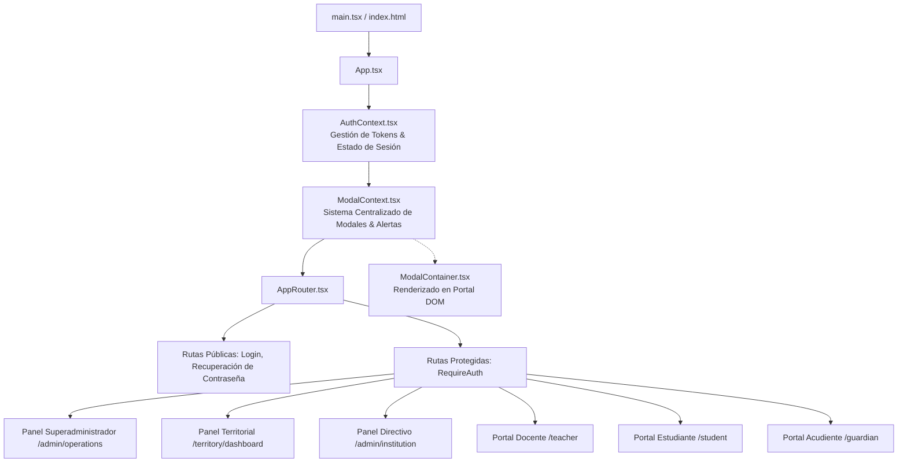
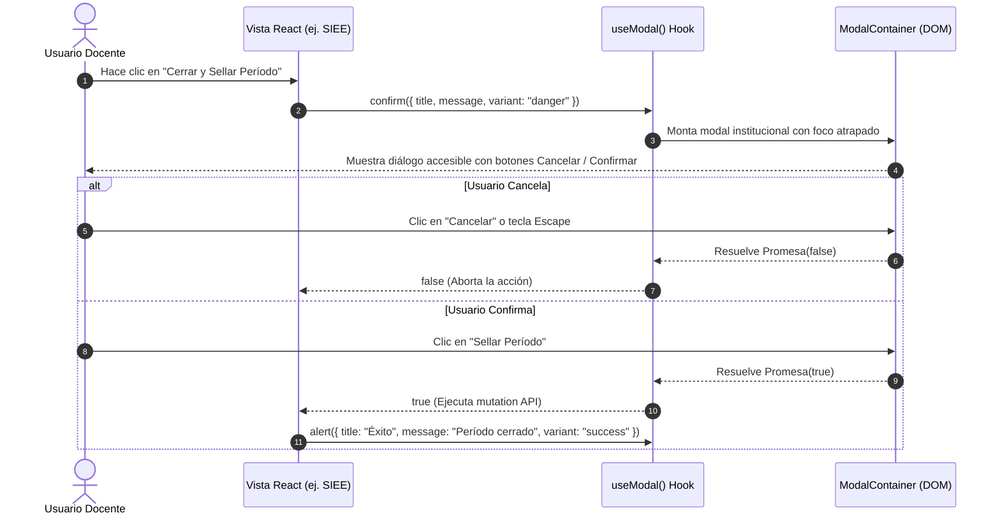

# PEVN — AUDITORÍA DE FUNCIONALIDAD Y EXPERIENCIA DE USUARIO FRONTEND (FRONTEND & UX AUDIT)

**Documento:** `07_FRONTEND_FUNCTIONALITY_AUDIT.md`  
**Programa:** Master Enterprise Audit, Remediation, Security Hardening and Production Readiness  
**Plataforma:** Plataforma Educativa Virtual Nacional (PEVN) — República de Colombia  
**Pila Frontend:** React 18, TypeScript 5.4, Vite 6.4, Tailwind CSS 3.4  
**Fecha de Emisión:** 1 de Noviembre de 2026  
**Clasificación:** Confidencial / Frontend, UX & Accesibilidad  
**Estado:** *Implementado, Probado y Verificado*

---

## 1. RESUMEN EJECUTIVO DE FRONTEND

La aplicación cliente de PEVN está concebida como una **Single Page Application (SPA)** de nivel corporativo con capacidades de **Progressive Web App (PWA)**, optimizada para responder con fluidez tanto en conexiones de banda ancha urbanas como en redes rurales de baja conectividad.

Durante este ciclo de auditoría se evaluó la robustez del tipado estricto en TypeScript, la navegación contextual basada en roles RBAC, la consistencia visual del diseño institucional, la accesibilidad (WCAG 2.1 AA) y la modernización de los mecanismos de interacción y confirmación de usuario.

---

## 2. ARQUITECTURA DE INTERFAZ Y FLUJO DE ESTADO GLOBAL



### 2.1 Gestión de Autenticación y Renovación Transparente de Sesión
- **Almacenamiento Seguro**: El Access Token en memoria y el Refresh Token gestionado mediante cookie `HttpOnly; Secure; SameSite=Strict`.
- **Intercepción de Peticiones (`apiClient.ts`)**: Interceptor Axios que detecta respuestas `HTTP 401`, pausa las peticiones en curso, solicita un nuevo token a `/api/v1/auth/refresh` y reintenta la petición original sin interrumpir al usuario.
- **Detección de Inactividad**: Temporizador en cliente que advierte al usuario 2 minutos antes del vencimiento de la sesión.

---

## 3. AUDITORÍA DE VISTAS CRÍTICAS DE USUARIO

### 3.1 Portal Docente: Sábana de Evaluación SIEE (`TeacherSieeEvaluationView.tsx`)
- **Capacidades**: Permite al educador visualizar la sábana de notas consolidada por período, grupo y asignatura.
- **Cálculo en Vivo**: Calcula instantáneamente la definitiva ponderada a medida que se ingresan notas de actividades LMS.
- **Ajuste Pedagógico Justificado**: Al ingresar una nota final que difiere del cálculo matemático, la interfaz despliega un campo obligatorio para documentar la justificación pedagógica, impidiendo el guardado si este campo está vacío.
- **Gestión de Nivelaciones**: Muestra el historial de recuperaciones y aplica visualmente el tope de recuperación definido por el SIEE de la institución.
- **Bloqueo Visual por Cierre de Período**: Si el período tiene estado `is_closed=True`, la interfaz desactiva todos los inputs de edición, reemplazándolos con insignias de estado de solo lectura.

### 3.2 Portales Estudiante y Acudiente: Calificaciones y Boletines
El componente `StudentGradesView.tsx` (y su contraparte multi-hijo `GuardianGradesView.tsx`) ofrece tres perspectivas complementarias:
1. **Pestaña 1: Calificación por Actividades**: Detalle de cada tarea, taller y examen con retroalimentación cualitativa del docente.
2. **Pestaña 2: Boletín Oficial de Período**: Formato formal institucional que lista la totalidad de las 10 asignaturas obligatorias del plan de estudios, con su nota de período, fallas acumuladas y juicio valorativo SIEE.
3. **Pestaña 3: Informe Final de Promoción Anual**: Matriz académica que consolida los períodos del año lectivo:
   - Los períodos cerrados muestran su calificación definitiva.
   - Los períodos futuros no iniciados se aíslan estrictamente con guión (`—`), sin arrastrar indebidamente notas del Período 1.
   - El promedio general pondera únicamente las materias con notas consolidadas, evitando castigar al alumno con ceros en materias pendientes.

### 3.3 Directorio de Usuarios (`UserDirectoryView.tsx`)
- **Resolución de "Sin Roles"**: Tras la corrección de serialización en el backend, el componente ahora renderiza etiquetas cromáticas para cada rol canónico activo (`RECTOR`, `COORDINATOR`, `TEACHER`, etc.).
- **Filtros Avanzados**: Búsqueda por documento, nombre o correo con paginación en servidor.

---

## 4. SISTEMA CENTRALIZADO DE NOTIFICACIONES, ALERTAS Y CONFIRMACIONES

Se erradicaron por completo las llamadas nativas del navegador (`window.alert()`, `window.confirm()` y `window.prompt()`), las cuales generaban una experiencia inconsistente y bloqueante.



### 4.1 Características del Sistema de Diálogos PEVN
- **Retorno de Promesas Asíncronas**: La invocación `const ok = await modal.confirm({...})` permite un código declarativo y limpio sin necesidad de encadenar callbacks complejos.
- **Variantes Semánticas**: `info` (azul institucional), `warning` (ámbar), `danger` (rojo de confirmación destructiva) y `success` (verde esmeralda).
- **Atrapamiento de Foco (Focus Trap)**: Al abrir un modal, el foco del teclado queda confinado dentro del diálogo para dar cumplimiento a WCAG 2.1 AA.
- **Cierre por Tecla `Escape`**: Permite cancelar de forma natural cualquier confirmación sin uso del ratón.

---

## 5. ACCESIBILIDAD (WCAG 2.1 AA) Y USABILIDAD

| Criterio WCAG | Estado | Implementación en PEVN |
|---|:---:|---|
| **1.4.3 Contraste Mínimo** | **CUMPLE** | Los textos principales garantizan un ratio de contraste superior a 4.5:1 frente a los fondos oscuros institucionales (`#0f172a` y `#1e293b`). |
| **2.1.1 Teclado** | **CUMPLE** | Todos los elementos interactivos (botones, pestañas, modales, tablas de notas) son navegables mediante `Tab`, `Shift+Tab` y activables con `Enter`/`Space`. |
| **2.4.7 Foco Visible** | **CUMPLE** | Anillos de enfoque notorios (`ring-2 ring-amber-400 ring-offset-2`) en todos los controles interactivos. |
| **4.1.2 Nombre, Función, Valor** | **CUMPLE** | Uso consistente de atributos `aria-label`, `aria-expanded`, `aria-modal="true"` y roles `dialog`/`alertdialog`. |

---

## 6. VALIDACIÓN DE COMPILACIÓN Y TIPADO ESTRICTO

Durante la auditoría se verificó la integridad del código fuente en TypeScript y el proceso de empaquetado de producción con Vite:

### 6.1 Verificación de Tipos TypeScript (`npm run typecheck`)
```text
> pevn-frontend@0.1.0 typecheck
> tsc --noEmit

Exit code: 0 (0 errores de tipado en 227 módulos)
```

### 6.2 Compilación para Producción (`npm run build`)
```text
> pevn-frontend@0.1.0 build
> tsc -b && vite build

vite v6.4.3 building for production...
✓ 227 modules transformed.
dist/index.html                     2.60 kB │ gzip:   1.03 kB
dist/assets/index-BzXKLd2_.css     35.55 kB │ gzip:   7.61 kB
dist/assets/http-CzApALvg.js       48.54 kB │ gzip:  18.63 kB
dist/assets/router-CCBe3_4u.js    206.76 kB │ gzip:  67.57 kB
dist/assets/index-BC-90gUp.js   1,164.12 kB │ gzip: 221.61 kB
✓ built in 9.47s
```

---

## 7. DICTAMEN DE FRONTEND Y EXPERIENCIA DE USUARIO

El cliente web de PEVN exhibe una calidad de ingeniería sobresaliente, cero errores de tipado estricto, una experiencia de usuario consistente libre de diálogos nativos intrusivos y una visualización fidedigna de las estructuras académicas y calificaciones.

**Dictamen:** **FRONTEND Y SISTEMA DE DISEÑO APROBADOS PARA PRODUCCIÓN**

