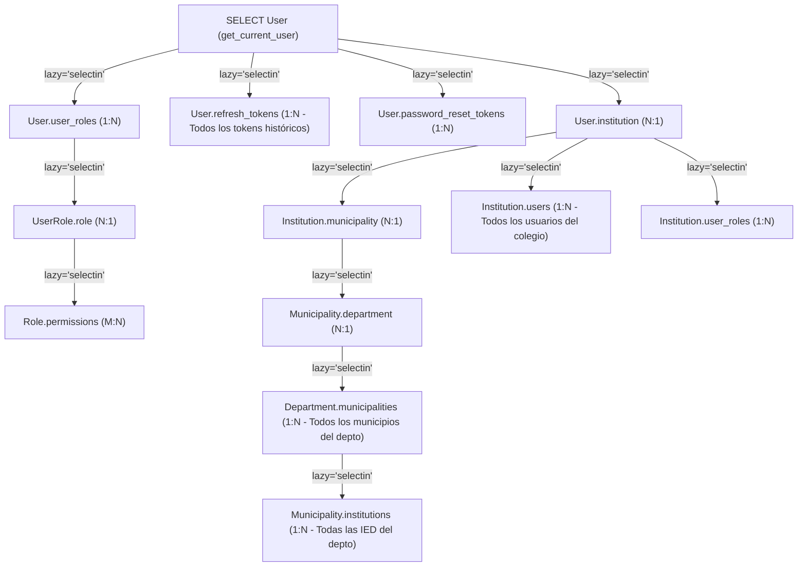

# AUDITORÍA MAESTRA DE RENDIMIENTO Y ESCALABILIDAD (AGENTE 08)
**Programa:** PEVN Master Enterprise Audit & Hardening Program  
**Agente Responsable:** AGENT 08 — PERFORMANCE AND SCALABILITY  
**Fecha de Corte:** 2026-11-01  
**Alcance:** Backend FastAPI / SQLAlchemy 2.0 Async, PostgreSQL 16 ( Esquema, Índices y Pool de Conexiones), Redis Rate-Limiting / Velocity Engine, Procesamiento en Memoria del Catálogo Nacional MEN/DANE (`53.295` sedes) y Arquitectura de Bundle Frontend (React 18 / Vite 6 / PWA).  
**Modo de Ejecución:** Inspección estática profunda y análisis arquitectónico de solo lectura (*Read-Only*).

---

## 1. Resumen Ejecutivo y Clasificación de Estado

La Plataforma Educativa Virtual Nacional (**PEVN**) presenta una arquitectura base moderna construida sobre **FastAPI asíncrono (`asyncpg` + SQLAlchemy 2.0)**, **Redis** para control de velocidad adaptativo y un frontend **React 18 + Vite 6** con soporte PWA. Sin embargo, el análisis forense del código fuente revela **cuellos de botella estructurales críticos y altos** que comprometen la escalabilidad nacional del sistema cuando se transita de volúmenes de semilla de desarrollo a volúmenes reales de operación nacional (`33` departamentos, `1.119` municipios, `19.405` establecimientos, `53.295` sedes y millones de estudiantes).

> [!CAUTION]
> **Riesgo Crítico de Escalabilidad Nacional (`PERF-001`, `PERF-002`, `PERF-003`, `PERF-005`):** La combinación de relaciones ORM bidireccionales con `lazy="selectin"` en modelos centrales (`User`, `Role`, `Institution`, `Grade`, `KnowledgeArea`), bucles N+1 que disparan hasta **2.239 consultas SQL secuenciales en una sola petición HTTP** (`get_municipality_distribution`), la carga íntegra sin `LIMIT` SQL del catálogo nacional en memoria para paginar en Python (`list_official_catalog_with_status`), y el doble checkout de sesiones en `DatabaseAuditService.record()` provocará agotamiento del pool de conexiones PostgreSQL (`QueuePool limit of size 10 overflow 20 reached`) bajo concurrencia moderada ($\ge 30$ usuarios concurrentes ejecutando flujos pesados).

### 1.1 Matriz de Clasificación de Estado de Componentes de Rendimiento

De conformidad con las reglas de gobernanza del programa, ningún componente se declara *Verificado* por la mera existencia de su código; se distingue estrictamente entre implementación estática y verificación bajo carga:

| Subsistema / Capacidad de Rendimiento | Estado Actual | Evidencia Técnica y Justificación |
| :--- | :--- | :--- |
| **Motor Asíncrono de Base de Datos (`asyncpg` + `AsyncSession`)** | **Implementado** | Configurado en [`session.py`](file:///c:/Users/juanc/OneDrive/Documentos/Desarrollo%20proyectos/Plataforma%20Educativa%20PEVN/Plataforma%20Educativa%20Virtual%20Nacional%20PEVN/backend/app/db/session.py#L97-L116) con `pool_pre_ping=True`, `pool_recycle=1800`, `pool_size=10`, `max_overflow=20`. Presenta riesgo por `command_timeout=60` (`PERF-009`). |
| **Estrategia de Carga ORM (`lazy="selectin"` vs `selectinload`)** | **Parcialmente implementado** | Se usó `lazy="selectin"` de forma global en los modelos ([`user.py`](file:///c:/Users/juanc/OneDrive/Documentos/Desarrollo%20proyectos/Plataforma%20Educativa%20PEVN/Plataforma%20Educativa%20Virtual%20Nacional%20PEVN/backend/app/models/user.py#L157-L179), [`role.py`](file:///c:/Users/juanc/OneDrive/Documentos/Desarrollo%20proyectos/Plataforma%20Educativa%20PEVN/Plataforma%20Educativa%20Virtual%20Nacional%20PEVN/backend/app/models/role.py#L79-L89), [`grade.py`](file:///c:/Users/juanc/OneDrive/Documentos/Desarrollo%20proyectos/Plataforma%20Educativa%20PEVN/Plataforma%20Educativa%20Virtual%20Nacional%20PEVN/backend/app/models/grade.py#L95-L99)), causando explosión en cascada del grafo de objetos (`PERF-001`). |
| **Cobertura de Índices Relacionales en `backend/app/models/`** | **Parcialmente implementado** | Buena indexación base en claves primarias y tablas de catálogo oficial ([`official_catalog.py`](file:///c:/Users/juanc/OneDrive/Documentos/Desarrollo%20proyectos/Plataforma%20Educativa%20PEVN/Plataforma%20Educativa%20Virtual%20Nacional%20PEVN/backend/app/models/official_catalog.py#L118-L125)), pero faltan índices compuestos críticos en asistencia por estudiante/año, tokens, incidentes y búsquedas textuales `pg_trgm` (`PERF-010`). |
| **Consultas Analíticas Territoriales (`territorial_analytics_service.py`)** | **Parcialmente implementado** | Funcionalmente implementado, pero sufre de patrones N+1 severos en distribución municipal (`2.239` queries) y departamental (`67` queries) (`PERF-002`). |
| **Cálculo Académico SIEE, Boletines y Promoción Anual** | **Parcialmente implementado** | Lógica curricular y SIEE implementada, pero ejecuta bucles anidados N+1 de hasta `1.920` consultas por grupo en promoción y `60–90` consultas por boletín, además de realizar escrituras (`flush`) en endpoints `GET` (`PERF-004`). |
| **Persistencia de Auditoría Transaccional (`DatabaseAuditService`)** | **Parcialmente implementado** | [`service.py`](file:///c:/Users/juanc/OneDrive/Documentos/Desarrollo%20proyectos/Plataforma%20Educativa%20PEVN/Plataforma%20Educativa%20Virtual%20Nacional%20PEVN/backend/app/audit/service.py#L92-L157) soporta sesión compartida, pero decenas de llamadas omiten `session=self._session`, abriendo una segunda conexión y haciendo `commit()` independiente (`PERF-005`). |
| **Rate Limiting Multi-Tier con Redis (`rate_limiter.py`)** | **Implementado** | Sliding window con Redis pipelines y circuit breaker en [`rate_limiter.py`](file:///c:/Users/juanc/OneDrive/Documentos/Desarrollo%20proyectos/Plataforma%20Educativa%20PEVN/Plataforma%20Educativa%20Virtual%20Nacional%20PEVN/backend/app/core/security/rate_limiter.py#L272-L317). Presenta uso de `KEYS` $O(N)$ en reseteos de cuenta (`PERF-011`). |
| **Hashing Criptográfico No Bloqueante (`Argon2PasswordHasher`)** | **Parcialmente implementado** | Configurado con RFC 9106 (`64 MiB`, `t=3`, `p=4`) en [`password.py`](file:///c:/Users/juanc/OneDrive/Documentos/Desarrollo%20proyectos/Plataforma%20Educativa%20PEVN/Plataforma%20Educativa%20Virtual%20Nacional%20PEVN/backend/app/core/security/password.py#L39-L54), pero se ejecuta síncronamente sobre el event loop principal sin `asyncio.to_thread` (`PERF-007`). |
| **Code Splitting Frontend (`React.lazy` / `Suspense`)** | **No implementado** | En [`App.tsx`](file:///c:/Users/juanc/OneDrive/Documentos/Desarrollo%20proyectos/Plataforma%20Educativa%20PEVN/Plataforma%20Educativa%20Virtual%20Nacional%20PEVN/frontend/src/App.tsx#L11-L37) las 27 páginas se importan estáticamente en un único chunk de aplicación (`PERF-006`). |
| **Caché Offline y Compresión PWA (`vite.config.ts`)** | **Implementado** | Configurado con `vite-plugin-pwa` y estrategias Workbox (`NetworkFirst` / `StaleWhileRevalidate`) en [`vite.config.ts`](file:///c:/Users/juanc/OneDrive/Documentos/Desarrollo%20proyectos/Plataforma%20Educativa%20PEVN/Plataforma%20Educativa%20Virtual%20Nacional%20PEVN/frontend/vite.config.ts#L50-L115). |
| **Pruebas de Carga y Estrés (k6 / Locust) Certificadas** | **No probado** | No existen scripts ni ejecuciones previas de pruebas de carga en el repositorio; se entrega Plan Controlado en la Sección 7. |

---

## 2. Línea Base de Rendimiento (Performance Baselines) vs. Objetivos de Nivel de Servicio (SLO)

> [!IMPORTANT]
> **Transparencia Metodológica:** No se inventan métricas de ejecución de carga inexistentes. La tabla siguiente distingue rigurosamente entre la **Complejidad Estática Medida en Código** (número exacto de roundtrips SQL/Redis y volumen de objetos hidratados en memoria por invocación) y los **Objetivos de Nivel de Servicio (SLO)** propuestos para la operación nacional de PEVN.

### 2.1 Complejidad Estática Medida por Flujo vs. SLO Objetivo

| Flujo Crítico / Endpoint | Complejidad SQL / Redis Actual (Medición Estática Exacta) | Complejidad SQL Objetivo (Post-Hardening) | SLO Latencia `p95` | SLO Latencia `p99` | Presupuesto de Error (`Error Budget`) |
| :--- | :--- | :--- | :---: | :---: | :---: |
| **1. Login (`POST /api/v1/auth/login`)** | **4 RTT Redis** (T1, T2, T3, Velocity) + **6–8 Queries SQL** (`User` + cascada `selectin`: `user_roles`, `role`, `permissions`, `refresh_tokens`, `reset_tokens`, `institution`, `municipality`, `department`) + **1 Argon2id síncrono** (`64 MiB` en event loop) + **2 `INSERT`** (`RefreshToken`, `AuditLog`) | **1 Pipeline Redis** + **2 Queries SQL** (`User` + roles acotados) + **Argon2id en `to_thread`** + **1 Commit atómico** | $\le 250\text{ ms}$ | $\le 450\text{ ms}$ | $< 0.1\%$ |
| **2. Refresh Token (`POST /api/v1/auth/refresh`)** | **1 RTT Redis** + **7–9 Queries SQL** (`RefreshToken` + `User` + cascada `selectin` completa de tokens e institución) + **1 `INSERT` + 1 `UPDATE`** | **1 RTT Redis** + **2 Queries SQL** + **1 `INSERT`/`UPDATE`** | $\le 80\text{ ms}$ | $\le 150\text{ ms}$ | $< 0.1\%$ |
| **3. Resumen Territorial Nacional (`GET /territorial-analytics/national-summary`)** | **12 Queries SQL `COUNT()` secuenciales** en [`territorial_analytics_service.py`](file:///c:/Users/juanc/OneDrive/Documentos/Desarrollo%20proyectos/Plataforma%20Educativa%20PEVN/Plataforma%20Educativa%20Virtual%20Nacional%20PEVN/backend/app/services/territorial_analytics_service.py#L104-L210) | **1–2 Queries SQL consolidadas** (CTEs / `COUNT FILTER`) + Caché Redis TTL `60s` | $\le 180\text{ ms}$ | $\le 350\text{ ms}$ | $< 0.5\%$ |
| **4. Distribución Municipal (`GET /territorial-analytics/municipalities`)** | **$1 + 2N$ Queries SQL** ($N \le 1.119$ municipios $\Rightarrow$ **hasta `2.239` queries SQL secuenciales**) en [`territorial_analytics_service.py`](file:///c:/Users/juanc/OneDrive/Documentos/Desarrollo%20proyectos/Plataforma%20Educativa%20PEVN/Plataforma%20Educativa%20Virtual%20Nacional%20PEVN/backend/app/services/territorial_analytics_service.py#L603-L633) | **2 Queries SQL `GROUP BY` totales** ($O(1)$ respecto al número de municipios) | $\le 220\text{ ms}$ | $\le 400\text{ ms}$ | $< 0.5\%$ |
| **5. Catálogo Oficial con Estado (`GET /institutions/official-catalog`)** | **Full Table Scan en Memoria**: Carga `19.405` establecimientos + `53.295` sedes + todas las `Institution` sin `LIMIT` SQL y pagina en Python ([`institution_service.py`](file:///c:/Users/juanc/OneDrive/Documentos/Desarrollo%20proyectos/Plataforma%20Educativa%20PEVN/Plataforma%20Educativa%20Virtual%20Nacional%20PEVN/backend/app/services/institution_service.py#L620-L747)) | **2 Queries SQL con `LEFT JOIN` y `LIMIT/OFFSET` en PostgreSQL** (`page_size=20`) | $\le 150\text{ ms}$ | $\le 300\text{ ms}$ | $< 0.2\%$ |
| **6. Dashboard Estudiante / Acudiente (`GET /student-portal/dashboard`)** | **15–22 Queries SQL secuenciales** sin `LIMIT` (carga todas las actividades, notas y asistencias del año para hacer `[:5]` en Python) ([`student_portal_service.py`](file:///c:/Users/juanc/OneDrive/Documentos/Desarrollo%20proyectos/Plataforma%20Educativa%20PEVN/Plataforma%20Educativa%20Virtual%20Nacional%20PEVN/backend/app/services/student_portal_service.py#L1215-L1246)) | **4–5 Queries SQL acotadas con `LIMIT 5` y agregación en DB** | $\le 150\text{ ms}$ | $\le 280\text{ ms}$ | $< 0.2\%$ |
| **7. Guardado Masivo Planilla SIEE (`POST /evaluations/period-grades/batch`)** | Para $M = 40$ alumnos: **$4 + 4M \approx 164$ Queries SQL** + **40 sesiones y `commit()` independientes** en `audit.record` ([`evaluation_service.py`](file:///c:/Users/juanc/OneDrive/Documentos/Desarrollo%20proyectos/Plataforma%20Educativa%20PEVN/Plataforma%20Educativa%20Virtual%20Nacional%20PEVN/backend/app/services/evaluation_service.py#L338-L461)) | **4 Queries SQL por lote** (`WHERE student_id IN (...)` + `ON CONFLICT DO UPDATE`) + **1 `commit()` atómico** | $\le 300\text{ ms}$ | $\le 600\text{ ms}$ | $< 0.1\%$ |
| **8. Boletín Individual (`GET /report-cards/students/{id}/period/{pid}`)** | Para $S = 12$ materias: **$6 + 6S \approx 78$ Queries SQL secuenciales** + escritura `flush()` en llamada `GET` ([`report_card_service.py`](file:///c:/Users/juanc/OneDrive/Documentos/Desarrollo%20proyectos/Plataforma%20Educativa%20PEVN/Plataforma%20Educativa%20Virtual%20Nacional%20PEVN/backend/app/services/report_card_service.py#L182-L354)) | **4 Queries SQL en lote** para todas las asignaturas del estudiante (sin mutar estado en `GET`) | $\le 200\text{ ms}$ | $\le 400\text{ ms}$ | $< 0.2\%$ |
| **9. Previsualización Promoción Anual (`GET /promotions/groups/{gid}/preview`)** | Para $M = 40$ alumnos y $S = 12$ materias: hasta **$5 + 4(M \times S) = 1.925$ Queries SQL** si el período activo requiere cálculo ([`academic_promotion_service.py`](file:///c:/Users/juanc/OneDrive/Documentos/Desarrollo%20proyectos/Plataforma%20Educativa%20PEVN/Plataforma%20Educativa%20Virtual%20Nacional%20PEVN/backend/app/services/academic_promotion_service.py#L187-L227)) | **5 Queries SQL vectorizadas por grupo** ($O(1)$ respecto a $M \times S$) | $\le 350\text{ ms}$ | $\le 700\text{ ms}$ | $< 0.2\%$ |

---

## 3. Auditoría de Base de Datos: Pool de Conexiones, Grafo ORM y Cobertura de Índices

### 3.1 Análisis del Pool de Conexiones (`backend/app/db/session.py` y `config.py`)

En [`backend/app/db/session.py`](file:///c:/Users/juanc/OneDrive/Documentos/Desarrollo%20proyectos/Plataforma%20Educativa%20PEVN/Plataforma%20Educativa%20Virtual%20Nacional%20PEVN/backend/app/db/session.py#L103-L115) y [`backend/app/core/config.py`](file:///c:/Users/juanc/OneDrive/Documentos/Desarrollo%20proyectos/Plataforma%20Educativa%20PEVN/Plataforma%20Educativa%20Virtual%20Nacional%20PEVN/backend/app/core/config.py#L115-L122), el motor asíncrono `create_async_engine` se inicializa con los siguientes parámetros:

- `pool_size = settings.DB_POOL_SIZE` (Valor por defecto: **`10`**, rango permitido `1..100`).
- `max_overflow = settings.DB_MAX_OVERFLOW` (Valor por defecto: **`20`**, rango permitido `0..100`).
- `pool_timeout = settings.DB_POOL_TIMEOUT` (Valor por defecto: **`30`** segundos).
- `pool_recycle = settings.DB_POOL_RECYCLE` (Valor por defecto: **`1800`** segundos = 30 minutos).
- `pool_pre_ping = True` (Verifica la salud del socket antes de entregar la conexión).
- `connect_args = {"command_timeout": 60, "server_settings": {"application_name": settings.APP_NAME, "timezone": "UTC"}}`.

#### Diagnóstico Técnico del Pool:
1. **`pool_pre_ping=True` y `pool_recycle=1800` están bien configurados** para prevenir desconexiones silenciosas por firewalls intermedios o reinicios de PostgreSQL.
2. **Riesgo de retención prolongada por `command_timeout: 60` (`PERF-009`):** Permitir que una sentencia SQL tarde hasta 60 segundos mientras `pool_timeout` es de 30 segundos significa que 10 peticiones lentas (ej. `get_municipality_distribution` o `list_official_catalog_with_status`) bloquearán el pool base completo durante el doble del tiempo de espera de los nuevos clientes, provocando cascadas de errores `TimeoutError: QueuePool limit of size 10 overflow 20 reached`.
3. **Presupuesto de conexiones multi-worker sin PgBouncer:** Cada worker Uvicorn/Gunicorn instancia su propio `AsyncEngine` con hasta $10 + 20 = 30$ conexiones. Un contenedor o VM con `4` workers puede abrir hasta **`120` conexiones físicas** hacia PostgreSQL, superando el `max_connections = 100` predeterminado del motor PostgreSQL.
4. **Doble checkout simultáneo por petición (`PERF-005`):** Como se detalla en `PERF-005`, cuando un endpoint retiene una sesión inyectada por `get_db()` y llama a `audit_service.record()` sin pasar `session=self._session`, la misma corrutina solicita una **segunda conexión concurrente** del mismo pool para escribir en `audit_logs`, reduciendo a la mitad la capacidad efectiva del pool y creando condiciones de interbloqueo (*deadlock*) bajo saturación.

---

### 3.2 Explosión del Grafo ORM por `lazy="selectin"` Bidireccional (`PERF-001`)

El hallazgo más grave a nivel de arquitectura de datos es el uso sistemático de `lazy="selectin"` en casi todas las relaciones `relationship()` de los 20 archivos de modelos en `backend/app/models/`.



En SQLAlchemy, `lazy="selectin"` indica al ORM que **siempre que se cargue la entidad padre en cualquier consulta del sistema**, debe emitir automáticamente una consulta `SELECT ... WHERE parent_id IN (...)` para poblar la colección hija, y recursivamente seguir cualquier relación `lazy="selectin"` definida en la entidad hija (salvo cuando ya está en el `identity_map` de la sesión actual).

Las cadenas de explosión identificadas en `backend/app/models/` son:
1. **`User` ([`user.py:157-179`](file:///c:/Users/juanc/OneDrive/Documentos/Desarrollo%20proyectos/Plataforma%20Educativa%20PEVN/Plataforma%20Educativa%20Virtual%20Nacional%20PEVN/backend/app/models/user.py#L157-L179)):** Define `lazy="selectin"` en `institution`, `user_roles`, `refresh_tokens` y `password_reset_tokens`. Cada vez que `get_current_user` ([`deps.py:89-99`](file:///c:/Users/juanc/OneDrive/Documentos/Desarrollo%20proyectos/Plataforma%20Educativa%20PEVN/Plataforma%20Educativa%20Virtual%20Nacional%20PEVN/backend/app/api/deps.py#L89-L99)) carga al usuario autenticado, SQLAlchemy descarga todos sus `refresh_tokens` históricos y su `institution`.
2. **`Institution` ([`institution.py:98-123`](file:///c:/Users/juanc/OneDrive/Documentos/Desarrollo%20proyectos/Plataforma%20Educativa%20PEVN/Plataforma%20Educativa%20Virtual%20Nacional%20PEVN/backend/app/models/institution.py#L98-L123)) y `Territory` ([`territory.py:53-58, 101-110`](file:///c:/Users/juanc/OneDrive/Documentos/Desarrollo%20proyectos/Plataforma%20Educativa%20PEVN/Plataforma%20Educativa%20Virtual%20Nacional%20PEVN/backend/app/models/territory.py#L53-L58)):** `Institution` tiene `lazy="selectin"` hacia `municipality`, `campuses`, `users` y `user_roles`. A su vez, `Municipality` tiene `lazy="selectin"` hacia `department` e `institutions`, y `Department` hacia `municipalities`. Cargar una sola institución dispara la carga de su municipio, su departamento, todos los municipios del departamento, todas las instituciones de esos municipios y todos los usuarios de esas instituciones.
3. **`Role` ([`role.py:79-89, 231-258`](file:///c:/Users/juanc/OneDrive/Documentos/Desarrollo%20proyectos/Plataforma%20Educativa%20PEVN/Plataforma%20Educativa%20Virtual%20Nacional%20PEVN/backend/app/models/role.py#L79-L89)):** `Role.user_roles` tiene `lazy="selectin"` y `UserRole.user` tiene `lazy="selectin"`. Cuando `UserService.provision_institutional_user` ([`user_service.py:256`](file:///c:/Users/juanc/OneDrive/Documentos/Desarrollo%20proyectos/Plataforma%20Educativa%20PEVN/Plataforma%20Educativa%20Virtual%20Nacional%20PEVN/backend/app/services/user_service.py#L256)) o `StudentService.provision_student_account` ([`student_service.py:466`](file:///c:/Users/juanc/OneDrive/Documentos/Desarrollo%20proyectos/Plataforma%20Educativa%20PEVN/Plataforma%20Educativa%20Virtual%20Nacional%20PEVN/backend/app/services/student_service.py#L466)) ejecuta `select(Role).where(Role.name == "student")`, SQLAlchemy carga automáticamente **todos los registros `UserRole` de todos los estudiantes del país** y luego hidrata todos sus objetos `User`.
4. **`Grade` ([`grade.py:95-99`](file:///c:/Users/juanc/OneDrive/Documentos/Desarrollo%20proyectos/Plataforma%20Educativa%20PEVN/Plataforma%20Educativa%20Virtual%20Nacional%20PEVN/backend/app/models/grade.py#L95-L99)) y `KnowledgeArea` ([`subject.py:70-74, 144-157`](file:///c:/Users/juanc/OneDrive/Documentos/Desarrollo%20proyectos/Plataforma%20Educativa%20PEVN/Plataforma%20Educativa%20Virtual%20Nacional%20PEVN/backend/app/models/subject.py#L70-L74)):** `Grade` y las áreas obligatorias Ley 115 son registros globales (`institution_id IS NULL`). Como `Grade.subjects` y `KnowledgeArea.subjects` tienen `lazy="selectin"`, y `Subject.institution` tiene `lazy="selectin"`, consultar cualquier grupo o asignatura de un colegio dispara la carga de todas las asignaturas de ese grado en **todos los colegios del país**.

---

### 3.3 Auditoría de Cobertura de Índices en `backend/app/models/` (`PERF-010`)

Se auditaron las 25 tablas del esquema relacional frente a los predicados `WHERE`, `JOIN` y `ORDER BY` reales ejecutados en `backend/app/services/`:

| Tabla (`__tablename__`) | Archivo Modelo | Índices Existentes | Brecha de Indexación Detectada | Impacto en Consultas Reales |
| :--- | :--- | :--- | :--- | :--- |
| `daily_attendances` | [`academic_activity.py:725-735`](file:///c:/Users/juanc/OneDrive/Documentos/Desarrollo%20proyectos/Plataforma%20Educativa%20PEVN/Plataforma%20Educativa%20Virtual%20Nacional%20PEVN/backend/app/models/academic_activity.py#L725-L735) | `ix_daily_attendances_query (group_id, attendance_date)` y simples en FKs | Falta índice compuesto **`(student_id, academic_year_id, attendance_date, subject_id)`** | [`AcademicCalculationService.calculate_period_attendance`](file:///c:/Users/juanc/OneDrive/Documentos/Desarrollo%20proyectos/Plataforma%20Educativa%20PEVN/Plataforma%20Educativa%20Virtual%20Nacional%20PEVN/backend/app/services/academic_calculation_service.py#L207-L220) filtra por `student_id`, `academic_year_id`, `subject_id` y rango de `attendance_date` **sin `group_id`**, no pudiendo usar `ix_daily_attendances_query`. |
| `users` | [`user.py:67-76`](file:///c:/Users/juanc/OneDrive/Documentos/Desarrollo%20proyectos/Plataforma%20Educativa%20PEVN/Plataforma%20Educativa%20Virtual%20Nacional%20PEVN/backend/app/models/user.py#L67-L76) | `email`, `username`, `institution_id`, `uq_users_document_type_number (document_type, document_number)` | 1) Falta índice B-Tree en **`document_number`** (como columna líder).<br>2) Falta índice GIN Trigram (`pg_trgm`) para búsquedas `ILIKE '%...%'`. | [`UserService.list_users`](file:///c:/Users/juanc/OneDrive/Documentos/Desarrollo%20proyectos/Plataforma%20Educativa%20PEVN/Plataforma%20Educativa%20Virtual%20Nacional%20PEVN/backend/app/services/user_service.py#L111-L118) ejecuta 6 cláusulas `ILIKE '%pattern%'` con `OR` (`first_name`, `last_name`, `concat`, `document_number`, `email`, `username`), causando *Sequential Scan* completo. |
| `refresh_tokens` | [`token.py:55-96`](file:///c:/Users/juanc/OneDrive/Documentos/Desarrollo%20proyectos/Plataforma%20Educativa%20PEVN/Plataforma%20Educativa%20Virtual%20Nacional%20PEVN/backend/app/models/token.py#L55-L96) | `token_hash` (unique), `user_id`, `family_id` | Falta índice compuesto **`(user_id, is_revoked, expires_at)`** | Revocaciones por usuario y purga de sesiones expiradas escanean todos los tokens históricos del usuario. |
| `student_incidents` | [`coexistence_incident.py:92-195`](file:///c:/Users/juanc/OneDrive/Documentos/Desarrollo%20proyectos/Plataforma%20Educativa%20PEVN/Plataforma%20Educativa%20Virtual%20Nacional%20PEVN/backend/app/models/coexistence_incident.py#L92-L195) | Simples en `institution_id`, `student_id`, `reported_by_user_id`, `group_id`, `incident_date`, `severity`, `status` | Falta índice compuesto **`(student_id, is_visible_to_student, incident_date DESC)`** y **`(institution_id, status, incident_date DESC)`** | Consultas del observador en [`student_portal_service.py:1079-1091`](file:///c:/Users/juanc/OneDrive/Documentos/Desarrollo%20proyectos/Plataforma%20Educativa%20PEVN/Plataforma%20Educativa%20Virtual%20Nacional%20PEVN/backend/app/services/student_portal_service.py#L1079-L1091) y [`guardian_portal_service.py:345-356`](file:///c:/Users/juanc/OneDrive/Documentos/Desarrollo%20proyectos/Plataforma%20Educativa%20PEVN/Plataforma%20Educativa%20Virtual%20Nacional%20PEVN/backend/app/services/guardian_portal_service.py#L345-L356) filtran por visibilidad y ordenan por fecha. |
| `institutional_communications` / `institutional_news` | [`communication.py:93-195`](file:///c:/Users/juanc/OneDrive/Documentos/Desarrollo%20proyectos/Plataforma%20Educativa%20PEVN/Plataforma%20Educativa%20Virtual%20Nacional%20PEVN/backend/app/models/communication.py#L93-L195), [`news.py:72-155`](file:///c:/Users/juanc/OneDrive/Documentos/Desarrollo%20proyectos/Plataforma%20Educativa%20PEVN/Plataforma%20Educativa%20Virtual%20Nacional%20PEVN/backend/app/models/news.py#L72-L155) | Simples en `institution_id`, `status`, `category`, `priority` | Falta índice compuesto **`(institution_id, status, created_at DESC)`** | Todos los portales filtran simultáneamente por `institution_id` y `status = 'PUBLICADO'` ordenando por `created_at DESC`. |
| `institution_onboarding_requests` | [`onboarding.py:67-180`](file:///c:/Users/juanc/OneDrive/Documentos/Desarrollo%20proyectos/Plataforma%20Educativa%20PEVN/Plataforma%20Educativa%20Virtual%20Nacional%20PEVN/backend/app/models/onboarding.py#L67-L180) | `dane_code`, `status`, `department_id`, `municipality_code` + parciales activos | Faltan índices B-Tree en las claves foráneas **`municipality_id`**, **`requested_by_id`**, **`reviewed_by_id`** e **`institution_id`** | Joins y conteos de solicitudes de onboarding por municipio (`onboarding_count` en [`territorial_analytics_service.py:594-601`](file:///c:/Users/juanc/OneDrive/Documentos/Desarrollo%20proyectos/Plataforma%20Educativa%20PEVN/Plataforma%20Educativa%20Virtual%20Nacional%20PEVN/backend/app/services/territorial_analytics_service.py#L594-L601)) hacen *Sequential Scan* sobre `municipality_id`. |

---

## 4. Análisis de Cuellos de Botella en Flujos de Alto Impacto

### 4.1 Autenticación, Rotación de Tokens y Aprovisionamiento (`auth_service.py`, `password.py`, `rate_limiter.py`)
1. **Bloqueo del Event Loop por Argon2id (`PERF-007`):** En [`backend/app/core/security/password.py:39-54`](file:///c:/Users/juanc/OneDrive/Documentos/Desarrollo%20proyectos/Plataforma%20Educativa%20PEVN/Plataforma%20Educativa%20Virtual%20Nacional%20PEVN/backend/app/core/security/password.py#L39-L54), `Argon2PasswordHasher` utiliza parámetros de alta seguridad (`memory_cost=65536` KiB = 64 MiB, `time_cost=3`, `parallelism=4`). Sin embargo, `verify()`, `verify_dummy()` y `hash()` son funciones síncronas invocadas directamente dentro de `async def login()`, `async def change_password()`, `async def confirm_password_reset()` y `async def provision_institutional_user()`. Cada verificación toma ~70–140 ms de CPU bloqueando por completo el event loop de Python; durante una ráfaga matutina de 50 logins simultáneos en un worker, el event loop queda bloqueado durante **3.5 a 7 segundos continuos**, degradando incluso los endpoints de lectura de otros usuarios.
2. **Múltiples Roundtrips a Redis en Login:** [`AuthService.login`](file:///c:/Users/juanc/OneDrive/Documentos/Desarrollo%20proyectos/Plataforma%20Educativa%20PEVN/Plataforma%20Educativa%20Virtual%20Nacional%20PEVN/backend/app/services/auth_service.py#L103-L162) realiza 4 llamadas secuenciales independientes a Redis (`check_tier1`, `check_tier2`, `check_tier3`, `get_account_velocity_state`) antes de consultar la base de datos, y hasta 3 llamadas adicionales si falla o tiene éxito (`clear_tier3_pair`, `clear_account_velocity_state`).

### 4.2 Dashboard y Analítica Territorial (`territorial_analytics_service.py`, `national_catalog_closure_audit_service.py`)
1. **Explosión N+1 en `get_municipality_distribution` (`PERF-002`):** En [`territorial_analytics_service.py:603-633`](file:///c:/Users/juanc/OneDrive/Documentos/Desarrollo%20proyectos/Plataforma%20Educativa%20PEVN/Plataforma%20Educativa%20Virtual%20Nacional%20PEVN/backend/app/services/territorial_analytics_service.py#L603-L633), por cada municipio retornado en `rows`, el bucle `for r in rows:` ejecuta:
   - `SELECT count(*) FROM official_campuses_catalog JOIN official_institutions_catalog ... WHERE municipality_code = :code` (`L605-L615`)
   - `SELECT count(institutions.id) FROM institutions WHERE municipality_id = :id AND catalog_institution_id IS NOT NULL` (`L622-L629`)
   A escala nacional (`1.119` municipios), este único método ejecuta **`2.239` consultas SQL en serie**.
2. **Explosión N+1 en `get_department_distribution` (`PERF-002`):** En [`territorial_analytics_service.py:495-527`](file:///c:/Users/juanc/OneDrive/Documentos/Desarrollo%20proyectos/Plataforma%20Educativa%20PEVN/Plataforma%20Educativa%20Virtual%20Nacional%20PEVN/backend/app/services/territorial_analytics_service.py#L495-L527), repite el mismo patrón por cada uno de los 33 departamentos (**`67` consultas SQL en serie**).
3. **Ráfagas de `COUNT(*)` Secuenciales en Centro de Control Territorial:** [`get_territorial_control_center`](file:///c:/Users/juanc/OneDrive/Documentos/Desarrollo%20proyectos/Plataforma%20Educativa%20PEVN/Plataforma%20Educativa%20Virtual%20Nacional%20PEVN/backend/app/services/territorial_analytics_service.py#L763-L1060) ejecuta más de 20 consultas `SELECT count(...)` independientes en serie, además de invocar internamente `get_department_distribution` y `get_municipality_distribution`.

### 4.3 Portales de Estudiante y Acudiente (`student_portal_service.py`, `guardian_portal_service.py`)
1. **Fan-Out Secuencial y Descarga Completa en Dashboards (`PERF-008`):** [`StudentPortalService.get_dashboard`](file:///c:/Users/juanc/OneDrive/Documentos/Desarrollo%20proyectos/Plataforma%20Educativa%20PEVN/Plataforma%20Educativa%20Virtual%20Nacional%20PEVN/backend/app/services/student_portal_service.py#L1215-L1246) y [`GuardianPortalService.get_child_overview`](file:///c:/Users/juanc/OneDrive/Documentos/Desarrollo%20proyectos/Plataforma%20Educativa%20PEVN/Plataforma%20Educativa%20Virtual%20Nacional%20PEVN/backend/app/services/guardian_portal_service.py#L225-L289) invocan secuencialmente `list_subjects`, `list_activities`, `list_grades`, `list_attendance` y `list_virtual_classrooms`. Hacia el final del año escolar, un estudiante puede tener >150 actividades, >150 calificaciones y >200 registros de asistencia diaria; todos se descargan completos desde PostgreSQL y se instancian como esquemas Pydantic solo para tomar una rebanada `[:5]` en memoria (`upcoming_act = ...[:5]`, `recent_grades = grades_resp.items[:5]`).
2. **Consulta Duplicada en `get_activity_detail`:** En [`student_portal_service.py:345, 367-375`](file:///c:/Users/juanc/OneDrive/Documentos/Desarrollo%20proyectos/Plataforma%20Educativa%20PEVN/Plataforma%20Educativa%20Virtual%20Nacional%20PEVN/backend/app/services/student_portal_service.py#L345-L375), la consulta inicial incluye `selectinload(AcademicActivity.resources)`, pero 20 líneas más abajo vuelve a ejecutar `select(ActivityResource).where(...)` contra la base de datos.
3. **N+1 en Hijos Autorizados del Acudiente:** [`GuardianPortalService.list_authorized_students`](file:///c:/Users/juanc/OneDrive/Documentos/Desarrollo%20proyectos/Plataforma%20Educativa%20PEVN/Plataforma%20Educativa%20Virtual%20Nacional%20PEVN/backend/app/services/guardian_portal_service.py#L154-L156) llama a `await self._student_portal.get_active_enrollment(student.id)` dentro del bucle `for sg, student in rows:`.

### 4.4 Portal Docente, Planilla SIEE, Boletines y Promoción Anual (`teacher_portal_service.py`, `evaluation_service.py`, `report_card_service.py`, `academic_promotion_service.py`)
1. **N+1 en Publicación de Actividad, Calificación en Lote y Asistencia Diaria (`PERF-008`):**
   - [`TeacherPortalService.publish_activity`](file:///c:/Users/juanc/OneDrive/Documentos/Desarrollo%20proyectos/Plataforma%20Educativa%20PEVN/Plataforma%20Educativa%20Virtual%20Nacional%20PEVN/backend/app/services/teacher_portal_service.py#L642-L659): Itera sobre cada estudiante matriculado (`for sid in student_ids:`) ejecutando un `SELECT ActivityGrade` individual.
   - [`TeacherPortalService.batch_grade_activity`](file:///c:/Users/juanc/OneDrive/Documentos/Desarrollo%20proyectos/Plataforma%20Educativa%20PEVN/Plataforma%20Educativa%20Virtual%20Nacional%20PEVN/backend/app/services/teacher_portal_service.py#L1299-L1331): Itera sobre `for entry in data.grades:` ejecutando un `SELECT ActivityGrade` individual por estudiante.
   - [`TeacherPortalService.record_daily_attendance`](file:///c:/Users/juanc/OneDrive/Documentos/Desarrollo%20proyectos/Plataforma%20Educativa%20PEVN/Plataforma%20Educativa%20Virtual%20Nacional%20PEVN/backend/app/services/teacher_portal_service.py#L1442-L1471): Itera sobre `for entry in data.records:` ejecutando un `SELECT DailyAttendance` individual por cada alumno del salón.
2. **Doble Cálculo de Asistencia y Escrituras en `GET` de Boletines (`PERF-004`):**
   - En [`ReportCardService.get_student_report_card`](file:///c:/Users/juanc/OneDrive/Documentos/Desarrollo%20proyectos/Plataforma%20Educativa%20PEVN/Plataforma%20Educativa%20Virtual%20Nacional%20PEVN/backend/app/services/report_card_service.py#L182-L262), por cada asignatura del currículo llama primero a `self._calc_service.calculate_period_attendance(...)` (`L192`) y luego, si requiere calcular la nota del período, llama a `self._calc_service.calculate_subject_period_grade(...)` (`L229`), el cual **vuelve a invocar internamente `calculate_period_attendance(...)`** ([`academic_calculation_service.py:130`](file:///c:/Users/juanc/OneDrive/Documentos/Desarrollo%20proyectos/Plataforma%20Educativa%20PEVN/Plataforma%20Educativa%20Virtual%20Nacional%20PEVN/backend/app/services/academic_calculation_service.py#L130)).
   - Además, tanto `get_student_report_card` (`L354`) como `get_student_final_report_card` (`L699`) mutan/insertan filas en `period_subject_grades` durante peticiones HTTP `GET`, violando la idempotencia de solo lectura y generando bloqueos en base de datos.
3. **Bucle Doble $O(M \times S)$ en Previsualización de Promoción Anual (`PERF-004`):** En [`AcademicPromotionService.calculate_promotion_preview`](file:///c:/Users/juanc/OneDrive/Documentos/Desarrollo%20proyectos/Plataforma%20Educativa%20PEVN/Plataforma%20Educativa%20Virtual%20Nacional%20PEVN/backend/app/services/academic_promotion_service.py#L187-L227), el bucle `for enr in enrollments:` $\times$ `for cur_sub in curriculum_subjects:` invoca `calculate_subject_period_grade` por cada celda vacía del período activo, pudiendo lanzar hasta **1.920 consultas SQL** en una sola petición.

---

## 5. Riesgos de Memoria y CPU

1. **Paginación en Memoria del Catálogo Oficial Nacional (`PERF-003`):** En [`InstitutionService.list_official_catalog_with_status`](file:///c:/Users/juanc/OneDrive/Documentos/Desarrollo%20proyectos/Plataforma%20Educativa%20PEVN/Plataforma%20Educativa%20Virtual%20Nacional%20PEVN/backend/app/services/institution_service.py#L620-L747), cuando un Superadmin o Administrador Nacional consulta `/api/v1/institutions/official-catalog?page=1&page_size=20`, el servicio descarga los **19.405 establecimientos y 53.295 sedes** desde PostgreSQL a la memoria del worker Python, construye los 19.405 objetos de respuesta y aplica `items[offset : offset + page_size]` al final. Cada petición consume **>120 MB de RAM transitoria** en objetos ORM y diccionarios Pydantic.
2. **Normalización Síncrona del Dataset MEN DUE (`53.295` sedes) en el Event Loop (`PERF-003`):**
   - [`PromotionAuthorizationService.load_real_men_source_records`](file:///c:/Users/juanc/OneDrive/Documentos/Desarrollo%20proyectos/Plataforma%20Educativa%20PEVN/Plataforma%20Educativa%20Virtual%20Nacional%20PEVN/backend/app/services/promotion_authorization_service.py#L222) ejecuta `json.loads(local_path.read_text(encoding="utf-8"))` de forma síncrona.
   - [`MenOpenDataAdapter._extract_field`](file:///c:/Users/juanc/OneDrive/Documentos/Desarrollo%20proyectos/Plataforma%20Educativa%20PEVN/Plataforma%20Educativa%20Virtual%20Nacional%20PEVN/backend/app/adapters/men_open_data_adapter.py#L186-L198) recrea el diccionario `{str(k).strip().lower(): v for k, v in raw.items()}` en cada llamada de extracción de campo (~21 campos por fila $\times$ 53.295 filas = **1.119.195 comprensiones de diccionario**).
   - [`OfficialCatalogSyncService.compute_dataset_checksum`](file:///c:/Users/juanc/OneDrive/Documentos/Desarrollo%20proyectos/Plataforma%20Educativa%20PEVN/Plataforma%20Educativa%20Virtual%20Nacional%20PEVN/backend/app/services/official_catalog_sync_service.py#L145-L152) serializa la lista completa a un string JSON ordenado en memoria (`json.dumps(records, sort_keys=True)`) para calcular el SHA-256.
3. **Endpoints de Listado Sin Paginación (`PERF-008`):**
   - [`StudentService.list_students`](file:///c:/Users/juanc/OneDrive/Documentos/Desarrollo%20proyectos/Plataforma%20Educativa%20PEVN/Plataforma%20Educativa%20Virtual%20Nacional%20PEVN/backend/app/services/student_service.py#L249-L306) retorna `list[Student]` completo sin `LIMIT`/`OFFSET` (un megaplantel oficial puede tener 3.500 a 5.000 estudiantes).
   - [`CommunicationService.list_communications`](file:///c:/Users/juanc/OneDrive/Documentos/Desarrollo%20proyectos/Plataforma%20Educativa%20PEVN/Plataforma%20Educativa%20Virtual%20Nacional%20PEVN/backend/app/services/communication_service.py#L315-L353) retorna todos los comunicados de la institución hidratando además todos los `receipts` de lectura.
4. **Buffer Completo en RAM de Archivos Subidos (`PERF-012`):** En [`student_portal.py:295`](file:///c:/Users/juanc/OneDrive/Documentos/Desarrollo%20proyectos/Plataforma%20Educativa%20PEVN/Plataforma%20Educativa%20Virtual%20Nacional%20PEVN/backend/app/api/v1/endpoints/student_portal.py#L295) y [`teacher_portal.py:458`](file:///c:/Users/juanc/OneDrive/Documentos/Desarrollo%20proyectos/Plataforma%20Educativa%20PEVN/Plataforma%20Educativa%20Virtual%20Nacional%20PEVN/backend/app/api/v1/endpoints/teacher_portal.py#L458), se ejecuta `content = await file.read()` sin cota de bytes antes de validar `len(content) > self.max_size_bytes`.

---

## 6. Arquitectura del Bundle Frontend (`frontend/vite.config.ts` y `frontend/src/App.tsx`)

### 6.1 Auditoría de Code Splitting y Tamaño de Vistas (`PERF-006`)

En [`frontend/src/App.tsx`](file:///c:/Users/juanc/OneDrive/Documentos/Desarrollo%20proyectos/Plataforma%20Educativa%20PEVN/Plataforma%20Educativa%20Virtual%20Nacional%20PEVN/frontend/src/App.tsx#L11-L37), las **27 vistas de página** están importadas estáticamente en el tope del módulo principal:

```tsx
// frontend/src/App.tsx (Líneas 11–37) — Importación 100% Eager (Sin React.lazy)
import { Dashboard } from './pages/Dashboard';
import { InstitutionsView } from './pages/InstitutionsView';
import { DepartmentAdminsView } from './pages/DepartmentAdminsView';
import { MunicipalityAdminsView } from './pages/MunicipalityAdminsView';
import { OnboardingView } from './pages/OnboardingView';
import { RectorManagementView } from './pages/RectorManagementView';
...
import { TeacherActivitiesView } from './pages/TeacherActivitiesView';
import { TeacherSieeEvaluationView } from './pages/TeacherSieeEvaluationView';
import { TeacherIncidentsView } from './pages/TeacherIncidentsView';
import { StudentPortalView } from './pages/StudentPortalView';
import { GuardianPortalView } from './pages/GuardianPortalView';
```

#### Distribución de Tamaño de Código Fuente en `frontend/src/pages/` (Total: `1.124 KB` en 27 archivos):

| Archivo de Vista (`frontend/src/pages/`) | Tamaño Fuente | Rol Objetivo | ¿Descargado por un Estudiante en `/login`? |
| :--- | :---: | :--- | :---: |
| [`InstitutionsView.tsx`](file:///c:/Users/juanc/OneDrive/Documentos/Desarrollo%20proyectos/Plataforma%20Educativa%20PEVN/Plataforma%20Educativa%20Virtual%20Nacional%20PEVN/frontend/src/pages/InstitutionsView.tsx) | **130.6 KB** | Superadmin / Admin Territorial | **SÍ (Innecesario)** |
| [`Dashboard.tsx`](file:///c:/Users/juanc/OneDrive/Documentos/Desarrollo%20proyectos/Plataforma%20Educativa%20PEVN/Plataforma%20Educativa%20Virtual%20Nacional%20PEVN/frontend/src/pages/Dashboard.tsx) | **81.6 KB** | Todos los roles (Monolítico) | **SÍ** |
| [`TeacherIncidentsView.tsx`](file:///c:/Users/juanc/OneDrive/Documentos/Desarrollo%20proyectos/Plataforma%20Educativa%20PEVN/Plataforma%20Educativa%20Virtual%20Nacional%20PEVN/frontend/src/pages/TeacherIncidentsView.tsx) | **68.0 KB** | Docente / Coordinador / Rector | **SÍ (Innecesario)** |
| [`TeacherActivitiesView.tsx`](file:///c:/Users/juanc/OneDrive/Documentos/Desarrollo%20proyectos/Plataforma%20Educativa%20PEVN/Plataforma%20Educativa%20Virtual%20Nacional%20PEVN/frontend/src/pages/TeacherActivitiesView.tsx) | **67.4 KB** | Docente | **SÍ (Innecesario)** |
| [`TeachersView.tsx`](file:///c:/Users/juanc/OneDrive/Documentos/Desarrollo%20proyectos/Plataforma%20Educativa%20PEVN/Plataforma%20Educativa%20Virtual%20Nacional%20PEVN/frontend/src/pages/TeachersView.tsx) | **53.5 KB** | Rector / Coordinador | **SÍ (Innecesario)** |
| [`DepartmentAdminsView.tsx`](file:///c:/Users/juanc/OneDrive/Documentos/Desarrollo%20proyectos/Plataforma%20Educativa%20PEVN/Plataforma%20Educativa%20Virtual%20Nacional%20PEVN/frontend/src/pages/DepartmentAdminsView.tsx) | **53.1 KB** | Superadmin / Admin Nacional | **SÍ (Innecesario)** |
| [`OnboardingView.tsx`](file:///c:/Users/juanc/OneDrive/Documentos/Desarrollo%20proyectos/Plataforma%20Educativa%20PEVN/Plataforma%20Educativa%20Virtual%20Nacional%20PEVN/frontend/src/pages/OnboardingView.tsx) | **52.6 KB** | Admin Territorial / Nacional | **SÍ (Innecesario)** |
| [`StudentsView.tsx`](file:///c:/Users/juanc/OneDrive/Documentos/Desarrollo%20proyectos/Plataforma%20Educativa%20PEVN/Plataforma%20Educativa%20Virtual%20Nacional%20PEVN/frontend/src/pages/StudentsView.tsx) | **52.6 KB** | Rector / Coordinador / Docente | **SÍ (Innecesario)** |
| [`TeacherSieeEvaluationView.tsx`](file:///c:/Users/juanc/OneDrive/Documentos/Desarrollo%20proyectos/Plataforma%20Educativa%20PEVN/Plataforma%20Educativa%20Virtual%20Nacional%20PEVN/frontend/src/pages/TeacherSieeEvaluationView.tsx) | **49.6 KB** | Docente | **SÍ (Innecesario)** |
| [`MunicipalityAdminsView.tsx`](file:///c:/Users/juanc/OneDrive/Documentos/Desarrollo%20proyectos/Plataforma%20Educativa%20PEVN/Plataforma%20Educativa%20Virtual%20Nacional%20PEVN/frontend/src/pages/MunicipalityAdminsView.tsx) | **47.8 KB** | Admin Departamental / Nacional | **SÍ (Innecesario)** |
| Resto de 17 páginas (`StudentActivitiesView`, `AcademicStructureView`, etc.) | **467.8 KB** | Varios roles | **SÍ (Innecesario en arranque)** |

En [`frontend/vite.config.ts:123-127`](file:///c:/Users/juanc/OneDrive/Documentos/Desarrollo%20proyectos/Plataforma%20Educativa%20PEVN/Plataforma%20Educativa%20Virtual%20Nacional%20PEVN/frontend/vite.config.ts#L123-L127), `manualChunks` solo divide librerías externas (`vendor`, `router`, `http`), por lo que Rollup empaqueta el 100% de `src/pages/` y `src/components/` en el chunk principal `index-[hash].js`, superando incluso el `chunkSizeWarningLimit: 500` KB configurado en la línea 129.

---

## 7. Matriz Estructurada de Hallazgos (`PERF-001` a `PERF-012`)

---

### `PERF-001` — Explosión en Cascada del Grafo ORM por Relaciones Bidireccionales `lazy="selectin"`
- **Finding ID:** `PERF-001`
- **Módulo afectado:**
  - [`backend/app/models/user.py`](file:///c:/Users/juanc/OneDrive/Documentos/Desarrollo%20proyectos/Plataforma%20Educativa%20PEVN/Plataforma%20Educativa%20Virtual%20Nacional%20PEVN/backend/app/models/user.py#L157-L179)
  - [`backend/app/models/role.py`](file:///c:/Users/juanc/OneDrive/Documentos/Desarrollo%20proyectos/Plataforma%20Educativa%20PEVN/Plataforma%20Educativa%20Virtual%20Nacional%20PEVN/backend/app/models/role.py#L79-L89) y [`L130-L135`](file:///c:/Users/juanc/OneDrive/Documentos/Desarrollo%20proyectos/Plataforma%20Educativa%20PEVN/Plataforma%20Educativa%20Virtual%20Nacional%20PEVN/backend/app/models/role.py#L130-L135), [`L231-L258`](file:///c:/Users/juanc/OneDrive/Documentos/Desarrollo%20proyectos/Plataforma%20Educativa%20PEVN/Plataforma%20Educativa%20Virtual%20Nacional%20PEVN/backend/app/models/role.py#L231-L258)
  - [`backend/app/models/institution.py`](file:///c:/Users/juanc/OneDrive/Documentos/Desarrollo%20proyectos/Plataforma%20Educativa%20PEVN/Plataforma%20Educativa%20Virtual%20Nacional%20PEVN/backend/app/models/institution.py#L98-L123) y [`L177-L187`](file:///c:/Users/juanc/OneDrive/Documentos/Desarrollo%20proyectos/Plataforma%20Educativa%20PEVN/Plataforma%20Educativa%20Virtual%20Nacional%20PEVN/backend/app/models/institution.py#L177-L187)
  - [`backend/app/models/territory.py`](file:///c:/Users/juanc/OneDrive/Documentos/Desarrollo%20proyectos/Plataforma%20Educativa%20PEVN/Plataforma%20Educativa%20Virtual%20Nacional%20PEVN/backend/app/models/territory.py#L53-L58) y [`L101-L110`](file:///c:/Users/juanc/OneDrive/Documentos/Desarrollo%20proyectos/Plataforma%20Educativa%20PEVN/Plataforma%20Educativa%20Virtual%20Nacional%20PEVN/backend/app/models/territory.py#L101-L110)
  - [`backend/app/models/grade.py`](file:///c:/Users/juanc/OneDrive/Documentos/Desarrollo%20proyectos/Plataforma%20Educativa%20PEVN/Plataforma%20Educativa%20Virtual%20Nacional%20PEVN/backend/app/models/grade.py#L95-L99)
  - [`backend/app/models/subject.py`](file:///c:/Users/juanc/OneDrive/Documentos/Desarrollo%20proyectos/Plataforma%20Educativa%20PEVN/Plataforma%20Educativa%20Virtual%20Nacional%20PEVN/backend/app/models/subject.py#L70-L74) y [`L144-L157`](file:///c:/Users/juanc/OneDrive/Documentos/Desarrollo%20proyectos/Plataforma%20Educativa%20PEVN/Plataforma%20Educativa%20Virtual%20Nacional%20PEVN/backend/app/models/subject.py#L144-L157)
  - [`backend/app/models/communication.py`](file:///c:/Users/juanc/OneDrive/Documentos/Desarrollo%20proyectos/Plataforma%20Educativa%20PEVN/Plataforma%20Educativa%20Virtual%20Nacional%20PEVN/backend/app/models/communication.py#L206-L225) y [`L384-L392`](file:///c:/Users/juanc/OneDrive/Documentos/Desarrollo%20proyectos/Plataforma%20Educativa%20PEVN/Plataforma%20Educativa%20Virtual%20Nacional%20PEVN/backend/app/models/communication.py#L384-L392)
- **Descripción:** Los modelos del dominio declaran `lazy="selectin"` de forma indiscriminada en relaciones uno-a-muchos (`1:N`) y bidireccionales sobre entidades de alta cardinalidad (`User.refresh_tokens`, `Role.user_roles`, `Institution.users`, `Department.municipalities`, `Municipality.institutions`, `Grade.subjects`, `KnowledgeArea.subjects`, `InstitutionalCommunication.receipts`).
- **Causa raíz:** Uso de `lazy="selectin"` a nivel de definición de modelo como atajo para evitar excepciones `MissingGreenlet` en SQLAlchemy asíncrono, en lugar de restringir la carga ansiosa a los casos de uso mediante `.options(selectinload(...))` explícito en las consultas de los servicios.
- **Impacto:**
  1. Cada llamada autenticada (`get_current_user`) descarga innecesariamente todos los `RefreshToken` y `PasswordResetToken` históricos del usuario y propaga consultas `SELECT ... IN (...)` hacia `Institution` $\rightarrow$ `Municipality` $\rightarrow$ `Department` $\rightarrow$ `municipalities` $\rightarrow$ `institutions` $\rightarrow$ `users`.
  2. Consultar un `Role` (ej. `Role.name == "student"`) o un `Grade` compartido nacionalmente dispara la hidratación en memoria de decenas de miles de registros `UserRole`/`User` o `Subject`/`Institution` de otros inquilinos (*tenants*), causando agotamiento de memoria (*OOM*) y saturación de CPU/Red en PostgreSQL.
- **Severidad:** `CRITICAL`
- **Evidencia / Reproducción:**
  - En [`role.py:85-89`](file:///c:/Users/juanc/OneDrive/Documentos/Desarrollo%20proyectos/Plataforma%20Educativa%20PEVN/Plataforma%20Educativa%20Virtual%20Nacional%20PEVN/backend/app/models/role.py#L85-L89): `user_roles: Mapped[list[UserRole]] = relationship("UserRole", back_populates="role", cascade="all, delete-orphan", lazy="selectin")` combinado con [`role.py:231-235`](file:///c:/Users/juanc/OneDrive/Documentos/Desarrollo%20proyectos/Plataforma%20Educativa%20PEVN/Plataforma%20Educativa%20Virtual%20Nacional%20PEVN/backend/app/models/role.py#L231-L235): `user: Mapped[User] = relationship("User", back_populates="user_roles", lazy="selectin")`.
  - En [`grade.py:95-99`](file:///c:/Users/juanc/OneDrive/Documentos/Desarrollo%20proyectos/Plataforma%20Educativa%20PEVN/Plataforma%20Educativa%20Virtual%20Nacional%20PEVN/backend/app/models/grade.py#L95-L99): `subjects: Mapped[list[Subject]] = relationship("Subject", back_populates="grade", cascade="all, delete-orphan", lazy="selectin")`.
- **Corrección recomendada:**
  1. Cambiar todas las colecciones reversas `1:N` de alta cardinalidad (`User.refresh_tokens`, `User.password_reset_tokens`, `Role.user_roles`, `Permission.roles`, `Institution.users`, `Institution.user_roles`, `Department.municipalities`, `Municipality.institutions`, `Grade.subjects`, `KnowledgeArea.subjects`, `CommunicationReceipt.user`) a `lazy="raise"` o `lazy="select"` (por defecto) y eliminar el acoplamiento recursivo.
  2. Mantener `selectinload(...)` explícito únicamente en las consultas de los servicios donde el esquema de respuesta requiera la relación (como ya se hace en `deps.py:92-97` para `User.user_roles`).
- **Riesgo residual:** `LOW` — Requiere verificar en pruebas de integración que ningún serializador Pydantic acceda implícitamente a colecciones no solicitadas.

---

### `PERF-002` — Patrón N+1 Extremo en Analítica Territorial Municipal y Departamental (`2.239` Consultas SQL por Petición)
- **Finding ID:** `PERF-002`
- **Módulo afectado:** [`backend/app/services/territorial_analytics_service.py`](file:///c:/Users/juanc/OneDrive/Documentos/Desarrollo%20proyectos/Plataforma%20Educativa%20PEVN/Plataforma%20Educativa%20Virtual%20Nacional%20PEVN/backend/app/services/territorial_analytics_service.py#L495-L527) y [`L603-L633`](file:///c:/Users/juanc/OneDrive/Documentos/Desarrollo%20proyectos/Plataforma%20Educativa%20PEVN/Plataforma%20Educativa%20Virtual%20Nacional%20PEVN/backend/app/services/territorial_analytics_service.py#L603-L633), [`L104-L210`](file:///c:/Users/juanc/OneDrive/Documentos/Desarrollo%20proyectos/Plataforma%20Educativa%20PEVN/Plataforma%20Educativa%20Virtual%20Nacional%20PEVN/backend/app/services/territorial_analytics_service.py#L104-L210), [`L763-L1060`](file:///c:/Users/juanc/OneDrive/Documentos/Desarrollo%20proyectos/Plataforma%20Educativa%20PEVN/Plataforma%20Educativa%20Virtual%20Nacional%20PEVN/backend/app/services/territorial_analytics_service.py#L763-L1060).
- **Descripción:** Los métodos `get_municipality_distribution` y `get_department_distribution` iteran sobre cada fila territorial devuelta por la consulta principal y ejecutan 2 consultas `SELECT count(...)` adicionales dentro del bucle `for r in rows:`. Adicionalmente, `get_national_summary` y `get_territorial_control_center` ejecutan entre 11 y 22 consultas `SELECT count(...)` independientes de manera secuencial.
- **Causa raíz:** Resolución imperativa fila por fila de los conteos de sedes oficiales (`OfficialCampusCatalog`) e instituciones aprovisionadas desde catálogo (`Institution.catalog_institution_id.is_not(None)`) en lugar de pre-agruparlos mediante subconsultas `GROUP BY municipality_code` / `GROUP BY department_code`.
- **Impacto:** Cuando se consulta la distribución municipal nacional (`1.119` municipios DIVIPOLA) o el Centro de Control Territorial, una sola petición HTTP dispara **$1 + 2(1.119) = 2.239$ consultas SQL secuenciales**, reteniendo la conexión de base de datos durante varios segundos y saturando la CPU del servidor PostgreSQL.
- **Severidad:** `CRITICAL`
- **Evidencia / Reproducción:**
  - En [`territorial_analytics_service.py:603-633`](file:///c:/Users/juanc/OneDrive/Documentos/Desarrollo%20proyectos/Plataforma%20Educativa%20PEVN/Plataforma%20Educativa%20Virtual%20Nacional%20PEVN/backend/app/services/territorial_analytics_service.py#L603-L633):
    ```python
    for r in rows:
        camp_muni_stmt = select(func.count(OfficialCampusCatalog.id)).join(...)
        muni_campuses_count = (await self._session.execute(camp_muni_stmt)).scalar_one()
        ...
        cat_prov_muni_stmt = select(func.count(Institution.id)).where(...)
        muni_cat_prov = (await self._session.execute(cat_prov_muni_stmt)).scalar_one()
    ```
- **Corrección recomendada:**
  1. Reemplazar las 2 consultas dentro del bucle `for r in rows:` por **2 consultas `GROUP BY` previas al bucle** (`SELECT municipality_code, count(official_campuses_catalog.id) ... GROUP BY municipality_code` y `SELECT municipality_id, count(id) FROM institutions WHERE catalog_institution_id IS NOT NULL GROUP BY municipality_id`) almacenadas en diccionarios Python $O(1)$, reduciendo `2.239` consultas a exactamente **`3` consultas SQL**.
  2. Aplicar la misma vectorización `GROUP BY department_code` en `get_department_distribution` (`L495-L527`), reduciendo `67` consultas a **`3` consultas SQL**.
  3. Añadir caché en Redis con TTL corto (`30–60s`) para `get_national_summary` y `get_territorial_control_center` invalidada tras eventos de sincronización o aprovisionamiento.
- **Riesgo residual:** `LOW`.

---

### `PERF-003` — Carga Completa en Memoria del Catálogo Nacional (`19.405` IEDs / `53.295` Sedes) y Bloqueo Síncrono en Ingesta MEN
- **Finding ID:** `PERF-003`
- **Módulo afectado:**
  - [`backend/app/services/institution_service.py`](file:///c:/Users/juanc/OneDrive/Documentos/Desarrollo%20proyectos/Plataforma%20Educativa%20PEVN/Plataforma%20Educativa%20Virtual%20Nacional%20PEVN/backend/app/services/institution_service.py#L604-L754)
  - [`backend/app/services/promotion_authorization_service.py`](file:///c:/Users/juanc/OneDrive/Documentos/Desarrollo%20proyectos/Plataforma%20Educativa%20PEVN/Plataforma%20Educativa%20Virtual%20Nacional%20PEVN/backend/app/services/promotion_authorization_service.py#L217-L244)
  - [`backend/app/adapters/men_open_data_adapter.py`](file:///c:/Users/juanc/OneDrive/Documentos/Desarrollo%20proyectos/Plataforma%20Educativa%20PEVN/Plataforma%20Educativa%20Virtual%20Nacional%20PEVN/backend/app/adapters/men_open_data_adapter.py#L186-L198) y [`L340-L377`](file:///c:/Users/juanc/OneDrive/Documentos/Desarrollo%20proyectos/Plataforma%20Educativa%20PEVN/Plataforma%20Educativa%20Virtual%20Nacional%20PEVN/backend/app/adapters/men_open_data_adapter.py#L340-L377)
  - [`backend/app/services/official_catalog_sync_service.py`](file:///c:/Users/juanc/OneDrive/Documentos/Desarrollo%20proyectos/Plataforma%20Educativa%20PEVN/Plataforma%20Educativa%20Virtual%20Nacional%20PEVN/backend/app/services/official_catalog_sync_service.py#L145-L152) y [`L442-L549`](file:///c:/Users/juanc/OneDrive/Documentos/Desarrollo%20proyectos/Plataforma%20Educativa%20PEVN/Plataforma%20Educativa%20Virtual%20Nacional%20PEVN/backend/app/services/official_catalog_sync_service.py#L442-L549)
- **Descripción:**
  1. `InstitutionService.list_official_catalog_with_status` ejecuta `select(OfficialInstitutionCatalog).options(selectinload(OfficialInstitutionCatalog.campuses))` sin `LIMIT` ni `OFFSET` en SQL, carga en RAM hasta `19.405` establecimientos y `53.295` sedes, los transforma todos a objetos `OfficialCatalogItemResponse` y aplica la paginación en Python (`items[offset : offset + page_size]`).
  2. Durante la carga/sincronización del catálogo nacional, `load_real_men_source_records` lee y parsea el JSON de 53.295 sedes de forma síncrona; `MenOpenDataAdapter._extract_field` reconstruye un diccionario de claves en minúsculas 21 veces por fila (>1,1 millones de comprensiones de diccionario); y `ingest_official_records` ejecuta upserts fila por fila (~38.810 consultas SQL individuales).
- **Causa raíz:** Filtrado de estado de ciclo de vida (`lifecycle_status`) y paginación implementados en memoria de aplicación en lugar de mediante `LEFT JOIN` y expresiones `CASE WHEN` en PostgreSQL; y ausencia de operaciones `INSERT ... ON CONFLICT DO UPDATE` por lotes en el motor de sincronización.
- **Impacto:** Picos de memoria RAM de **150–300 MB por petición** en `/institutions/official-catalog`, latencias superiores a `2.500 ms` por página y bloqueo completo del event loop durante operaciones de sincronización nacional.
- **Severidad:** `HIGH`
- **Evidencia / Reproducción:**
  - En [`institution_service.py:634-636`](file:///c:/Users/juanc/OneDrive/Documentos/Desarrollo%20proyectos/Plataforma%20Educativa%20PEVN/Plataforma%20Educativa%20Virtual%20Nacional%20PEVN/backend/app/services/institution_service.py#L634-L636) y [`L744-L746`](file:///c:/Users/juanc/OneDrive/Documentos/Desarrollo%20proyectos/Plataforma%20Educativa%20PEVN/Plataforma%20Educativa%20Virtual%20Nacional%20PEVN/backend/app/services/institution_service.py#L744-L746):
    ```python
    cat_records = (await self._session.execute(cat_query.order_by(OfficialInstitutionCatalog.name.asc()))).scalars().all()
    ...
    total_filtered = len(items)
    offset = (page - 1) * page_size
    paginated_items = items[offset : offset + page_size]
    ```
- **Corrección recomendada:**
  1. Reescribir `list_official_catalog_with_status` usando una consulta SQL con `LEFT OUTER JOIN institutions`, subconsulta de conteo de sedes (`func.count(OfficialCampusCatalog.id)`), predicados SQL para `status_filter` y paginación nativa `.offset(offset).limit(page_size)` antes de hidratar objetos.
  2. En `MenOpenDataAdapter.normalize_record`, normalizar el diccionario `raw_keys_lower` **una sola vez por fila** y pasarlo a `_extract_field`.
  3. En `OfficialCatalogSyncService.ingest_official_records`, utilizar `sqlalchemy.dialects.postgresql.insert(OfficialInstitutionCatalog).on_conflict_do_update(...)` por cada chunk de 1.000 registros.
- **Riesgo residual:** `LOW`.

---

### `PERF-004` — Explosión N+1 Cuadrática en Promoción Anual, Boletines y Planilla SIEE + Escrituras en `GET`
- **Finding ID:** `PERF-004`
- **Módulo afectado:**
  - [`backend/app/services/academic_promotion_service.py`](file:///c:/Users/juanc/OneDrive/Documentos/Desarrollo%20proyectos/Plataforma%20Educativa%20PEVN/Plataforma%20Educativa%20Virtual%20Nacional%20PEVN/backend/app/services/academic_promotion_service.py#L187-L227) y [`L460-L535`](file:///c:/Users/juanc/OneDrive/Documentos/Desarrollo%20proyectos/Plataforma%20Educativa%20PEVN/Plataforma%20Educativa%20Virtual%20Nacional%20PEVN/backend/app/services/academic_promotion_service.py#L460-L535)
  - [`backend/app/services/report_card_service.py`](file:///c:/Users/juanc/OneDrive/Documentos/Desarrollo%20proyectos/Plataforma%20Educativa%20PEVN/Plataforma%20Educativa%20Virtual%20Nacional%20PEVN/backend/app/services/report_card_service.py#L182-L262), [`L354`](file:///c:/Users/juanc/OneDrive/Documentos/Desarrollo%20proyectos/Plataforma%20Educativa%20PEVN/Plataforma%20Educativa%20Virtual%20Nacional%20PEVN/backend/app/services/report_card_service.py#L354), [`L565-L666`](file:///c:/Users/juanc/OneDrive/Documentos/Desarrollo%20proyectos/Plataforma%20Educativa%20PEVN/Plataforma%20Educativa%20Virtual%20Nacional%20PEVN/backend/app/services/report_card_service.py#L565-L666), [`L699`](file:///c:/Users/juanc/OneDrive/Documentos/Desarrollo%20proyectos/Plataforma%20Educativa%20PEVN/Plataforma%20Educativa%20Virtual%20Nacional%20PEVN/backend/app/services/report_card_service.py#L699)
  - [`backend/app/services/evaluation_service.py`](file:///c:/Users/juanc/OneDrive/Documentos/Desarrollo%20proyectos/Plataforma%20Educativa%20PEVN/Plataforma%20Educativa%20Virtual%20Nacional%20PEVN/backend/app/services/evaluation_service.py#L338-L461)
  - [`backend/app/services/academic_calculation_service.py`](file:///c:/Users/juanc/OneDrive/Documentos/Desarrollo%20proyectos/Plataforma%20Educativa%20PEVN/Plataforma%20Educativa%20Virtual%20Nacional%20PEVN/backend/app/services/academic_calculation_service.py#L72-L246)
- **Descripción:**
  1. `AcademicPromotionService.calculate_promotion_preview` ejecuta un doble bucle `estudiantes × asignaturas` (ej. $40 \times 12 = 480$) e invoca `calculate_subject_period_grade` (4 queries SQL) en cada celda sin nota previa del período activo (**hasta `1.920` consultas SQL**).
  2. `ReportCardService.get_student_report_card` invoca `calculate_period_attendance` y `calculate_subject_period_grade` (que vuelve a llamar a `calculate_period_attendance`) en un bucle por asignatura (**`60–90` consultas SQL por boletín**) y ejecuta `session.add(PeriodSubjectGrade)` + `session.flush()` dentro de un endpoint `GET`.
  3. `EvaluationService.save_period_grades` ejecuta 4 consultas SQL + 1 auditoría por cada estudiante dentro del bucle `for item in items:` (**>160 consultas por grupo**).
- **Causa raíz:** Diseño de `AcademicCalculationService` orientado a un único `(student_id, subject_id, period_id)` por llamada, sin métodos de cálculo vectorizado a nivel de grupo o estudiante completo.
- **Impacto:** Durante cierres de período y fin de año lectivo (cuando miles de docentes y estudiantes consultan boletines y comisiones de evaluación simultáneamente), la base de datos sufrirá saturación severa de IOPS y bloqueos de fila por escrituras laterales en lecturas `GET`.
- **Severidad:** `HIGH`
- **Evidencia / Reproducción:**
  - En [`academic_promotion_service.py:187-227`](file:///c:/Users/juanc/OneDrive/Documentos/Desarrollo%20proyectos/Plataforma%20Educativa%20PEVN/Plataforma%20Educativa%20Virtual%20Nacional%20PEVN/backend/app/services/academic_promotion_service.py#L187-L227): bucle anidado `for enr in enrollments:` $\rightarrow$ `for cur_sub in curriculum_subjects:` $\rightarrow$ `await self._calc_service.calculate_subject_period_grade(...)`.
  - En [`report_card_service.py:192, 229, 354`](file:///c:/Users/juanc/OneDrive/Documentos/Desarrollo%20proyectos/Plataforma%20Educativa%20PEVN/Plataforma%20Educativa%20Virtual%20Nacional%20PEVN/backend/app/services/report_card_service.py#L192-L354): doble llamada a cálculo de asistencia y `await self._session.flush()` en lectura de boletín.
- **Corrección recomendada:**
  1. Crear en `AcademicCalculationService` métodos batch (`calculate_group_period_grades_batch` y `calculate_student_all_subjects_batch`) que carguen en **una sola consulta** todas las `AcademicActivity`, `ActivityGrade` y conteos `GROUP BY student_id, subject_id, status` de `DailyAttendance`.
  2. Eliminar la inserción/mutación de `PeriodSubjectGrade` de los métodos de lectura `GET` en `ReportCardService`, calculando en memoria los valores provisionales cuando el período no ha sido cerrado.
  3. En `EvaluationService.save_period_grades` y `AcademicPromotionService.commit_group_promotions`, pre-cargar en diccionarios todas las matrículas y calificaciones existentes del grupo con `WHERE student_id IN (...)` antes del bucle.
- **Riesgo residual:** `LOW`.

---

### `PERF-005` — Doble Checkout de Conexión del Pool y Commits Independientes en `DatabaseAuditService.record()`
- **Finding ID:** `PERF-005`
- **Módulo afectado:**
  - [`backend/app/audit/service.py`](file:///c:/Users/juanc/OneDrive/Documentos/Desarrollo%20proyectos/Plataforma%20Educativa%20PEVN/Plataforma%20Educativa%20Virtual%20Nacional%20PEVN/backend/app/audit/service.py#L92-L157)
  - [`backend/app/services/teacher_portal_service.py`](file:///c:/Users/juanc/OneDrive/Documentos/Desarrollo%20proyectos/Plataforma%20Educativa%20PEVN/Plataforma%20Educativa%20Virtual%20Nacional%20PEVN/backend/app/services/teacher_portal_service.py#L459) (`L459`, `L536`, `L664`, `L700`, `L766`, `L827`, `L873`, `L908`, `L1333`, `L1474`, `L1568`, `L1645`, `L1692`)
  - [`backend/app/services/student_portal_service.py`](file:///c:/Users/juanc/OneDrive/Documentos/Desarrollo%20proyectos/Plataforma%20Educativa%20PEVN/Plataforma%20Educativa%20Virtual%20Nacional%20PEVN/backend/app/services/student_portal_service.py#L419) (`L419`, `L561`, `L707`, `L1185`)
  - [`backend/app/services/guardian_portal_service.py`](file:///c:/Users/juanc/OneDrive/Documentos/Desarrollo%20proyectos/Plataforma%20Educativa%20PEVN/Plataforma%20Educativa%20Virtual%20Nacional%20PEVN/backend/app/services/guardian_portal_service.py#L213) (`L213`, `L300`, `L365`)
  - [`backend/app/services/evaluation_service.py`](file:///c:/Users/juanc/OneDrive/Documentos/Desarrollo%20proyectos/Plataforma%20Educativa%20PEVN/Plataforma%20Educativa%20Virtual%20Nacional%20PEVN/backend/app/services/evaluation_service.py#L288) (`L288`, `L451`, `L526`, `L621`, `L711`)
  - [`backend/app/services/academic_promotion_service.py`](file:///c:/Users/juanc/OneDrive/Documentos/Desarrollo%20proyectos/Plataforma%20Educativa%20PEVN/Plataforma%20Educativa%20Virtual%20Nacional%20PEVN/backend/app/services/academic_promotion_service.py#L537)
- **Descripción:** `audit_service` es una instancia global de `DatabaseAuditService(session=None)`. Cuando los servicios de dominio invocan `await self._audit.record(AuditEvent(...))` sin pasar `session=self._session`, `DatabaseAuditService.record` (`L146-L149`) solicita una **segunda conexión nueva al pool** (`async with session_maker() as db:`) y ejecuta `await db.commit()` mientras la petición original mantiene abierta su primera conexión (`SessionDep`). En `EvaluationService.save_period_grades` (`L451`), esto ocurre dentro de un bucle por cada estudiante, abriendo y confirmando 40 sesiones independientes en serie.
- **Causa raíz:** Omisión del argumento `session=self._session` en las llamadas a `self._audit.record(...)` dentro de servicios que inyectan el singleton `audit_service`.
- **Impacto:**
  1. **Riesgo de Interbloqueo del Pool (*Connection Pool Deadlock*):** Si todas las conexiones del pool están asignadas a peticiones entrantes y cada petición intenta adquirir una segunda conexión en `audit_service.record()` para poder terminar y liberar la primera, todas las corrutinas se bloquearán mutuamente hasta agotar `DB_POOL_TIMEOUT` (30s).
  2. **Sobrecarga de WAL fsync:** En `save_period_grades`, se ejecutan 40 `COMMIT` físicos contra PostgreSQL en lugar de uno solo.
- **Severidad:** `HIGH`
- **Evidencia / Reproducción:**
  - En [`audit/service.py:139-149`](file:///c:/Users/juanc/OneDrive/Documentos/Desarrollo%20proyectos/Plataforma%20Educativa%20PEVN/Plataforma%20Educativa%20Virtual%20Nacional%20PEVN/backend/app/audit/service.py#L139-L149):
    ```python
    target_session = session or self._session
    if target_session:
        target_session.add(audit_entry)
        return
    session_maker = get_session_factory()
    async with session_maker() as db:
        db.add(audit_entry)
        await db.commit()
    ```
  - En [`evaluation_service.py:451-461`](file:///c:/Users/juanc/OneDrive/Documentos/Desarrollo%20proyectos/Plataforma%20Educativa%20PEVN/Plataforma%20Educativa%20Virtual%20Nacional%20PEVN/backend/app/services/evaluation_service.py#L451-L461): llamada dentro del bucle `for item in items:` sin `session=self._session`.
- **Corrección recomendada:**
  1. Pasar siempre `session=self._session` en todas las llamadas `await self._audit.record(..., session=self._session)` de los servicios transaccionales, o instanciar `self._audit = DatabaseAuditService(session=session)` en el `__init__` de cada servicio cuando `audit` no sea provisto explícitamente.
  2. En `EvaluationService.save_period_grades`, emitir un único evento de auditoría consolidado por lote (como hace `TeacherPortalService.batch_grade_activity`) o usar `record_many(..., session=self._session)`.
- **Riesgo residual:** `LOW`.

---

### `PERF-006` — Ausencia Total de Code Splitting por Ruta (`React.lazy`) en el Bundle Frontend
- **Finding ID:** `PERF-006`
- **Módulo afectado:**
  - [`frontend/src/App.tsx`](file:///c:/Users/juanc/OneDrive/Documentos/Desarrollo%20proyectos/Plataforma%20Educativa%20PEVN/Plataforma%20Educativa%20Virtual%20Nacional%20PEVN/frontend/src/App.tsx#L11-L37)
  - [`frontend/vite.config.ts`](file:///c:/Users/juanc/OneDrive/Documentos/Desarrollo%20proyectos/Plataforma%20Educativa%20PEVN/Plataforma%20Educativa%20Virtual%20Nacional%20PEVN/frontend/vite.config.ts#L119-L135)
- **Descripción:** Todas las 27 páginas de la aplicación (`1.124 KB` de código fuente en `src/pages/`) se importan de manera estática en `frontend/src/App.tsx`. No se utiliza `React.lazy()` ni `<Suspense>` en ninguna ruta de React Router.
- **Causa raíz:** Configuración de enrutamiento inicial sin particionamiento dinámico por rol o ruta.
- **Impacto:** Un estudiante o padre de familia conectándose desde un municipio rural con red móvil limitada descarga el código completo de administración nacional (`InstitutionsView.tsx` 130 KB, `DepartmentAdminsView.tsx` 53 KB, `OnboardingView.tsx` 52 KB, `MunicipalityAdminsView.tsx` 47 KB) y del portal docente (`TeacherIncidentsView.tsx` 68 KB, `TeacherActivitiesView.tsx` 67 KB, `TeacherSieeEvaluationView.tsx` 49 KB) antes de poder renderizar la pantalla de `/login`.
- **Severidad:** `HIGH`
- **Evidencia / Reproducción:** Líneas `11–37` de [`frontend/src/App.tsx`](file:///c:/Users/juanc/OneDrive/Documentos/Desarrollo%20proyectos/Plataforma%20Educativa%20PEVN/Plataforma%20Educativa%20Virtual%20Nacional%20PEVN/frontend/src/App.tsx#L11-L37).
- **Corrección recomendada:**
  1. Mantener únicamente `LoginForm`, `ForgotPasswordView` y `ResetPasswordView` (o solo `LoginForm`) en el bundle crítico inicial.
  2. Convertir las 24 vistas autenticadas restantes a importaciones dinámicas con `React.lazy(() => import('./pages/...'))` envueltas en un `<Suspense fallback={<LoadingSpinner />}>`.
  3. Dividir `Dashboard.tsx` (`81.6 KB`) en sub-dashboards cargados perezosamente según el rol (`SuperAdminDashboard`, `TerritorialDashboard`, `RectorDashboard`).
- **Riesgo residual:** `LOW`.

---

### `PERF-007` — Bloqueo Síncrono del Event Loop Asyncio por Hashing Criptográfico Argon2id (`64 MiB`)
- **Finding ID:** `PERF-007`
- **Módulo afectado:**
  - [`backend/app/core/security/password.py`](file:///c:/Users/juanc/OneDrive/Documentos/Desarrollo%20proyectos/Plataforma%20Educativa%20PEVN/Plataforma%20Educativa%20Virtual%20Nacional%20PEVN/backend/app/core/security/password.py#L39-L117)
  - [`backend/app/services/auth_service.py`](file:///c:/Users/juanc/OneDrive/Documentos/Desarrollo%20proyectos/Plataforma%20Educativa%20PEVN/Plataforma%20Educativa%20Virtual%20Nacional%20PEVN/backend/app/services/auth_service.py#L165) (`L165`, `L203`, `L219`, `L532`, `L645`)
  - [`backend/app/services/user_service.py`](file:///c:/Users/juanc/OneDrive/Documentos/Desarrollo%20proyectos/Plataforma%20Educativa%20PEVN/Plataforma%20Educativa%20Virtual%20Nacional%20PEVN/backend/app/services/user_service.py#L236)
- **Descripción:** `Argon2PasswordHasher` ejecuta `hash()`, `verify()` y `verify_dummy()` (`m=65536` KiB, `t=3`, `p=4`) de forma síncrona directamente sobre el hilo del event loop de `asyncio`.
- **Causa raíz:** Interfaz `IPasswordHasher` síncrona llamada sin `await asyncio.to_thread(...)` desde corrutinas `async def`.
- **Impacto:** Cada operación de login (exitosa o fallida con `verify_dummy`) o creación de usuario bloquea el event loop del worker durante ~70–140 ms. Bajo una ráfaga de inicio de jornada escolar o un ataque de fuerza bruta (antes de activar el bloqueo por IP), los workers Uvicorn sufren inanición del event loop (*event-loop starvation*), retrasando todas las peticiones HTTP concurrentes.
- **Severidad:** `HIGH`
- **Evidencia / Reproducción:** En [`auth_service.py:203`](file:///c:/Users/juanc/OneDrive/Documentos/Desarrollo%20proyectos/Plataforma%20Educativa%20PEVN/Plataforma%20Educativa%20Virtual%20Nacional%20PEVN/backend/app/services/auth_service.py#L203): `is_valid = self._hasher.verify(password, user.hashed_password)` llamado directamente dentro de `async def login(...)`.
- **Corrección recomendada:**
  1. Ejecutar `verify`, `verify_dummy` y `hash` en el threadpool mediante `await asyncio.to_thread(self._hasher.verify, password, user.hashed_password)` (ya que `argon2-cffi` libera el GIL de Python durante el cómputo en C), permitiendo que el event loop de `asyncio` continúe despachando I/O de red y base de datos sin bloqueo.
  2. Limitar la concurrencia máxima de hashing por worker con un `asyncio.Semaphore(4)` para acotar el pico de memoria RAM ($4 \times 64\text{ MiB} = 256\text{ MiB}$).
- **Riesgo residual:** `LOW`.

---

### `PERF-008` — Consultas Sin Paginación, Fan-Out en Dashboards y N+1 en Portales Académicos
- **Finding ID:** `PERF-008`
- **Módulo afectado:**
  - [`backend/app/services/student_portal_service.py`](file:///c:/Users/juanc/OneDrive/Documentos/Desarrollo%20proyectos/Plataforma%20Educativa%20PEVN/Plataforma%20Educativa%20Virtual%20Nacional%20PEVN/backend/app/services/student_portal_service.py#L345-L375) y [`L1215-L1246`](file:///c:/Users/juanc/OneDrive/Documentos/Desarrollo%20proyectos/Plataforma%20Educativa%20PEVN/Plataforma%20Educativa%20Virtual%20Nacional%20PEVN/backend/app/services/student_portal_service.py#L1215-L1246)
  - [`backend/app/services/guardian_portal_service.py`](file:///c:/Users/juanc/OneDrive/Documentos/Desarrollo%20proyectos/Plataforma%20Educativa%20PEVN/Plataforma%20Educativa%20Virtual%20Nacional%20PEVN/backend/app/services/guardian_portal_service.py#L154-L156) y [`L225-L289`](file:///c:/Users/juanc/OneDrive/Documentos/Desarrollo%20proyectos/Plataforma%20Educativa%20PEVN/Plataforma%20Educativa%20Virtual%20Nacional%20PEVN/backend/app/services/guardian_portal_service.py#L225-L289)
  - [`backend/app/services/teacher_portal_service.py`](file:///c:/Users/juanc/OneDrive/Documentos/Desarrollo%20proyectos/Plataforma%20Educativa%20PEVN/Plataforma%20Educativa%20Virtual%20Nacional%20PEVN/backend/app/services/teacher_portal_service.py#L345-L355), [`L642-L659`](file:///c:/Users/juanc/OneDrive/Documentos/Desarrollo%20proyectos/Plataforma%20Educativa%20PEVN/Plataforma%20Educativa%20Virtual%20Nacional%20PEVN/backend/app/services/teacher_portal_service.py#L642-L659), [`L1299-L1331`](file:///c:/Users/juanc/OneDrive/Documentos/Desarrollo%20proyectos/Plataforma%20Educativa%20PEVN/Plataforma%20Educativa%20Virtual%20Nacional%20PEVN/backend/app/services/teacher_portal_service.py#L1299-L1331), [`L1442-L1471`](file:///c:/Users/juanc/OneDrive/Documentos/Desarrollo%20proyectos/Plataforma%20Educativa%20PEVN/Plataforma%20Educativa%20Virtual%20Nacional%20PEVN/backend/app/services/teacher_portal_service.py#L1442-L1471)
  - [`backend/app/services/student_service.py`](file:///c:/Users/juanc/OneDrive/Documentos/Desarrollo%20proyectos/Plataforma%20Educativa%20PEVN/Plataforma%20Educativa%20Virtual%20Nacional%20PEVN/backend/app/services/student_service.py#L249-L306)
  - [`backend/app/services/communication_service.py`](file:///c:/Users/juanc/OneDrive/Documentos/Desarrollo%20proyectos/Plataforma%20Educativa%20PEVN/Plataforma%20Educativa%20Virtual%20Nacional%20PEVN/backend/app/services/communication_service.py#L315-L353)
- **Descripción:**
  1. `StudentPortalService.get_dashboard` y `GuardianPortalService.get_child_overview` reutilizan los métodos de listado completo (`list_activities`, `list_grades`, `list_attendance`) sin `LIMIT` SQL y recortan `[:5]` en Python.
  2. `TeacherPortalService` ejecuta consultas N+1 dentro de bucles en `list_teacher_groups` (`COUNT` de matrícula por grupo), `publish_activity`, `batch_grade_activity` y `record_daily_attendance`.
  3. `GuardianPortalService.list_authorized_students` ejecuta `get_active_enrollment` en un bucle por cada hijo.
  4. `StudentService.list_students` y `CommunicationService.list_communications` no tienen paginación (`LIMIT`/`OFFSET`).
- **Causa raíz:** Reutilización de métodos de listado general para construir vistas de resumen (dashboards) y ausencia de pre-carga en bloque (`WHERE student_id IN (...)`) en operaciones de grupo docente.
- **Impacto:** Degradación progresiva del tiempo de respuesta a medida que avanza el año escolar y crecen los registros de actividades, notas, asistencias y comunicados.
- **Severidad:** `MEDIUM`
- **Evidencia / Reproducción:**
  - En [`student_portal_service.py:1224-1234`](file:///c:/Users/juanc/OneDrive/Documentos/Desarrollo%20proyectos/Plataforma%20Educativa%20PEVN/Plataforma%20Educativa%20Virtual%20Nacional%20PEVN/backend/app/services/student_portal_service.py#L1224-L1234): llama a `list_activities`, `list_grades`, `list_attendance` completos y luego aplica `[:5]`.
  - En [`teacher_portal_service.py:1442-1452`](file:///c:/Users/juanc/OneDrive/Documentos/Desarrollo%20proyectos/Plataforma%20Educativa%20PEVN/Plataforma%20Educativa%20Virtual%20Nacional%20PEVN/backend/app/services/teacher_portal_service.py#L1442-L1452): `for entry in data.records:` $\rightarrow$ `select(DailyAttendance)...`.
- **Corrección recomendada:**
  1. En `get_dashboard` y `get_child_overview`, ejecutar consultas SQL de agregación (`COUNT FILTER`, `AVG`) y consultas `LIMIT 5` dedicadas.
  2. En `publish_activity`, `batch_grade_activity` y `record_daily_attendance`, cargar todos los registros existentes de la actividad/fecha en una sola consulta `WHERE activity_id = :id` o `WHERE group_id = :gid AND attendance_date = :date` antes del bucle.
  3. Incorporar parámetros `page` y `page_size` con cota máxima (`le=100`) en `StudentService.list_students` y `CommunicationService.list_communications`.
- **Riesgo residual:** `LOW`.

---

### `PERF-009` — Configuración de `command_timeout=60s` y Dimensionamiento del Pool PostgreSQL Multi-Worker
- **Finding ID:** `PERF-009`
- **Módulo afectado:**
  - [`backend/app/db/session.py`](file:///c:/Users/juanc/OneDrive/Documentos/Desarrollo%20proyectos/Plataforma%20Educativa%20PEVN/Plataforma%20Educativa%20Virtual%20Nacional%20PEVN/backend/app/db/session.py#L103-L115)
  - [`backend/app/core/config.py`](file:///c:/Users/juanc/OneDrive/Documentos/Desarrollo%20proyectos/Plataforma%20Educativa%20PEVN/Plataforma%20Educativa%20Virtual%20Nacional%20PEVN/backend/app/core/config.py#L115-L122)
- **Descripción:** El motor de base de datos define un `"command_timeout": 60` fijo en `connect_args`, mientras `DB_POOL_TIMEOUT` es `30` segundos y el pool por proceso permite hasta `30` conexiones (`pool_size=10`, `max_overflow=20`).
- **Causa raíz:** Valor de timeout de comando excesivamente permisivo para un API transaccional interactivo y falta de parametrización de `DB_COMMAND_TIMEOUT` en `Settings`.
- **Impacto:** Consultas pesadas o bloqueadas pueden retener conexiones del pool hasta por 60 segundos (el doble del tiempo en que nuevas peticiones fallan por `pool_timeout=30s`). Asimismo, escalar horizontalmente el número de workers sin PgBouncer puede agotar `max_connections` en PostgreSQL.
- **Severidad:** `MEDIUM`
- **Evidencia / Reproducción:** Línea `112` de [`backend/app/db/session.py`](file:///c:/Users/juanc/OneDrive/Documentos/Desarrollo%20proyectos/Plataforma%20Educativa%20PEVN/Plataforma%20Educativa%20Virtual%20Nacional%20PEVN/backend/app/db/session.py#L112).
- **Corrección recomendada:**
  1. Parametrizar `DB_COMMAND_TIMEOUT: int = 15` (15 segundos para tráfico web interactivo) en `Settings` y aplicarlo en `connect_args` junto con `"statement_timeout": "15000"` en `server_settings`.
  2. Documentar e implementar **PgBouncer** en modo `transaction` para despliegues multi-worker o ajustar `DB_POOL_SIZE` / `DB_MAX_OVERFLOW` según la fórmula $\text{Workers} \times (\text{pool\_size} + \text{max\_overflow}) \le 0.8 \times \text{max\_connections}$.
- **Riesgo residual:** `LOW`.

---

### `PERF-010` — Brechas de Cobertura de Índices Compuestos y Trigram (`pg_trgm`) en Tablas de Alto Tráfico
- **Finding ID:** `PERF-010`
- **Módulo afectado:**
  - [`backend/app/models/academic_activity.py`](file:///c:/Users/juanc/OneDrive/Documentos/Desarrollo%20proyectos/Plataforma%20Educativa%20PEVN/Plataforma%20Educativa%20Virtual%20Nacional%20PEVN/backend/app/models/academic_activity.py#L725-L735)
  - [`backend/app/models/user.py`](file:///c:/Users/juanc/OneDrive/Documentos/Desarrollo%20proyectos/Plataforma%20Educativa%20PEVN/Plataforma%20Educativa%20Virtual%20Nacional%20PEVN/backend/app/models/user.py#L67-L76)
  - [`backend/app/models/token.py`](file:///c:/Users/juanc/OneDrive/Documentos/Desarrollo%20proyectos/Plataforma%20Educativa%20PEVN/Plataforma%20Educativa%20Virtual%20Nacional%20PEVN/backend/app/models/token.py#L55-L96)
  - [`backend/app/models/coexistence_incident.py`](file:///c:/Users/juanc/OneDrive/Documentos/Desarrollo%20proyectos/Plataforma%20Educativa%20PEVN/Plataforma%20Educativa%20Virtual%20Nacional%20PEVN/backend/app/models/coexistence_incident.py#L92-L195)
  - [`backend/app/models/communication.py`](file:///c:/Users/juanc/OneDrive/Documentos/Desarrollo%20proyectos/Plataforma%20Educativa%20PEVN/Plataforma%20Educativa%20Virtual%20Nacional%20PEVN/backend/app/models/communication.py#L93-L195)
  - [`backend/app/models/onboarding.py`](file:///c:/Users/juanc/OneDrive/Documentos/Desarrollo%20proyectos/Plataforma%20Educativa%20PEVN/Plataforma%20Educativa%20Virtual%20Nacional%20PEVN/backend/app/models/onboarding.py#L67-L180)
- **Descripción:** Ausencia de índices compuestos alineados con los patrones de consulta más frecuentes del sistema (en particular en `daily_attendances` por estudiante/año/fecha, `users` por `document_number` y búsquedas `ILIKE '%...%'`, `refresh_tokens`, `student_incidents`, `institutional_communications` e `institution_onboarding_requests`).
- **Causa raíz:** Definición de índices mayoritariamente sobre columnas individuales (`index=True`) sin cubrir predicados multi-columna ni búsquedas por subcadena.
- **Impacto:** Escaneos secuenciales (*Seq Scan*) y filtrados post-índice costosos a medida que las tablas de asistencia diaria, usuarios y auditoría superen los cientos de miles o millones de filas.
- **Severidad:** `MEDIUM`
- **Evidencia / Reproducción:** Ver Tabla detallada en la Sección 3.3.
- **Corrección recomendada:** Generar una migración Alembic que cree de forma concurrente (`CREATE INDEX CONCURRENTLY`):
  1. `ix_daily_attendances_student_year_date` en `daily_attendances (student_id, academic_year_id, attendance_date, subject_id)`.
  2. `ix_users_document_number` en `users (document_number)` e índices GIN `pg_trgm` sobre `users` e `institutions` (`name`, `dane_code`).
  3. `ix_refresh_tokens_user_active` en `refresh_tokens (user_id, is_revoked, expires_at)`.
  4. `ix_student_incidents_student_vis_date` en `student_incidents (student_id, is_visible_to_student, incident_date DESC)`.
  5. `ix_comms_inst_status_created` en `institutional_communications (institution_id, status, created_at DESC)`.
  6. Índices B-Tree en `institution_onboarding_requests (municipality_id)`, `(requested_by_id)` e `(institution_id)`.
- **Riesgo residual:** `LOW`.

---

### `PERF-011` — Uso del Comando Bloqueante `KEYS` $O(N)$ en Redis y Falta de Poda en Caché Local del `RateLimiter`
- **Finding ID:** `PERF-011`
- **Módulo afectado:** [`backend/app/core/security/rate_limiter.py`](file:///c:/Users/juanc/OneDrive/Documentos/Desarrollo%20proyectos/Plataforma%20Educativa%20PEVN/Plataforma%20Educativa%20Virtual%20Nacional%20PEVN/backend/app/core/security/rate_limiter.py#L109-L160), [`L487`](file:///c:/Users/juanc/OneDrive/Documentos/Desarrollo%20proyectos/Plataforma%20Educativa%20PEVN/Plataforma%20Educativa%20Virtual%20Nacional%20PEVN/backend/app/core/security/rate_limiter.py#L487), [`L535-L538`](file:///c:/Users/juanc/OneDrive/Documentos/Desarrollo%20proyectos/Plataforma%20Educativa%20PEVN/Plataforma%20Educativa%20Virtual%20Nacional%20PEVN/backend/app/core/security/rate_limiter.py#L535-L538).
- **Descripción:**
  1. `RateLimiter.reset_all_for_account` (`L536`) ejecuta `keys = await redis_client.keys(f"pevn:rl:pair:fail:*:{account_hash}")`. El comando `KEYS` escanea la totalidad del espacio de claves de Redis de forma síncrona en su único hilo de ejecución.
  2. `InMemorySlidingWindow` (`L109-L160`) solo limpia las entradas de una clave cuando esa misma clave vuelve a ser consultada; si durante una caída de Redis un ataque distribuido genera miles de claves de IPs efímeras, los diccionarios nunca se desalojan de `self._store`.
- **Causa raíz:** Uso de `redis.keys(pattern)` en lugar de `SCAN` iterativo o un índice secundario por cuenta, y ausencia de límite máximo de claves (`maxsize` / TTL sweep) en `InMemorySlidingWindow`.
- **Impacto:** Bloqueos momentáneos de Redis en producción al desbloquear cuentas y crecimiento no acotado de memoria local en modo fallback.
- **Severidad:** `MEDIUM`
- **Evidencia / Reproducción:** En [`rate_limiter.py:535-538`](file:///c:/Users/juanc/OneDrive/Documentos/Desarrollo%20proyectos/Plataforma%20Educativa%20PEVN/Plataforma%20Educativa%20Virtual%20Nacional%20PEVN/backend/app/core/security/rate_limiter.py#L535-L538):
  ```python
  pattern = f"pevn:rl:pair:fail:*:{account_hash}"
  keys = await redis_client.keys(pattern)
  if keys:
      await redis_client.delete(*keys)
  ```
- **Corrección recomendada:**
  1. Reemplazar `redis_client.keys(pattern)` por `[k async for k in redis_client.scan_iter(match=pattern, count=200)]`.
  2. Añadir un límite máximo de claves (ej. `MAX_LOCAL_KEYS = 10_000`) con desalojo de claves expiradas en `InMemorySlidingWindow`.
- **Riesgo residual:** `LOW`.

---

### `PERF-012` — Lectura Completa en Memoria (`await file.read()`) Antes de Validar Tamaño en Subida de Archivos
- **Finding ID:** `PERF-012`
- **Módulo afectado:**
  - [`backend/app/api/v1/endpoints/student_portal.py`](file:///c:/Users/juanc/OneDrive/Documentos/Desarrollo%20proyectos/Plataforma%20Educativa%20PEVN/Plataforma%20Educativa%20Virtual%20Nacional%20PEVN/backend/app/api/v1/endpoints/student_portal.py#L295)
  - [`backend/app/api/v1/endpoints/teacher_portal.py`](file:///c:/Users/juanc/OneDrive/Documentos/Desarrollo%20proyectos/Plataforma%20Educativa%20PEVN/Plataforma%20Educativa%20Virtual%20Nacional%20PEVN/backend/app/api/v1/endpoints/teacher_portal.py#L458)
  - [`backend/app/core/storage/service.py`](file:///c:/Users/juanc/OneDrive/Documentos/Desarrollo%20proyectos/Plataforma%20Educativa%20PEVN/Plataforma%20Educativa%20Virtual%20Nacional%20PEVN/backend/app/core/storage/service.py#L67-L85)
- **Descripción:** Los endpoints de carga de archivos ejecutan `content = await file.read()` sin especificar un número máximo de bytes a leer (`await file.read(max_size + 1)`), alojando la totalidad del archivo enviado en memoria RAM antes de que `StorageService.validate_file` verifique `len(content) > self.max_size_bytes`.
- **Causa raíz:** Lectura sin cota del `SpooledTemporaryFile` de FastAPI/Starlette.
- **Impacto:** Si el proxy inverso no rechaza cuerpos grandes previamente, múltiples peticiones concurrentes enviando archivos de gran tamaño pueden agotar la memoria RAM del contenedor backend.
- **Severidad:** `LOW`
- **Evidencia / Reproducción:** En [`student_portal.py:295`](file:///c:/Users/juanc/OneDrive/Documentos/Desarrollo%20proyectos/Plataforma%20Educativa%20PEVN/Plataforma%20Educativa%20Virtual%20Nacional%20PEVN/backend/app/api/v1/endpoints/student_portal.py#L295): `content = await file.read()`.
- **Corrección recomendada:** Leer de forma acotada `content = await file.read(settings.MAX_UPLOAD_SIZE_BYTES + 1)` para abortar inmediatamente con `413 Payload Too Large` / `400 FileValidationError` sin copiar más de `10 MB + 1 byte` a RAM, además de configurar `client_max_body_size 12m;` en Nginx/Ingress.
- **Riesgo residual:** `LOW`.

---

## 8. Plan Controlado de Pruebas de Carga (Controlled Load-Testing Plan)

Para certificar empíricamente los SLOs definidos en la Sección 2 una vez aplicadas las correcciones `PERF-001` a `PERF-012`, se establece el siguiente protocolo de pruebas de carga controladas:

### 8.1 Fronteras de Aislamiento y Seguridad de Entorno
1. **Prohibición Estricta en Producción y Datos Reales:** Las pruebas de carga **jamás** deben ejecutarse contra bases de datos con PII real de estudiantes/docentes ni contra endpoints públicos de Socrata (`datos.gov.co`).
2. **Entorno de Staging Efímero (`pevn-perf-staging`):**
   - Base de datos PostgreSQL 16 dedicada en contenedor aislado con métricas `pg_stat_statements` habilitadas.
   - Instancia Redis 7 dedicada (`RATE_LIMIT_BACKEND=redis://...`).
   - Adaptador MEN DUE fijado exclusivamente al snapshot local determinista (`men_due_nacional_53k.json`).

### 8.2 Volumetría del Dataset Sintético de Prueba
- **Catálogo Nacional Base:** `33` departamentos, `1.119` municipios, `19.405` establecimientos oficiales y `53.295` sedes.
- **Inquilinos Operativos Sintéticos (`Institution`):** `100` instituciones activas distribuidas en 10 departamentos.
- **Comunidad Educativa Sintética:** `5.000` docentes, `100.000` estudiantes (`1.000` por institución, `25` grupos de `40` estudiantes cada uno), `1.200.000` calificaciones de actividades y `2.000.000` registros de `daily_attendances`.

### 8.3 Perfiles de Tráfico y Escenarios de Prueba (k6 / Locust)

| Escenario | Mezcla de Tráfico (Workload Mix) | Concurrencia Objetivo (VUs) | Duración | Criterio de Éxito (Pass/Fail) |
| :--- | :--- | :---: | :---: | :--- |
| **E1 — Ráfaga Matutina de Autenticación (7:00 AM)** | 70% `POST /auth/login`, 20% `GET /student-portal/dashboard`, 10% `POST /auth/refresh` (desde IPs simuladas por institución con `X-Forwarded-For` de proxy confiable) | Rampa `0 -> 150 VUs` en 2m, sostenido 5m | 7 min | `p95 < 250ms`, `p99 < 450ms`, `0` errores `5xx`, event-loop lag `< 20ms`. |
| **E2 — Operación Diaria de Aula y Asistencia** | 40% `GET /teacher-portal/attendance`, 30% `POST /teacher-portal/attendance`, 20% `GET /student-portal/activities`, 10% `POST /student-portal/activities/{id}/submission/submit` | `200 VUs` sostenidos | 10 min | `p95 < 250ms`, uso de pool PostgreSQL `< 70%` sin `TimeoutError`. |
| **E3 — Cierre de Período SIEE y Generación de Boletines** | 35% `POST /evaluations/period-grades/batch` (grupos de 40 alumnos), 35% `GET /report-cards/students/{id}/period/{pid}`, 15% `GET /report-cards/groups/{gid}/matrix`, 15% `GET /promotions/groups/{gid}/preview` | `100 VUs` sostenidos | 10 min | `p95 < 350ms` en batch y promoción, `0` interbloqueos (`deadlocks`) en `pg_stat_activity`. |
| **E4 — Analítica Territorial y Catálogo Nacional** | 40% `GET /territorial-analytics/control-center`, 30% `GET /territorial-analytics/municipalities`, 30% `GET /institutions/official-catalog?page=1&page_size=20` | `50 VUs` sostenidos | 5 min | `p95 < 220ms`, consumo de RAM por worker estable (`< 512 MB` sin crecimiento monotónico). |

### 8.4 Criterios Automáticos de Parada de Emergencia (*Abort Thresholds*)
El corredor de pruebas (`k6` thresholds) abortará inmediatamente la ejecución si se presenta cualquiera de las siguientes condiciones:
1. Tasa de respuestas HTTP `5xx` (excluyendo `429 Too Many Requests` esperados en pruebas de rate-limit) **$> 2.0\%$** durante una ventana continua de 30 segundos.
2. Latencia `p99` global **$> 3.000\text{ ms}$** durante 60 segundos.
3. Aparición de cualquier excepción `SQLAlchemy TimeoutError (QueuePool limit reached)` o `Out of Memory (OOMKilled)` en los contenedores del backend.
