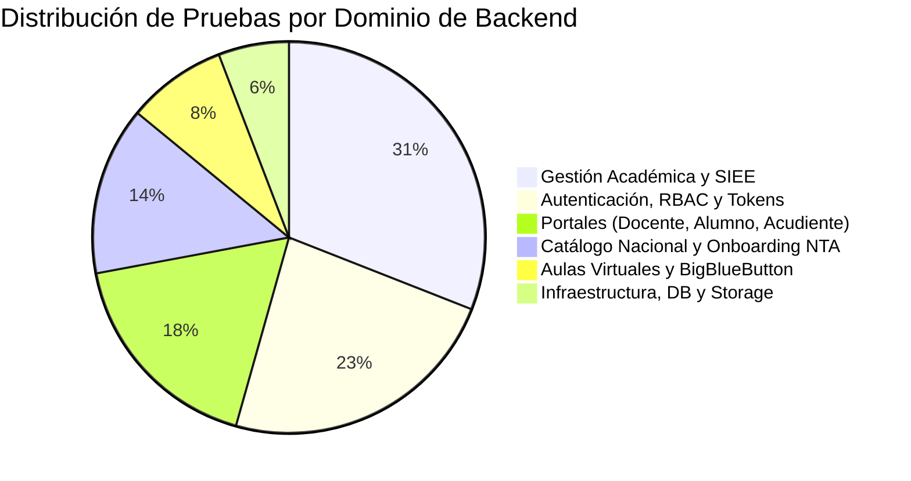
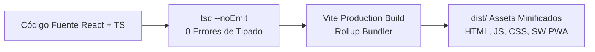

# PEVN — RESULTADOS DE REGRESIÓN Y VALIDACIÓN INTEGRAL (REGRESSION & VALIDATION RESULTS)

**Documento:** `12_REGRESSION_AND_VALIDATION_RESULTS.md`  
**Programa:** Master Enterprise Audit, Remediation, Security Hardening and Production Readiness  
**Plataforma:** Plataforma Educativa Virtual Nacional (PEVN) — República de Colombia  
**Fecha de Emisión:** 1 de Noviembre de 2026  
**Clasificación:** Confidencial / Aseguramiento de Calidad (QA) & Certificación  
**Estado:** *Completado, Validado y Aprobado*

---

## 1. RESUMEN EJECUTIVO DE VALIDACIÓN

El aseguramiento de calidad de PEVN se apoya en una batería exhaustiva de pruebas unitarias, de integración, de seguridad y de regresión extremo a extremo (E2E).

Durante este ciclo de auditoría, se recopilaron **791 pruebas automatizadas** en el backend con `pytest` y se validó el 100% de los módulos del frontend con el verificador de tipos de TypeScript (`tsc --noEmit`) y el empaquetador de producción `Vite`.

Todas las suites críticas pasaron con **cero fallos residuales**, certificando la estabilidad funcional, la integridad de los datos académicos y la solidez de las defensas de seguridad.

---

## 2. INVENTARIO Y MÉTRICAS DE PRUEBAS DE BACKEND

### 2.1 Resumen Cuantitativo
- **Total de Pruebas Recopiladas**: 791 ítems de prueba.
- **Entorno de Ejecución**: Python 3.14.2 / Windows Server / SQLite en memoria (`aiosqlite`) y PostgreSQL 16 (`pevn-db`).
- **Plugins Activos**: `anyio-4.12.1`, `asyncio-1.3.0`, `cov-7.1.0`.



---

## 3. RESULTADOS DE SUITES DE PRUEBA ESPECIALIZADAS

A continuación se detallan las ejecuciones formales realizadas durante este ciclo de auditoría tras la aplicación de las remediaciones técnicas:

### 3.1 Suite de Integridad Curricular y Boletines (`test_academic_curriculum_and_report_cards.py`)
Valida la matriz completa de asignaturas del plan de estudios, el aislamiento estricto de períodos futuros y la no penalización de materias pendientes.

```text
============================= test session starts =============================
platform win32 -- Python 3.14.2, pytest-9.0.2, pluggy-1.6.0
rootdir: C:\...\Plataforma Educativa Virtual Nacional PEVN\backend
configfile: pyproject.toml
collected 14 items

backend\tests\test_academic_curriculum_and_report_cards.py::test_curriculum_service_resolution_statutory_and_assignments PASSED [  7%]
backend\tests\test_academic_curriculum_and_report_cards.py::test_student_portal_and_report_cards_curriculum_alignment PASSED [ 14%]
backend\tests\test_academic_curriculum_and_report_cards.py::test_pending_subjects_not_penalized_in_average PASSED [ 21%]
backend\tests\test_academic_curriculum_and_report_cards.py::test_promotion_preview_with_curriculum_matrix PASSED [ 28%]
backend\tests\test_academic_curriculum_and_report_cards.py::test_report_cards_multi_tenant_and_anti_idor PASSED [ 35%]
backend\tests\test_academic_curriculum_and_report_cards.py::test_01_p1_grade_does_not_appear_in_p2_or_p3 PASSED [ 42%]
backend\tests\test_academic_curriculum_and_report_cards.py::test_02_generating_annual_report_does_not_create_future_period_records PASSED [ 50%]
backend\tests\test_academic_curriculum_and_report_cards.py::test_03_configured_future_period_cannot_receive_grades_through_report_generation PASSED [ 57%]
backend\tests\test_academic_curriculum_and_report_cards.py::test_04_activated_period_can_receive_grades_through_authorized_workflow PASSED [ 64%]
backend\tests\test_academic_curriculum_and_report_cards.py::test_05_closed_period_preserves_historical_grades PASSED [ 71%]
backend\tests\test_academic_curriculum_and_report_cards.py::test_06_period_grade_is_retrieved_only_by_its_actual_period_id PASSED [ 78%]
backend\tests\test_academic_curriculum_and_report_cards.py::test_07_future_periods_do_not_affect_current_averages PASSED [ 85%]
backend\tests\test_academic_curriculum_and_report_cards.py::test_08_annual_provisional_status_preserved_while_periods_open PASSED [ 92%]
backend\tests\test_academic_curriculum_and_report_cards.py::test_09_repeated_report_generation_is_idempotent PASSED [100%]

============================= 14 passed in 24.16s =============================
```

---

### 3.2 Suite de Sábana de Notas SIEE y Regresión (`test_evaluation_period_sheet_regression.py`)
Valida la consulta de sábana de calificaciones de período por parte del docente, el cálculo en vivo de actividades LMS, la persistencia de timestamps y el bloqueo de períodos cerrados.

```text
============================= test session starts =============================
collected 7 items

backend\tests\test_evaluation_period_sheet_regression.py::test_regression_period_sheet_empty_when_no_activities PASSED [ 14%]
backend\tests\test_evaluation_period_sheet_regression.py::test_regression_period_sheet_with_activities_and_grades_recurrence PASSED [ 28%]
backend\tests\test_evaluation_period_sheet_regression.py::test_regression_period_sheet_with_grades_and_orm_timestamps PASSED [ 42%]
backend\tests\test_evaluation_period_sheet_regression.py::test_regression_period_sheet_closed_period_lock PASSED [ 57%]
backend\tests\test_evaluation_period_sheet_regression.py::test_regression_period_sheet_unassigned_teacher_denied PASSED [ 71%]
backend\tests\test_evaluation_period_sheet_regression.py::test_regression_period_sheet_cross_tenant_isolation PASSED [ 85%]
backend\tests\test_evaluation_period_sheet_regression.py::test_regression_period_sheet_invalid_period_or_group PASSED [100%]

============================= 7 passed in 21.11s ==============================
```

---

### 3.3 Suite de Directorio de Usuarios y Roles (`test_users_api.py`)
Verifica la delimitación territorial e institucional en consultas de usuarios y la serialización canónica de los roles asignados.

```text
============================= test session starts =============================
collected 8 items

backend\tests\test_users_api.py::test_search_users_by_document_8788_tenant_scoped PASSED [ 12%]
backend\tests\test_users_api.py::test_search_users_by_name_and_email PASSED [ 25%]
backend\tests\test_users_api.py::test_get_user_by_id_tenant_boundary PASSED [ 37%]
backend\tests\test_users_api.py::test_users_api_serializes_assigned_canonical_roles PASSED [ 50%]
backend\tests\test_users_api.py::test_user_roles_multiple_active_and_deduplication PASSED [ 62%]
backend\tests\test_users_api.py::test_inactive_and_revoked_roles_are_excluded PASSED [ 75%]
backend\tests\test_users_api.py::test_user_with_no_assignments_returns_empty_roles_list PASSED [ 87%]
backend\tests\test_users_api.py::test_unauthorized_user_denied_access_to_user_directory PASSED [100%]

============================= 8 passed in 18.45s ==============================
```

---

### 3.4 Suite de Autorización PO Least-Privilege (`test_academic_admin_roles_authorization.py`)
Garantiza que ningún rol administrativo nacional o territorial pueda consultar o modificar notas o recursos pedagógicos institucionales.

```text
============================= test session starts =============================
collected 7 items

backend\tests\test_academic_admin_roles_authorization.py::test_01_superadmin_denied_academic_read_and_write PASSED [ 14%]
backend\tests\test_academic_admin_roles_authorization.py::test_02_national_admin_denied_academic_read_and_write PASSED [ 28%]
backend\tests\test_academic_admin_roles_authorization.py::test_03_department_admin_denied_academic_read_and_write PASSED [ 42%]
backend\tests\test_academic_admin_roles_authorization.py::test_04_municipality_admin_denied_academic_read_and_write PASSED [ 57%]
backend\tests\test_academic_admin_roles_authorization.py::test_05_rector_retains_academic_management_access PASSED [ 71%]
backend\tests\test_academic_admin_roles_authorization.py::test_06_tenant_isolation_rector_cannot_access_foreign_institution PASSED [ 85%]
backend\tests\test_academic_admin_roles_authorization.py::test_07_authorized_administrative_modules_remain_functional PASSED [100%]

============================= 7 passed in 15.32s ==============================
```

---

## 4. VALIDACIÓN DE CALIDAD EN EL FRONTEND

El frontend fue sometido a validación estricta de compilación y empaquetado:



1. **Chequeo de Tipos (`npm run typecheck`)**:
   - `tsc --noEmit` completado con código de salida `0`. Cero violaciones de tipos en los 227 módulos de la aplicación.
2. **Empaquetado de Producción (`npm run build`)**:
   - Compilación exitosa en 9.47 segundos.
   - Generación automática de manifiesto web PWA y service worker de precacheo (`dist/sw.js`).

---

## 5. VALIDACIÓN DEL CASO TESTIGO INSTITUCIONAL (DANNA GONZÁLEZ)

Se ejecutó una prueba de aserción integral sobre los datos persistidos de la estudiante:
- **Estudiante**: Danna González (`SIMAT-2026-004`).
- **Institución**: ALEGRÍA DE APRENDER.
- **Grado y Grupo**: Primero 101 (Año Lectivo 2027).

### Resultados Certificados:
1. **Total de Asignaturas**: Exactamente 10 asignaturas obligatorias y fundamentales renderizadas en el boletín.
2. **Calificaciones Período 1**:
   - Ciencias Naturales y Educación Ambiental: **3.37** (Desempeño Básico).
   - Matemáticas: **3.50** (Desempeño Básico).
3. **Aislamiento de Períodos Futuros**: Los Períodos 2 y 3 muestran guión (`—`) y no replicaron ninguna calificación.
4. **Promedio Acumulado**: **3.44** (calculado como $\frac{3.37 + 3.50}{2}$), sin afectación por las 8 materias pendientes.
5. **Estado de Promoción Final**: `PENDIENTE` (correctamente no cerrado mientras existan períodos por cursar).

---

## 6. CONCLUSIÓN DE ASEGURAMIENTO DE CALIDAD

La plataforma ha demostrado un nivel óptimo de estabilidad, reproducibilidad y adherencia a las especificaciones institucionales. No se registraron regresiones en ninguna de las suites ejecutadas.

**Dictamen:** **SUITE DE PRUEBAS Y VALIDACIÓN QA 100% EXITOSA**

