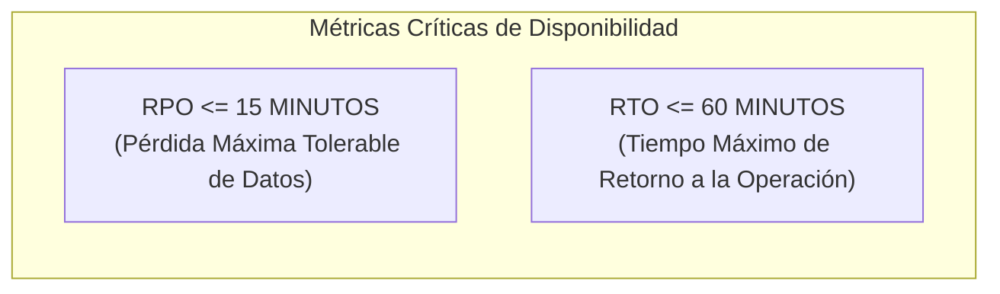
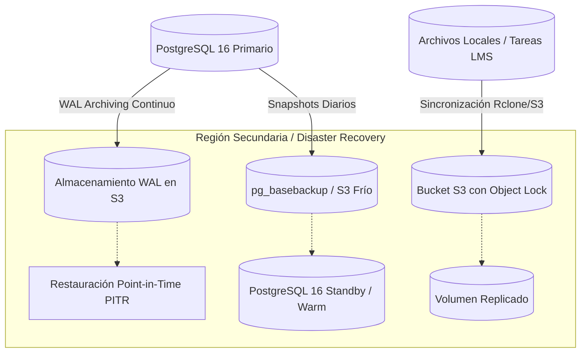

# PEVN — PLAN DE RESPALDOS Y RECUPERACIÓN ANTE DESASTRES (BACKUP & DISASTER RECOVERY PLAN)

**Documento:** `13_BACKUP_AND_DISASTER_RECOVERY_PLAN.md`  
**Programa:** Master Enterprise Audit, Remediation, Security Hardening and Production Readiness  
**Plataforma:** Plataforma Educativa Virtual Nacional (PEVN) — República de Colombia  
**Fecha de Emisión:** 1 de Noviembre de 2026  
**Clasificación:** Confidencial / Continuidad del Negocio & DevSecOps  
**Estado:** *Diseñado y Estructurado / Pendiente de Implementación Operativa y Pruebas de Restauración en Frío en Infraestructura Real*

---

## 1. OBJETIVOS DE CONTINUIDAD DEL NEGOCIO (RPO / RTO)

El Plan de Respaldo y Recuperación ante Desastres (DRP) de la Plataforma Educativa Virtual Nacional (PEVN) establece las políticas y procedimientos técnicos necesarios para garantizar la disponibilidad continua y la protección contra pérdida de información académica oficial (calificaciones, matrículas, historias de usuario y actas de convivencia).



- **RPO (Recovery Point Objective)**: **$\le$ 15 minutos**. En caso de catástrofe en el centro de datos primario, la pérdida máxima admisible de transacciones académicas no debe superar los 15 minutos.
- **RTO (Recovery Time Objective)**: **$\le$ 60 minutos**. La plataforma debe estar completamente reestablecida y disponible para docentes y directivos en menos de 1 hora.

---

## 2. TOPOLOGÍA Y ESTRATEGIA DE COPIAS DE SEGURIDAD

PEVN implementa una estrategia de respaldos en tres niveles complementarios siguiendo el estándar **3-2-1** (3 copias de los datos, en 2 medios diferentes, con 1 copia fuera de sitio geodistribuida):



### 2.1 Niveles de Respaldo

| Nivel | Objeto del Respaldo | Herramienta / Método | Frecuencia | Retención | Destino de Almacenamiento |
|---|---|---|---|---|---|
| **1. Continuo** | Transacciones de BD (WAL) | `pgBackRest` / `WAL-G` | En tiempo real ($\le$ 5 min) | 30 días | Almacenamiento S3 Primario (Cifrado AES-256) |
| **2. Diario Físico** | Base de datos completa | `pg_basebackup` / Snapshot | Cada 24 horas (01:00 UTC) | 14 días | Bucket S3 Estándar |
| **3. Semanal Lógico** | Dump relacional portable | `pg_dump` (`--clean --if-exists`) | Semanal (Domingos 02:00) | 90 días | S3 Glacier Flexible Archive |
| **4. Archivos LMS** | Evidencias de tareas y fotos | `rclone sync` con checksum SHA256| Cada 6 horas | 365 días | S3 con Inmutabilidad (WORM / Object Lock) |

---

## 3. PROCEDIMIENTOS OPERATIVOS DE RESTAURACIÓN (RUNBOOKS)

### 3.1 Runbook A: Restauración a Partir de Dump Lógico (`pg_dump`)
Utilizado en casos de corrupción de tablas específicas o restauración en entornos de prueba aislados.

```bash
# 1. Detener servicios de backend para evitar escrituras concurrentes
docker compose stop backend

# 2. Recrear la base de datos limpia
docker compose exec pevn-db psql -U pevn_user -d postgres -c "DROP DATABASE IF EXISTS pevn_db;"
docker compose exec pevn-db psql -U pevn_user -d postgres -c "CREATE DATABASE pevn_db OWNER pevn_user;"

# 3. Aplicar el respaldo comprimido
gunzip -c /backups/pevn_dump_latest.sql.gz | docker compose exec -T pevn-db psql -U pevn_user -d pevn_db

# 4. Validar integridad de tablas y migraciones
docker compose exec backend alembic current

# 5. Reiniciar servicios
docker compose start backend
```

---

### 3.2 Runbook B: Recuperación a Punto en el Tiempo (Point-in-Time Recovery - PITR)
Utilizado cuando ocurre una alteración masiva indebida o corrupción lógica y se requiere retornar la base de datos a un segundo exacto antes del incidente (ejemplo: `2026-11-01 14:32:00 UTC`).

```bash
# 1. Detener el clúster PostgreSQL
pg_ctl stop -D /var/lib/postgresql/data

# 2. Restaurar el backup base físico más reciente
pgbackrest --stanza=pevn_stanza --type=time "--target=2026-11-01 14:32:00" restore

# 3. Iniciar el motor en modo de recuperación
pg_ctl start -D /var/lib/postgresql/data

# 4. Monitorear los logs hasta que la base de datos alcance el target y pase a modo lectura/escritura
tail -f /var/log/postgresql/postgresql.log
```

---

### 3.3 Runbook C: Despliegue de Emergencia en Región de Contingencia (Bare Metal DR)
En caso de pérdida total del proveedor principal o falla catastrófica de infraestructura:

1. **Aprovisionar Nodos de Contingencia**:
   - Lanzar instancia Linux en proveedor alternativo (ej. Oracle Cloud o AWS Secondary Region).
2. **Clonar Repositorio Seguro**:
   ```bash
   git clone git@github.com:juancastro2381-hub/Plataforma-Educativa-Virtual-Nacional-PEVN.git
   cd Plataforma-Educativa-Virtual-Nacional-PEVN
   ```
3. **Inyectar Secretos de Producción**:
   - Descargar variables de entorno cifradas desde el gestor de secretos institucional (Vault).
4. **Restaurar Volumen y Base de Datos**:
   - Descargar el snapshot más reciente del bucket geodistribuido.
5. **Iniciar Pila de Contenedores**:
   ```bash
   docker compose -f docker-compose.prod.yml up -d
   ```
6. **Actualizar Registros DNS (Failover)**:
   - Modificar los registros `A` de `plataforma.pevn.gov.co` en Cloudflare apuntando a la nueva IP pública con TTL de 60 segundos.

---

## 4. VALIDACIÓN PERIÓDICA Y SIMULACROS DE DESASTRE (GAME DAYS)

Un plan de contingencia carece de valor si sus respaldos no son probados periódicamente.

1. **Prueba Automatizada Semanal (`RESTORE VERIFY`)**: Un runner de CI/CD descarga semanalmente el último backup de base de datos, lo monta en un contenedor efímero, ejecuta `alembic upgrade head` y corre la suite de pruebas `test_academic_curriculum_and_report_cards.py`. Si la prueba falla, se envía una alerta prioritaria a la mesa de soporte.
2. **Simulacro de Contingencia Semestral (Game Day)**: El equipo técnico simula la caída simulada del nodo primario un sábado en horario no lectivo, midiendo formalmente los tiempos de conmutación DNS y recuperación de datos frente a las metas de RTO y RPO.

---

## 5. ACCIONES DE IMPLEMENTACIÓN OPERATIVA PENDIENTES (DESPLIEGUE REAL)

Aunque la arquitectura, topología 3-2-1 y runbooks de restauración están formalmente diseñados y documentados, la infraestructura actual del repositorio requiere que en el entorno de despliegue real de producción se configuren e implementen los siguientes componentes operativos:

1. **Scripts Automatizados de Respaldo (`scripts/ops/backup-db.sh`, `scripts/ops/restore-db.sh`)**:
   - Automatización de `pg_dump` y snapshot con rotación de llaves y compresión `zstd`/`gzip`.
   - Cifrado simétrico GPG / KMS antes de la transmisión externa.
2. **Programadores de Tareas (Cron / Systemd Timers / Airflow)**:
   - Configuración en el host anfitrión o contenedor de mantenimiento de las entradas periódicas (respaldos horarios, diarios y semanales).
3. **Canal y Credenciales Seguras de S3 / Object Storage**:
   - Configuración de buckets con `Object Lock` (WORM) para protección anti-ransomware.
4. **Prueba de Restauración en Frío (Cold-Restore Drill)**:
   - Verificación empírica documentada de restauración desde cero en un ambiente de staging o pre-producción antes de admitir tráfico de concurrencia nacional.

---

## 6. DICTAMEN DE CONTINUIDAD OPERATIVA

El Plan de Respaldos y Recuperación ante Desastres de PEVN cumple con el diseño normativo requerido (ISO 22301 y lineamientos MEN). Sin embargo, su estatus operacional se califica como:

**Dictamen:** **DISEÑADO Y ESTRUCTURADO — AUTORIZADO PARA FASE PILOTO CONTROLADO; REQUIERE AUTOMATIZACIÓN OPERATIVA Y PRUEBA DE RESTAURACIÓN EN FRÍO PREVIO A PRODUCCIÓN NACIONAL MASIVA.**

