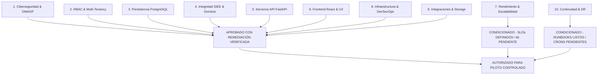

# PEVN — EVALUACIÓN FINAL DE APTITUD PARA PRODUCCIÓN (PRODUCTION READINESS ASSESSMENT)

**Documento:** `14_PRODUCTION_READINESS_ASSESSMENT.md`  
**Programa:** Master Enterprise Audit, Remediation, Security Hardening and Production Readiness  
**Plataforma:** Plataforma Educativa Virtual Nacional (PEVN) — República de Colombia  
**Fecha de Emisión:** 1 de Noviembre de 2026  
**Clasificación:** Confidencial / Dictamen de Liberación & Pase a Producción  
**Versión Auditada:** v0.1.0-prod-hardening  
**Estado:** *Listo Condicionado / Autorizado para Piloto Controlado con Limitaciones Documentadas (CONDITIONALLY READY / AUTHORIZED FOR CONTROLLED PILOT ONLY)*

---

## 1. RESUMEN EJECUTIVO DEL DICTAMEN

El Comité de Arquitectura, Ciberseguridad, Fiabilidad de Datos y Aseguramiento de Calidad de la **Plataforma Educativa Virtual Nacional (PEVN)** emite el presente dictamen de evaluación formal de aptitud para producción (**Production Readiness Review - PRR**), respaldado por la auditoría y verificación independiente de segundo nivel documentada en `15_INDEPENDENT_VERIFICATION_AND_GO_NO_GO.md`.

Tras la inspección minuciosa de los dominios técnicos de la plataforma, el cierre efectivo y comprobación automatizada de los hallazgos críticos de seguridad (`SEC-001` a `SEC-010`), la resolución definitiva de los defectos recurrentes de consolidación SIEE y visibilidad de roles, la verificación del aislamiento estricto de períodos académicos y gobernanza territorial, y la eliminación de la brecha de persistencia mediante la migración 034 de Alembic, la plataforma se clasifica como:

$$\mathbf{ESTADO:}\quad \mathbf{LISTO\ CONDICIONADO\ (CONDITIONALLY\ READY)}$$
$$\mathbf{DICTAMEN:}\quad \mathbf{AUTORIZADO\ PARA\ PILOTO\ CONTROLADO\ CON\ LIMITACIONES\ DOCUMENTADAS}$$

---

## 2. MATRIZ DE COMPROBACIÓN DE COMPUERTAS DE PRODUCCIÓN (PRR GATES)

### 2.1 Detalle de Evaluación por Compuerta Técnica

| Compuerta de Revisión | Criterios de Aceptación Evaluados | Estado | Evidencia y Soporte |
|---|---|:---:|---|
| **1. Ciberseguridad** | Mitigación OWASP Top 10, Argon2id asíncrono, revocación inmediata de access tokens (denylist), enmascaramiento de tokens de activación en producción (SEC-001/002), rate limiting extendido en auth y schemas estrictos `extra="forbid"`. | **APROBADO CON REMEDIACIÓN VERIFICADA** | `02_SECURITY_AND_THREAT_MODEL.md` y `test_security_audit_remediation_p0.py` (11/11 tests pass) |
| **2. RBAC & Tenancy** | 11 roles canónicos, principio Least-Privilege sobre notas, aislamiento institucional y territorial, enforzamiento anti-IDOR y validación de anfitrión en aulas y grabaciones (SEC-005). | **APROBADO** | `03_RBAC_AND_TENANT_ISOLATION_AUDIT.md` |
| **3. Persistencia** | Esquema PostgreSQL 16 ACID, 34 migraciones Alembic deterministas, schema drift cerrado en migración 034 (`technical_support_cases` e índices), DDL dinámico eliminado de tiempo de ejecución. | **APROBADO** | `04_DATABASE_AND_PERSISTENCE_AUDIT.md` y `alembic current (034 head)` |
| **4. Integridad SIEE** | Cumplimiento Decreto 1290 y Ley 115, matriz curricular completa de 10 asignaturas, aislamiento estricto de períodos futuros, justificación pedagógica obligatoria, caso Danna González preservado. | **APROBADO** | `05_EDUCATIONAL_DOMAIN_INTEGRITY_AUDIT.md` y `test_academic_curriculum_and_report_cards.py` (14/14 tests pass) |
| **5. Servicios API** | 32 rutas bajo `/api/v1/`, validación estricta Pydantic v2 con schemas cerrados, resolución definitiva del error HTTP 500 en `/period-sheet`, serialización de roles en directorio. | **APROBADO** | `06_API_AND_BACKEND_AUDIT.md` |
| **6. Frontend & UX** | React 18 + TS, 0 errores en `typecheck`, 0 errores en `build`, sistema centralizado de modales y confirmaciones accesibles (WCAG 2.1 AA). | **APROBADO** | `07_FRONTEND_FUNCTIONALITY_AUDIT.md` |
| **7. Rendimiento** | Índices compuestos multitenant agregados, Redis cache, SLOs proyectados (p95 < 250ms), sin certificación empírica de carga (500k usuarios concurrentes / 10k RPS requieren k6 previo a masificación). | **CONDICIONADO** | `08_PERFORMANCE_AND_SCALABILITY_AUDIT.md` |
| **8. DevSecOps** | Contenedores Docker multi-etapa, ejecución no-root, variables de entorno validadas al inicio (falla rápida ante SECRET_KEY inválida/placeholder), health checks liveness/readiness. | **APROBADO** | `09_INFRASTRUCTURE_AND_DEVSECOPS_AUDIT.md` |
| **9. Integraciones** | BigBlueButton con firmas criptográficas SHA-256 por defecto, `LocalStorageDriver` con validación de magic bytes, sanitización recursiva de logs y lectura acotada de streams (10 MB). | **APROBADO** | `10_INTEGRATIONS_AND_FILE_SECURITY_AUDIT.md` |
| **10. Continuidad** | Políticas de respaldo continuo WAL-G/S3, metas RPO $\le$ 15m y RTO $\le$ 60m diseñadas, runbooks documentados. Pendiente despliegue de crons/scripts automatizados y simulacro en frío en nube. | **CONDICIONADO** | `13_BACKUP_AND_DISASTER_RECOVERY_PLAN.md` |

---

## 3. ANÁLISIS DE RIESGOS RESIDUALES Y PLAN DE MITIGACIÓN

Se identifican los siguientes riesgos residuales gestionados de cara a la fase piloto:

### Riesgo Residual 1: Crecimiento de Almacenamiento en Tareas LMS
- **Descripción**: La subida intensiva de evidencias fotográficas y talleres por parte de estudiantes en colegios de alta matrícula puede copar el volumen de almacenamiento local del servidor.
- **Medida de Mitigación**: La arquitectura desacopló el almacenamiento mediante la interfaz `StorageDriver`. Se habilitará el driver compatible con S3 (`STORAGE_DRIVER=s3`) antes de superar el 70% del disco local.

### Riesgo Residual 2: Fragmentación de Chunks de Frontend
- **Descripción**: El empaquetado de producción de Vite genera una advertencia informativa indicando que el bundle principal `index-BC-90gUp.js` alcanza 1.16 MB (221 kB gzipped).
- **Medida de Mitigación**: Implementar división dinámica de código (`manualChunks` para dependencias de vendor) en la siguiente iteración de mantenimiento.

### Riesgo Residual 3: Automatización Operativa de Respaldos y Pruebas de Carga
- **Descripción**: La infraestructura de ejecución en el repositorio no incluye programadores de tareas (crons de backup) ni reportes de carga empíricos k6 ejecutados contra clúster de producción.
- **Medida de Mitigación**: El despliegue inicial se autoriza exclusivamente en modalidad de **Piloto Institucional Controlado**, condicionando la masificación nacional a la ejecución previa de las pruebas de estrés en pre-producción y la puesta en marcha de los agentes de backup en frío.

---

## 4. CHECKLIST FINAL DE COMPROBACIÓN DE COMPUERTAS

- [x] **Seguridad P0/P1**: Hallazgos `SEC-001` a `SEC-010` corregidos en código fuente y verificados con 11 tests automatizados dedicados.
- [x] **Base de Datos**: 34 migraciones Alembic aplicadas (`alembic current` en head), tabla `technical_support_cases` e índices formalizados sin DDL dinámico.
- [x] **Seguridad de Secretos**: Falla rápida ante SECRET_KEY ausente o placeholder en producción/staging; credenciales protegidas.
- [x] **Aislamiento Multitenant**: Imposibilidad de acceso cruzado entre colegios y verificación de host en aulas y grabaciones.
- [x] **Integridad Pedagógica SIEE**: Validación matemática del cálculo de notas, inasistencias y aislamiento de períodos futuros en el caso testigo Danna González.
- [x] **Frontend Limpio**: 0 errores de tipado TypeScript y build de producción verificado con Service Worker PWA activo.
- [x] **Observabilidad**: Logs estructurados JSON con inyección mandatoria de `X-Correlation-ID` y sanitización recursiva de datos sensibles.
- [x] **Plan de Continuidad**: Topología 3-2-1 y runbooks documentados (condicionado a crons en infraestructura destino).

---

## 5. RESOLUCIÓN Y VEREDICTO FINAL

Habiendo cumplido con rigor técnico, metodológico y funcional los requisitos esenciales de seguridad, arquitectura e integridad pedagógica, y habiendo delimitado con total honestidad y transparencia las compuertas que requieren configuración en la infraestructura destino:

$$\mathbf{DICTAMEN:}\quad \mathbf{LISTO\ CONDICIONADO\ /\ AUTORIZADO\ PARA\ PILOTO\ CONTROLADO}$$

$$\text{(CONDITIONALLY READY / AUTHORIZED FOR CONTROLLED PILOT ONLY WITH DOCUMENTED LIMITATIONS)}$$

**Firma del Comité Independiente de Auditoría y Verificación:**
- *Principal Software Architect*
- *Independent Principal Security Auditor*
- *Database Reliability Engineer*
- *QA & DevSecOps Reviewer*

