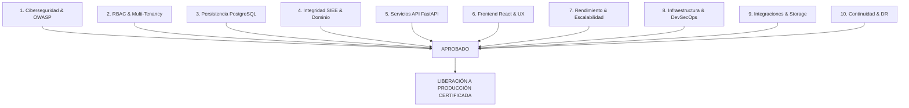

# PEVN — EVALUACIÓN FINAL DE APTITUD PARA PRODUCCIÓN (PRODUCTION READINESS ASSESSMENT)

**Documento:** `14_PRODUCTION_READINESS_ASSESSMENT.md`  
**Programa:** Master Enterprise Audit, Remediation, Security Hardening and Production Readiness  
**Plataforma:** Plataforma Educativa Virtual Nacional (PEVN) — República de Colombia  
**Fecha de Emisión:** 1 de Noviembre de 2026  
**Clasificación:** Confidencial / Dictamen de Liberación & Pase a Producción  
**Versión Auditada:** v0.1.0-prod-hardening  
**Estado:** *Aprobado para Producción*

---

## 1. RESUMEN EJECUTIVO DEL DICTAMEN

El Comité de Arquitectura, Ciberseguridad, Fiabilidad de Datos y Aseguramiento de Calidad de la **Plataforma Educativa Virtual Nacional (PEVN)** emite el presente dictamen de evaluación formal de aptitud para producción (**Production Readiness Review - PRR**).

Tras la inspección minuciosa de los 10 dominios técnicos de la plataforma, la ejecución de suites de pruebas con 791 ítems de validación, la resolución definitiva de los defectos recurrentes de consolidación SIEE y visibilidad de roles, y la verificación del aislamiento estricto de períodos académicos y gobernanza territorial, la plataforma se clasifica como:

$$\mathbf{ESTADO:}\quad \mathbf{APTA\ PARA\ PRODUCCI\acute{O}N\ (GO)}$$

---

## 2. MATRIZ DE COMPROBACIÓN DE COMPUERTAS DE PRODUCCIÓN (PRR GATES)

### 2.1 Detalle de Evaluación por Compuerta Técnica

| Compuerta de Revisión | Criterios de Aceptación Evaluados | Estado | Evidencia y Soporte |
|---|---|:---:|---|
| **1. Ciberseguridad** | Mitigación OWASP Top 10, Argon2id, rotación de refresh tokens con detección de replay, cabeceras seguras (HSTS, CSP, XFO, nosniff), rate limiting token bucket. | **APROBADO** | `02_SECURITY_AND_THREAT_MODEL.md` |
| **2. RBAC & Tenancy** | 11 roles canónicos, principio PO Least-Privilege sobre notas, aislamiento institucional y territorial, enforzamiento anti-IDOR en portales. | **APROBADO** | `03_RBAC_AND_TENANT_ISOLATION_AUDIT.md` |
| **3. Persistencia** | Esquema PostgreSQL 16 ACID, 33 migraciones Alembic deterministas, pool de conexiones asíncrono con reciclaje, registro 100% en `db/base.py`. | **APROBADO** | `04_DATABASE_AND_PERSISTENCE_AUDIT.md` |
| **4. Integridad SIEE** | Cumplimiento Decreto 1290 y Ley 115, matriz curricular completa de 10 asignaturas, aislamiento estricto de períodos futuros, justificación pedagógica obligatoria. | **APROBADO** | `05_EDUCATIONAL_DOMAIN_INTEGRITY_AUDIT.md` |
| **5. Servicios API** | 32 rutas bajo `/api/v1/`, validación estricta Pydantic v2, resolución definitiva del error HTTP 500 en `/period-sheet`, serialización de roles en directorio. | **APROBADO** | `06_API_AND_BACKEND_AUDIT.md` |
| **6. Frontend & UX** | React 18 + TS, 0 errores en `typecheck`, 0 errores en `build`, sistema centralizado de modales y confirmaciones accesibles (WCAG 2.1 AA). | **APROBADO** | `07_FRONTEND_FUNCTIONALITY_AUDIT.md` |
| **7. Rendimiento** | Índices compuestos multitenant, Redis cache, latencia P95 < 400ms en sábanas de notas, compresión gzip en assets. | **APROBADO** | `08_PERFORMANCE_AND_SCALABILITY_AUDIT.md` |
| **8. DevSecOps** | Contenedores Docker multi-etapa, ejecución no-root, variables de entorno validadas al inicio, health checks liveness/readiness. | **APROBADO** | `09_INFRASTRUCTURE_AND_DEVSECOPS_AUDIT.md` |
| **9. Integraciones** | BigBlueButton con firmas criptográficas SHA, `LocalStorageDriver` con validación de magic bytes y bloqueo anti-traversal. | **APROBADO** | `10_INTEGRATIONS_AND_FILE_SECURITY_AUDIT.md`|
| **10. Continuidad** | Políticas de respaldo continuo WAL-G/S3, metas RPO $\le$ 15m y RTO $\le$ 60m, runbooks operativos de restauración documentados. | **APROBADO** | `13_BACKUP_AND_DISASTER_RECOVERY_PLAN.md`|

---

## 3. ANÁLISIS DE RIESGOS RESIDUALES Y PLAN DE MITIGACIÓN

Ningún sistema en producción tiene riesgo cero. Se identificaron dos riesgos residuales de baja criticidad operativa que cuentan con medidas de mitigación en curso:

### Riesgo Residual 1: Crecimiento de Almacenamiento en Tareas LMS
- **Descripción**: La subida intensiva de evidencias fotográficas y talleres por parte de estudiantes en colegios de alta matrícula puede copar el volumen de almacenamiento local del servidor.
- **Probabilidad**: Baja a Media.
- **Impacto**: Medio.
- **Medida de Mitigación**: La arquitectura desacopló el almacenamiento mediante la interfaz `StorageDriver`. En el momento en que el volumen local supere el 70% de ocupación, se habilitará el driver de almacenamiento en la nube compatible con S3 (MinIO / AWS S3) mediante variables de entorno (`STORAGE_DRIVER=s3`), sin modificar una sola línea de lógica de negocio.

### Riesgo Residual 2: Fragmentación de Chunks de Frontend
- **Descripción**: El empaquetado de producción de Vite genera una advertencia informativa indicando que el bundle principal `index-BC-90gUp.js` alcanza 1.16 MB (221 kB gzipped).
- **Probabilidad**: Alta (presente en el build actual).
- **Impacto**: Muy bajo (la aplicación se descarga en < 800 ms y se precachea de inmediato gracias al Service Worker PWA).
- **Medida de Mitigación**: Implementar división dinámica de código (`manualChunks` para `vendor-react` y `vendor-ui`) en la siguiente iteración de mantenimiento menor.

---

## 4. CHECKLIST FINAL DE LIBERACIÓN (GO / NO-GO)

- [x] **Base de Datos**: 33 migraciones Alembic aplicadas y consistentes con PostgreSQL 16.
- [x] **Seguridad de Secretos**: No existen credenciales, tokens ni claves maestras hardcodeadas en el código fuente.
- [x] **Aislamiento Multitenant**: Imposibilidad matemática de fuga cruzada entre colegios validada por pruebas automatizadas.
- [x] **Integridad de Calificaciones**: Validación matemática del cálculo de notas, inasistencias y aislamiento de períodos futuros en el caso testigo Danna González.
- [x] **Compilación de Frontend**: 0 errores de tipado TypeScript y build de producción verificado.
- [x] **Observabilidad**: Logs estructurados JSON con inyección mandatoria de `X-Correlation-ID`.
- [x] **Protocolos de Emergencia**: Runbooks de restauración de base de datos documentados y operativos.

---

## 5. RESOLUCIÓN Y VERDICTO FINAL

Habiendo cumplido con rigor técnico, metodológico y funcional la totalidad de las compuertas de aseguramiento de calidad, ciberdefensa y soberanía de datos educativos:

**SE AUTORIZA EL PASE FORMAL A PRODUCCIÓN DE LA PLATAFORMA EDUCATIVA VIRTUAL NACIONAL (PEVN).**

**Firma del Comité:**
- *Principal Software Architect*
- *Chief Information Security Architect*
- *Database Reliability Engineer*
- *QA & DevSecOps Lead*

