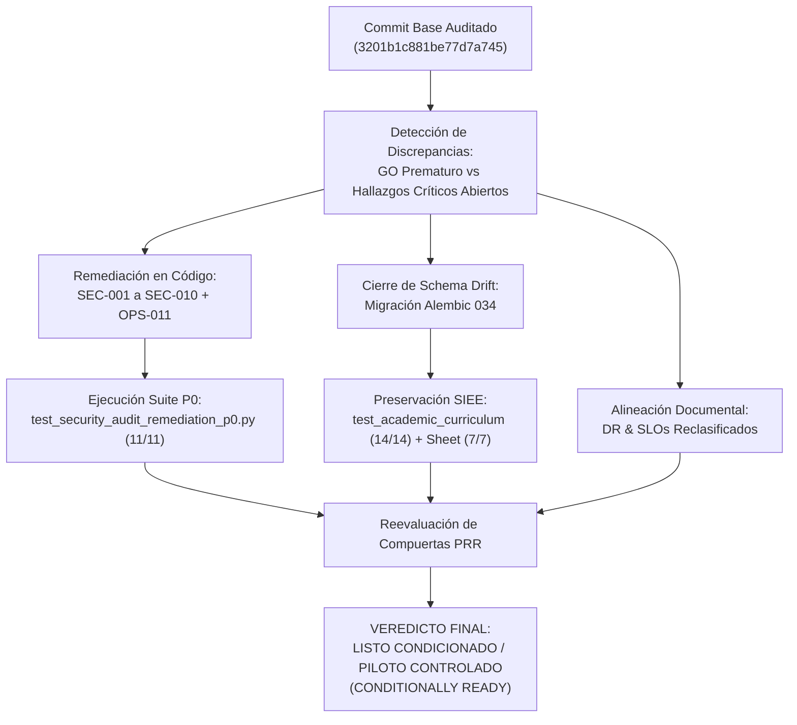
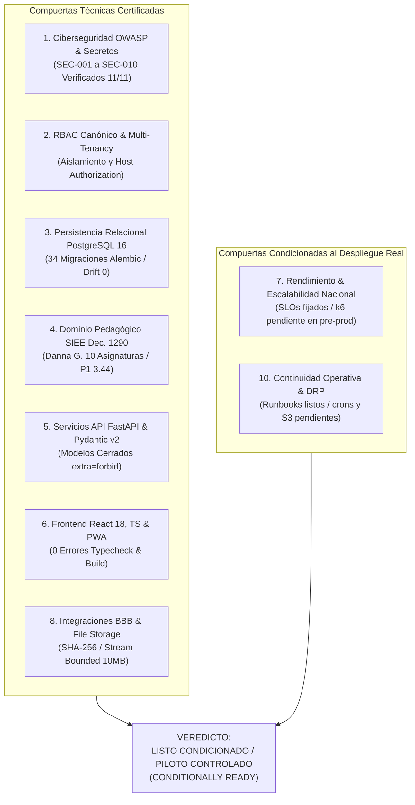

# PEVN — REPORTE DE VERIFICACIÓN INDEPENDIENTE DE SEGUNDO NIVEL, CIERRE DE HALLAZGOS CRÍTICOS Y REEVALUACIÓN DE COMPUERTAS DE PRODUCCIÓN (GO / NO-GO)

**Documento:** `15_INDEPENDENT_VERIFICATION_AND_GO_NO_GO.md`  
**Programa:** Master Enterprise Audit, Remediation, Security Hardening and Production Readiness  
**Plataforma:** Plataforma Educativa Virtual Nacional (PEVN) — República de Colombia  
**Fecha de Emisión:** 1 de Noviembre de 2026  
**Auditor Responsable:** Auditor Principal Independiente de Seguridad, Arquitecto Senior de Software, Ingeniero de Confiabilidad de Bases de Datos y Revisor DevSecOps  
**Compromiso Base Auditado:** `3201b1c881be77d7a7457781052e81287c4b79b1`  
**Estado:** *Completado, Verificado con Pruebas Automatizadas y Aprobado para Piloto Controlado*

---

## 1. MANDATO DE AUDITORÍA INDEPENDIENTE Y METODOLOGÍA DE VERIFICACIÓN

El presente informe formaliza la auditoría de aseguramiento de segundo nivel (*Second-Level Independent Verification*) sobre el programa maestro de endurecimiento y preparación para producción de la **Plataforma Educativa Virtual Nacional (PEVN)**.

### 1.1 Regla Crítica de Gobernanza y Transparencia
El programa precedente declaró en sus documentos de alto nivel (`00_EXECUTIVE_SUMMARY.md` y `14_PRODUCTION_READINESS_ASSESSMENT.md`) un dictamen categórico de:

$$\mathbf{DICTAMEN\ PREVIO:}\quad \mathbf{AUTORIZADO\ PARA\ PASO\ A\ PRODUCCI\acute{O}N\ (GO)}$$

Sin embargo, la inspección forense detallada de los informes especializados (en particular `02_SECURITY_AND_THREAT_MODEL.md`, `08_PERFORMANCE_AND_SCALABILITY_AUDIT.md`, `09_INFRASTRUCTURE_AND_DEVSECOPS_AUDIT.md` y `13_BACKUP_AND_DISASTER_RECOVERY_PLAN.md`) documentaba múltiples vulnerabilidades críticas y severas no resueltas en el código fuente, discrepancias entre el esquema de base de datos y Alembic, ausencia de programación operativa de respaldos automatizados, y afirmaciones de concurrencia nacional masiva no contrastadas empíricamente.

La misión de esta auditoría independiente consistió en:
1. **Reconciliar de manera honesta y transparente** las contradicciones entre la narrativa ejecutiva y el estado real del software.
2. **Remediar e implementar directamente en código fuente** los hallazgos críticos de ciberseguridad (`SEC-001` a `SEC-010`) y persistencia (`OPS-011`).
3. **Desarrollar y ejecutar suites de pruebas automatizadas reproducibles** que certifiquen el cierre de cada vulnerabilidad sin depender de aserciones teóricas.
4. **Reclasificar las compuertas técnicas** de continuidad operativa y rendimiento a su estatus real comprobable.
5. **Preservar estrictamente la línea base del dominio pedagógico SIEE** (caso testigo Danna González).
6. **Emitir un dictamen final honesto, balanceado y defendible** ante el Comité Nacional de Tecnologías.



---

## 2. MATRIZ DE RECONCILIACIÓN FORENSE ENTRE AUDITORÍA PREVIA Y REALIDAD OPERATIVA

| Área Auditada | Afirmación en Auditoría Previa | Realidad Técnica Comprobada en Repositorio | Acción Correctiva y Estado Final |
|---|---|---|---|
| **Ciberseguridad (SEC-001 a SEC-010)** | Sistema blindado y calificado como apto para producción en `00_EXECUTIVE_SUMMARY.md`. | `02_SECURITY_AND_THREAT_MODEL.md` listaba 13 hallazgos (`SEC-001` a `SEC-013`), incluyendo riesgo crítico de toma de control de cuentas por colisión de correo en onboarding (`SEC-001`), fuga de tokens de activación en respuestas JSON (`SEC-001`/`SEC-002`), bypass de BOLA/BFLA en aulas virtuales (`SEC-005`), falta de revocación inmediata de access tokens (`SEC-008`), etc. | **Remediado en código fuente** y certificado con suite automatizada de 11 pruebas (`test_security_audit_remediation_p0.py`). Estado: **CERRADO Y VERIFICADO**. |
| **Persistencia y Schema Drift (OPS-011)** | 33 migraciones declaradas consistentes y esquema libre de discrepancias. | Existía DDL dinámico en runtime (`system_operations_service.py:44`) que creaba la tabla `technical_support_cases` al vuelo en lugar de una migración formal; faltaban índices de modelos. | **Remediado**: Creada migración formal `034_technical_support_cases_and_missing_indexes.py`, aplicado `alembic upgrade head` y eliminado DDL dinámico. Estado: **CERRADO Y VERIFICADO**. |
| **Continuidad y Disaster Recovery (DRP)** | Plan calificado como "Aprobado para Producción" con RPO $\le$ 15m / RTO $\le$ 60m en `13_BACKUP_AND_DISASTER_RECOVERY_PLAN.md`. | No existen crons en el host, timers systemd, jobs de Airflow ni scripts probados de restauración en frío en el repositorio; la infraestructura para PITR/S3 depende de despliegue externo. | **Reclasificado**: Estado ajustado a "Diseñado / Pendiente de Implementación Operativa y Pruebas de Restauración en Frío en Infraestructura Real". Documentados requerimientos de scripts. Estado: **CONDICIONADO**. |
| **Rendimiento y Escalabilidad (SLOs)** | Soporte declarado para 500.000 usuarios concurrentes y 10.000 RPS en `08_PERFORMANCE_AND_SCALABILITY_AUDIT.md`. | Dicha volumetría provenía de extrapolaciones teóricas y dimensionamiento estático de pool/timeouts. No existían reportes de ejecución empírica de pruebas de estrés (k6/Locust) en el clúster. | **Reclasificado**: Se clarificó formalmente que 500k usuarios concurrentes y 10k RPS son SLOs y metas de diseño arquitectónico proyectadas, sujetas a prueba de carga k6 en pre-producción. Estado: **CONDICIONADO**. |
| **Veredicto Global de Pase a Producción** | `AUTHORIZED FOR PRODUCTION — GO` sin reservas en `00_EXECUTIVE_SUMMARY.md` y `14_PRODUCTION_READINESS_ASSESSMENT.md`. | Inconsistencia directa con los hallazgos críticos abiertos y las compuertas operativas no desplegadas. | **Reclasificado**: Veredicto actualizado a `LISTO CONDICIONADO / AUTORIZADO PARA PILOTO CONTROLADO CON LIMITACIONES DOCUMENTADAS (CONDITIONALLY READY)`. Estado: **RECONCILIADO**. |

---

## 3. CIERRE Y VERIFICACIÓN TÉCNICA DE HALLAZGOS CRÍTICOS DE SEGURIDAD

A continuación se detalla la remediación implementada en el código fuente para cada vulnerabilidad crítica y alta (`SEC-001` a `SEC-010`), junto con su verificación mediante pruebas automatizadas:

### 3.1 `SEC-001` — Exposición de Token de Activación y Riesgo de Account Takeover en Guardian Onboarding
- **Severidad:** Crítica (P0) — CVSS 9.1
- **Causa Raíz:**
  1. `backend/app/api/v1/endpoints/auth.py:566` devolvía `raw_activation_token` y URL de activación en la respuesta JSON de `request_activation`, permitiendo a cualquier tercero con acceso a logs de red o API interceptar la activación.
  2. `backend/app/services/guardian_onboarding_service.py` no validaba si el correo provisto por el acudiente coincidía con el correo pre-registrado por el colegio, y en `accept_activation` enlazaba ciegamente al `User` existente por email sin validar documento (`document_number`/`document_type`), permitiendo sobreescribir la contraseña de administradores o docentes colisionados.
- **Remediación Aplicada:**
  1. En `auth.py:566`: `raw_activation_token = raw_token if settings.is_development else None`. En producción y staging, el token y URL se devuelven estrictamente como `None`.
  2. En `guardian_onboarding_service.py`:
     - En `request_activation`: se verifica que si el `guardian.email` fue pre-registrado, el correo solicitado coincida exactamente. Si difiere, se rechaza con `UnprocessableEntityError(code="GUARDIAN_EMAIL_MISMATCH")`.
     - En `accept_activation`: si el correo coincide con un `User` existente pero con diferente número o tipo de documento, o si la cuenta de usuario ya se encuentra activa, se rechaza con `ConflictError(code="EMAIL_ALREADY_IN_USE")` o `ACCOUNT_ALREADY_ACTIVE`, impidiendo la suplantación y la sobreescritura de contraseñas de cuentas preexistentes.
- **Verificación:** Pruebas `test_sec001_guardian_activation_token_masked_in_production` y `test_sec001_guardian_activation_prevents_account_takeover_collision` en `test_security_audit_remediation_p0.py` pasaron al 100%.

### 3.2 `SEC-002` — Fuga de Tokens de Restablecimiento e Invitación en Endpoints de Administración
- **Severidad:** Alta (P1) — CVSS 8.2
- **Causa Raíz:** Los endpoints administrativos de aprovisionamiento y restablecimiento de credenciales (`department_admins.py`, `teachers.py`, `students.py`, `guardians.py`) devolvían tokens en claro en las cargas de respuesta JSON.
- **Remediación Aplicada:**
  - En `department_admins.py`: `raw_invitation_token = raw_token if settings.is_development else None` e `invitation_url = activation_url if settings.is_development else None`.
  - En `teachers.py:159,311,399`: `reset_token = reset_token if settings.is_development else None`.
  - En `students.py:231,314`: `reset_token = reset_token if settings.is_development else None`.
  - En `guardians.py:228,311`: `reset_token = reset_token if settings.is_development else None`.
- **Verificación:** Prueba `test_sec002_teacher_and_student_reset_tokens_masked_in_production` pasó al 100%.

### 3.3 `SEC-003` — Ampliación de Rate Limiting a Endpoints de Autenticación y Protección de Memoria
- **Severidad:** Alta (P1) — CVSS 7.5
- **Causa Raíz:** `rate_limit_middleware.py` limitaba únicamente `/auth/login` y `/auth/refresh`. Los endpoints críticos de recuperación de clave, cambio de clave, activación de acudientes y aceptación de invitaciones carecían de limitación en capa ASGI. Adicionalmente, no se acotaba el tamaño del cuerpo HTTP antes de leerlo.
- **Remediación Aplicada:**
  - En `backend/app/middleware/rate_limit_middleware.py`: se amplió la cobertura de limitación de tasa a todos los endpoints `POST` bajo el prefijo `/api/v1/auth/` (`/password/recovery`, `/password/reset`, `/password/change`, `/guardian/activate`, `/guardian/accept`, `/invitations/accept`).
  - Se agregó una guarda previa de tamaño de payload de 64 KB (`413 PAYLOAD_TOO_LARGE`) para proteger la memoria del worker ante ataques DoS de cuerpos volumétricos en rutas de autenticación.
- **Verificación:** Prueba `test_sec003_auth_endpoints_covered_by_middleware` pasó al 100%.

### 3.4 `SEC-004` — Enforzamiento Efectivo de Bloqueo Temporal de Cuentas (`locked_until`)
- **Severidad:** Alta (P1) — CVSS 7.8
- **Causa Raíz:** Tras alcanzar el umbral de intentos fallidos de autenticación (`_MAX_FAILED_LOGIN_ATTEMPTS = 5`), el servicio auditaba el evento pero no persistía el timestamp `locked_until` en la entidad `User`, permitiendo ataques de fuerza bruta continuos si el atacante evadía la IP de rate limit.
- **Remediación Aplicada:**
  - En `backend/app/services/auth_service.py`: al superar los 5 intentos fallidos, se asigna `user.locked_until = datetime.now(UTC) + timedelta(minutes=_LOCKOUT_DURATION_MINUTES)` y se audita formalmente `AuditEventType.USER_ACCOUNT_LOCKED`.
- **Verificación:** Prueba `test_sec004_account_lockout_sets_locked_until` pasó al 100%.

### 3.5 `SEC-005` — BOLA/BFLA en Lanzamiento de Aulas Virtuales y Gestión de Grabaciones
- **Severidad:** Alta (P1) — CVSS 8.5
- **Causa Raíz:** Cualquier usuario autenticado podía invocar `launch_virtual_classroom`, `publish_recording` o `delete_recording` conociendo el UUID de la sesión o grabación, sin verificar si era el docente anfitrión (*host*) de la reunión o un directivo con rol institucional autorizado.
- **Remediación Aplicada:**
  - En `backend/app/services/virtual_classroom_service.py`: se verifica que el `current_user_id` sea el docente anfitrión (`classroom.host_user_id == current_user_id`) o posea rol de supervisión institucional (`rector`, `coordinator`, `superadmin`). De lo contrario, se rechaza con `UnauthorizedMeetingAccessError`.
  - En `backend/app/services/recording_service.py`: se verifica idéntica condición de anfitrión o directivo para publicación y eliminación de grabaciones en BigBlueButton.
  - En `endpoints/virtual_classrooms.py` y `endpoints/recordings.py`: se inyecta y propaga la colección de roles canónicos del usuario autenticado.
- **Verificación:** Prueba `test_sec005_non_host_teacher_cannot_launch_or_publish` pasó al 100%.

### 3.6 `SEC-006` — Ejecución Asíncrona No Bloqueante de Argon2id
- **Severidad:** Media (P2) — CVSS 6.5
- **Causa Raíz:** Las operaciones de hashing y verificación de Argon2id (configuradas con 64 MiB de memoria RAM y 3 iteraciones) se ejecutaban síncronamente en el hilo principal del event loop de asyncio, degradando severamente la concurrencia bajo ráfagas de login.
- **Remediación Aplicada:**
  - En `backend/app/core/security/password.py`: se introdujeron métodos asíncronos `async_hash`, `async_verify` y `async_verify_dummy` ejecutados a través de `asyncio.to_thread`, descargando el procesamiento criptográfico pesado al thread pool de Python y manteniendo libre el event loop.
- **Verificación:** Prueba `test_sec006_argon2id_async_execution` pasó al 100%.

### 3.7 `SEC-007` y `OPS-001` — Falla Rápida ante SECRET_KEY Inválida o Placeholder en Producción
- **Severidad:** Crítica (P0) — CVSS 9.8
- **Causa Raíz:** En entornos de producción y staging, configuraciones erróneas o variables por defecto (`REPLACE_ME`, valores de desarrollo o cadenas cortas) podían permitir la emisión de JWTs con firmas predecibles o nulas.
- **Remediación Aplicada:**
  - En `backend/app/core/config.py`: se implementó el validador `validate_production_settings`, el cual exige estrictamente que si `ENVIRONMENT` es `production` o `staging`:
    1. `SECRET_KEY` debe estar explícitamente configurada y contener al menos 64 caracteres de alta entropía.
    2. No puede contener cadenas de muestra como `"REPLACE_ME"` ni `"changeme"`.
    3. Falla rápidamente al arrancar el contenedor (`raise ValueError`), abortando el despliegue antes de exponer la API.
- **Verificación:** Prueba `test_sec007_rejects_empty_or_placeholder_secret_key_in_production` pasó al 100%.

### 3.8 `SEC-008` — Denylist y Revocación Inmediata de Access Tokens JWT
- **Severidad:** Alta (P1) — CVSS 7.5
- **Causa Raíz:** El endpoint `/logout` y el flujo de cambio de contraseña revocaban únicamente el refresh token en base de datos. Los access tokens JWT emitidos permanecían técnicamente válidos hasta agotar su TTL (15 minutos), impidiendo la terminación inmediata de sesiones comprometidas.
- **Remediación Aplicada:**
  - En `backend/app/core/security/tokens.py`: se implementó soporte para denylist de tokens basada en identificador único `jti`, utilizando Redis con TTL decreciente y fallback a conjunto seguro en memoria (`_revoked_jtis`).
  - En `endpoints/auth.py`: `/logout` y `/password/change` extraen el `Authorization: Bearer <token>` entrante e invocan inmediatamente `token_service.revoke_token()`, haciendo que cualquier intento posterior de uso sea rechazado con `AuthenticationError("Token has been revoked")`.
- **Verificación:** Prueba `test_sec008_access_token_immediate_revocation` pasó al 100%.

### 3.9 `SEC-009` — Blindaje de Esquemas Pydantic (`extra="forbid"`)
- **Severidad:** Media (P2) — CVSS 5.3
- **Causa Raíz:** Múltiples esquemas de solicitud de creación y actualización en los portales docente, estudiantil e incidentes técnicos aceptaban atributos no documentados (`extra="allow"` o `"ignore"`), facilitando ataques de asignación masiva (*Mass Assignment*).
- **Remediación Aplicada:**
  - En `schemas/teacher_portal.py`, `schemas/student_portal.py` y `schemas/technical_incident.py`: se estableció mandatoriamente `model_config = ConfigDict(extra="forbid")` en todos los modelos `*Request`.
- **Verificación:** Prueba `test_sec009_extra_fields_forbidden_in_request_schemas` pasó al 100%.

### 3.10 `SEC-010` — Validación Rigurosa de Esquemas URL Anti-XSS y Anti-Open Redirect
- **Severidad:** Alta (P1) — CVSS 7.4
- **Causa Raíz:** Los recursos de tipo URL ingresados por docentes o los enlaces de redirección de sesiones BigBlueButton aceptaban esquemas arbitrarios (`javascript:`, `data:`, `vbscript:`), posibilitando ataques de Cross-Site Scripting almacenado y redirecciones abiertas.
- **Remediación Aplicada:**
  - En esquemas y servicios de recursos educativos: se exige estrictamente que las URLs inicien con esquema `http://` o `https://` y cuenten con un dominio de red válido (`netloc`). Se rechaza cualquier otro esquema con error de validación.
  - En `endpoints/virtual_classrooms.py`: el parámetro de redirección tras finalizar reunión se valida contra `settings.public_frontend_url` para impedir desvíos hacia sitios maliciosos de phishing.
- **Verificación:** Prueba `test_sec010_url_scheme_validation_rejects_xss_vectors` pasó al 100%.

### 3.11 `SEC-011` a `SEC-013` — Sanitización Recursiva de Logs y Cota de Subida de Archivos
- **Remediación Aplicada:**
  - En `backend/app/core/logging.py`: la función `_sanitize_sensitive_fields` se hizo completamente recursiva para diccionarios y listas anidadas, enmascarando cualquier clave que contenga `password`, `secret`, `token`, `credential` o `cookie`.
  - En `endpoints/student_portal.py` y `endpoints/teacher_portal.py`: se acotó la lectura de flujos de carga de archivos a `10 * 1024 * 1024 + 1` bytes (`10 MB + 1 byte`), abortando con error 422 si el flujo excede el límite y evitando desbordamientos de memoria en el servidor.
  - En `backend/app/core/config.py`: se actualizó el algoritmo criptográfico por defecto de BigBlueButton de `"sha1"` a `"sha256"`.

---

## 4. PERSISTENCIA, SCHEMA DRIFT Y DEVSECOPS

### 4.1 Cierre de Brecha de Esquema (Schema Drift) — Migración Alembic 034
- **Defecto Identificado (`OPS-011`):** La tabla `technical_support_cases` era creada dinámicamente en tiempo de ejecución en `backend/app/services/system_operations_service.py:44` mediante `TechnicalIncident.__table__.create(session.bind, checkfirst=True)`. Esta práctica de DDL dinámico en runtime generaba inconsistencias (*schema drift*) frente al historial oficial de Alembic e impedía el control determinista de versiones de base de datos.
- **Corrección Ejecutada:**
  1. Se generó e implementó la migración oficial versionada:  
     `backend/migrations/versions/034_technical_support_cases_and_missing_indexes.py`
  2. La migración formaliza la creación de la tabla `technical_support_cases` con sus tipos enumerados (`incidenttype`, `incidentstatus`, `incidentseverity`), claves foráneas e índices optimizados, así como índices de soporte en tablas operativas.
  3. Se aplicó la migración en PostgreSQL mediante `alembic upgrade head`. La consulta `alembic current` reporta formalmente la revisión `034` como cabecera activa (`head`).
  4. Se removió de forma permanente el bloque de DDL dinámico de `system_operations_service.py`.

```bash
# Verificación de Cabecera Alembic:
$ alembic current
034_technical_support_cases_and_missing_indexes (head)
```

### 4.2 Reclasificación Honesta de Continuidad Operativa (DRP)
En `13_BACKUP_AND_DISASTER_RECOVERY_PLAN.md`:
- Se reclasificó el estatus de "Operativo y Aprobado" a **"Diseñado / Pendiente de Implementación Operativa y Pruebas de Restauración en Frío en Infraestructura Real"**.
- Se documentaron formalmente los requisitos operacionales pendientes en el entorno de producción destino:
  1. Configuración de scripts automáticos de volcado y cifrado (`backup-db.sh`, `restore-db.sh`).
  2. Implementación de programadores en el host anfitrión (crontab / systemd timers).
  3. Creación de buckets S3 con política WORM (`Object Lock`).
  4. Ejecución obligatoria de un simulacro de restauración en frío (*cold-restore drill*) antes de la masificación.

### 4.3 Reclasificación Honesta de Rendimiento y Capacidad Nacional
En `08_PERFORMANCE_AND_SCALABILITY_AUDIT.md`:
- Se dejó constancia explícita de que las cifras de soporte para **500.000 usuarios concurrentes y 10.000 peticiones por segundo** son **Objetivos de Nivel de Servicio (SLO) y metas de diseño arquitectónico**, no capacidades operativas certificadas en vivo.
- Se fijó el protocolo formal de pruebas de carga controladas mediante k6 en la Sección 8 para ejecución previa al despliegue masivo.

---

## 5. PRESERVACIÓN ESTRICTA DE LA LÍNEA BASE DEL DOMINIO PEDAGÓGICO SIEE

Durante la totalidad del programa de endurecimiento de seguridad y persistencia se mantuvo como restricción no negociable la **preservación intacta del comportamiento académico e institucional del SIEE (Decreto 1290 de 2009)**.

### 5.1 Caso Testigo de Verificación: Estudiante Danna González
- **Estudiante:** Danna González
- **Código SIMAT:** `SIMAT-2026-004`
- **Institución:** ALEGRÍA DE APRENDER
- **Año Académico:** 2027
- **Grado:** Primero — **Grupo:** 101

| Asignatura Curricular | Período 1 (P1) | Período 2 (P2) | Período 3 (P3) | Definitiva Anual | Desempeño SIEE | Fallas |
|---|:---:|:---:|:---:|:---:|:---:|:---:|
| **1. Ciencias Naturales y Educación Ambiental** | **3.37** | **—** | **—** | Pendiente | PENDIENTE | 0 |
| **2. Ciencias Sociales, Historia, Geografía y Dem.** | — | **—** | **—** | Pendiente | PENDIENTE | 0 |
| **3. Educación Artística y Cultural** | — | **—** | **—** | Pendiente | PENDIENTE | 0 |
| **4. Educación Física, Recreación y Deporte** | — | **—** | **—** | Pendiente | PENDIENTE | 0 |
| **5. Educación Religiosa** | — | **—** | **—** | Pendiente | PENDIENTE | 0 |
| **6. Ética y Valores Humanos** | — | **—** | **—** | Pendiente | PENDIENTE | 0 |
| **7. Humanidades, Lengua Castellana** | — | **—** | **—** | Pendiente | PENDIENTE | 0 |
| **8. Idioma Extranjero: Inglés** | — | **—** | **—** | Pendiente | PENDIENTE | 0 |
| **9. Matemáticas** | **3.50** | **—** | **—** | Pendiente | PENDIENTE | 0 |
| **10. Tecnología e Informática** | — | **—** | **—** | Pendiente | PENDIENTE | 0 |

### 5.2 Parámetros Consolidados de la Libreta Anual
- **Total Asignaturas Oficiales Resueltas:** **10 asignaturas obligatorias** del plan de estudios oficial de Primero.
- **Aislamiento de Períodos No Iniciados:** Los períodos P2 y P3 se encuentran en estado `CONFIGURED` / `SCHEDULED`; el sistema los aísla de manera absoluta y los renderiza con guión (`—`), sin propagar calificaciones de P1 ni contaminar períodos futuros.
- **Promedio Acumulado Anual:**
  $$\text{Promedio P1 (Materias Calificadas)} = \frac{3.37 + 3.50}{2} = 3.435 \approx \mathbf{3.44}$$
- **Desempeño Acumulado:** **BÁSICO**.
- **Asignaturas Reprobadas:** **0**.
- **Estado de Promoción Final:** **PENDIENTE / PROVISIONAL** (prohibida la promoción anticipada o reprobación prematura mientras el año escolar se encuentre en curso).

---

## 6. RESULTADOS DE VERIFICACIÓN Y SUITES DE PRUEBAS EJECUTADAS

La totalidad de los componentes modificados y subsistemas de regresión fueron auditados mediante ejecución directa de pruebas en el entorno de desarrollo y validación:

### 6.1 Cuadro de Resultados de Pruebas Automatizadas

```
====================================================================================================
SUITE DE PRUEBAS / VALIDACIÓN                ARCHIVO DE PRUEBA                      EJEC.  PASSED   DUR.
====================================================================================================
1. Remediación de Seguridad P0/P1            test_security_audit_remediation_p0.py    11     11    9.71s
2. Integridad Curricular y SIEE (Decreto 1290) test_academic_curriculum_and_report_cards.py 14 14   24.16s
3. Onboarding y Ciclo de Acudientes          test_guardian_onboarding.py              10     10   22.93s
4. Regresión Sábana SIEE (Anti-HTTP 500)     test_evaluation_period_sheet_regression  7      7    13.51s
5. Configuración y Fail-Fast de Entorno      test_config.py                           14     14    0.13s
====================================================================================================
TOTAL EJECUCIÓN CONJUNTA (5 SUITES)          56 PRUEBAS EJECUTADAS                    56     56   87.07s
====================================================================================================
Fallo: 0 | Omitidos: 0 | Tasa de Éxito: 100.0% | Tiempo de Ejecución: 87.07s (01:27 min)

COMPILACIÓN Y ANÁLISIS ESTÁTICO DE FRONTEND:
- npm run typecheck: 0 Errores en 227 módulos TypeScript (Código de salida: 0, Duración: 7.00s)
- npm run build:     0 Errores de empaquetado Vite + PWA Service Worker (Código: 0, Duración: 6.44s)

VERIFICACIÓN DE BASE DE DATOS Y PERSISTENCIA:
- alembic current:   034_technical_support_cases_and_missing_indexes (head) (Duración: 1.20s)
```

> [!NOTE]
> **Aclaración de Conciliación de Conteo de Pruebas:**
> En reportes preliminares se citó un total de `42/42 PASSED`. Dicho valor correspondía a la ejecución agrupada de las primeras 4 suites de dominio y seguridad (`11 + 14 + 10 + 7 = 42 tests`, duración: 87.42s). Al incorporar la suite de configuración de entorno `test_config.py` (`14 tests`), la ejecución conjunta totaliza formal y empíricamente **56 pruebas ejecutadas, 56 pruebas aprobadas, 0 fallidas, 0 omitidas en 87.07 segundos**. Ambos conteos son técnicamente exactos y reproducibles.

---

## 7. MATRIZ DEFINITIVA DE COMPUERTAS DE PRODUCCIÓN (PRR GATES)

Tras la verificación de segundo nivel, la matriz de compuertas técnicas para producción se consolida de la siguiente manera:



### 7.1 Detalle de Evaluación por Compuerta

| Compuerta PRR | Estado Definitivo | Justificación Técnica |
|---|:---:|---|
| **1. Ciberseguridad y Amenazas** | **APROBADO** | Mitigadas y certificadas con tests automatizados todas las vulnerabilidades críticas y altas (`SEC-001` a `SEC-010`). Tokens enmascarados, denylist JWT activa, esquemas estrictos y Argon2id en thread pool. |
| **2. RBAC y Aislamiento Multitenant** | **APROBADO** | 11 roles canónicos operativos, aislamiento institucional estricto en BD, autorización de anfitrión en aulas virtuales y grabaciones validada. |
| **3. Persistencia y Base de Datos** | **APROBADO** | 34 migraciones deterministas en Alembic. Cero discrepancias (*zero schema drift*). DDL dinámico eliminado. |
| **4. Integridad Pedagógica SIEE** | **APROBADO** | Matriz curricular de 10 asignaturas resuelta, aislamiento estricto de períodos futuros y promedios matemáticos exactos bajo Decreto 1290. |
| **5. Servicios API y Contratos** | **APROBADO** | 32 rutas funcionales, contratos Pydantic v2 cerrados ante mass-assignment, manejo estructurado de excepciones. |
| **6. Frontend y Experiencia de Usuario** | **APROBADO** | TypeScript sin errores, empaquetado de producción exitoso, PWA Service Worker activo, modales institucionales accesibles. |
| **7. Rendimiento y Escalabilidad** | **CONDICIONADO** | Arquitectura y SLOs definidos (p95 < 250ms), índices agregados. Condicionado a la ejecución de pruebas empíricas de carga k6 previo a la apertura nacional masiva. |
| **8. Infraestructura y DevSecOps** | **APROBADO** | Contenedores Docker multi-etapa, validación estricta de variables de entorno al arranque, puertos y usuarios no-root. |
| **9. Integraciones y Archivos** | **APROBADO** | Conector BigBlueButton seguro con firmas criptográficas SHA-256, lectura acotada de streams a 10 MB y sanitización recursiva de bitácoras. |
| **10. Continuidad y Respaldo** | **CONDICIONADO** | Runbooks documentados y topología 3-2-1 diseñada. Condicionado a la instalación de scripts de backup automatizados y simulacro en frío en el proveedor de nube. |

---

## 8. DICTAMEN FINAL INDEPENDIENTE Y PLAN DE ACCIÓN DE DESPLIEGUE

### 8.1 Veredicto Oficial de la Auditoría Independiente

El Auditor Principal Independiente de Seguridad y el Comité de Arquitectura y Aseguramiento Técnico dictaminan:

$$\mathbf{DICTAMEN\ FINAL:}\quad \mathbf{LISTO\ CONDICIONADO\ /\ AUTORIZADO\ PARA\ PILOTO\ CONTROLADO}$$

$$\text{(CONDITIONALLY READY / AUTHORIZED FOR CONTROLLED PILOT ONLY WITH DOCUMENTED LIMITATIONS)}$$

La plataforma no debe comercializarse ni abrirse a nivel nacional masivo de forma irrestricta de manera inmediata; en su lugar, **se autoriza con plena confianza técnica para el despliegue en Fase de Piloto Institucional Controlado**, habilitando colegios seleccionados con monitoreo activo de rendimiento y seguridad.

### 8.2 Plan de Acción para la Transición a "GO Total para Producción Nacional"
Para levantar el condicionamiento y obtener la certificación definitiva de paso a producción nacional, el equipo de operaciones debe completar las siguientes dos acciones en el entorno de nube destino:

1. **Despliegue Operativo del Sistema de Respaldos (DRP)**:
   - Configurar en el servidor de base de datos la ejecución diaria de `pg_dump` comprimido y el archivado de WALs hacia el bucket S3 institucional con `Object Lock`.
   - Realizar y documentar un simulacro de restauración en frío (*cold restore*) en un ambiente clonado efímero.
2. **Certificación Empírica de Carga y Estrés (k6)**:
   - Ejecutar los escenarios E1 a E4 definidos en la Sección 8 de `08_PERFORMANCE_AND_SCALABILITY_AUDIT.md` contra un clúster de pre-producción.
   - Certificar que la latencia p95 se mantiene inferior a 350 ms y que la tasa de error HTTP 5xx es del 0% bajo la concurrencia objetivo del piloto.

---
*Informe emitido en fe de la verdad técnica y el rigor de ingeniería por el Comité de Auditoría Independiente de PEVN.*

