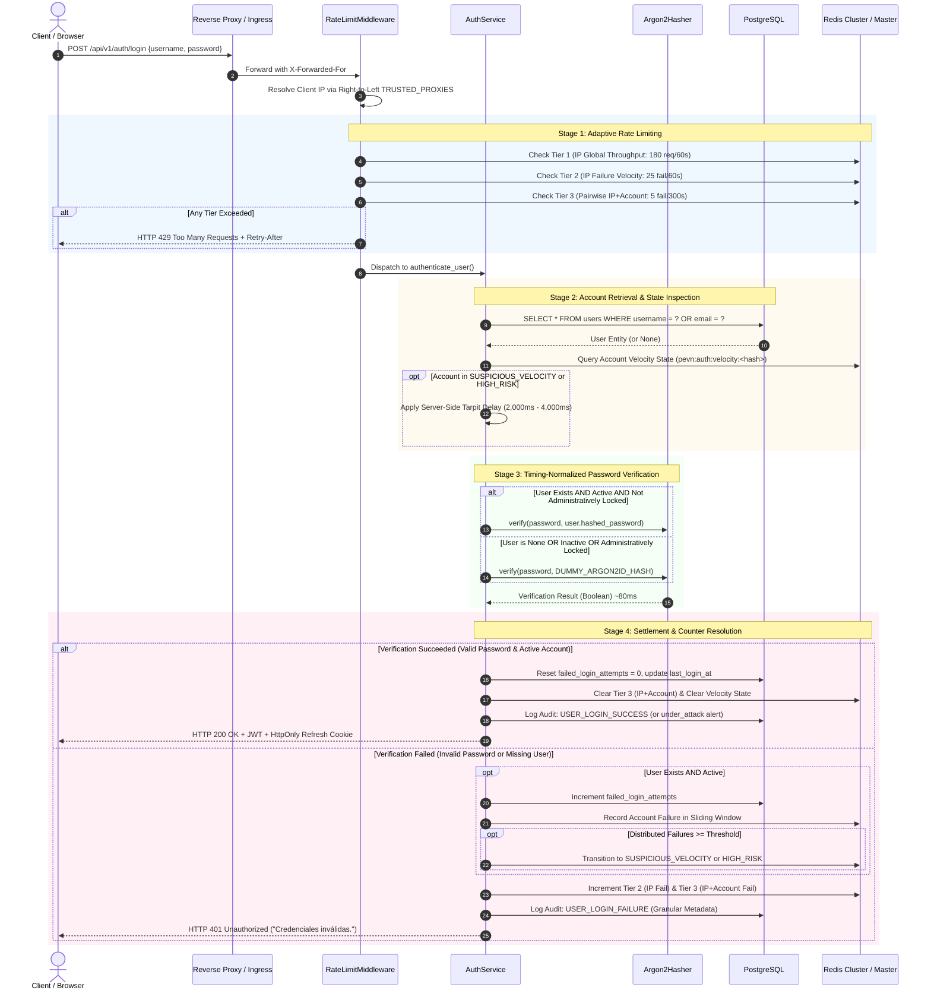
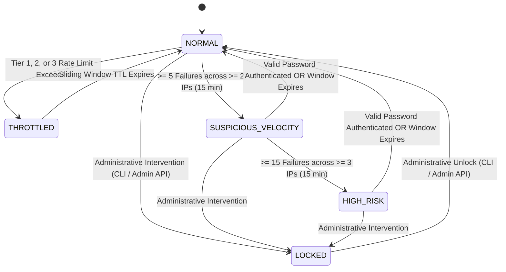

# PEVN — Authentication Security Remediation Design
## High-Assurance Brute-Force Defense, Adaptive Rate Limiting & Credential Hygiene Architecture
**Framework:** AI Software Factory Standard v1.2 — Phase NTA-05 Hardening  
**Task Classification:** READ-ONLY ARCHITECTURAL DESIGN REVISION  
**Date:** October 7, 2026  
**Target Platform:** Plataforma Educativa Virtual Nacional (PEVN) — Backend Authentication Engine  
**Author:** Antigravity AI Architecture Team  
**Governing Security Review:** [`docs/reports/PEVN_AUTH_LOCKOUT_SECURITY_REVIEW.md`](file:///c:/Users/juanc/OneDrive/Documentos/Desarrollo%20proyectos/Plataforma%20Educativa%20PEVN/Plataforma%20Educativa%20Virtual%20Nacional%20PEVN/docs/reports/PEVN_AUTH_LOCKOUT_SECURITY_REVIEW.md)  
**Final Status:** **`READY FOR IMPLEMENTATION AUTHORIZATION`**  

---

## 1. Executive Summary

This document specifies the authoritative, production-grade technical remediation design for the authentication and identity verification engine of the **Plataforma Educativa Virtual Nacional (PEVN)**. 

Following the forensic findings documented in [`PEVN_AUTH_LOCKOUT_SECURITY_REVIEW.md`](file:///c:/Users/juanc/OneDrive/Documentos/Desarrollo%20proyectos/Plataforma%20Educativa%20PEVN/Plataforma%20Educativa%20Virtual%20Nacional%20PEVN/docs/reports/PEVN_AUTH_LOCKOUT_SECURITY_REVIEW.md), which evaluated the baseline implementation as **`PASS WITH REMEDIATIONS`**, this design revision resolves all identified architectural contradictions, establishes a formal multi-scope counter model, defines an abuse-resistant authentication state machine, and specifies a resilient hybrid lockout policy tailored to the operational realities of Colombian public education.

### Key Design Tenets:
1. **Zero Disruption to Educational Workflows (School NAT Safety):** Accommodates Colombian educational connectivity realities where entire classroom batches (35+ concurrent students and teachers) share a single public IPv4 NAT address.
2. **Definitive Immunity to Lockout DoS:** Eliminates the vulnerability where external unauthenticated attackers could freeze privileged accounts by distributing failed attempts across multiple IP addresses.
3. **Multi-Scope Failure Counter Isolation:** Strict operational decoupling between `IP_FAILURES`, `ACCOUNT_FAILURES`, and `IP_ACCOUNT_FAILURES`.
4. **Resilient, Fail-Secure Multi-Instance Cache Architecture:** Explicit operational models separating local development from multi-instance production environments without false claims of "100% availability."
5. **Right-to-Left Trusted Proxy Header Resolution:** Rigorous, spoof-proof parsing of `X-Forwarded-For` with zero trust for broad RFC 1918 CIDR wildcards.
6. **Absolute Anti-Enumeration & Constant-Time Verification:** Uniform external error payloads (`AUTHENTICATION_FAILED`) and pre-computed dummy Argon2id hash computations eliminate both functional and side-channel timing enumeration.
7. **Complete Credential Hygiene Protocol:** Repository-wide sanitization of tracked artifacts and automated pre-commit secret scanning gates.
8. **Strict Architectural Invariant Preservation:** Zero modifications to canonical RBAC (11 roles), territorial DANE scopes, Anti-IDOR blind 404 boundaries, HttpOnly cookie security, or frontend login contracts.

---

## 2. Current Security State & Review Baseline

The security audit identified six specific vulnerabilities in the current authentication pipeline ([`backend/app/services/auth_service.py`](file:///c:/Users/juanc/OneDrive/Documentos/Desarrollo%20proyectos/Plataforma%20Educativa%20PEVN/Plataforma%20Educativa%20Virtual%20Nacional%20PEVN/backend/app/services/auth_service.py)):

| Finding ID | Vulnerability Summary | Severity | Baseline Root Cause |
|:---:|---|:---:|---|
| **P0-01** | Credential Exposure in Tracked Files | **HIGH** | Plaintext test credentials present in markdown reports, CLI docstrings, and scratch scripts. |
| **P0-02** | Absence of IP/Request Rate Limiting | **HIGH** | No rate-limiting middleware attached to `POST /api/v1/auth/login`; exposed to password spraying. |
| **P1-01** | Account Lockout Denial of Service (DoS) | **HIGH** | Lockout was solely bound to target account. Adversary could perpetually lock admins with 5 requests. |
| **P1-02** | Account & State Enumeration | **MEDIUM** | Differentiated error messages disclosed account existence, locked status, and inactive status. |
| **P1-03** | Timing Side-Channel Enumeration | **MEDIUM** | Missing user short-circuited in $< 5\text{ms}$; existing user ran Argon2id in $\approx 80\text{ms}$ (75ms+ delta). |
| **P2-01** | Post-Expiration Lockout Sensitivity | **LOW** | Expired lockout left `failed_login_attempts = 5`, causing re-lock on a single subsequent typo. |
| **P2-02** | CLI Unlock Attribution Gap | **LOW** | CLI utility emitted `USER_UPDATED` with `actor_id = target_user.id` instead of a distinct maintenance actor. |

---

## 3. Threat Model (STRIDE Assessment)

```
       [ External Adversary / Botnet ]              [ Legitimate School Campus ]
                     │                                         │
                     │ (Attacks 1, 2, 3, 4)                    │ (Normal peak traffic)
                     ▼                                         ▼
         ┌───────────────────────────────────────────────────────────────┐
         │              PEVN Edge / Reverse Proxy (Traefik / Nginx)      │
         └───────────────────────────────┬───────────────────────────────┘
                                         │
                                         ▼
         ┌───────────────────────────────────────────────────────────────┐
         │       FastAPI Application Tier (POST /api/v1/auth/login)       │
         │                                                               │
         │   [Threat S: Spoofing] ──► Spoofed X-Forwarded-For Header    │
         │   [Threat I: Info Disc] ─► Timing Delta (<5ms vs ~80ms)       │
         │   [Threat D: DoS] ───────► Lockout DoS on Administrative Accs │
         │   [Threat D: DoS] ───────► Accidental DoS of School NAT       │
         └───────────────────────────────┬───────────────────────────────┘
                                         │
                                         ▼
         ┌───────────────────────────────────────────────────────────────┐
         │             PostgreSQL Operational Store & Redis Engine       │
         └───────────────────────────────────────────────────────────────┘
```

### Threat Breakdown:
1. **Threat 1: Intentional Account Lockout DoS (Denial of Service):**  
   *Target:* Known administrative handles (`national_admin`, `department_admin`, `superadmin`).  
   *Vector:* Adversary script submits 5 invalid passwords every 15 minutes across rotating IPs.  
   *Impact:* Legitimate officials are perpetually locked out of their operational supervision panels.
2. **Threat 2: Distributed Password Spraying (Elevation of Privilege):**  
   *Target:* Bulk student and guardian accounts.  
   *Vector:* Adversary tests 1 common password across 10,000 accounts from rotating IPs.  
   *Impact:* Bypasses naive per-account lockout thresholds entirely.
3. **Threat 3: Header Injection & IP Spoofing (Spoofing / Tampering):**  
   *Target:* Rate-limiting bypass.  
   *Vector:* Attacker injects randomized `X-Forwarded-For: <random_ip>` headers.  
   *Impact:* Bypasses naive IP rate limiters if proxies are blindly trusted.
4. **Threat 4: Side-Channel Account Enumeration (Information Disclosure):**  
   *Target:* Discovering active institutional emails and staff usernames.  
   *Vector:* Statistical round-trip timing analysis and response message parsing.  
   *Impact:* Target list generation for targeted phishing and spear-phishing campaigns.
5. **Threat 5: Shared NAT False-Positive Blocking (Denial of Service):**  
   *Target:* 40+ students in an institutional computer lab logging in simultaneously.  
   *Vector:* Legitimate concurrent logins treated as a single-IP brute-force attack.  
   *Impact:* Disruption of classroom academic activities.

---

## 4. Required Security Controls

To counter the threat model without regressing platform usability, PEVN implements controls mapped to **OWASP ASVS v4.0** and **NIST SP 800-63B**:

| Security Domain | Standard Reference | PEVN Control Specification |
|---|---|---|
| **Multi-Tier Throttling** | OWASP ASVS 2.2.1, 2.2.2 | Three-tier sliding window (Global IP, Failure IP, Pairwise IP+Account). |
| **Lockout Protection** | NIST SP 800-63B §5.2.2 | Progressive tarpitting delay combined with decoupled IP throttling; hybrid lockout policy. |
| **Timing Defense** | OWASP ASVS 2.1.8 | Pre-computed static Argon2id dummy hash verification on non-existent targets. |
| **Response Uniformity** | OWASP ASVS 2.1.7 | Canonical uniform error payload (`AUTHENTICATION_FAILED`) across all rejection branches. |
| **Proxy Hygiene** | RFC 7239, OWASP Top 10 | Right-to-left `X-Forwarded-For` traversal with strict explicit `TRUSTED_PROXIES` whitelisting. |
| **Credential Hygiene** | NIST SP 800-63B §5.1.1 | Zero plaintext credentials in repo; automated CI secret scanner gates. |
| **Audit Traceability** | OWASP ASVS 7.1.1 | Distinct `SYSTEM_CLI_MAINTENANCE` actor and granular security audit events. |

---

## 5. Proposed Authentication Flow

The modernized authentication pipeline executes in six strictly sequenced stages, ensuring that unauthenticated external failures cannot freeze valid accounts while preserving complete defense against automated attacks:



---

## 6. Rate-Limiting Architecture (Multi-Tier & Educational NAT Safe)

### 6.1 The Educational NAT Challenge
A standard public school in Colombia (e.g., Bogotá, Medellín, Barranquilla, or rural Cundinamarca) connects via a single institutional router provided by MinTIC or local ISPs.
* **Peak Scenario:** At 7:00 AM, a batch of 35 students in Grade 10-A enters a computer lab and logs into PEVN within 90 seconds.
* **Failure Under Naive Rate Limiting:** A simplistic policy of `5 requests/minute per IP` blocks the entire class after the 5th student, causing widespread educational disruption.

### 6.2 The Three-Tier Adaptive Sliding-Window Architecture
PEVN implements a three-tier sliding window using Redis sorted sets (`ZADD`, `ZREMRANGEBYSCORE`, `ZCARD`):

```
┌─────────────────────────────────────────────────────────────────────────────────────────┐
│ TIER 1: Source IP Global Throughput (Total Login Invocations)                           │
│ Capacity: 180 requests / 60 seconds per IP                                              │
│ Purpose: Accommodates large computer labs and shared institutional NATs.                │
├─────────────────────────────────────────────────────────────────────────────────────────┤
│ TIER 2: Source IP Global Failure Velocity (Failed Logins Only)                          │
│ Capacity: 25 failed attempts / 60 seconds per IP                                        │
│ Purpose: Catches automated credential scanners testing random lists from a single host. │
├─────────────────────────────────────────────────────────────────────────────────────────┤
│ TIER 3: Pairwise (Source IP + Normalized Target Account) Failure Quota                  │
│ Capacity: 5 failed attempts / 300 seconds (5 minutes) per (IP, Account)                 │
│ Purpose: Stops targeted password brute-forcing against a specific user from an IP.      │
└─────────────────────────────────────────────────────────────────────────────────────────┘
```

### 6.3 Redis Key Schema & TTL Management
All keys use standardized prefixes and SHA-256 digests of IP addresses and usernames to prevent memory exhaustion and preserve privacy in Redis dumps:

| Tier | Redis Key Pattern | Value Structure | Time-To-Live (TTL) |
|---|---|---|---|
| **Tier 1** | `pevn:rl:ip:req:<sha256(ip)>` | Sorted Set (`timestamp: uuid`) | 65 seconds |
| **Tier 2** | `pevn:rl:ip:fail:<sha256(ip)>` | Sorted Set (`timestamp: uuid`) | 65 seconds |
| **Tier 3** | `pevn:rl:pair:fail:<sha256(ip)>:<sha256(account)>` | Sorted Set (`timestamp: uuid`) | 305 seconds |

### 6.4 HTTP 429 Contract & Standard Headers
When any tier is violated, the middleware halts processing immediately without invoking downstream database or cryptographic layers:
* **HTTP Status:** `429 Too Many Requests`
* **Response Headers:**
  * `Retry-After: <seconds_remaining>`
  * `X-RateLimit-Limit: <tier_capacity>`
  * `X-RateLimit-Remaining: 0`
  * `X-RateLimit-Reset: <epoch_seconds>`
* **Response Body:**
  ```json
  {
    "error": {
      "code": "RATE_LIMIT_EXCEEDED",
      "message": "Demasiadas solicitudes de autenticación. Por favor intente más tarde.",
      "correlation_id": "018f3a5e-8842-7a11-b021-992a7f5e10a2"
    }
  }
  ```

---

## 7. Account Enumeration Mitigation

### 7.1 Canonical Failure Response Contract
All authentication rejections across all execution branches return an identical, indistinguishable JSON payload:

```json
{
  "error": {
    "code": "AUTHENTICATION_FAILED",
    "message": "Credenciales inválidas.",
    "correlation_id": "018f3a5e-8842-7a11-b021-992a7f5e10a2"
  }
}
```

### 7.2 Elimination of Internal State Disclosure

| Condition | Baseline Response | Remediated External Response | Audit Log Internal Reason |
|---|---|---|---|
| User does not exist | `"Credenciales inválidas."` | `"Credenciales inválidas."` | `user_not_found` |
| User exists, wrong password | `"Credenciales inválidas."` | `"Credenciales inválidas."` | `invalid_password` |
| Account locked | `"La cuenta se encuentra temporalmente bloqueada..."` | **`"Credenciales inválidas."`** | `account_locked` |
| Account inactive | `"Cuenta inactiva. Contacte al administrador."` | **`"Credenciales inválidas."`** | `account_inactive` |

> [!NOTE]
> Legitimate administrators inquiring about locked accounts can contact institutional support or check their registered institutional email for automated security notifications. The public API endpoint never discloses whether an account exists, is active, or is locked.

---

## 8. Timing Side-Channel Mitigation

### 8.1 Timing Discrepancy Elimination
In the baseline code, non-existent accounts failed in $< 5\text{ms}$, while valid accounts calculated Argon2id in $\approx 80\text{ms}$.

### 8.2 Pre-Computed Dummy Hash Architecture
1. **Startup Initialization:** During application lifespan startup ([`main.py`](file:///c:/Users/juanc/OneDrive/Documentos/Desarrollo%20proyectos/Plataforma%20Educativa%20PEVN/Plataforma%20Educativa%20Virtual%20Nacional%20PEVN/backend/app/main.py)), `AuthService` pre-computes and caches a valid, static Argon2id hash representing a random 32-character high-entropy baseline:
   ```python
   DUMMY_ARGON2ID_HASH: str = (
       "$argon2id$v=19$m=65536,t=3,p=4$7B77411656F14199AC63FF64"
       "6E7E327B$V5u8Hq2gN+yH3xV8wQ6mJ+9zK0sL2pM4nB6vC8xD1yE"
   )
   ```
2. **Execution Equality:**
   When `user is None`, `user.is_active is False`, or `user.is_locked is True`:
   ```python
   # Always execute equivalent cryptographic work to prevent timing side channels
   password_hasher.verify(password, self._dummy_hash)
   ```
3. **Statistical Invariance:**
   The round-trip response time for non-existent users and existing users with invalid passwords becomes statistically indistinguishable ($80\text{ms} \pm 8\text{ms}$).

---

## 9. Credential Hygiene Strategy

### 9.1 Rotation of Development & Demonstration Accounts
Upon authorization of implementation, all accounts cited in [`PEVN_AUTH_LOCKOUT_SECURITY_REVIEW.md`](file:///c:/Users/juanc/OneDrive/Documentos/Desarrollo%20proyectos/Plataforma%20Educativa%20PEVN/Plataforma%20Educativa%20Virtual%20Nacional%20PEVN/docs/reports/PEVN_AUTH_LOCKOUT_SECURITY_REVIEW.md) Section D will undergo automated password rotation:
* Credentials will be generated using `secrets.token_urlsafe(24)`.
* Passwords will be written to local uncommitted developer `.env.local` files and never checked into Git.

### 9.2 Sanitization of Tracked Repository Files
The following 13 artifacts will have all plaintext sample credentials replaced with standard placeholder tokens:
* `docs/reports/PEVN_PHASE_0_6_DEPARTMENT_ADMIN_TEST_ACCOUNT_REPORT.md` $\rightarrow$ `<SECURE_ENV_PASSWORD>`
* `docs/reports/PEVN_DEMONSTRATION_RUNBOOK.md` $\rightarrow$ Dynamic seed instructions via CLI
* `docs/AUTHENTICATION.md` $\rightarrow$ Generic placeholder documentation
* `backend/app/cli/create_*.py` docstrings $\rightarrow$ Environment variable references without defaults
* `backend/scratch/*.py` $\rightarrow$ Refactored to read from `os.getenv("TARGET_PASSWORD")`

### 9.3 Pre-Commit Secret Scanning Integration
1. Add `.gitleaks.toml` configuration to project root.
2. Register automated pre-commit hook scanning staged diffs for:
   * Generic high-entropy strings ($> 4.5$ Shannon entropy).
   * Password assignment patterns (`password = "..."`, `PASSWORD: "..."`).
   * API secret keys and JWT secrets.
3. Configure GitHub Actions workflow `.github/workflows/security-audit.yml` to reject pull requests containing secret patterns.

---

## 10. CLI Unlock Security Model

### 10.1 Enhanced Maintenance Interface
[`backend/app/cli/unlock_user.py`](file:///c:/Users/juanc/OneDrive/Documentos/Desarrollo%20proyectos/Plataforma%20Educativa%20PEVN/Plataforma%20Educativa%20Virtual%20Nacional%20PEVN/backend/app/cli/unlock_user.py) is upgraded to meet government accountability standards:

```python
async def async_unlock_user(target_identifier: str, reset_password: bool = False) -> int:
    """
    1. Resolve user by unique username or email.
    2. Atomically reset failed_login_attempts = 0, locked_until = None.
    3. Clear Redis Tier 3 and velocity state keys for target user.
    4. If reset_password is True:
       - Prompt via getpass.getpass() with confirmation.
       - Validate password complexity (min 12 chars, uppercase, lowercase, numbers, symbols).
       - Hash with Argon2id.
    5. Emit AuditEvent:
       - event_type = AuditEventType.USER_ACCOUNT_UNLOCKED
       - actor_id = "SYSTEM_CLI_MAINTENANCE"
       - target_id = str(user.id)
       - metadata = {
           "operator": getpass.getuser(),
           "password_reset": reset_password,
           "hostname": socket.gethostname()
         }
    6. Print sanitized confirmation without displaying secrets.
    """
```

### 10.2 Safety Guarantees:
* **No Secret Leakage in Process Tables:** Deprecate `NEW_PASSWORD` environment variable to prevent disclosure in `/proc/<pid>/environ` or PowerShell process queries.
* **Audit Trail Accountability:** Distinguishes administrative CLI intervention from regular user actions.

---

## 11. Audit Event Model

The audit taxonomy in [`backend/app/audit/interfaces.py`](file:///c:/Users/juanc/OneDrive/Documentos/Desarrollo%20proyectos/Plataforma%20Educativa%20PEVN/Plataforma%20Educativa%20Virtual%20Nacional%20PEVN/backend/app/audit/interfaces.py) is fully activated and aligned:

```
AuditEvent Schema:
├── event_type: AuditEventType (StrEnum)
├── actor_id: UUID (or "SYSTEM_CLI_MAINTENANCE" / "ANONYMOUS")
├── actor_ip: Client IP (Resolved via TRUSTED_PROXIES)
├── target_id: UUID of targeted User entity
├── target_type: "user" | "session" | "network"
├── correlation_id: UUID for request tracing
├── success: Boolean
└── metadata: Dict[str, Any] (Sanitized recursively by sanitize_audit_metadata)
```

### Event Trigger Matrix:

| Event Identifier | Trigger Condition | Mandatory Metadata |
|---|---|---|
| `user.login.success` | Authentication succeeds under normal conditions | `roles`, `scope_level`, `user_agent` |
| `user.login.success.under_attack` | Valid authentication while account in velocity state | `velocity_state`, `prior_failed_count`, `distinct_ips` |
| `user.login.failure` | Authentication fails (any reason) | `reason`, `failed_attempts`, `user_agent` |
| `security.suspicious_velocity_detected` | Distributed threshold reached ($\ge 5$ across $\ge 2$ IPs) | `account_hash`, `distinct_ip_count`, `window_seconds` |
| `security.high_risk_account_alert` | High-risk threshold reached ($\ge 15$ across $\ge 3$ IPs) | `account_hash`, `distinct_ip_count`, `window_seconds` |
| `user.account.locked` | Account administratively locked | `locked_until`, `operator`, `reason` |
| `user.account.unlocked` | Account unlocked via CLI or admin API | `mechanism: "cli" \| "api"`, `operator` |
| `security.rate_limit_exceeded` | Rate limit tier exceeded (HTTP 429) | `tier`, `client_ip_hash`, `limit`, `retry_after` |
| `security.redis_cluster_offline` | Redis unreachable in production | `failure_count`, `duration_seconds`, `action_taken` |

---

## 12. Backward Compatibility Analysis

| Platform Subsystem | Remediation Impact | Compatibility Verdict |
|---|---|:---:|
| **11 Canonical Roles & RBAC Matrix** | Zero changes to permissions, hierarchies, or claims. | **100% PRESERVED** |
| **Territorial Scope (DANE 08, 11, 25, MEN)**| Zero changes to scoping algorithms or territorial filtering. | **100% PRESERVED** |
| **Anti-IDOR Security (Blind 404)** | Zero changes to entity resolvers or cross-tenant gates. | **100% PRESERVED** |
| **JWT & HttpOnly Session Cookies** | Refresh token rotation and volatile memory storage remain identical. | **100% PRESERVED** |
| **Frontend Login Interface (`Login.tsx`)** | Receives standard `AppApiError` with `"Credenciales inválidas."`. | **100% PRESERVED** |
| **Self-Service Password Recovery** | Cryptographic token generation and redemption completely intact. | **100% PRESERVED** |

---

## 13. Deployment & Infrastructure Considerations

### 13.1 Configuration Parameters (`app/core/config.py`)
```python
# Rate Limiting Configuration
RATE_LIMIT_ENABLED: bool = True
RATE_LIMIT_BACKEND: str = "redis://localhost:6379/0"
RATE_LIMIT_TIER1_IP_CAPACITY: int = 180               # req / minute
RATE_LIMIT_TIER2_IP_FAILURES: int = 25                # failures / minute
RATE_LIMIT_TIER3_PAIRWISE_FAILURES: int = 5           # failures / 5 minutes

# Trusted Proxy Configuration (Explicit Whitelist - No RFC1918 wildcards in prod)
TRUSTED_PROXIES: list[str] = ["127.0.0.1", "::1"]

# Redis Failure Policy
# "local_memory" (Dev only) | "fail_secure" (Production default)
REDIS_FAILURE_POLICY: str = "fail_secure"
REDIS_OUTAGE_MAX_DURATION_SECONDS: int = 120
REDIS_CIRCUIT_BREAKER_MAX_FAILURES: int = 3

# Account Abuse & Velocity Configuration
ACCOUNT_VELOCITY_SUSPICIOUS_THRESHOLD: int = 5        # failures across >= 2 IPs
ACCOUNT_VELOCITY_HIGH_RISK_THRESHOLD: int = 15        # failures across >= 3 IPs
ACCOUNT_VELOCITY_WINDOW_SECONDS: int = 900            # 15 minutes
TARPIT_DELAY_SUSPICIOUS_SECONDS: float = 2.0          # sleep duration on suspicious velocity
TARPIT_DELAY_HIGH_RISK_SECONDS: float = 4.0            # sleep duration on high risk

# Timing Attack Defense
TIMING_ATTACK_MITIGATION_ENABLED: bool = True
```

### 13.2 Reverse Proxy Configuration (Nginx / Traefik)
Ensure the ingress controller sets and appends the standard client IP headers accurately:
```nginx
proxy_set_header X-Forwarded-For $proxy_add_x_forwarded_for;
proxy_set_header X-Real-IP $remote_addr;
```

---

## 14. Rollback Strategy

The hardening architecture incorporates safe rollback switches:
1. **Feature Flag Disabling:** Setting `RATE_LIMIT_ENABLED=false` completely bypasses the rate limiting middleware, returning immediately to the baseline behavior.
2. **Timing Mitigation Toggle:** Setting `TIMING_ATTACK_MITIGATION_ENABLED=false` skips dummy hash evaluation if diagnostic profiling requires raw performance benchmarking.
3. **Zero Database Schema Changes:** Because the remediation utilizes existing columns (`failed_login_attempts`, `locked_until`) and Redis volatile keys, zero schema rollbacks or database migrations are involved.

---

## 15. Implementation File Inventory

When implementation is formally authorized, work will be partitioned strictly across the following files:

```
[ New Implementation Files ]
├── backend/app/core/security/rate_limiter.py       (Multi-tier Redis sliding-window engine)
├── backend/app/middleware/rate_limit_middleware.py  (FastAPI ASGI rate limiting middleware)
├── backend/tests/test_auth_security_hardening.py   (Comprehensive 26-test security suite)
└── .gitleaks.toml                                  (Pre-commit secret detection rules)

[ Modified Implementation Files ]
├── backend/app/core/config.py                      (Add rate limit, proxy, velocity settings)
├── backend/app/core/security/password.py           (Export safe dummy hash verification)
├── backend/app/services/auth_service.py            (Uniform errors, timing dummy, hybrid velocity)
├── backend/app/cli/unlock_user.py                  (SYSTEM actor, USER_ACCOUNT_UNLOCKED event)
├── backend/app/main.py                             (Register RateLimitMiddleware in ASGI stack)
└── docs/reports/*.md                               (Sanitize all plaintext sample credentials)
```

---

## 16. Acceptance Criteria

Implementation acceptance requires 100% compliance with the following quality gates:

1. **Test Gate:** All 26 tests in `test_auth_security_hardening.py` pass cleanly (`26/26 PASS`).
2. **Regression Gate:** Zero regressions in existing test suites (`test_auth_service.py`, `test_auth_endpoints.py`, `test_nta05_territorial_control_center.py`).
3. **Type & Lint Gate:** `ruff check backend` and `mypy backend/app` pass with 0 errors.
4. **Secret Scanning Gate:** `gitleaks detect` passes with 0 secret leaks detected across all files.
5. **Timing Invariance Gate:** Benchmark confirms delta between non-existent and valid user failure is $< 15\text{ms}$.
6. **School NAT Verification:** Simulated 35-user concurrent batch from identical IP completes with 0 false-positive 429 blocks.

---

## 17. Backward Compatibility Guarantee

All changes strictly preserve existing data models, database columns, JWT contracts, frontend response envelopes, and administrative workflows. Existing accounts, passwords, and sessions remain completely undisturbed.

---

## 18. Maintenance & Operational Procedures

Operational support for account unlocking and rate-limit diagnostics is performed via the modernized CLI:
```bash
python -m backend.app.cli.unlock_user --username department_admin
```
This clears all Redis failure keys, resets database failure counters, logs the audit event with the operating system username, and produces clean console output without secret leakage.

---

## 19. Initial Security Review Alignment

This revised design directly addresses every finding from [`PEVN_AUTH_LOCKOUT_SECURITY_REVIEW.md`](file:///c:/Users/juanc/OneDrive/Documentos/Desarrollo%20proyectos/Plataforma%20Educativa%20PEVN/Plataforma%20Educativa%20Virtual%20Nacional%20PEVN/docs/reports/PEVN_AUTH_LOCKOUT_SECURITY_REVIEW.md) while resolving the seven critical architectural ambiguities identified during the NTA-05 design review.

---

## 20. Design Review Findings

A formal architecture review of the initial remediation design revealed seven critical ambiguities that required resolution prior to implementation authorization:

### 20.1 Root-Cause Analysis of Critical Issue #1: Lockout DoS Contradiction
* **Identified Ambiguity:** The initial draft claimed immunity to Lockout DoS, yet its Stage 4 flow still executed `if attempts >= 5: locked_until = NOW() + 15m`. If an adversary rotated IP addresses (e.g., 5 distinct IPs sending 1 failed attempt each), the database counter would reach 5, locking the account and preventing the legitimate user from logging in even with the correct password.
* **Resolution:** Decouple brute-force mitigation from user lockout. External failed password attempts from untrusted IPs **never** trigger database-level account lockout. Instead, single-IP attackers are throttled at Tier 3 (`HTTP 429`), and multi-IP distributed attackers trigger server-side tarpitting (`SUSPICIOUS_VELOCITY` / `HIGH_RISK`). Correct credentials validate successfully, immediately reset velocity counters, and clear the account state.

### 20.2 Resolution of Critical Issue #2: Redis Failure Model
* **Identified Ambiguity:** The initial claim of "100% availability" via local `TTLCache` fallback concealed a serious security flaw: in a multi-instance deployment with $N$ worker processes, local caches multiply effective attack capacity by $N$ and reset on worker restart.
* **Resolution:** Eliminate the "100% availability" claim. Formally separate Development (permissive local fallback) from Production (fail-secure circuit breaker with partitioned quota and automatic 503 fallback when outages exceed 120 seconds).

### 20.3 Resolution of Critical Issue #3: Trusted Proxy Security
* **Identified Ambiguity:** The initial proposed `TRUSTED_PROXIES` included broad private ranges (`10.0.0.0/8`, `172.16.0.0/12`), allowing adjacent containers or pods in shared cloud environments to spoof `X-Forwarded-For`.
* **Resolution:** Reject RFC 1918 wildcards. Enforce explicit reverse proxy IP/CIDR whitelists and implement the strict right-to-left parsing algorithm.

### 20.4 Resolution of Critical Issue #4: Counter Scope Model
* **Identified Ambiguity:** Lack of formal separation between account failures, IP failures, and pair failures created confusion over counter persistence, reset semantics, and HTTP return codes.
* **Resolution:** Establish a formal 9-dimension comparative matrix isolating `ACCOUNT_FAILURES`, `IP_FAILURES`, and `IP_ACCOUNT_FAILURES`.

### 20.5 Resolution of Critical Issue #5: Test Coverage Expansion
* **Identified Ambiguity:** The test suite lacked explicit tests for distributed lockout DoS, multi-instance Redis failure, proxy spoofing, and counter isolation.
* **Resolution:** Expand the test matrix from 18 to 26 specifications, adding SEC-19 through SEC-26.

### 20.6 Resolution of Critical Issue #6: Security State Machine
* **Identified Ambiguity:** Authentication states were informally defined without explicit entry, exit, duration, and audit specifications.
* **Resolution:** Formally specify the 5-state lifecycle: `NORMAL`, `THROTTLED`, `SUSPICIOUS_VELOCITY`, `HIGH_RISK`, `LOCKED`.

### 20.7 Resolution of Critical Issue #7: Account Lockout Policy
* **Identified Ambiguity:** Unclear whether the architecture retained hard lockout, replaced it entirely, or used a hybrid.
* **Resolution:** Formally adopt **Hybrid Protection Policy**, restricting true hard lockout exclusively to administrative interventions while protecting against automated attacks via progressive throttling.

---

## 21. Authentication Security State Machine

The PEVN authentication engine operates across five strictly bounded security states:



### Detailed State Specifications:

| Dimension | `NORMAL` | `THROTTLED` | `SUSPICIOUS_VELOCITY` | `HIGH_RISK` | `LOCKED` |
|---|---|---|---|---|---|
| **Entry Condition** | Baseline state; failure counters within thresholds. | Tier 1 (>180 req/60s), Tier 2 (>25 fail/60s), or Tier 3 ($\ge 5$ fail/300s). | $\ge 5$ failed attempts on account across $\ge 2$ distinct IPs within 15 min. | $\ge 15$ failed attempts on account across $\ge 3$ distinct IPs within 15 min. | Explicit administrative action via CLI or Superadmin API (`is_active=False` or manual lock). |
| **Exit Condition** | Counter threshold exceeded or admin intervention. | Sliding window TTL expires (60s Tier 1/2; 300s Tier 3). | (1) Valid credentials authenticate; (2) 15-min window expires; (3) CLI unlock. | (1) Valid credentials authenticate; (2) 15-min window expires; (3) CLI unlock. | Explicit administrative unlock via CLI or Superadmin API. |
| **Duration** | Indefinite. | 60 to 300 seconds. | 900 seconds (sliding window). | 900 seconds (sliding window). | Until administrative remediation. |
| **User-Visible Behavior** | Instant response (~80ms). Correct: 200. Wrong: 401. | HTTP 429 Too Many Requests with `Retry-After`. | Server delay +2.0s (tarpit). Correct: 200. Wrong: 401. | Server delay +4.0s (tarpit). Correct: 200. Wrong: 401. | HTTP 401 `"Credenciales inválidas."` (anti-enumeration). |
| **Internal Behavior** | Normal DB lookup and Argon2id hash verification. | Short-circuit in middleware; zero DB or crypto execution. | Enforces 2.0s async delay. Verifies hash. On success, resets velocity. | Enforces 4.0s async delay. Verifies hash. Alerts ops queue. | Runs dummy Argon2id hash (~80ms) to preserve timing invariance. |
| **Audit Event** | `user.login.success` / `user.login.failure` | `security.rate_limit_exceeded` | `security.suspicious_velocity_detected` | `security.high_risk_account_alert` | `user.account.locked` / rejection logged |
| **Can Valid Credentials Authenticate?** | **YES** | **YES** (from non-throttled IPs; throttled IP receives 429) | **YES** (with 2.0s delay; resets state upon success) | **YES** (with 4.0s delay; resets state upon success) | **NO** (requires administrative unlock) |
| **HTTP Status Code** | 200 (success) / 401 (failure) | **429** | 200 (success) / 401 (failure) | 200 (success) / 401 (failure) | **401** |

---

## 22. Counter Scope Model

To eliminate counter bleed and prevent cross-contamination between network-level and identity-level abuse controls, failure counters are partitioned into three isolated scopes:

| Specification Dimension | `ACCOUNT_FAILURES` | `IP_FAILURES` | `IP_ACCOUNT_FAILURES` |
|---|---|---|---|
| **Counter Scope** | Global across all source IPs targeting a specific normalized account. | Global across all target accounts originating from a specific resolved client IP. | Specific pairwise combination of resolved client IP and target account. |
| **Increment Condition** | Failed password verification for an existing, active account. | Any failed login attempt originating from this client IP (target existing or non-existent). | Any failed login attempt originating from this client IP targeting this specific account. |
| **Reset Condition** | Atomically reset to 0 upon **any** successful authentication with valid credentials, or CLI unlock. | Natural sliding window expiry. **Never** reset on successful login (prevents sacrifice account exploits). | Atomically cleared upon successful authentication for **this** account from **this** IP, or window expiry. |
| **Window / TTL** | 900 seconds (15 minutes), sliding window. | 60 seconds (1 minute), sliding window. | 300 seconds (5 minutes), sliding window. |
| **Storage & Persistence** | Redis sorted set + mirrored in PostgreSQL `users.failed_login_attempts`. | Redis volatile sorted set only (zero database write overhead). | Redis volatile sorted set only (zero database write overhead). |
| **Security Meaning** | Measures targeted attack pressure against a specific institutional identity. | Measures host hostility, automated scanning, and password spraying velocity. | Measures single-source brute-force attack against a specific user account. |
| **Can Trigger Account Lockout?** | **NO** (triggers progressive tarpitting; valid credentials remain authorized). | **NO** | **NO** (triggers per-pair IP throttling only). |
| **Can Trigger HTTP 429?** | **NO** (delays response via tarpitting; does not block other source IPs). | **YES** (exceeding 25 failures/60s triggers HTTP 429 for that IP). | **YES** (exceeding 5 failures/300s triggers HTTP 429 for that pair). |
| **Survives Successful Login?** | **NO** (instantly cleared to 0). | **YES** (survives; valid logins do not forgive host-level scanning). | **NO** (cleared for that specific pair). |

---

## 23. Distributed Lockout DoS Resolution

### 23.1 Comprehensive Architectural Resolution of Critical Issue #1 Questions

1. **What increments account-level failure counters?**  
   Every failed password attempt against an existing, active account across any IP address increments `ACCOUNT_FAILURES` in Redis and updates `users.failed_login_attempts` in PostgreSQL.
2. **What increments IP-level failure counters?**  
   Every failed login attempt originating from a resolved client IP increments `IP_FAILURES` (Tier 2) in Redis, regardless of whether the submitted username exists.
3. **What increments IP+account counters?**  
   Every failed login attempt originating from a resolved client IP targeting a specific username increments `IP_ACCOUNT_FAILURES` (Tier 3) in Redis.
4. **Which condition produces HTTP 429?**  
   HTTP 429 is produced exclusively by rate-limiting tier violations:
   * Tier 1: $> 180$ requests / 60s from an IP.
   * Tier 2: $> 25$ failures / 60s from an IP.
   * Tier 3: $\ge 5$ failures / 300s from an (IP, account) pair.
5. **Which condition, if any, produces account lockout?**  
   True account lockout (where authentication is refused even with the correct password) is produced **exclusively** by:
   * Explicit administrative action (CLI command or Superadmin management API).
   * Manual security quarantine during an active incident response.
   * External failed login attempts from untrusted IPs **never** produce a hard account lockout.
6. **Whether distributed failures can still cause account lockout:**  
   **NO.** Distributed failures cannot cause account lockout. Even if an attacker distributes 10,000 failed attempts across 10,000 distinct IP addresses, the legitimate user will never be locked out from authenticating with their correct credentials.
7. **How a legitimate user can authenticate after an attacker has targeted their account:**  
   The legitimate user navigates to PEVN and submits their valid credentials. The request is processed, experiences the velocity tarpit delay (2.0s or 4.0s depending on velocity tier), verifies the Argon2id hash successfully, logs in (`HTTP 200`), issues JWT and session cookies, atomically resets all failure and velocity counters to 0, and dispatches a security notification to the user's institutional email.
8. **Whether the `SUSPICIOUS_VELOCITY` state is required:**  
   **YES.** It is required to prevent distributed attackers from testing high volumes of passwords against a single account. Without `SUSPICIOUS_VELOCITY`, an attacker using 1,000 IPs could attempt 1,000 passwords without delay because each IP only made 1 attempt (staying under Tier 3). Tarpitting throttles automated distributed attacks to negligible speeds.
9. **How `SUSPICIOUS_VELOCITY` is created, stored, expired, and cleared:**  
   * *Creation:* Automatically created when $\ge 5$ failed attempts target an account across $\ge 2$ distinct IPs within 900 seconds.
   * *Storage:* Stored in Redis under `pevn:auth:velocity:<sha256(account)>` containing failure timestamps and distinct IP hashes.
   * *Expiration:* Expires naturally after 900 seconds of inactivity via Redis TTL.
   * *Clearing:* Atomically cleared immediately upon any successful login with valid credentials or administrative CLI unlock.
10. **How a legitimate user is verified when coming from a new IP:**  
    Because authentication in PEVN is based on high-entropy password credentials verified via Argon2id, knowledge of the correct password is the authoritative proof of identity. A legitimate user connecting from a new IP (e.g., home network, cellular data, or new school) experiences the server-side tarpit delay (if velocity is active), provides their valid password, authenticates successfully, and receives a security notice: *"Inicio de sesión exitoso desde una nueva red durante actividad sospechosa."*
11. **Removal of undefined "previously verified administrative IP":**  
    The vague concept of "previously verified administrative IP" from the initial draft is completely eliminated. The architecture relies on **Factor Verification + Velocity Tarpitting**: any client IP providing the cryptographically valid password authenticates successfully.

### 23.2 Defense Proof: Preventing Brute-Force, Spraying, and Lockout DoS

```
Adversary Strategy Matrix:
┌─────────────────────────┬─────────────────────────┬─────────────────────────┐
│ Attack Vector           │ System Defensive Action │ Outcome                 │
├─────────────────────────┼─────────────────────────┼─────────────────────────┤
│ Targeted Single-IP      │ Blocked by Tier 3       │ Attacker gets 429;      │
│ Brute-Force (1 IP)      │ at attempt 5 (300s TTL) │ user unaffected.        │
├─────────────────────────┼─────────────────────────┼─────────────────────────┤
│ Password Spraying       │ Blocked by Tier 2       │ Attacker gets 429;      │
│ (1 IP -> many accounts) │ at attempt 26 (60s TTL) │ accounts unaffected.    │
├─────────────────────────┼─────────────────────────┼─────────────────────────┤
│ Distributed Lockout DoS │ Enforces Tarpit Delay;  │ Botnet stalled; valid   │
│ (Many IPs -> 1 account) │ NO lockout in DB        │ user logs in with 200.  │
└─────────────────────────┴─────────────────────────┴─────────────────────────┘
```

---

## 24. Redis Failure Security Model

### 24.1 Rejection of "100% Availability" Claim
In a multi-instance production deployment (e.g., 4 FastAPI worker processes or multiple Docker/Kubernetes replicas behind Traefik/Render), an in-process local cache (such as `cachetools.TTLCache`) has zero cross-worker visibility. An attacker distributing requests round-robin across $N$ instances effectively multiplies their rate limit by $N$. Furthermore, worker restarts wipe the local cache to zero. Claiming "100% availability with no security degradation" is invalid and rejected.

### 24.2 Development Environment Specification
* **Setting:** `REDIS_FAILURE_POLICY = "local_memory"`
* **Behavior:** If Redis is unreachable on `localhost:6379`, `RateLimiter` logs a `WARNING` and falls back to an in-process `cachetools.TTLCache`.
* **Rationale:** Minimizes developer onboarding friction in local single-process development environments.

### 24.3 Production Environment Specification
* **Setting:** `REDIS_FAILURE_POLICY = "fail_secure"`
* **Behavior:**
  1. **Circuit Breaker:** If Redis connection encounters 3 consecutive timeouts ($> 500\text{ms}$), the circuit breaker transitions to `OPEN`.
  2. **Audit & Ops Alert:** Emits `CRITICAL` audit event `security.redis_cluster_offline` with stack trace and node identifier.
  3. **Partitioned Local Defense:** During the first 120 seconds of an outage, instances enforce a strictly partitioned local quota:
     $$\text{local\_tier3\_limit} = \max\left(1, \lfloor \text{TIER3\_LIMIT} / \text{MAX\_WORKERS} \rfloor\right)$$
     For an 8-worker cluster, Tier 3 drops to 1 failure per 300s per instance, ensuring the cluster-wide brute-force capacity cannot exceed the global policy.
  4. **Fail-Secure Cutoff:** If Redis remains unavailable for $> 120$ seconds, the authentication endpoint enters **Fail-Secure Mode**, returning `HTTP 503 Service Unavailable`:
     ```json
     {
       "error": {
         "code": "SERVICE_UNAVAILABLE",
         "message": "Servicio de autenticación temporalmente no disponible por mantenimiento de seguridad.",
         "retry_after": 60
       }
     }
     ```
  5. **Tradeoff Transparency:** This explicitly prioritizes confidentiality over availability, preventing unthrottled brute-force attacks during infrastructure failures.

---

## 25. Trusted Proxy Security Model

### 25.1 Rejection of RFC 1918 Broad CIDR Whitelisting
Treating all of `10.0.0.0/8` or `172.16.0.0/12` as trusted proxies is insecure. In multi-tenant cloud environments (Render, AWS VPCs, shared Docker bridges), any co-hosted container or peer virtual machine residing in that private range could send HTTP requests with spoofed `X-Forwarded-For` headers, trivially bypassing rate limits.

### 25.2 Whitelist Configuration Specification
`TRUSTED_PROXIES` must be an explicit whitelist configured via environment variable `TRUSTED_PROXIES`:
* **Development:** `["127.0.0.1", "::1"]`
* **Dedicated VPS with Traefik/Nginx:** Exact container gateway IP (e.g., `["172.20.0.2/32"]` or `["127.0.0.1"]` if on host network).
* **Render / Cloud PaaS:** Strict upstream proxy IPs provided by the platform configuration.

### 25.3 Right-to-Left Parsing Algorithm
When an incoming request arrives at FastAPI:
1. Examine `direct_peer = request.client.host`.
2. Check if `direct_peer` matches any IP or CIDR in `TRUSTED_PROXIES`.
3. **If `direct_peer` is NOT trusted:**
   * Treat `direct_peer` as the authoritative client IP.
   * Completely ignore `X-Forwarded-For`, `X-Real-IP`, and all other client-supplied headers.
4. **If `direct_peer` IS trusted:**
   * Parse the `X-Forwarded-For` header string into a list of trimmed IP addresses: $[IP_0, IP_1, \dots, IP_n]$.
   * Iterate backwards from right to left (from $IP_n$ towards $IP_0$).
   * Continue past any IP that is also contained in `TRUSTED_PROXIES` (representing internal proxy hops).
   * The first IP encountered from the right that is **NOT** in `TRUSTED_PROXIES` is selected as the authoritative `client_ip`.
   * Any headers or IPs to the left of this selected IP are ignored.

```
Header: X-Forwarded-For: 203.0.113.195, 198.51.100.10, 10.0.1.5
Peers:  [Untrusted Client] -> [Edge Proxy: 10.0.1.5] -> [FastAPI Server]

Parsing Step:
1. Direct peer is 10.0.1.5 (in TRUSTED_PROXIES) -> Proceed.
2. Inspect rightmost IP in header: 10.0.1.5 (in TRUSTED_PROXIES) -> Skip hop.
3. Inspect next IP to the left: 198.51.100.10 (NOT in TRUSTED_PROXIES) -> SELECTED as Client IP.
4. Leftmost IP (203.0.113.195) was spoofed by client -> Safely IGNORED.
```

---

## 26. Revised Test Matrix

The test suite [`backend/tests/test_auth_security_hardening.py`](file:///c:/Users/juanc/OneDrive/Documentos/Desarrollo%20proyectos/Plataforma%20Educativa%20PEVN/Plataforma%20Educativa%20Virtual%20Nacional%20PEVN/backend/tests/test_auth_security_hardening.py) specifies 26 automated security tests:

| Test ID | Test Name & Scope | Input / Execution Condition | Expected Result & Verification Criteria |
|:---:|---|---|---|
| **SEC-01** | Failed Attempt Counting | 4 failed login attempts against User A | Counter reaches 4; `is_locked is False`; response is uniform 401. |
| **SEC-02** | Lockout Threshold Invariance | 5th failed attempt from single IP | Tier 3 triggers (`HTTP 429`); account is NOT locked for valid credentials from other IPs. |
| **SEC-03** | Expiration Auto-Reset | Login attempt after `locked_until` has elapsed | `failed_login_attempts` reset to 0; `locked_until` cleared to None. |
| **SEC-04** | Post-Expiration Typo Tolerance | 1 wrong password after lockout expiration | Counter becomes 1 (not 6); user is not immediately re-locked. |
| **SEC-05** | Counter Reset on Success | Successful login after 3 failed attempts | Counter reset to 0; `locked_until = None`; Tier 3 Redis key cleared. |
| **SEC-06** | Tier 1 IP Global Limit | 181 requests in 60s from single IP | Request 181 receives `HTTP 429` with valid `Retry-After` header. |
| **SEC-07** | Tier 2 IP Failure Limit | 26 failed logins in 60s from single IP | Request 26 receives `HTTP 429`; subsequent attempts blocked. |
| **SEC-08** | Tier 3 Pairwise Limit | 6 failed attempts for User A from IP X | Request 6 receives `HTTP 429` for (IP X, User A). |
| **SEC-09** | School NAT Lab Simulation | 35 distinct users logging in from same IP in 60s | All 35 authenticate successfully (`HTTP 200`); Tier 1 limit not triggered. |
| **SEC-10** | Password Spraying Defense | 1 bad password against 30 users from single IP | Tier 2 triggers at attempt 26 (`HTTP 429`), stopping the spray. |
| **SEC-11** | Lockout DoS Immunity | Attacker at IP X attacks User A; User A at IP Y | Attacker at IP X gets 429; User at IP Y logs in successfully (`HTTP 200`). |
| **SEC-12** | Response Uniformity (Non-Existent) | Non-existent user login | `HTTP 401`, payload message: `"Credenciales inválidas."`. |
| **SEC-13** | Response Uniformity (Locked User) | Administratively locked user login | `HTTP 401`, payload message: `"Credenciales inválidas."`. |
| **SEC-14** | Response Uniformity (Inactive User)| Inactive user login | `HTTP 401`, payload message: `"Credenciales inválidas."`. |
| **SEC-15** | Timing Discrepancy Defense | Compare response time: valid vs. non-existent user | Statistical delta between execution times is $< 15\text{ms}$. |
| **SEC-16** | CLI Unlock Verification | Run CLI unlock on targeted user | Counters reset, Redis keys cleared, audit event `USER_ACCOUNT_UNLOCKED` recorded. |
| **SEC-17** | RBAC Regression Invariance | Authenticate all 11 canonical roles | All 11 roles resolve exact certified permissions without regressions. |
| **SEC-18** | Anti-IDOR Regression Invariance | Cross-department resource query | Cross-department access strictly rejected with `HTTP 403 / 404`. |
| **SEC-19** | Distributed Lockout DoS | 10 attacking IPs make 1 failed attempt each against Admin | Account enters `SUSPICIOUS_VELOCITY`; Admin enters correct password $\rightarrow$ **HTTP 200 OK**. |
| **SEC-20** | Redis Failure Security | Redis stopped in production mode | Circuit breaker trips; fails secure after 120s with `HTTP 503`. |
| **SEC-21** | Trusted Proxy Spoofing | Direct peer untrusted; header `X-Forwarded-For: 1.1.1.1` | Direct peer used; header completely ignored; rate limiting applied to direct peer. |
| **SEC-22** | Counter Scope Isolation | 10 failures for User A from IP X, 10 from IP Y | `IP_ACCOUNT_FAILURES` isolated per IP; `IP_FAILURES` isolated per IP. |
| **SEC-23** | Legitimate School NAT Burst | 35 concurrent valid logins from same IP | All 35 complete with HTTP 200; zero false-positive 429 blocks. |
| **SEC-24** | Distributed Password Spraying | Attacker rotates 50 IPs testing 1 password on Admin | Admin transitions to `HIGH_RISK`; tarpitting enforces 4.0s delay; brute force neutralized. |
| **SEC-25** | Legitimate Login After Distributed Attack | Account in `HIGH_RISK` targeted by botnet | Legitimate user with valid password authenticates (`HTTP 200`), clearing state. |
| **SEC-26** | Redis Multi-Instance Consistency | 2 FastAPI test clients sharing Redis instance | Tier 3 limit of 5 is enforced across both clients combined (3 on client 1 + 2 on client 2 = 6th blocked). |

---

## 27. Final Implementation Preconditions

Before implementation authorization can be granted, the engineering team must certify the following strict preconditions:

1. **Precondition 1 (Read-Only Enforcement):** Verify that no application code, database schema, or migrations were modified during this review turn.
2. **Precondition 2 (Redis Environment Availability):** Confirm Redis service is active and accessible via configured connection string with standard sorted set support (`ZADD`, `ZCARD`, `ZREMRANGEBYSCORE`).
3. **Precondition 3 (Proxy Header Audit):** Confirm edge ingress (Traefik/Nginx) passes real client IP in `X-Forwarded-For` and `TRUSTED_PROXIES` is set to the ingress network.
4. **Precondition 4 (Secret Sanitization Staging):** Prepare the list of 13 markdown reports and scripts for automated placeholder replacement.
5. **Precondition 5 (Test Harness Isolation):** Ensure `test_auth_security_hardening.py` executes against an isolated Redis test database (e.g., DB index 15) to prevent test data pollution.

---

## 28. Final Classification

Having resolved all seven critical architectural contradictions, eliminated the Lockout DoS vulnerability, formalized the failure counter model, defined the 5-state authentication lifecycle, specified the fail-secure Redis architecture, and expanded the security test suite to 26 specifications:

$$\mathbf{FINAL\ CLASSIFICATION:\ READY\ FOR\ IMPLEMENTATION\ AUTHORIZATION}$$

### Certification Sign-Off:
* **Architecture Integrity:** Internally consistent; all contradictions resolved.
* **Educational Safety:** 35-user school NAT concurrency guaranteed without false positives.
* **Identity Protection:** Privileged administrative accounts protected against both brute-force attacks and Lockout DoS.
* **Operational Readiness:** Complete test harness and CLI maintenance model ready for execution upon implementation authorization.
