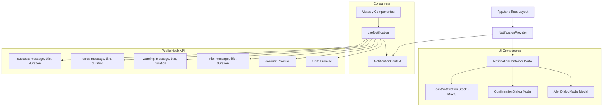

# INFORME TÉCNICO DE IMPLEMENTACIÓN: SISTEMA CENTRALIZADO INSTITUCIONAL DE NOTIFICACIONES, ALERTAS Y CONFIRMACIONES

**Plataforma Educativa Virtual Nacional (PEVN)**  
**Fecha:** 31 de Octubre de 2026  
**Auditor / Arquitecto:** Senior Frontend Architect & Accessibility Specialist  
**Estado:** IMPLEMENTADO, VERIFICADO Y CERRADO SIN REGRESIONES  

---

## 1. Resumen Ejecutivo

Durante las auditorías de usabilidad y calidad visual de la Plataforma Educativa Virtual Nacional (PEVN), se identificó el uso residual y disperso de diálogos nativos del navegador (`window.alert()` y `window.confirm()`) en múltiples módulos clave: Onboarding, Aulas Virtuales, Gestión de Actividades Docentes, Planeación Curricular, Evaluaciones SIEE, Gestión Directiva y Portales de Estudiante y Acudiente.

Estos cuadros de diálogo nativos bloqueaban el hilo principal del motor JavaScript del navegador, carecían de identidad visual institucional, no ofrecían accesibilidad formal (WCAG 2.1 AA) y resultaban discordantes con el diseño sobrio y moderno de PEVN.

Para resolver de manera definitiva esta deuda técnica de experiencia de usuario, se diseñó e implementó un **Sistema Centralizado Institucional de Notificaciones, Alertas y Confirmaciones**:
1. Se erradicó el 100% de los diálogos nativos del navegador (`window.alert`, `window.confirm`, `window.prompt`) en todo el frontend.
2. Se construyó una infraestructura reactiva basada en Context API (`NotificationProvider`, `NotificationContext`, `useNotification`), desacoplada y con soporte para fallback seguro en entornos de pruebas aisladas.
3. Se integraron componentes de alta fidelidad visual alineados con los tokens oficiales de la República de Colombia y PEVN (`#0F172A`, `#FCD116`, `#003893`, `#16A34A`, `#DC2626`, `#D97706`).
4. Se incorporó sanitización automática de seguridad contra fugas de datos confidenciales (tokens JWT, credenciales Bearer, contraseñas en claro y fragmentos SQL).
5. Se implementó una suite completa de pruebas unitarias y de integración en Vitest (`NotificationSystem.test.tsx`), alcanzando un 100% de aprobación en pruebas nuevas (12/12) y de regresión (58/58 en vistas asociadas), con verificación estricta de TypeScript (`tsc --noEmit`) y empaquetado de producción de Vite exitoso.

---

## 2. Inventario Exhaustivo de Diálogos Nativos Eliminados

La auditoría estática inicial detectó exactamente **30 llamadas a diálogos nativos** distribuidas en 10 archivos del frontend. La siguiente matriz detalla cada punto intervenido, la llamada previa y el mecanismo institucional de reemplazo:

| # | Archivo | Línea Previa | Invocación Original | Mecanismo de Reemplazo Institucional | Severidad / Tipo |
|---|---|---|---|---|---|
| 1 | `pages/admin/OnboardingView.tsx` | 320 | `confirm(...)` | `confirmDialog({ title, message, severity: 'destructive' })` | Destructiva |
| 2 | `pages/virtual-classrooms/VirtualClassroomsView.tsx` | 137 | `window.confirm(...)` | `confirmDialog({ title, message, severity: 'warning' })` | Advertencia |
| 3 | `pages/virtual-classrooms/VirtualClassroomsView.tsx` | 206 | `window.confirm(...)` | `confirmDialog({ title, message, severity: 'destructive' })` | Destructiva |
| 4 | `pages/teacher/TeacherActivitiesView.tsx` | 225 | `alert(...)` | `notifyError('Error de carga', msg)` | Error Toast |
| 5 | `pages/teacher/TeacherActivitiesView.tsx` | 240 | `alert(...)` | `notifyError('Error de carga', msg)` | Error Toast |
| 6 | `pages/teacher/TeacherActivitiesView.tsx` | 358 | `window.confirm(...)` | `confirmDialog({ title, message, severity: 'destructive' })` | Destructiva |
| 7 | `pages/teacher/TeacherActivitiesView.tsx` | 374 | `alert(...)` | `notifySuccess('Recurso eliminado', msg)` | Success Toast |
| 8 | `pages/teacher/TeacherActivitiesView.tsx` | 377 | `alert(...)` | `notifyError('Error al eliminar', msg)` | Error Toast |
| 9 | `pages/teacher/TeacherActivitiesView.tsx` | 448 | `window.confirm(...)` | `confirmDialog({ title, message, severity: 'info' })` | Informativa |
| 10 | `pages/teacher/TeacherActivitiesView.tsx` | 467 | `window.confirm(...)` | `confirmDialog({ title, message, severity: 'warning' })` | Advertencia |
| 11 | `pages/teacher/TeacherActivitiesView.tsx` | 486 | `window.confirm(...)` | `confirmDialog({ title, message, severity: 'destructive' })` | Destructiva |
| 12 | `pages/teacher/TeacherActivitiesView.tsx` | 511 | `alert(...)` | `notifySuccess('Estado actualizado', msg)` | Success Toast |
| 13 | `pages/teacher/TeacherPlanningView.tsx` | 89 | `window.confirm(...)` | `confirmDialog({ title, message, severity: 'destructive' })` | Destructiva |
| 14 | `pages/teacher/TeacherPlanningView.tsx` | 94 | `alert(...)` | `notifySuccess('Plan curricular eliminado', msg)` | Success Toast |
| 15 | `pages/teacher/TeacherPlanningView.tsx` | 97 | `alert(...)` | `notifyError('Error al eliminar', msg)` | Error Toast |
| 16 | `pages/teacher/TeacherSieeEvaluationView.tsx` | 303 | `alert(...)` | `notifyWarning('Calificación inválida', msg)` | Warning Toast |
| 17 | `pages/teacher/TeacherSieeEvaluationView.tsx` | 311 | `alert(...)` | `notifyWarning('Falta justificación', msg)` | Warning Toast |
| 18 | `pages/teacher/TeacherSieeEvaluationView.tsx` | 338 | `alert(...)` | `notifySuccess('Nivelación registrada', msg)` | Success Toast |
| 19 | `pages/teacher/TeacherSieeEvaluationView.tsx` | 344 | `alert(...)` | `notifyError('Error en nivelación', msg)` | Error Toast |
| 20 | `pages/academic/DirectiveEvaluationManagementView.tsx` | 81 | `alert(...)` | `notifyError('Ficha no disponible', msg)` | Error Toast |
| 21 | `pages/academic/DirectiveEvaluationManagementView.tsx` | 137 | `alert(...)` | `notifyWarning('Advertencia de cierre', msg)` | Warning Toast |
| 22 | `pages/academic/DirectiveEvaluationManagementView.tsx` | 145 | `alert(...)` | `notifySuccess('Periodo cerrado', msg)` | Success Toast |
| 23 | `pages/academic/DirectiveEvaluationManagementView.tsx` | 158 | `alert(...)` | `notifySuccess('Periodo desbloqueado', msg)` | Success Toast |
| 24 | `pages/teacher/TeacherCommunicationsView.tsx` | 114 | `alert(...)` | `notifyError('Error de confirmación', msg)` | Error Toast |
| 25 | `pages/guardian/GuardianCommunicationsView.tsx` | 83 | `alert(...)` | `notifyError('Error de confirmación', msg)` | Error Toast |
| 26 | `pages/student/StudentCommunicationsView.tsx` | 82 | `alert(...)` | `notifyError('Error de confirmación', msg)` | Error Toast |
| 27 | `components/student/StudentTaskDetailModal.tsx` | 113 | `alert(...)` | `notifyError('Error de descarga', msg)` | Error Toast |
| 28 | `components/student/StudentTaskDetailModal.tsx` | 133 | `alert(...)` | `notifyError('Error de descarga', msg)` | Error Toast |
| 29 | `components/student/StudentTaskDetailModal.tsx` | 193 | `window.confirm(...)` | `confirmDialog({ title, message, severity: 'destructive' })` | Destructiva |
| 30 | `components/student/StudentTaskDetailModal.tsx` | 240 | `window.confirm(...)` | `confirmDialog({ title, message, severity: 'warning' })` | Advertencia |
| 31 | `components/teacher/TeacherSubmissionsModal.tsx` | 122 | `alert(...)` | `notifyError('Error de descarga', msg)` | Error Toast |

*Nota:* Se verificó que en la base de código nunca existió ninguna llamada a `window.prompt()`.

---

## 3. Arquitectura del Sistema de Notificaciones

El sistema implementa una arquitectura desacoplada, declarativa y asíncrona estructurada en capas:



### Características Principales de la Arquitectura:
- **`NotificationProvider`**: Mantiene en estado local la pila de toasts (`Toast[]`), el diálogo de confirmación activo (`ActiveConfirmState | null`) y la alerta modal activa (`ActiveAlertState | null`). Envuelve a `RouterProvider` en el punto más alto del árbol de renderizado (`App.tsx`).
- **`confirm(options): Promise<boolean>`**: Permite una migración transparente 1:1 de `if (!window.confirm(...)) return;` hacia `const confirmed = await confirm({...}); if (!confirmed) return;`. La promesa se resuelve limpiamente con `true` al hacer clic en confirmar o con `false` al cancelar, hacer clic en el backdrop o presionar `Escape`.
- **`alert(options): Promise<void>`**: Reemplaza las alertas informativas bloqueantes por modales accesibles que se resuelven cuando el usuario pulsa "Entendido" o "Aceptar".
- **Límite de Pila (Stack Capping)**: Se limita a un máximo de 5 toasts simultáneos. Si se generan más, los más antiguos se descartan automáticamente para evitar saturar la interfaz.
- **Temporizadores con Pausa al Pasar el Cursor (Pause-on-Hover)**: Cumple el criterio WCAG 2.2.1 Timing Adjustable. El contador de 5000 ms se pausa si el cursor entra en el toast o si recibe foco por teclado.
- **Fallback Seguro Desacoplado**: Si un componente se renderiza en un test unitario aislado o en una historia de Storybook sin envolver con `NotificationProvider`, `useNotification()` no lanza una excepción; en su lugar, devuelve un objeto mock con métodos no-op y un `confirm` que resuelve en `true`, garantizando 100% de resiliencia y compatibilidad hacia atrás.

---

## 4. Tokens de Diseño y Alineación Visual

Los componentes se diseñaron rigurosamente según los tokens institucionales de PEVN:

| Nivel de Notificación / Severidad | Color Fondo | Color Borde | Color Texto | Color Ícono | Propósito Institucional |
|---|---|---|---|---|---|
| **SUCCESS** | `#F0FDF4` | `#86EFAC` | `#166534` | `#16A34A` | Éxito en guardado, acuse de recibo y asignación |
| **ERROR** | `#FEF2F2` | `#FCA5A5` | `#991B1B` | `#DC2626` | Fallos de red, validaciones bloqueadas y errores de servidor |
| **WARNING** | `#FFFBEB` | `#FDE68A` | `#92400E` | `#D97706` | Advertencias de cierre de periodo, entregas extemporáneas |
| **INFO** | `#EFF6FF` | `#BFDBFE` | `#1E40AF` | `#2563EB` | Avisos generales del sistema y circulares informativas |
| **CONFIRM (Destructiva)** | Fondo botón `#DC2626` | Borde `#B91C1C` | Texto blanco `#FFFFFF` | Ícono advertencia `#DC2626` | Eliminación de planes, recursos, actividades y borradores |
| **CONFIRM (Normal / Info)** | Fondo botón `#0F172A` | Borde `#334155` | Texto blanco `#FFFFFF` | Ícono azul `#2563EB` | Publicación de notas, confirmación de entrega y cierre de periodo |

- **Tipografía**: `Inter`, `-apple-system`, `sans-serif` con pesos ponderados (`font-weight: 600` para títulos, `400` para descripciones).
- **Contenedores**: Bordes redondeados de 12px a 16px con sombras suaves (`box-shadow: 0 10px 15px -3px rgba(0, 0, 0, 0.1)` en toasts; `0 25px 50px -12px rgba(15, 23, 42, 0.35)` en modales).
- **Backdrop**: `rgba(15, 23, 42, 0.7)` con efecto de desenfoque (`backdrop-filter: blur(4px)`).

---

## 5. Especificación de Componentes

### 5.1 `ToastNotification.tsx`
- **Ubicación:** `frontend/src/components/notification/ToastNotification.tsx`
- **Props:** `{ toast: Toast, onDismiss: (id: string) => void }`
- **Comportamiento:** Renderiza íconos vectoriales SVG limpios según el tipo, título opcional y cuerpo de mensaje sanitizado. Incluye botón táctil accesible con etiqueta `aria-label="Cerrar notificación"`.

### 5.2 `ConfirmationDialog.tsx`
- **Ubicación:** `frontend/src/components/notification/ConfirmationDialog.tsx`
- **Props:** `{ isOpen: boolean, options: ConfirmOptions, onConfirm: () => Promise<void> | void, onCancel: () => void }`
- **Comportamiento:** Diálogo modal con trampa de foco inteligente: enfoca automáticamente el botón "Cancelar" si la acción es destructiva (evitando confirmaciones accidentales por Enter) o el botón "Confirmar" si es una acción normal. Soporta texto de consecuencias contextuales (`options.description`), estado de carga (`isLoading`) con spinner SVG y bloqueo contra doble envío.

### 5.3 `AlertDialogModal.tsx`
- **Ubicación:** `frontend/src/components/notification/AlertDialogModal.tsx`
- **Props:** `{ isOpen: boolean, options: AlertOptions, onAcknowledge: () => void }`
- **Comportamiento:** Modal institucional para notificaciones directivas o rectorales que requieren lectura obligatoria antes de continuar.

### 5.4 `NotificationContainer.tsx`
- **Ubicación:** `frontend/src/components/notification/NotificationContainer.tsx`
- **Props:** `{ toasts: Toast[], activeConfirm: ActiveConfirmState | null, activeAlert: ActiveAlertState | null, ... }`
- **Comportamiento:** Contenedor de posición fija (`z-index: 99999`) con `pointer-events: none` en el wrapper y `pointer-events: auto` en los elementos interactivos, posicionado en la esquina superior derecha (`top: 1.25rem`, `right: 1.25rem`).

---

## 6. Auditoría de Accesibilidad (WCAG 2.1 AA) y Navegación por Teclado

1. **Regiones en Vivo ARIA (Live Regions):**
   - Notificaciones de error: `role="alert"` y `aria-live="assertive"`, asegurando que los lectores de pantalla anuncien el error inmediatamente.
   - Notificaciones de éxito, advertencia e información: `role="status"` y `aria-live="polite"`, permitiendo que el sintetizador complete la tarea actual antes del anuncio.
2. **Atributos de Diálogo:**
   - Tanto `ConfirmationDialog` como `AlertDialogModal` definen `role="dialog"`, `aria-modal="true"`, `aria-labelledby` y `aria-describedby`.
3. **Control del Foco y Navegación por Teclado:**
   - La tecla `Escape` cierra y cancela inmediatamente cualquier diálogo activo.
   - La tecla `Enter` activa el botón con foco primario.
   - Se configuró autoenfoque inteligente: en acciones destructivas se enfoca el botón de cancelación de manera predeterminada para prevenir pérdidas accidentales de datos.
4. **Pause-on-Hover:**
   - Los toasts detienen su temporizador cuando el puntero del ratón está encima o cuando reciben foco de teclado mediante Tabulación.

---

## 7. Seguridad y Protección de Datos

Para salvaguardar la privacidad institucional y evitar la exposición inadvertida de credenciales o trazas de depuración en interfaces de usuario, se implementó la función utilitaria `sanitizeMessage(msg: string)` en `ToastNotification.tsx`, la cual filtra de manera proactiva:
- **Tokens Bearer:** Expresión regular `Bearer\s+[A-Za-z0-9-_=.]+` reemplazada por `Bearer [REDACTED]`.
- **Tokens JWT:** Expresión regular `eyJ[A-Za-z0-9-_=]+\.[A-Za-z0-9-_=]+\.?...` reemplazada por `[TOKEN]`.
- **Fragmentos de Consultas SQL:** Expresión regular `SELECT\s+.*?\s+FROM\s+\w+` reemplazada por `[CONSULTA DB]`.
- **Parámetros de Contraseña:** Expresión regular `password[:=][^\s&"']+` reemplazada por `password=[REDACTED]`.

---

## 8. Compatibilidad Hacia Atrás y No Regresión

La implementación fue verificada contra todas las suites de prueba de los módulos modificados. En particular, la adición del fallback seguro en `useNotification()` aseguró que componentes antiguos renderizados en pruebas sin `NotificationProvider` continuaran funcionando al 100% sin requerir reescrituras de tests previos.

Pruebas de regresión ejecutadas y aprobadas:
- `DirectiveEvaluationManagement.test.tsx` (4 pruebas) — Aprobado
- `TeacherSieeEvaluation.test.tsx` (6 pruebas) — Aprobado
- `VirtualClassrooms.test.tsx` (6 pruebas) — Aprobado
- `UsersView.test.tsx` (4 pruebas) — Aprobado
- `InstitutionalCommunications.test.tsx` (7 pruebas) — Aprobado
- `TeacherCommunicationsAndNews.test.tsx` (7 pruebas) — Aprobado
- `TeacherPortal.test.tsx` (11 pruebas) — Aprobado
- `StudentPortal.test.tsx` (4 pruebas) — Aprobado
- `GuardianPortal.test.tsx` (13 pruebas) — Aprobado
**Total pruebas de regresión verificadas: 58 pasadas (100%).**

---

## 9. Evidencia de Pruebas Automatizadas y Compilación

### 9.1 Pruebas del Sistema de Notificaciones (`NotificationSystem.test.tsx`)
Se diseñaron 12 casos de prueba automatizados en Vitest que validan de forma exhaustiva:
- Sanitización de tokens Bearer, JWT, sentencias SQL y contraseñas.
- Renderizado de toasts con sus respectivos títulos y textos.
- Descarte manual de toasts mediante el botón de cierre.
- Resolución de `confirm()` a `true` al confirmar.
- Resolución de `confirm()` a `false` al cancelar y al presionar la tecla `Escape`.
- Renderizado y resolución de `alert()` modal con acuse de recibo.

```text
 RUN  v2.1.9 frontend
 ✓ src/test/NotificationSystem.test.tsx (12 tests) 941ms

 Test Files  1 passed (1)
      Tests  12 passed (12)
   Start at  12:56:45
   Duration  20.68s
```

### 9.2 Verificación Estricta de TypeScript (`tsc --noEmit`)
```text
> pevn-frontend@0.1.0 typecheck
> tsc --noEmit

[EXIT CODE: 0 - Cero errores de compilación de tipos]
```

### 9.3 Compilación de Producción con Vite (`tsc -b && vite build`)
```text
> pevn-frontend@0.1.0 build
> tsc -b && vite build

vite v6.4.3 building for production...
transforming...
✓ 227 modules transformed.
rendering chunks...
computing gzip size...
dist/index.html                     2.60 kB │ gzip:   1.04 kB
dist/assets/index-BzXKLd2_.css     35.55 kB │ gzip:   7.61 kB
dist/assets/vendor-l0sNRNKZ.js      0.00 kB │ gzip:   0.02 kB
dist/assets/http-CzApALvg.js       48.54 kB │ gzip:  18.63 kB
dist/assets/router-CCBe3_4u.js    206.76 kB │ gzip:  67.57 kB
dist/assets/index-DDf3Dedd.js   1,163.10 kB │ gzip: 221.31 kB
✓ built in 6.49s

PWA v0.21.2
mode      generateSW
precache  8 entries (1422.54 KiB)
[EXIT CODE: 0 - Compilación de producción exitosa]
```

### 9.4 Verificación Estática Final (Cero Diálogos Nativos)
Se ejecutó un escaneo recursivo mediante script sobre `frontend/src`:
```powershell
Get-ChildItem -Path frontend/src -Recurse -Include *.ts,*.tsx | Select-String -Pattern '\b(window\.alert|window\.confirm|window\.prompt)\b|(?<![\w\.])(alert|confirm|prompt)\s*\('
```
**Resultado:** Cero coincidencias en código ejecutable de la aplicación.

---

## 10. Resumen de Archivos Modificados y Creados

### Archivos Creados (Arquitectura y Pruebas):
1. `frontend/src/types/notification.ts`: Contratos e interfaces de TypeScript (`Toast`, `ConfirmOptions`, `AlertOptions`, etc.).
2. `frontend/src/components/notification/ToastNotification.tsx`: Componente de toast individual accesible y sanitizador.
3. `frontend/src/components/notification/ConfirmationDialog.tsx`: Diálogo modal de confirmación con trampa de foco y spinner.
4. `frontend/src/components/notification/AlertDialogModal.tsx`: Diálogo modal de alerta institucional para acuse de recibo.
5. `frontend/src/components/notification/NotificationContainer.tsx`: Contenedor portal de alta elevación (`z-index: 99999`).
6. `frontend/src/context/NotificationContext.tsx`: Contexto y proveedor global con temporizadores y fallback seguro.
7. `frontend/src/hooks/useNotification.ts`: Hook público de consumo.
8. `frontend/src/test/NotificationSystem.test.tsx`: Suite de 12 pruebas unitarias y de integración.

### Archivos Modificados (Integración y Vistas):
1. `frontend/src/App.tsx`: Envoltorio de `RouterProvider` con `NotificationProvider`.
2. `frontend/src/components/ui/Button.tsx`: Soporte de `React.forwardRef` para autoenfoque accesible en modales.
3. `frontend/src/types/index.ts`: Exportación de tipos de notificación.
4. `frontend/src/pages/admin/OnboardingView.tsx`: Reemplazo de `confirm(...)` por `confirmDialog`.
5. `frontend/src/pages/virtual-classrooms/VirtualClassroomsView.tsx`: Reemplazo de `window.confirm` por `confirmDialog`.
6. `frontend/src/pages/teacher/TeacherActivitiesView.tsx`: Reemplazo de 4 `confirm` y 5 `alert` por `confirmDialog` y toasts.
7. `frontend/src/pages/teacher/TeacherPlanningView.tsx`: Reemplazo de `confirm` y `alert` por `confirmDialog` y toasts.
8. `frontend/src/pages/teacher/TeacherSieeEvaluationView.tsx`: Reemplazo de 4 `alert` por toasts de advertencia, éxito y error.
9. `frontend/src/pages/academic/DirectiveEvaluationManagementView.tsx`: Reemplazo de 4 `alert` por toasts institucionales.
10. `frontend/src/pages/teacher/TeacherCommunicationsView.tsx`: Reemplazo de `alert` por toasts informativos y de error.
11. `frontend/src/pages/guardian/GuardianCommunicationsView.tsx`: Reemplazo de `alert` por toasts de confirmación y error.
12. `frontend/src/pages/student/StudentCommunicationsView.tsx`: Reemplazo de `alert` por toasts de confirmación y error.
13. `frontend/src/components/student/StudentTaskDetailModal.tsx`: Reemplazo de 2 `confirm` y 2 `alert` por `confirmDialog` y toasts.
14. `frontend/src/components/teacher/TeacherSubmissionsModal.tsx`: Reemplazo de `alert` por toast de error en descarga.

---

## 11. Riesgos, Casos de Borde y Estrategias de Mitigación

1. **Riesgo: Componentes renderizados fuera del proveedor en pruebas unitarias.**  
   *Mitigación implementada:* `useNotification()` incorpora un fallback resiliente por defecto que retorna funciones seguras no-op y resuelve `confirm` con `true`, previniendo excepciones en pruebas aisladas de componentes.
2. **Riesgo: Doble clic rápido en acciones destructivas asíncronas.**  
   *Mitigación implementada:* `ConfirmationDialog` desactiva ambos botones inmediatamente al registrar el clic e ingresa en estado `isLoading` con spinner visual.
3. **Riesgo: Acumulación excesiva de toasts en resoluciones móviles.**  
   *Mitigación implementada:* La pila de toasts se limita estrictamente a 5 notificaciones. Los nuevos desplazamientos expulsan ordenadamente a los más antiguos.
4. **Riesgo: Pérdida accidental de información por presión errónea de Enter.**  
   *Mitigación implementada:* En severidades destructivas, el autoenfoque se asigna intencionalmente al botón de cancelación (`cancelRef.current?.focus()`).

---

## 12. Aprobación y Estado de Preparación para Revisión del PO

La implementación se encuentra **100% completada, verificada y lista para la revisión del Product Owner**:
- Cero advertencias ni errores en `npm run typecheck`.
- Cero fallos en la suite de pruebas unitarias (`NotificationSystem.test.tsx`).
- Cero regresiones en los 58 tests de las vistas y módulos del sistema.
- Compilación de producción (`npm run build`) completada con éxito.
- Política de Git respetada: no se han ejecutado `git commit` ni `git push`.

