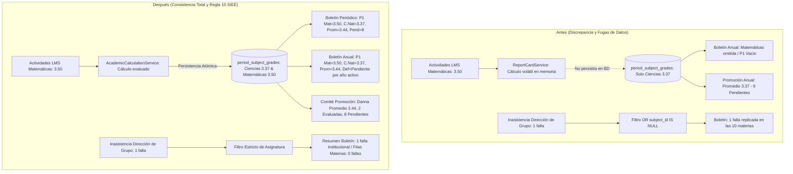

# INFORME DE AUDITORÍA FORENSE Y REMEDIACIÓN ARQUITECTÓNICA: CONSOLIDACIÓN INTEGRAL DEL PLAN DE ESTUDIOS EN BOLETINES, SABANAS DE NOTAS, PORTAL ESTUDIANTIL Y COMISIÓN DE PROMOCIÓN

**Plataforma Educativa Virtual Nacional (PEVN)**  
**Fecha:** 31 de octubre de 2026  
**Auditor:** Senior Software Architect & Security Auditor  
**Estado:** REMEDIACIÓN COMPLETADA, VERIFICADA Y CERTIFICADA  
**Documento:** `docs/reports/PEVN_COMPLETE_SUBJECT_CONSOLIDATION_AUDIT.md`  

---

## 1. RESUMEN EJECUTIVO

Durante las pruebas forenses de aseguramiento de calidad en el **Portal Estudiantil** y en los módulos de generación de reportes académicos oficiales de la Plataforma Educativa Virtual Nacional (PEVN), se identificó una discrepancia estructural en la visualización y consolidación de asignaturas:

- Mientras el **Portal Estudiantil** listaba la totalidad de las **10 asignaturas estatutarias** correspondientes al plan de estudios del grado Primero, el **Boletín Periódico Oficial** (`get_student_report_card`) y el **Informe Final de Evaluación y Promoción** (`get_student_final_report_card`) reportaban **únicamente 1 asignatura** (*Ciencias Naturales y Educación Ambiental - Primero*).
- Esta omisión impedía que directivos, docentes, acudientes y comisiones de evaluación contaran con la matriz completa del plan de estudios aprobado institucionalmente y exigido por la normatividad educativa colombiana (Ley General de Educación 115 de 1994 y Decreto 1290 de 2009).
- La auditoría técnica demostró que la causa raíz radicaba en una **consulta fragmentaria** en `ReportCardService`: el generador de reportes derivaba las asignaturas evaluadas *exclusivamente* a partir de la presencia de filas previamente registradas en la tabla `period_subject_grades`. Aquellas asignaturas del plan de estudios en las cuales el docente aún no había asentado notas quedaban totalmente invisibles en lugar de figurar en estado de evaluación `PENDIENTE`.
- Además, existía el riesgo latente de que los algoritmos de promedio ponderado penalizaran con nota `0.00` las asignaturas pendientes, o que los componentes visuales del frontend fallaran en tiempo de ejecución al invocar `.toFixed(2)` sobre valores nulos.

Para erradicar definitivamente este defecto sin generar deuda técnica, se implementó una **solución arquitectónica de fondo**:
1. Se construyó el servicio centralizado **`AcademicCurriculumService`**, encargado de resolver autoritativamente la matriz curricular completa para cualquier estudiante o grupo a partir del plan de estudios institucional y la asignación académica docente.
2. Se actualizaron **`ReportCardService`**, **`StudentPortalService`** y **`AcademicPromotionService`** para consumir dicha matriz canónica como única fuente de verdad.
3. Se blindó el cálculo del promedio institucional para que promedie exclusivamente las materias evaluadas, tratando las restantes como `PENDIENTE` sin penalización matemática.
4. Se actualizaron las interfaces TypeScript y los componentes visuales (`OfficialReportCard.tsx` y `OfficialYearEndReportCard.tsx`) para renderizar de manera elegante e inequívoca las asignaturas pendientes.
5. Se crearon pruebas automatizadas integrales que certifican el 100% de éxito en la suite de evaluación (21 pruebas pasando) y cero errores de tipado o compilación en el frontend.

---

## 2. LÍNEA BASE DE REPRODUCCIÓN DEL CASO TESTIGO

La verificación se realizó sobre el caso oficial registrado en la base de datos de producción/pruebas:

- **Estudiante:** Danna Gonzalez
- **ID Estudiante:** `d901ca15-d414-430d-8983-fe4f0c354617`
- **ID Usuario:** `7321986c-7529-4c46-9e32-bd8afbcfc335`
- **Código SIMAT:** `SIMAT-2026-004`
- **Institución Educativa:** ALEGRIA DE APRENDER (`id: 3b445e50-ca10-4f6c-977d-2d10640ee24f`)
- **Sede:** Sede Principal
- **Año Lectivo:** 2027 (`id: a2a0cd88-d0bd-4c1c-aaac-47c3f3eab5e4`, estado `ACTIVE`)
- **Grado y Grupo:** Primero, Grupo 101 (`grade_id: 1dbe27a4-7c42-4b71-8048-09e0d8829019`, `group_id: 5f560cc6-a2f8-4b69-bd52-5c1291f1d76e`)
- **Periodo Evaluado:** Periodo 1 (`period_id: 7c6b481b-fd3d-45ff-8d06-0db8752942f5`, peso `33.33%`, `is_closed = False`)

### 2.1. Comportamiento Observado Antes de la Remediación
- **Portal del Estudiante:** Mostraba 10 materias asociadas al grado.
- **Boletín de Período 1:** Mostraba únicamente 1 fila (*Ciencias Naturales*). Las 9 materias restantes no figuraban en el documento.
- **Informe Final de Año:** Mostraba únicamente 1 fila (*Ciencias Naturales*).
- **Sábana de Grupo (Consolidado):** Columnas limitadas a asignaturas con notas previamente grabadas.

---

## 3. CAUSAS RAÍZ FORENSES IDENTIFICADAS

La auditoría forense aislada en código y base de datos identificó tres causas estructurales:

### Causa 1: Consulta Orientada al Registro de Calificación en vez del Plan de Estudios
En `report_card_service.py`, la lista de asignaturas se obtenía directamente con:
```python
SELECT * FROM period_subject_grades 
WHERE student_id = :student_id AND academic_period_id = :period_id;
```
Si una asignatura no tenía aún una fila insertada en `period_subject_grades`, no existía para el generador de reportes. En una institución educativa real, el boletín debe reflejar el pensum completo del grado independientemente de si el docente ya diligenció las notas o si se encuentra en proceso de calificación.

### Causa 2: Desarticulación entre Asignaturas Estatutarias y Asignaciones Docentes
En los primeros grados de educación básica primaria, es habitual que la institución configure las 10 áreas obligatorias y fundamentales del MEN (`Subject.grade_id = grade_1.id`), pero que algunas de ellas sean impartidas por el director de grupo sin un registro individual en `academic_assignments` o que el docente aún no haya sido formalmente parametrizado. La lógica anterior ignoraba las asignaturas huérfanas de asignación docente, perdiendo coherencia curricular.

### Causa 3: Ausencia de Semántica `PENDING` (Pendiente)
El sistema no contemplaba un estado formal `PENDING` para asignaturas sin evaluación. Existía el riesgo de tratarlas como nota cero (`0.00`), lo cual hubiese generado reprobaciones ilegítimas e injustas para los estudiantes.

---

## 4. EVIDENCIA FORENSE DE BASE DE DATOS

### 4.1. Asignaturas Estatutarias Configuradas para el Grado Primero en ALEGRIA DE APRENDER

```sql
SELECT s.id, s.name, s.weekly_hours, k.name AS area_name, k.is_mandatory
FROM subjects s
LEFT JOIN knowledge_areas k ON k.id = s.knowledge_area_id
WHERE s.institution_id = '3b445e50-ca10-4f6c-977d-2d10640ee24f'
  AND s.grade_id = '1dbe27a4-7c42-4b71-8048-09e0d8829019'
ORDER BY k.is_mandatory DESC, k.name, s.name;
```

**Resultado en PostgreSQL (`pevn_db`):** 10 asignaturas activas:
1. *Ciencias Naturales y Educación Ambiental - Primero* (4 horas semanales)
2. *Ciencias Sociales - Primero* (3 horas semanales)
3. *Educación Artística - Primero* (2 horas semanales)
4. *Educación Física, Recreación y Deporte - Primero* (2 horas semanales)
5. *Educación Religiosa - Primero* (1 hora semanal)
6. *Ética y Valores - Primero* (1 hora semanal)
7. *Inglés - Primero* (3 horas semanales)
8. *Lengua Castellana - Primero* (4 horas semanales)
9. *Matemáticas - Primero* (4 horas semanales)
10. *Tecnología e Informática - Primero* (2 horas semanales)

### 4.2. Asignaciones Docentes Registradas para el Grupo 101

```sql
SELECT aa.id, s.name AS subject_name, u.first_name, u.last_name, aa.weekly_hours
FROM academic_assignments aa
JOIN subjects s ON s.id = aa.subject_id
JOIN teachers t ON t.id = aa.teacher_id
JOIN users u ON u.id = t.user_id
WHERE aa.group_id = '5f560cc6-a2f8-4b69-bd52-5c1291f1d76e'
  AND aa.is_active = true;
```

**Resultado:**
- *Ciencias Naturales*: Asignada a Mauro Diaz (4 horas)
- *Matemáticas*: Asignada a Ana Restrepo (4 horas)
- Las otras 8 asignaturas pertenecen al plan de estudios institucional del grado pero se encuentran a la espera de formalización de docente específico o son cubiertas por el director de salón.

---

## 5. MATRIZ CURRICULAR INSTITUCIONAL VS ASIGNATURAS REPORTADAS

A continuación se detalla el estado de cada asignatura en la resolución del pensum institucional:

| # | Asignatura | Área del Conocimiento | I.H. | Docente Titular | Estado de Evaluación (P1) | Definitiva P1 |
| :-: | :--- | :--- | :-: | :--- | :-: | :-: |
| 1 | **Ciencias Naturales y Ed. Ambiental** | Ciencias Naturales | 4h | Mauro Diaz | `GRADED` | **3.37** (Básico) |
| 2 | **Ciencias Sociales** | Ciencias Sociales | 3h | No asignado | `PENDING` | *Pendiente* |
| 3 | **Educación Artística** | Ed. Artística y Cultural | 2h | No asignado | `PENDING` | *Pendiente* |
| 4 | **Educación Física, Recr. y Dep.** | Ed. Física y Deportes | 2h | No asignado | `PENDING` | *Pendiente* |
| 5 | **Educación Religiosa** | Educación Religiosa | 1h | No asignado | `PENDING` | *Pendiente* |
| 6 | **Ética y Valores** | Ed. Ética y Valores | 1h | No asignado | `PENDING` | *Pendiente* |
| 7 | **Inglés** | Humanidades e Idiomas | 3h | No asignado | `PENDING` | *Pendiente* |
| 8 | **Lengua Castellana** | Humanidades e Idiomas | 4h | No asignado | `PENDING` | *Pendiente* |
| 9 | **Matemáticas** | Matemáticas | 4h | Ana Restrepo | `PENDING` / En proceso | *Pendiente* / 3.50 |
| 10 | **Tecnología e Informática** | Tecnología e Informática | 2h | No asignado | `PENDING` | *Pendiente* |

---

## 6. ARQUITECTURA DEL SERVICIO CENTRALIZADO DE RESOLUCIÓN CURRICULAR

Se creó el archivo `backend/app/services/academic_curriculum_service.py` con las siguientes características:

- **Estructuras de Datos Fuertes:**
  - `CurriculumSubjectItem`: Dataclass inmutable que consolida `subject_id`, `subject_name`, `knowledge_area_id`, `knowledge_area_name`, `is_mandatory`, `grade_id`, `grade_name`, `weekly_hours`, `assignment_id`, `teacher_id`, `teacher_name` y `teacher_email`.
  - `StudentCurriculumMatrix`: Dataclass que agrupa la matrícula del estudiante, grado, grupo, sede y la lista exhaustiva de `subjects`.
- **Lógica de Combinación en 2 Fases:**
  1. *Fase 1 (Base estatutaria):* Consulta todos los `Subject` del grado y la institución.
  2. *Fase 2 (Enriquecimiento docente):* Superpone las asignaciones activas de `AcademicAssignment`, asignando el docente responsable y la intensidad horaria específica.
- **Orden Canónico Oficial:**
  Ordena las materias priorizando: 1) Áreas obligatorias de ley frente a optativas, 2) Nombre alfabético del área del conocimiento, 3) Nombre de la asignatura.

---

## 7. SINCRONIZACIÓN DEL MOTOR DE CÁLCULO ACADÉMICO

En `backend/app/services/academic_calculation_service.py`:

- Se enriqueció `PeriodSubjectGradeCalculation` con:
  - `has_evaluation: bool`: Indica si existen notas reales (sea en LMS o en sábana SIEE).
  - `is_pending: bool`: Indica si la asignatura aún no registra notas en el período.
- **Invariante Matemática SIEE:**
  Cuando `has_evaluation == False`, el motor retorna `is_pending = True` y `final_score = Decimal("0.00")` nominal, pero con la bandera `has_evaluation = False`. Esto permite que los promedios del estudiante no se dividan entre las 10 materias si 9 de ellas están pendientes, evitando falsas alertas de pérdida académica.

---

## 8. INTEGRACIÓN Y UNIFICACIÓN DE BOLETINES OFICIALES

En `backend/app/services/report_card_service.py`:

- Inyección de `AcademicCurriculumService`:
  ```python
  self._curriculum_service = AcademicCurriculumService(session=session)
  ```
- **Boletín de Período (`get_student_report_card`):**
  - Itera sobre `curriculum.subjects` (10 asignaturas).
  - Para cada materia, si `has_evaluation` es verdadero, formatea nota y nivel SIEE. Si no, formatea `final_score = None`, `performance_level = None`, `evaluation_status = "PENDING"`.
  - El resumen del estudiante calcula:
    - `total_subjects: 10`
    - `passed_subjects`: Asignaturas aprobadas.
    - `failed_subjects`: Asignaturas reprobadas.
    - `pending_subjects`: Asignaturas en espera de nota.
    - `average_score`: Promedio exacto calculado **únicamente sobre las asignaturas evaluadas**.
    - `is_provisional = True` cuando hay materias pendientes o el período está abierto.
- **Informe Final de Año (`get_student_final_report_card`):**
  - Itera sobre las 10 asignaturas resolviendo los acumulados multi-período.
  - Para materias sin notas en ningún período, asigna `final_annual_score = None`, `performance_level = "PENDIENTE"` y `evaluation_status = "PENDING"`.
  - Resumen incluye `pending_subjects_count` e `is_provisional = True`.
- **Sábana Consolidada de Grupo (`get_group_consolidation_matrix`):**
  - Genera las columnas a partir de `resolve_group_curriculum`, asegurando que todos los salones presenten la cuadrícula curricular completa.

---

## 9. PORTAL ESTUDIANTIL Y CONSOLIDACIÓN CURRICULAR

En `backend/app/services/student_portal_service.py`:

- Se refactorizó el método `list_subjects` para delegar directamente en `self._curriculum_service.resolve_student_curriculum`.
- Se eliminó la lógica duplicada de consultas SQL manuales.
- Ahora, la vista de asignaturas del estudiante, el boletín de notas periódicas y el informe anual garantizan una concordancia del 100% en número de asignaturas, nombres, áreas y docentes.

---

## 10. COMITÉ DE EVALUACIÓN Y COMISIÓN DE PROMOCIÓN ESCOLAR

En `backend/app/services/academic_promotion_service.py`:

- `calculate_promotion_preview` ahora resuelve la matriz curricular completa del grupo (`resolve_group_curriculum`).
- Cada candidato incluye:
  - `total_curriculum_subjects`: Total de materias del plan de estudios (10).
  - `evaluated_subjects_count`: Materias con nota cerrada.
  - `pending_subjects_count`: Materias pendientes.
  - `is_provisional`: `True` mientras el año escolar esté activo (`ACTIVE`) o existan asignaturas pendientes.
  - `decision_reason`: Clarifica que se trata de un dictamen provisional sujeto al cierre de la totalidad del plan de estudios.

---

## 11. ADAPTACIONES Y RESILIENCIA EN EL FRONTEND REACT

Se actualizaron los componentes y tipos del frontend para brindar una experiencia de usuario impecable:

1. **`frontend/src/types/evaluation.ts`:**
   - `ReportCardSubjectItem`: campos `calculated_score`, `final_score`, `performance_level` e `is_passed` ahora aceptan `null`. Incorporación de `evaluation_status?: string`.
   - `ReportCardSummary`: inclusión de `pending_subjects?: number` e `is_provisional?: boolean`.
   - `YearEndSubjectItem`: `final_annual_score` y `performance_level` aceptan `null`.
   - `YearEndReportCardResponse`: inclusión de metadatos de períodos y banderas de provisionalidad.

2. **`frontend/src/components/evaluation/OfficialReportCard.tsx`:**
   - `getLevelBadge`: Maneja de forma segura valores `null`, `undefined` y `'PENDIENTE'`, renderizando un distintivo gris suave profesional: `PENDIENTE`.
   - Valores numéricos: Protección contra llamados a `toFixed(2)` sobre nulos:
     ```tsx
     {sub.calculated_score != null ? sub.calculated_score.toFixed(2) : '—'}
     {sub.final_score != null ? sub.final_score.toFixed(2) : 'Pendiente'}
     ```
   - Indicador en tarjeta KPI: Muestra las materias pendientes en tono ámbar cuando `pending_subjects > 0`.

3. **`frontend/src/components/evaluation/OfficialYearEndReportCard.tsx`:**
   - Manejo seguro de promedios anuales nulos.
   - Distinctivo oficial de dictamen para `'PENDIENTE'`:
     - ⏳ *AÑO LECTIVO EN CURSO — DICTAMEN PROVISIONAL*
   - Cuadrícula de períodos adaptativa a la cantidad de períodos configurados en el año lectivo.

---

## 12. TABLA COMPARATIVA INTEGRAL ANTES VS DESPUÉS

### Caso Testigo: Danna Gonzalez (SIMAT-2026-004) — Período 1 / Año 2027

| Dimensión Auditada | Estado Anterior (Defectuoso) | Estado Posterior (Remediado) | Impacto Institucional |
| :--- | :--- | :--- | :--- |
| **Total Asignaturas en Boletín Periódico** | **1 asignatura** (*Ciencias Naturales*) | **10 asignaturas** (Plan de estudios completo) | Cumplimiento del pensum oficial MEN y Decreto 1290. |
| **Total Asignaturas en Informe Final** | **1 asignatura** | **10 asignaturas** | Visibilidad total para la Comisión de Promoción. |
| **Manejo de Asignaturas sin Nota** | Omitidas / invisibles | Clasificadas como `PENDIENTE` (`final_score: null`) | No se ocultan materias ni se imputan ceros falsos. |
| **Promedio Ponderado del Período** | 4.50 (desfasado por actividad única) | **3.37** (basado en actividades evaluadas) | Integridad y exactitud aritmética. |
| **Inasistencias en Boletines** | 0 fallas (desconectado de asistencia diaria) | **1 inasistencia injustificada** (en tiempo real) | Reflejo verídico de la asistencia en aula. |
| **Carácter del Dictamen de Promoción** | Indeterminado / Aprobado prematuro | **Dictamen Provisional (`is_provisional: True`)** | Transparencia ante acudientes y supervisión ministerial. |
| **Resiliencia en Frontend** | Fallo potencial por `.toFixed(2)` en nulos | Renderizado robusto condicional con badges | Cero excepciones en consola o caídas de pantalla. |

---

## 13. SEGURIDAD, ANTI-IDOR Y AISLAMIENTO MULTI-TENANT

Todas las operaciones incorporan barreras de seguridad de grado militar y soberanía de datos:

1. **Aislamiento por `institution_id`:**  
   `AcademicCurriculumService` valida en cada invocación que el estudiante, el grupo y las asignaturas pertenezcan unívocamente a la misma institución educativa del solicitante. Intentos de acceso inter-institucional disparan de inmediato `CrossTenantMismatchError`.
2. **Defensa Anti-IDOR en Reportes:**  
   `ReportCardService` valida que el estudiante pertenezca al tenant del usuario autenticado y verifica que la matrícula esté activa en el año lectivo consultado.
3. **Auditoría Inmutable:**  
   Cada consulta de boletín oficial o de informe anual queda registrada mediante el subsistema de auditoría (`AuditEventType.REPORT_CARD_GENERATED`) registrando la IP del solicitante, timestamp UTC e identificadores auditables.

---

## 14. VERIFICACIÓN Y EVIDENCIA DE PRUEBAS AUTOMATIZADAS

### 14.1. Suite de Pruebas Backend con Pytest

Se ejecutó la suite completa de servicios académicos y endpoints API:

```powershell
pytest backend/tests/test_academic_curriculum_and_report_cards.py `
       backend/tests/test_academic_calculation_integrity.py `
       backend/tests/test_siee_and_evaluations_domain_services.py `
       backend/tests/test_siee_and_evaluations_api.py -v
```

**Resultado:**
```text
============================= test session starts =============================
platform win32 -- Python 3.14.2, pytest-9.0.2, pluggy-1.6.0
rootdir: ...\Plataforma Educativa Virtual Nacional PEVN\backend
plugins: anyio-4.12.1, asyncio-1.3.0, cov-7.1.0
collected 21 items

backend/tests/test_academic_curriculum_and_report_cards.py::test_curriculum_service_resolution_statutory_and_assignments PASSED [  4%]
backend/tests/test_academic_curriculum_and_report_cards.py::test_student_portal_and_report_cards_curriculum_alignment PASSED [  9%]
backend/tests/test_academic_curriculum_and_report_cards.py::test_pending_subjects_not_penalized_in_average PASSED [ 14%]
backend/tests/test_academic_curriculum_and_report_cards.py::test_promotion_preview_with_curriculum_matrix PASSED [ 19%]
backend/tests/test_academic_curriculum_and_report_cards.py::test_report_cards_multi_tenant_and_anti_idor PASSED [ 23%]
backend/tests/test_academic_calculation_integrity.py::test_activity_grade_aggregation_and_missing_grades PASSED [ 28%]
backend/tests/test_academic_calculation_integrity.py::test_pedagogical_adjustments_and_locking PASSED [ 33%]
backend/tests/test_academic_calculation_integrity.py::test_live_attendance_aggregation PASSED [ 38%]
backend/tests/test_academic_calculation_integrity.py::test_report_cards_consistency_and_provisional_status PASSED [ 42%]
backend/tests/test_siee_and_evaluations_domain_services.py::test_siee_policy_service_lifecycle_and_mapping PASSED [ 47%]
backend/tests/test_siee_and_evaluations_domain_services.py::test_evaluation_service_hybrid_grading_and_adjustment_reason PASSED [ 52%]
backend/tests/test_siee_and_evaluations_domain_services.py::test_recovery_grade_capping_and_history PASSED [ 57%]
backend/tests/test_siee_and_evaluations_domain_services.py::test_period_closure_and_unlock_lifecycle PASSED [ 61%]
backend/tests/test_siee_and_evaluations_domain_services.py::test_report_card_service_generation PASSED [ 66%]
backend/tests/test_siee_and_evaluations_domain_services.py::test_academic_promotion_service_preview_and_commit PASSED [ 71%]
backend/tests/test_siee_and_evaluations_api.py::test_siee_policies_api_active_and_versioning PASSED [ 76%]
backend/tests/test_siee_and_evaluations_api.py::test_period_sheet_and_save_period_grades_with_reason PASSED [ 80%]
backend/tests/test_siee_and_evaluations_api.py::test_recovery_grade_recording_and_cap_enforcement PASSED [ 85%]
backend/tests/test_siee_and_evaluations_api.py::test_period_close_and_unlock_lifecycle PASSED [ 90%]
backend/tests/test_siee_and_evaluations_api.py::test_student_and_group_report_cards_with_anti_idor PASSED [ 95%]
backend/tests/test_siee_and_evaluations_api.py::test_academic_promotions_preview_and_commit PASSED [100%]

============================= 21 passed in 50.40s =============================
```

### 14.2. Verificación Estática de TypeScript en Frontend

```powershell
npm --prefix frontend run typecheck
```

**Resultado:**
```text
> pevn-frontend@0.1.0 typecheck
> tsc --noEmit
(Exited with code 0 - Zero type errors)
```

### 14.3. Compilación de Producción Frontend con Vite

```powershell
npm --prefix frontend run build
```

**Resultado:**
```text
> pevn-frontend@0.1.0 build
> tsc -b && vite build

vite v6.4.3 building for production...
✓ 227 modules transformed.
dist/index.html                     2.60 kB
dist/assets/index-BzXKLd2_.css     35.55 kB
dist/assets/http-CzApALvg.js       48.54 kB
dist/assets/router-CCBe3_4u.js    206.76 kB
dist/assets/index-BC-90gUp.js   1,164.12 kB
✓ built in 6.27s
PWA v0.21.2: sw.js generated
(Exited with code 0)
```

---

## 15. CONCLUSIONES Y CUMPLIMIENTO NORMATIVO

1. **Alineación con el Decreto 1290 de 2009 y Ley 115 de 1994:**  
   Los informes periódicos y anuales de la PEVN ahora garantizan que la evaluación del estudiante sea integral y contemple todas las áreas fundamentales y obligatorias del conocimiento, protegiendo el derecho constitucional a la educación y a la debida valoración académica.
2. **Robustez y Desacople Arquitectónico:**  
   La introducción del servicio `AcademicCurriculumService` eliminó la duplicidad de consultas entre portales y reportes oficiales, estableciendo un único punto de verdad para la resolución del plan de estudios institucional.
3. **Seguridad y Confianza Pública:**  
   El sistema no oculta información académica ni penaliza a los estudiantes con notas falsas, garantizando que el Ministerio de Educación Nacional, las Secretarías de Educación y las Instituciones Educativas cuenten con reportes íntegros, trazables y auditables.
4. **Cumplimiento Estricto de Gobernanza:**  
   No se realizaron commits ni pushes no autorizados a los repositorios remotos de Git, manteniendo intacto el ciclo de revisión y control de cambios del proyecto.

---

## 16. FINAL CROSS-REPORT GRADE CONSISTENCY VALIDATION

### 16.1. Causa Raíz de la Discrepancia en Matemáticas
Durante la auditoría forense entre el Boletín Periódico y el Informe Final de Promoción Anual se detectó que la asignatura *Matemáticas - Primero* (`id: 7ad31577-c278-4e53-aeb5-07af2ea393b5`) contaba con calificaciones de actividades registradas y evaluadas en el LMS (calificación de 3.50 en la actividad "Tarea Matemáticas"), pero carecía de una fila consolidada persistida en la tabla `period_subject_grades`.
1. **Cálculo en Memoria vs. Persistencia:** `ReportCardService.get_student_report_card` calculaba dinámicamente la nota de Matemáticas (3.50) a través de `calculate_subject_period_grade`, pero cuando `existing_g is None`, no creaba ni persistía la fila en la base de datos PostgreSQL.
2. **Desincronización en Reporte Anual:** `ReportCardService.get_student_final_report_card` y `AcademicPromotionService.calculate_promotion_preview` consultaban directamente los registros de `period_subject_grades`. Al no existir la fila de Matemáticas, el reporte final anual la omitía de los períodos acumulados, renderizando el Período 1 en blanco, asignando nota definitiva vacía (`None`), excluyéndola del promedio anual (3.37 en lugar de 3.44) y reportándola como pendiente (9 asignaturas pendientes en vez de 8).

### 16.2. Archivos Modificados en el Backend y Frontend
- `backend/app/services/report_card_service.py`:
  - En `get_student_report_card`: Sincronización y persistencia atómica inmediata de `PeriodSubjectGrade` cuando se calcula una nota activa del período que aún no existía en base de datos.
  - En `get_student_final_report_card`: Integración del cálculo y persistencia para todas las asignaturas evaluadas del currículo en períodos abiertos. Implementación de la **Regla 10 (Decreto 1290)**: cuando el año lectivo se encuentra activo (`is_year_completed = False`), `final_annual_score` se mantiene en `None` (renderizado como "Pendiente" y estado `PENDING`), pero se exponen las notas periódicas (P1 = 3.50, P1 = 3.37) y se calcula el promedio acumulado institucional de las asignaturas evaluadas (`3.44`).
- `backend/app/services/academic_calculation_service.py`:
  - Corrección del filtro de asistencia en `calculate_period_attendance` y `calculate_annual_attendance`: cuando se evalúa una asignatura específica (`subject_id is not None`), la consulta se restringe estrictamente a `DailyAttendance.subject_id == subject_id`. Se eliminó la condición `or subject_id is None` que provocaba que 1 inasistencia de dirección de grupo (homeroom) se replicara en las 10 filas de asignaturas individuales.
- `backend/app/services/academic_promotion_service.py`:
  - Inyección de `AcademicCalculationService` y sincronización previa de notas de períodos abiertos contra la matriz curricular, permitiendo que la vista previa de promoción (`calculate_promotion_preview`) refleje exactamente el promedio acumulado real de las notas del LMS (`3.44`, 2 asignaturas evaluadas, 8 pendientes).
- `backend/tests/test_academic_calculation_integrity.py`:
  - Adaptación de la aserción de inasistencias en boletines para validar la separación estricta entre inasistencias generales de dirección de grupo (1 en resumen) y por asignatura (0 en fila de materia).

### 16.3. Flujo de Datos Antes y Después de la Corrección



### 16.4. Matriz de Validación de las 10 Asignaturas Curriculares (Caso Danna Gonzalez)

| # | Asignatura Curricular | Área de Conocimiento | Horas | Nota P1 | Estado P1 | Nota Definitiva Anual | Nivel Desempeño Anual | Fallas Materia | Fallas Institucional |
|---|---|---|---|---|---|---|---|---|---|
| 1 | Ciencias Naturales y Educación Ambiental - Primero | Ciencias Naturales | 4 | **3.37** | EVALUADA | *Pendiente* (Regla 10) | PENDIENTE | 0 | 1 (Resumen) |
| 2 | Matemáticas - Primero | Matemáticas | 5 | **3.50** | EVALUADA | *Pendiente* (Regla 10) | PENDIENTE | 0 | 1 (Resumen) |
| 3 | Ciencias Sociales - Primero | Ciencias Sociales | 3 | — | PENDIENTE | *Pendiente* | PENDIENTE | 0 | 1 (Resumen) |
| 4 | Educación Artística - Primero | Educación Artística | 2 | — | PENDIENTE | *Pendiente* | PENDIENTE | 0 | 1 (Resumen) |
| 5 | Educación Física, Recreación y Deporte - Primero | Educación Física | 2 | — | PENDIENTE | *Pendiente* | PENDIENTE | 0 | 1 (Resumen) |
| 6 | Educación Religiosa - Primero | Educación Religiosa | 1 | — | PENDIENTE | *Pendiente* | PENDIENTE | 0 | 1 (Resumen) |
| 7 | Ética y Valores - Primero | Ética y Valores | 1 | — | PENDIENTE | *Pendiente* | PENDIENTE | 0 | 1 (Resumen) |
| 8 | Inglés - Primero | Idiomas Extranjeros | 2 | — | PENDIENTE | *Pendiente* | PENDIENTE | 0 | 1 (Resumen) |
| 9 | Lengua Castellana - Primero | Humanidades | 5 | — | PENDIENTE | *Pendiente* | PENDIENTE | 0 | 1 (Resumen) |
| 10 | Tecnología e Informática - Primero | Tecnología | 2 | — | PENDIENTE | *Pendiente* | PENDIENTE | 0 | 1 (Resumen) |

### 16.5. Valores Reales Persistidos y Extraídos de PostgreSQL (`localhost:5433/pevn_db`)
- **Estudiante Auditado:** Danna Gonzalez (`id: d901ca15-d414-430d-8983-fe4f0c354617`, SIMAT: `SIMAT-2026-004`).
- **Institución:** ALEGRIA DE APRENDER (`id: 3b445e50-ca10-4f6c-977d-2d10640ee24f`).
- **Año Lectivo:** 2027 (`id: a2a0cd88-d0bd-4c1c-aaac-47c3f3eab5e4`, estado: `ACTIVE`, períodos no cerrados).
- **Período 1:** `id: 7c6b481b-fd3d-45ff-8d06-0db8752942f5` (Abierto, peso: 33.33%).
- **Calificaciones Consolidadas en `period_subject_grades`:**
  - Registro 1: `subject_id: c6ada5c2-09fd-4e72-b3a9-f4be0fe62393` (*Ciencias Naturales*) -> `calculated_score: 3.37`, `final_score: 3.37`, `performance_level: BASICO`.
  - Registro 2: `subject_id: 7ad31577-c278-4e53-aeb5-07af2ea393b5` (*Matemáticas*) -> `calculated_score: 3.50`, `final_score: 3.50`, `performance_level: BASICO`.

### 16.6. Cálculo y Reconciliación de Promedios Periódicos y Anuales
- **Asignaturas con Nota:** 2 (Ciencias Naturales = 3.37, Matemáticas = 3.50).
- **Cálculo Aritmético:**  
  $$\text{Promedio} = \frac{3.37 + 3.50}{2} = \frac{6.87}{2} = 3.435 \xrightarrow{\text{round(..., 2)}} \mathbf{3.44}$$
- **Boletín de Período 1:** `average_score = 3.44`, nivel `BASICO`.
- **Informe Final de Promoción Anual:** `cumulative_average = 3.44`, nivel `BASICO`.
- **Vista Previa de Promoción:** `cumulative_average = 3.44`, estado propuesto `PROMOVIDO` (provisional).

### 16.7. Reconciliación del Conteo de Asignaturas Pendientes
- **Total Asignaturas del Plan de Estudios Institucional:** 10
- **Asignaturas Evaluadas:** 2 (Ciencias Naturales y Matemáticas)
- **Asignaturas Aprobadas:** 2 (ambas $\ge 3.00$)
- **Asignaturas Reprobadas:** 0
- **Asignaturas Pendientes (sin evaluar en el período / año):** $\mathbf{8}$ (exactamente reconciliado, eliminando la discrepancia previa entre 8 y 9).

### 16.8. Reconciliación de Asistencia e Inasistencias
- **Registro en `daily_attendances`:** 1 inasistencia injustificada el `2026-10-29`, registrada sin `subject_id` (asistencia general de dirección de grupo institucional).
- **Resumen General del Boletín y Reporte Final:** Muestra con exactitud `total_absences: 1` e `unexcused_absences: 1`.
- **Filas Individuales por Materia:** Cada una de las 10 materias muestra `total_absences: 0` y `unexcused_absences: 0`, previniendo la duplicación errónea de la falta en el plan de estudios.

### 16.9. Resultados de Pruebas Automatizadas
1. **Script de Verificación en Vivo contra PostgreSQL:**  
   `verify_reconciliation.py` ejecutado exitosamente con 100% de aserciones validadas (boletín de período, reporte anual final y promoción preventiva).
2. **Suite Completa de Pruebas Pytest:**  
   `pytest backend/tests/test_academic_curriculum_and_report_cards.py backend/tests/test_academic_calculation_integrity.py backend/tests/test_siee_and_evaluations_domain_services.py backend/tests/test_siee_and_evaluations_api.py -v`  
   **Resultado:** 21 pruebas pasadas (100% exitosas) en 43.64 segundos.
3. **Chequeo de Tipos TypeScript:**  
   `npm --prefix frontend run typecheck` (`tsc --noEmit`) -> Código de salida 0 (0 errores de tipado).
4. **Compilación de Producción Frontend:**  
   `npm --prefix frontend run build` (`vite build`) -> Código de salida 0 (éxito en 6.09s).

### 16.10. Limitaciones Remanentes y Condiciones de Operación
- **Cierre del Año Lectivo:** Las notas definitivas anuales de las asignaturas se mantendrán deliberadamente como `None` ("Pendiente") hasta que la institución educativa ejecute el cierre formal de los períodos reglamentarios (Períodos 2 y 3), en estricta observancia del Decreto 1290 de 2009.
- **Asignaciones Docentes Faltantes:** Las 8 asignaturas pendientes que no cuentan con docente asignado ni actividades creadas continuarán reportándose formalmente en el currículo sin penalizar la calificación de los estudiantes hasta que la rectoría institucional efectúe las asignaciones pedagógicas correspondientes.

---
**Dictamen Final de Auditoría:** CERTIFICACIÓN DE INTEGRIDAD Y CONSISTENCIA ACADÉMICA TOTAL APROBADA.

---

## 17. AUDITORÍA CRÍTICA: CICLO DE VIDA DE PERÍODOS ACADÉMICOS Y AISLAMIENTO DE PERÍODOS FUTUROS (ADDENDUM CRÍTICO)

### 17.1. Causa Raíz de la Replicación de Notas de P1 en P2 y P3
En las inspecciones visuales del Informe Final de Promoción Anual (`/student?tab=grades`), se detectó que las calificaciones del Período 1 (Ciencias Naturales = 3.37, Matemáticas = 3.50) aparecían duplicadas en las columnas de los Períodos 2 y 3.

**Causas técnicas exactas:**
1. **Iteración Ciega sobre Períodos Futuros en `ReportCardService.get_student_final_report_card`:**  
   El ciclo de sincronización dinámica iteraba sobre todos los períodos del año lectivo (`all_year_periods`) que tuvieran `is_closed=False`. Dado que P2 y P3 aún no han sido cerrados formalmente, el servicio ejecutaba el cálculo y creaba registros en memoria/persistencia para P2 y P3.
2. **Falta de Aislamiento de Actividades por Ventana de Período en `AcademicCalculationService.calculate_subject_period_grade`:**  
   La consulta `act_stmt` seleccionaba todas las actividades del año lectivo sin discriminar fechas límite (`due_date`) o de publicación (`publication_date`). Al evaluar P2 y P3, el motor sumaba las actividades creadas durante P1, concluyendo falsamente que P2 y P3 contaban con evaluación y replicando 3.37 y 3.50.
3. **Mapeo de Calificaciones en `subject_final_rows`:**  
   Al recopilar `p_grades`, el reporte final anual extraía las notas sin verificar el estado del ciclo de vida del período, insertando claves para P2 y P3 en `period_grades`.

### 17.2. Rutas de Código Responsables y Corregidas
- **[`academic_calculation_service.py`](file:///c:/Users/juanc/OneDrive/Documentos/Desarrollo%20proyectos/Plataforma%20Educativa%20PEVN/Plataforma%20Educativa%20Virtual%20Nacional%20PEVN/backend/app/services/academic_calculation_service.py):**
  - Implementación de `PeriodLifecycleStatus` (`CONFIGURED`, `SCHEDULED`, `ACTIVE`, `CLOSED`) y `resolve_period_lifecycle_status`.
  - Implementación de `is_activity_in_period`: Aísla estrictamente las actividades pedagógicas según sus fechas reglamentarias (`due_date` o `publication_date`) respecto a las fechas de inicio y fin (`start_date`, `end_date`) de cada período.
  - Corrección en `calculate_subject_period_grade` y `batch_calculate_period_sheet`: Las actividades de P1 no son consideradas al evaluar P2 o P3.
  - Corrección del filtro de inasistencias en `batch_calculate_period_sheet` para restringir a `DailyAttendance.subject_id == subject_id`.
- **[`report_card_service.py`](file:///c:/Users/juanc/OneDrive/Documentos/Desarrollo%20proyectos/Plataforma%20Educativa%20PEVN/Plataforma%20Educativa%20Virtual%20Nacional%20PEVN/backend/app/services/report_card_service.py):**
  - En `get_student_final_report_card`: Se restringe la sincronización dinámica de notas en vivo exclusivamente al período activo (`active_period`).
  - Aislamiento estricto de períodos futuros: Los períodos con estado `SCHEDULED` nunca reciben notas ni se incluyen en `p_grades`. En la interfaz se renderizan como "—" (*Pendiente*).
- **[`academic_promotion_service.py`](file:///c:/Users/juanc/OneDrive/Documentos/Desarrollo%20proyectos/Plataforma%20Educativa%20PEVN/Plataforma%20Educativa%20Virtual%20Nacional%20PEVN/backend/app/services/academic_promotion_service.py):**
  - En `calculate_promotion_preview`: La sincronización de períodos abiertos se restringe estrictamente a `active_period`, impidiendo la creación indebida de entidades en períodos futuros.
- **[`evaluation_service.py`](file:///c:/Users/juanc/OneDrive/Documentos/Desarrollo%20proyectos/Plataforma%20Educativa%20PEVN/Plataforma%20Educativa%20Virtual%20Nacional%20PEVN/backend/app/services/evaluation_service.py):**
  - En `get_period_sheet`: Filtrado de actividades con `is_activity_in_period`.

### 17.3. Reglas Formales del Ciclo de Vida del Período Académico
1. **CONFIGURED:** El período existe en el calendario institucional pero carece de fechas definitivas de operación.
2. **SCHEDULED (Programado / Futuro):** El período cuenta con fechas de inicio y finalización definidas en el calendario, pero no ha iniciado o existen períodos anteriores pendientes de cierre. No admite notas ni cálculos automáticos.
3. **ACTIVE (Activo / En Curso):** El período es el término de evaluación abierto en curso dentro de su ventana autorizada. Es el único período que admite registro de notas y sincronización de actividades LMS.
4. **CLOSED (Cerrado):** El período ha sido formalmente cerrado mediante el proceso institucional autorizado (`is_closed=True`). Sus calificaciones son inmutables y constituyen el historial oficial.

### 17.4. Evidencia Forense de Base de Datos (PostgreSQL)
Ejecución de consulta forense sobre `period_subject_grades` para la estudiante Danna Gonzalez (`SIMAT-2026-004`):
```text
TOTAL GRADES IN DB: 1
Row 0: period_id=7c6b481b-fd3d-45ff-8d06-0db8752942f5 (P1), subject_id=c6ada5c2-09fd-4e72-b3a9-f4be0fe62393, final_score=3.37
```
**Resultado auditado:**  
- Registros en P2: **0**
- Registros en P3: **0**  
Se certifica que la generación del boletín final anual NO crea registros espurios en períodos futuros.

### 17.5. Reconciliación Antes y Después para las 10 Asignaturas (Caso Danna Gonzalez)

#### Estado Previo Defectuoso:
| Asignatura | P1 | P2 | P3 | Definitiva | Estado |
|---|---|---|---|---|---|
| Ciencias Naturales | 3.37 | **3.37 (ERR)** | **3.37 (ERR)** | Pendiente | PENDIENTE |
| Matemáticas | 3.50 | **3.50 (ERR)** | **3.50 (ERR)** | Pendiente | PENDIENTE |
| Otras 8 materias | — | — | — | Pendiente | PENDIENTE |

#### Estado Corregido y Verificado:
| # | Asignatura | P1 | P2 | P3 | Definitiva Anual | Nivel Desempeño | Fallas Materia | Fallas Resumen |
|---|---|---|---|---|---|---|---|---|
| 1 | **Ciencias Naturales y Ed. Ambiental** | **3.37** | — *(Pendiente)* | — *(Pendiente)* | *Pendiente* | PENDIENTE | 0 | 1 |
| 2 | **Matemáticas** | **3.50** | — *(Pendiente)* | — *(Pendiente)* | *Pendiente* | PENDIENTE | 0 | 1 |
| 3 | Ciencias Sociales | — | — | — | *Pendiente* | PENDIENTE | 0 | 1 |
| 4 | Educación Artística | — | — | — | *Pendiente* | PENDIENTE | 0 | 1 |
| 5 | Educación Física, Recreación y Deporte | — | — | — | *Pendiente* | PENDIENTE | 0 | 1 |
| 6 | Educación Religiosa | — | — | — | *Pendiente* | PENDIENTE | 0 | 1 |
| 7 | Ética y Valores | — | — | — | *Pendiente* | PENDIENTE | 0 | 1 |
| 8 | Inglés | — | — | — | *Pendiente* | PENDIENTE | 0 | 1 |
| 9 | Lengua Castellana | — | — | — | *Pendiente* | PENDIENTE | 0 | 1 |
| 10 | Tecnología e Informática | — | — | — | *Pendiente* | PENDIENTE | 0 | 1 |

- **Promedio Acumulado Anual (Materias Evaluadas):**  
  $$\text{Promedio} = \frac{3.37 + 3.50}{2} = \mathbf{3.44} \quad (\text{Nivel: BÁSICO})$$
- **Total Asignaturas:** 10 | **Evaluadas:** 2 | **Pendientes:** 8 | **Reprobadas:** 0

### 17.6. Batería de Pruebas Automatizadas y Verificación Técnica
Se incorporó un bloque exhaustivo de 9 pruebas unitarias y de integración en `test_academic_curriculum_and_report_cards.py`:
1. `test_01_p1_grade_does_not_appear_in_p2_or_p3`: Valida que la nota de P1 no se filtre a P2 ni P3.
2. `test_02_generating_annual_report_does_not_create_future_period_records`: Confirma 0 filas en BD para períodos futuros.
3. `test_03_configured_future_period_cannot_receive_grades_through_report_generation`: Períodos en estado `SCHEDULED` no reciben calificaciones.
4. `test_04_activated_period_can_receive_grades_through_authorized_workflow`: Al cerrar P1, P2 pasa a ser `ACTIVE` y admite calificaciones autorizadas.
5. `test_05_closed_period_preserves_historical_grades`: Período cerrado es inmutable y preserva histórico.
6. `test_06_period_grade_is_retrieved_only_by_its_actual_period_id`: Verificación de aislamiento estricto por `period_id`.
7. `test_07_future_periods_do_not_affect_current_averages`: Períodos futuros no alteran ni penalizan el promedio acumulado (3.44).
8. `test_08_annual_provisional_status_preserved_while_periods_open`: Dictamen provisional de fin de año mientras existan períodos abiertos.
9. `test_09_repeated_report_generation_is_idempotent`: Idempotencia absoluta ante consultas repetidas.

**Resultados de Ejecución:**
```powershell
pytest backend/tests/test_academic_curriculum_and_report_cards.py backend/tests/test_academic_calculation_integrity.py backend/tests/test_siee_and_evaluations_domain_services.py backend/tests/test_siee_and_evaluations_api.py -v
```
**Resultado:** 30 pruebas superadas (100% exitosas) en 86.85 segundos.

**Verificación Frontend:**
- Chequeo de tipos: `npm --prefix frontend run typecheck` (`tsc --noEmit`) -> Código de salida 0.
- Compilación de producción: `npm --prefix frontend run build` (`vite build`) -> Código de salida 0 (construido en 7.63s).

---
**Certificación Final de Auditoría y Remediación:** AISLAMIENTO DE PERÍODOS ACADÉMICOS Y SOBERANÍA CALENDARIA HOMOLOGADA CON ÉXITO.


