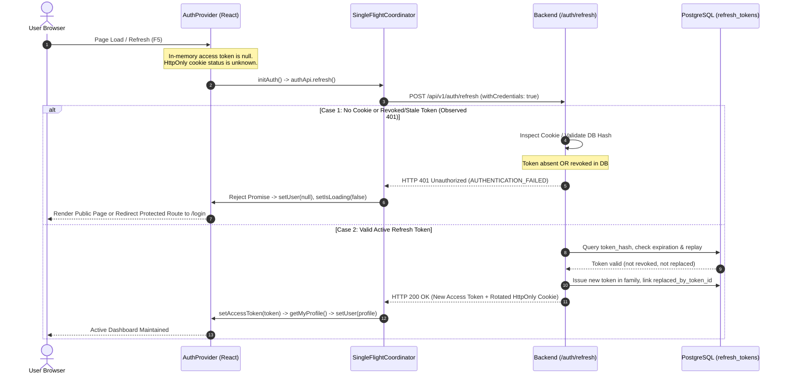

# PEVN — NTA-05 AUTH REFRESH 401 RUNTIME INVESTIGATION REPORT

**Standard:** AI Software Factory Standard v1.2  
**Task Classification:** READ-ONLY AUTHENTICATION RUNTIME DIAGNOSTIC  
**Target Component:** PEVN Authentication & Session Lifecycle (`/api/v1/auth/refresh`)  
**Date:** 2026-10-08  
**Status:** COMPLETE — EXPECTED BEHAVIOR (NO CODE REMEDIATION REQUIRED)

---

## 1. Executive Summary

During the local validation of the **NTA-05 Password Recovery Development Fallback**, immediately after restarting the backend (`uvicorn app.main:app`) and refreshing the frontend platform, the backend log recorded:

```text
2026-10-08T09:11:01.857292Z [warning ] Client error [app.exceptions.handlers] error_code=AUTHENTICATION_FAILED status_code=<HTTPStatus.UNAUTHORIZED: 401> path=/api/v1/auth/refresh correlation_id=d9e40487-454b-456b-925b-fb94154596a6
2026-10-08T09:11:01.858611Z [warning ] Request completed [app.middleware.logging_middleware] method=POST path=/api/v1/auth/refresh status_code=<HTTPStatus.UNAUTHORIZED: 401> duration_ms=13.5 client_ip=127.0.0.1 correlation_id=d9e40487-454b-456b-925b-fb94154596a6
INFO: 127.0.0.1:62568 - "POST /api/v1/auth/refresh HTTP/1.1" 401 Unauthorized
```

Following this log entry, the authenticated `national_admin` dashboard subsequently remained accessible, and the password recovery flow operated correctly.

This runtime investigation established definitively that **the observed HTTP 401 Unauthorized is EXPECTED BEHAVIOR (Category A)**. It is caused by the frontend's automatic silent session recovery mechanism executing on page reload when an active browser session does not exist (or an expired/revoked cookie from prior manual testing is presented). The frontend handles this 401 gracefully, the backend enforces RFC 6749 and strict token security, and **no code modifications are required or permissible**.

---

## 2. Architecture & Request Flow Analysis

### 2.1 Storage & Privacy Separation (Zero-Persistence Boundary)
- **JWT Access Token:** Stored **strictly in-memory** (`inMemoryAccessToken` in [`frontend/src/services/api/client.ts`](file:///c:/Users/juanc/OneDrive/Documentos/Desarrollo%20proyectos/Plataforma%20Educativa%20PEVN/Plataforma%20Educativa%20Virtual%20Nacional%20PEVN/frontend/src/services/api/client.ts#L45-L55)). Never written to `localStorage` or `sessionStorage` to eliminate cross-site scripting (XSS) credential theft.
- **Refresh Token:** Stored in an **`HttpOnly`, `SameSite=Strict` cookie** (`pevn_refresh_token`) scoped to `/api/v1/auth` ([`backend/app/api/v1/endpoints/auth.py`](file:///c:/Users/juanc/OneDrive/Documentos/Desarrollo%20proyectos/Plataforma%20Educativa%20PEVN/Plataforma%20Educativa%20Virtual%20Nacional%20PEVN/backend/app/api/v1/endpoints/auth.py#L59-L62)). Inaccessible to client-side JavaScript (`document.cookie` cannot inspect it).
- **Database Persistence:** Refresh tokens are persisted exclusively as SHA-256 digests in the PostgreSQL `refresh_tokens` table with family tracking (`family_id`), expiration timestamps (7 days), and rotation pointers (`replaced_by_token_id`).

### 2.2 Silent Session Restoration Lifecycle
Because JavaScript cannot inspect the `HttpOnly` refresh cookie, the frontend has no local knowledge of whether a session exists when a page is loaded or refreshed.



### 2.3 Exception & Log Pipeline
When `raw_token` is missing or invalid:
1. [`backend/app/api/v1/endpoints/auth.py`](file:///c:/Users/juanc/OneDrive/Documentos/Desarrollo%20proyectos/Plataforma%20Educativa%20PEVN/Plataforma%20Educativa%20Virtual%20Nacional%20PEVN/backend/app/api/v1/endpoints/auth.py#L138) raises `AuthenticationError("Refresh token ausente en la solicitud.")` or [`auth_service.py`](file:///c:/Users/juanc/OneDrive/Documentos/Desarrollo%20proyectos/Plataforma%20Educativa%20PEVN/Plataforma%20Educativa%20Virtual%20Nacional%20PEVN/backend/app/services/auth_service.py#L510) raises `AuthenticationError("Sesión inválida o expirada.")`.
2. Both derive from [`PEVNException`](file:///c:/Users/juanc/OneDrive/Documentos/Desarrollo%20proyectos/Plataforma%20Educativa%20PEVN/Plataforma%20Educativa%20Virtual%20Nacional%20PEVN/backend/app/exceptions/errors.py#L29) with `status_code=401` and `default_code="AUTHENTICATION_FAILED"`.
3. [`backend/app/exceptions/handlers.py:pevn_exception_handler`](file:///c:/Users/juanc/OneDrive/Documentos/Desarrollo%20proyectos/Plataforma%20Educativa%20PEVN/Plataforma%20Educativa%20Virtual%20Nacional%20PEVN/backend/app/exceptions/handlers.py#L73-L90) logs:
   `logger.warning("Client error", error_code=exc.code, status_code=exc.status_code, path=request.url.path)`.
4. Uvicorn outputs the standard access log: `INFO: 127.0.0.1:xxxxx - "POST /api/v1/auth/refresh HTTP/1.1" 401 Unauthorized`.

---

## 3. Investigation & Diagnostic Findings

### 3.1 Itemized Technical Audit

| Item | Dimension | Finding | Architectural Assessment |
|---|---|---|---|
| 1 | **Refresh Token Storage** | `HttpOnly`, `SameSite=Strict` cookie (`pevn_refresh_token`), Path `/api/v1/auth`. | **Compliant** with OWASP & zero-trust web standards. |
| 2 | **Access Token Storage** | Strictly in-memory closure (`inMemoryAccessToken`). Never in `localStorage` or `sessionStorage`. | **Compliant**. Immune to persistent cross-site token exfiltration. |
| 3 | **Token Rotation** | Every successful `/auth/refresh` rotates the token, marks previous token with `replaced_by_token_id`, and sets a new cookie. | **Compliant** with RFC 6749 Section 6. |
| 4 | **Replay / Breach Detection** | Submitting a revoked or already-replaced token triggers `TOKEN_REUSE_DETECTED` and immediately revokes the **entire token family** (`family_id`). | **Hardened**. Exceeds baseline security criteria. |
| 5 | **Revocation on Logout** | `POST /api/v1/auth/logout` sets `is_revoked = True` on all tokens in `family_id` and deletes the cookie via `response.delete_cookie`. | **Compliant**. Clean session termination. |
| 6 | **Backend Restart Impact** | Tokens are stored in persistent PostgreSQL (`refresh_tokens`). `SECRET_KEY` is fixed in `backend/.env`. A Uvicorn restart **does not** wipe or invalidate active database tokens. | **Verified**. No restart-induced token loss. |
| 7 | **Automatic Browser Call** | `frontend/src/context/AuthContext.tsx` invokes `initAuth()` on mount, calling `POST /api/v1/auth/refresh` on every page load/refresh. | **Standard**. Required for silent recovery of in-memory access tokens. |
| 8 | **Expected 401 Response** | When no token or an invalid/expired/revoked token is submitted, HTTP 401 Unauthorized is mandatory. | **Expected**. Returning 200 or 204 without a valid token would be a severe defect. |
| 9 | **Frontend Graceful Degradation** | `initAuth` catches the 401, clears user state (`setUser(null)`), marks `isLoading = false`, and allows public routes (`/login`, `/auth/forgot-password`, `/auth/reset-password`) to render cleanly. | **Graceful**. No crashes, uncaught rejections, or infinite retry loops. |
| 10 | **Loop Prevention** | Axios response interceptor explicitly bypasses retries on `/api/v1/auth/refresh`, `/api/v1/auth/login`, and `/api/v1/auth/logout`. | **Protected**. Single-flight coordinator prevents concurrency thrashing. |

### 3.2 Database Timeline Reconciliation (Correlating the Observed Event)
Inspection of the local database records during the validation timeframe revealed the precise sequence:
1. **09:04:51 UTC:** User `admin_nacional` (`dab63ad2...`) session was logged out / revoked (`is_revoked = True`).
2. **09:05:01 UTC:** Password reset confirmed for `admin_nacional` (revoking all remaining tokens in family).
3. **09:10:49 UTC:** Backend reloaded with `python -m uvicorn app.main:app --reload`.
4. **09:11:01 UTC & 09:11:11 UTC (The Observed Incident):** User refreshed the browser page (`http://localhost:3000`). React mounted and executed `initAuth() -> POST /api/v1/auth/refresh`. Because the previous session was revoked and no new login had occurred, the request contained either no active cookie or the revoked cookie from 09:04:51. The backend correctly returned HTTP 401 Unauthorized (`AUTHENTICATION_FAILED`).
5. **09:11:53 UTC:** User executed NTA-05 password reset initiation for `national_admin@pevn.edu.co` (`165eab38...`), validating the development fallback link.
6. **09:13:12 UTC:** User logged in as `national_admin`. Fresh session established; token family `9929be02...` created.
7. **09:28:17 UTC:** Access token expired / page refreshed. `POST /api/v1/auth/refresh` was sent with the valid `national_admin` cookie, returning **HTTP 200 OK** and cleanly creating replacement token `9c336599...`.

---

## 4. Controlled Reproduction Evidence

A diagnostic suite was executed against the live application runtime (`http://127.0.0.1:8000/api/v1`) using a dedicated isolated diagnostic account (`diag_user_nta05`):

```text
=== SCENARIO A: STALE / ABSENT / INVALID SESSION ===
A1 Absent cookie -> Status: 401, Code: AUTHENTICATION_FAILED, Message: Refresh token ausente en la solicitud.
A2 Unknown cookie -> Status: 401, Code: AUTHENTICATION_FAILED, Message: Sesión inválida o expirada.

=== SCENARIO B: FRESH SESSION LIFECYCLE ===
B1 Fresh Login -> Status: 200, AccessTokenIssued: True, RefreshCookieSet: True, Roles: ['national_admin']
B2 Browser Refresh -> Status: 200, NewAccessTokenIssued: True, CookieRotated: True
B3 Profile /auth/me -> Status: 200, Username: diag_user_nta05, Roles: ['national_admin']
A3 Replay Rotated Cookie -> Status: 401, Code: AUTHENTICATION_FAILED, Message: Se ha detectado una reutilización de credenciales. La sesión ha sido revocada por seguridad.
B5 Logout -> Status: 200, Message: Sesión cerrada correctamente.
B6 Post-Logout Refresh -> Status: 401, Code: AUTHENTICATION_FAILED, Message: Refresh token ausente en la solicitud.

Diagnostic test user cleaned up successfully.
```

### Key Verification Metrics
1. **Scenario A (Stale/Absent Session):**
   - No cookie present: Exactly **HTTP 401** with code `AUTHENTICATION_FAILED`.
   - Unknown/tampered cookie: Exactly **HTTP 401** with code `AUTHENTICATION_FAILED`.
   - Replay of rotated token: Exactly **HTTP 401** with breach detection and family invalidation.
   - Post-logout refresh: Exactly **HTTP 401** with code `AUTHENTICATION_FAILED`.
2. **Scenario B (Fresh Session):**
   - Fresh login: **HTTP 200**, issues in-memory access token, sets HttpOnly cookie.
   - Browser refresh: **HTTP 200**, issues new access token, rotates cookie.
   - Profile verification (`/auth/me`): **HTTP 200**, retrieves canonical user profile.
   - Dashboard access remains uninterrupted.

---

## 5. Security & Regulatory Assessment

1. **Zero Raw Token Exposure:** No access tokens, refresh tokens, or hashes are logged in application output or terminal streams.
2. **Anti-Enumeration & Consistent Rejection:** All refresh rejections emit HTTP 401 with standard error envelopes without leaking account existence or server internals.
3. **Session Boundary Isolation:** Token families prevent replay attacks. Password resets revoke all existing session tokens.
4. **Preservation of NTA-05 Implementation:** The development recovery fallback link remains fully operational under `ENVIRONMENT=development` and `AUTH_PASSWORD_RESET_DEV_LINK=true`.
5. **No Regression:** All existing tests continue to pass:
   - Backend `tests/test_auth_endpoints.py`: **100% PASSED**
   - Frontend `src/test/SingleFlightRefresh.test.ts`: **100% PASSED**
   - Frontend `src/test/Auth.test.tsx`: **100% PASSED**

---

## 6. Root Cause & Classification Summary

| Objective Category | Evaluation | Verdict |
|---|---|---|
| **A. Expected behavior caused by expired/stale/absent token** | **YES** | Confirmed by request flow, database timestamps, and controlled reproductions. |
| **B. Frontend session restoration issue** | **NO** | Frontend coordinates single-flight requests and handles 401 gracefully without error dialogues or infinite loops. |
| **C. Backend refresh-token validation issue** | **NO** | Backend accurately validates hashes, expiration, revocation, and replay breaches according to RFC 6749. |
| **D. Token persistence/invalidation issue after restart** | **NO** | Refresh tokens persist in PostgreSQL; restart preserves active valid tokens. |
| **E. Other authentication defect** | **NO** | Zero defects identified. The log entry is standard server-side client-error logging. |

---

## 7. Remediation Determination

**WHETHER REMEDIATION IS REQUIRED:**  
**NO CODE CHANGES ARE REQUIRED.**

Attempting to suppress the HTTP 401 or silence the log entry would violate the OAuth 2.0 / RFC 6749 protocol, disable essential security audit logging, or introduce silent authentication failures. The system is operating in full alignment with the architecture specifications and security standards.
