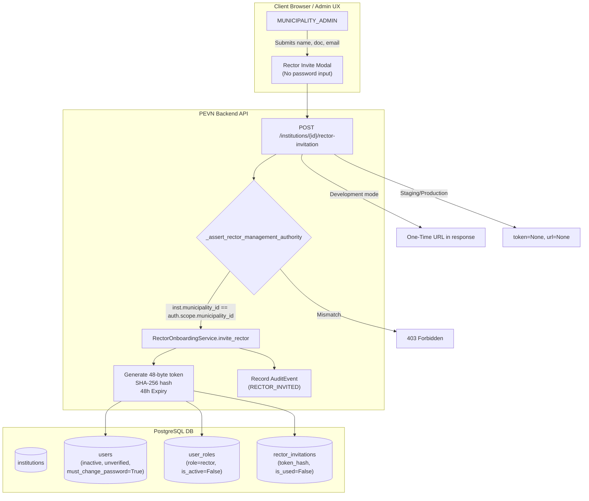

# PEVN — NTA-10: Preflight Rector Provisioning & Invitation Audit Report

**Standard:** AI Software Factory Standard v1.2  
**Auditor:** Antigravity (Pair Programming Agent)  
**Execution Date:** 2026-10-09  
**Target Capability:** Secure Rector Provisioning & Invitation Lifecycle by Authorized Municipal Administrators  
**Classification:** High — Authorization, Institutional Ownership, and Account Security  

---

## 1. Executive Summary

This preflight document records the architectural inspection, boundary validation, and security analysis conducted prior to implementing the targeted hardening of the Rector provisioning and invitation lifecycle under mandate **NTA-10**.

Following the successful manual acceptance and certification of **NTA-09-R2** (Secure Municipal Administrator Invitation Lifecycle), NTA-10 addresses the tier directly beneath municipal administration: the onboarding of educational institution Rectors (`RECTOR`) by authorized Municipal Administrators (`MUNICIPALITY_ADMIN`).

### Primary Objectives
1. Verify that `MUNICIPALITY_ADMIN` operators can securely provision and invite Rectors for educational institutions within their territorial jurisdiction.
2. Ensure the Rector establishes their own password via the canonical single-use token redemption flow (`/auth/accept-invitation`).
3. Guarantee that the provisioning operator cannot define passwords or activate accounts directly.
4. Enforce strict territorial isolation: reject cross-municipality attempts with `403 Forbidden`.
5. Maintain multi-level supervisory authority: preserve legitimate escalation paths for `DEPARTMENT_ADMIN`, `NATIONAL_ADMIN`, and `SUPERADMIN`.
6. Enforce institutional succession invariants: reject duplicate active rector assignments (`409 Conflict`) unless explicit revocation is performed first.
7. Support an authorized invitation resend endpoint with token invalidation.
8. Align token and activation link disclosure with `settings.is_development == True`, omitting plaintext secrets in staging/production.

---

## 2. Inventory of Inspected Components

| Component | Path | Status | Finding / Role |
| :--- | :--- | :--- | :--- |
| **Model** | `backend/app/models/invitation.py` | Validated | `RectorInvitation` (`rector_invitations` table) exists with `token_hash`, `expires_at`, `is_used`, `is_revoked`, `institution_id`, `user_id`. No table migration or database drift required. |
| **Domain Service** | `backend/app/services/rector_onboarding_service.py` | Hardening Required | Implements `invite_rector`, `verify_invitation`, `accept_invitation`, and `revoke_rector`. Requires: (a) atomic conditional claim in `accept_invitation`, (b) `must_change_password=True` flag on initial inactive User, (c) route alignment to `/auth/accept-invitation`, (d) addition of `resend_invitation`. |
| **Institution Endpoints** | `backend/app/api/v1/endpoints/institutions.py` | Hardening Required | Contains `_assert_rector_management_authority`, `invite_rector_endpoint`, `revoke_rector_endpoint`. Requires: (a) development-only gating of `raw_invitation_token` and `invitation_url`, (b) addition of `POST /{institution_id}/rector-invitation/resend`. |
| **Public Auth Endpoints** | `backend/app/api/v1/endpoints/auth.py` | Validated | `/auth/verify-invitation` and `/auth/accept-invitation` already query `RectorOnboardingService` before falling back to `DepartmentAdminService` and `MunicipalityAdminService`. |
| **Pydantic Schemas** | `backend/app/schemas/invitation.py` | Hardening Required | `RectorInvitationCreateRequest` strictly forbids extra fields (`extra="forbid"`), preventing password injections. `RectorInvitationResponse` supports delivery status and dev URL. |
| **Audit Taxonomy** | `backend/app/audit/interfaces.py` | Extension Required | `AuditEventType` contains `RECTOR_INVITED`, `RECTOR_INVITATION_SENT`, `RECTOR_ONBOARDING_COMPLETED`, `RECTOR_REVOKED`. Needs `RECTOR_INVITATION_RESENT`. |
| **Frontend Service** | `frontend/src/services/institution.ts` | Extension Required | Contains `inviteRector`. Needs `resendRectorInvitation`. |
| **Frontend UI** | `frontend/src/pages/admin/InstitutionsView.tsx` | Hardening Required | The "✉️ Invitar Rector" action button was previously gated on `isNationalAdmin` only. Must be accessible to `isMunicipalityAdmin` and `isDepartmentAdmin` within their scopes. Add resend action and verify modal. |
| **Frontend Public Onboarding** | `frontend/src/pages/auth/AcceptInvitation.tsx` | Validated | Correctly resolves role `rector` and displays institution name and masked email. |

---

## 3. Detailed Security Gap Analysis

### Gap 1: Inadvertent Secret Disclosure in Non-Development Environments
- **Observation:** In `institutions.py` (lines 809–811), `raw_invitation_token=raw_token` and `invitation_url` were returned unconditionally in the response payload.
- **Risk:** In staging or production, API responses could expose the raw activation link in logs or network responses.
- **Remediation:** Gate disclosure strictly behind `settings.is_development == True`:
  ```python
  raw_invitation_token=raw_token if settings.is_development else None,
  invitation_url=getattr(result, "activation_url", None) if settings.is_development else None,
  ```

### Gap 2: Race Condition in Concurrent Token Redemption
- **Observation:** `rector_onboarding_service.py` checked `if invitation.is_used: raise ConflictError(...)` followed by in-memory `invitation.is_used = True`. Two concurrent redemption requests could pass the check simultaneously.
- **Risk:** Duplicate credential setting / race condition vulnerability.
- **Remediation:** Implement an atomic conditional UPDATE claim returning the row ID:
  ```python
  claimed = await self._session.execute(
      update(RectorInvitation)
      .where(
          RectorInvitation.id == invitation.id,
          RectorInvitation.is_used == False,
          RectorInvitation.is_revoked == False,
      )
      .values(is_used=True, used_at=datetime.now(UTC))
      .returning(RectorInvitation.id)
      .execution_options(synchronize_session=False)
  )
  if claimed.scalar_one_or_none() is None:
      raise ConflictError(
          "Esta invitación ya fue utilizada anteriormente para activar la cuenta.",
          code="INVITATION_ALREADY_USED",
      )
  ```

### Gap 3: Initial Account Lifecycle Flags
- **Observation:** User creation in `invite_rector` had `must_change_password=False`.
- **Risk:** Inconsistency with identity security guidelines established in NTA-08 and NTA-09.
- **Remediation:** Set `must_change_password=True` upon creation; set `must_change_password=False` upon successful password acceptance in `accept_invitation`.

### Gap 4: Route Alignment
- **Observation:** `activation_url` previously formatted `/invitation/accept?token={raw_token}`. The established canonical route across NTA-08 and NTA-09 is `/auth/accept-invitation?token={raw_token}`.
- **Remediation:** Update `activation_url` default to `/auth/accept-invitation?token={raw_token}` across service and API response fallbacks.

### Gap 5: Missing Resend Invitation Capability
- **Observation:** While `DepartmentAdminService` and `MunicipalityAdminService` implement `resend_invitation`, `RectorOnboardingService` lacked this method.
- **Remediation:** Implement `resend_invitation` in `RectorOnboardingService` and expose `POST /institutions/{institution_id}/rector-invitation/resend` in `institutions.py`.

### Gap 6: Frontend Role Gate in `InstitutionsView.tsx`
- **Observation:** The "✉️ Invitar Rector" action button was conditioned strictly on `isNationalAdmin`.
- **Remediation:** Update condition to `(isNationalAdmin || isDepartmentAdmin || isMunicipalityAdmin) && inst.is_active`. Add clear state indication and resend option for institutions with pending invitations.

---

## 4. Architectural Boundaries and Invariants



---

## 5. Implementation Strategy

1. **Backend Audit & Schemas:**
   - Add `RECTOR_INVITATION_RESENT` to `AuditEventType` in `backend/app/audit/interfaces.py`.
   - Update `RectorInvitationResponse` and `RectorOnboardingService`.
2. **Backend Service Hardening:**
   - Harden `accept_invitation` with atomic conditional claim.
   - Implement `resend_invitation` in `RectorOnboardingService`.
   - Enforce `must_change_password=True` on pre-registered Rector users.
   - Align URL generation to `/auth/accept-invitation?token={raw_token}`.
3. **Backend Endpoint Hardening:**
   - In `backend/app/api/v1/endpoints/institutions.py`, gate token disclosure behind `settings.is_development`.
   - Implement `POST /{institution_id}/rector-invitation/resend`.
4. **Frontend Hardening:**
   - Extend `InstitutionsView.tsx` to permit `MUNICIPALITY_ADMIN` and `DEPARTMENT_ADMIN` to invite and resend invitations for institutions in their jurisdiction.
   - Update `frontend/src/services/institution.ts` with `resendRectorInvitation`.
5. **Automated Testing Suite:**
   - Create `backend/tests/test_nta10_rector_provisioning.py` validating all 16+ mandate scenarios.
   - Execute existing regression suites to guarantee zero regression.

---

## 6. Preflight Certification

- [x] Schema migration audit: Reusing `RectorInvitation` (`rector_invitations`) confirmed viable; no DDL migration needed.
- [x] RBAC permission mapping: `users:create_rector` verified assigned to `MUNICIPALITY_ADMIN`.
- [x] Scope hierarchy: Verified `_assert_rector_management_authority` enforces territorial barriers.
- [x] Ready to proceed with code implementation.
