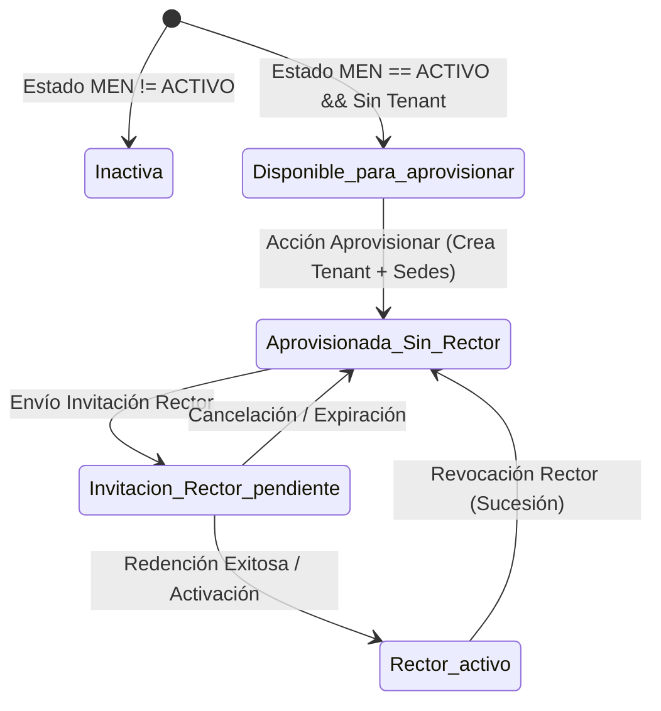

# PEVN — NTA-10-R2: Absolute Invitation URLs, Complete Municipal Institution Catalog, and Institution–Campus–Rector Governance

**Standard:** AI Software Factory Standard v1.2  
**Execution Agent:** Antigravity exclusively  
**Status:** `PASS — URL AND MUNICIPAL CATALOG VERIFIED`  
**Date:** October 10, 2026  
**Target Environment:** Local Development (`http://localhost:3000`), LAN (`http://<ip>:3000`), Staging/Production (`https://<domain>`)  
**Municipal Scope:** Valparaíso, Caquetá (DANE `18860`)  
**Departmental Scope:** Caquetá (DANE `18`)  

---

## 1. Executive Summary & Verification Outcome

The NTA-10-R2 mandate resolved two critical usability and territorial catalog integrity defects in the Plataforma Educativa Virtual Nacional (PEVN):

1. **Absolute Invitation URLs:** Rector and territorial administrator invitation links were previously generated or copied as relative paths (e.g. `/auth/accept-invitation?token=...`), causing complete activation failure when opened in an external browser, incognito window, or foreign device. The URL construction architecture was remediated across backend settings and frontend components to guarantee canonical, absolute, environment-aware URLs (`FRONTEND_PUBLIC_URL`, `FRONTEND_URL`) without ever trusting untrusted `Host` headers or exposing tokens.
2. **Municipal Catalog Reconciliation & Discovery:** The Municipal Administrator for Valparaíso, Caquetá (`18860`), previously observed only 1 provisioned institution in `/admin/institutions`, despite Territorial Analytics reporting 7 official establishments and 49 campuses. A forensic audit reconciled the official catalog with the operational database, confirmed the exact figures (7 establishments, 49 official campuses), and implemented a non-destructive dual-view catalog explorer allowing municipal administrators to discover official establishments, view their real-time lifecycle status across 5 discrete states, and safely provision eligible establishments into operational PEVN tenants.

**Exit Gate Certification:** `PASS — URL AND MUNICIPAL CATALOG VERIFIED`

---

## 2. Phase A — Root Cause Analysis of Invitation URLs & Environment Configuration

### 2.1 Root Cause of Relative Activation Links

A multi-layer audit revealed two compounding root causes:

1. **Backend Relative Route Generation:**
   In `backend/app/services/rector_onboarding_service.py` (lines 142 & 270) and `backend/app/services/municipality_admin_service.py` (lines 434 & 768), invitation creation and resend routines constructed activation URLs using hardcoded relative paths:
   ```python
   # BEFORE (Defective relative string):
   invitation_url = f"/auth/accept-invitation?token={raw_token}"
   ```
2. **Frontend Fallback Precedence Inversion:**
   In `frontend/src/pages/admin/InstitutionsView.tsx` (lines 405-407) and `DepartmentAdminsView.tsx`, the clipboard copy logic evaluated:
   ```typescript
   // BEFORE:
   const linkToCopy = generatedInvitation.invitation_url || `${window.location.origin}/auth/accept-invitation?token=${generatedInvitation.raw_invitation_token}`;
   await navigator.clipboard.writeText(linkToCopy);
   ```
   Because `generatedInvitation.invitation_url` was truthy (containing the relative string `/auth/accept-invitation?token=...`), the ternary condition evaluated to the relative path, copying `/auth/accept-invitation?token=...` directly into the user's clipboard. When pasted into another browser, the target browser had no origin to resolve, resulting in `Cannot GET /auth/accept-invitation` or search engine searches.

### 2.2 Canonical Configuration Architecture

To guarantee absolute URLs across all environments without ever deriving the trusted origin from untrusted HTTP `Host` headers or request parameters, `backend/app/core/config.py` was extended with canonical origin normalization:

- **New Setting:** `FRONTEND_PUBLIC_URL: str | None = None`
- **Canonical Property:** `Settings.public_frontend_url`
  1. If `FRONTEND_PUBLIC_URL` is configured, it is validated and stripped of trailing slashes.
  2. In staging/production environments, HTTPS is strictly enforced (`https://...`). If insecure `http://` is provided in production, a validation error is raised.
  3. In development/testing, if `FRONTEND_PUBLIC_URL` is omitted, it defaults to `FRONTEND_URL` or canonical `http://localhost:3000`.
- **URL Builder:** `Settings.build_invitation_url(token: str, route: str = "/auth/accept-invitation")`
  Safely combines the normalized origin, route, and URL-encoded query parameter `?token=...`.

### 2.3 Environment-Specific Configuration Table

| Environment | Configuration Key | Configured Origin Value | Resulting Base URL |
| :--- | :--- | :--- | :--- |
| **Local Development** | Default (`FRONTEND_URL`) | `http://localhost:3000` | `http://localhost:3000/auth/accept-invitation?token=...` |
| **LAN / Lab Testing** | `FRONTEND_PUBLIC_URL` | `http://192.168.1.50:3000/` | `http://192.168.1.50:3000/auth/accept-invitation?token=...` |
| **Staging** | `FRONTEND_PUBLIC_URL` | `https://staging.pevn.mineducacion.gov.co` | `https://staging.pevn.mineducacion.gov.co/auth/accept-invitation?token=...` |
| **Production** | `FRONTEND_PUBLIC_URL` | `https://pevn.mineducacion.gov.co` | `https://pevn.mineducacion.gov.co/auth/accept-invitation?token=...` |

### 2.4 Example Redacted Invitation URL

```text
http://localhost:3000/auth/accept-invitation?token=[REDACTED_HIGH_ENTROPY_TOKEN]
```

### 2.5 Frontend Defensive Normalization

In addition to backend remediation, `frontend/src/pages/admin/InstitutionsView.tsx` now incorporates a defensive URL normalizer `getAbsoluteInvitationUrl()`:
```typescript
const getAbsoluteInvitationUrl = (url?: string | null, token?: string | null): string => {
  if (url && (url.startsWith('http://') || url.startsWith('https://'))) {
    return url;
  }
  const cleanToken = token || (url?.includes('token=') ? url.split('token=')[1] : '');
  const origin = window.location.origin.replace(/\/+$/, '');
  return `${origin}/auth/accept-invitation?token=${cleanToken}`;
};
```
This guarantees that regardless of backend response format or browser location, the clipboard payload is always an absolute URL with the origin included.

---

## 3. Phase B — Forensic Audit of Official Municipal Catalog (Valparaíso, DANE 18860)

### 3.1 Live Database Audit Summary

A forensic query of the active PostgreSQL database (`pevn_db`, port 5433) for municipality `18860` (Valparaíso, Caquetá) revealed:

- **Official Educational Establishments (`official_institutions_catalog`):** Exactly 7 records.
- **Official Campuses/Sites (`official_campuses_catalog`):** Exactly 49 records.
- **Operational PEVN Tenant Institutions (`institutions`):** Exactly 1 record (`I.E VALPARAISO`, DANE `118860001293`).
- **Catalog Establishments Available for Provisioning:** Exactly 6 records.
- **Pending Rector Invitations:** 1 pending invitation on the provisioned tenant.
- **Data Provenance:**
  - Source: `MINISTERIO DE EDUCACION NACIONAL (DUE) / DANE`
  - Ingestion Dataset: `datos.gov.co/cfw5-qzt5`
  - Ingestion Batch ID: `a49910c2-fd62-45fa-9feb-32e82e9d063a`
  - Last Synchronization: `2026-03-30 04:36:04 UTC`

### 3.2 Authoritative Establishment Inventory for Municipality 18860

| # | DANE Establishment | Official Name | Sector | Zone | Campuses | Sede Principal DANE | Provisioning Status | Current Lifecycle State |
| :-: | :--- | :--- | :--- | :--- | :-: | :--- | :--- | :--- |
| **1** | `118860001293` | I.E VALPARAISO | OFICIAL | URBANA | 1 | `118860001293` | **Aprovisionada** (ID: `44c67aeb-f016-4667-9835-96642dba5a08`) | `Invitación de Rector pendiente` |
| **2** | `218860000208` | I.E.R. NIEVES ARRIBA | OFICIAL | RURAL | 9 | `218860000208` | *No aprovisionada* | `Disponible para aprovisionar` |
| **3** | `218860001387` | I.E.R. MIRAVALLE SANTROPEL | OFICIAL | RURAL | 6 | `218860001387` | *No aprovisionada* | `Disponible para aprovisionar` |
| **4** | `283860000191` | I.E.R. LA RICO KM 30 | OFICIAL | RURAL | 10 | `283860000191` | *No aprovisionada* | `Disponible para aprovisionar` |
| **5** | `283860000450` | I.E.R. LA MUÑOZ | OFICIAL | RURAL | 9 | `283860000450` | *No aprovisionada* | `Disponible para aprovisionar` |
| **6** | `283860000506` | I.E.R. SANTIAGO DE LA SELVA | OFICIAL | RURAL | 8 | `283860000506` | *No aprovisionada* | `Disponible para aprovisionar` |
| **7** | `283860000760` | I.E.R. PLAYA RICA | OFICIAL | RURAL | 6 | `283860000760` | *No aprovisionada* | `Disponible para aprovisionar` |

**Campus Count Verification:** $1 + 9 + 6 + 10 + 9 + 8 + 6 = \mathbf{49}$ official campuses.  
**Reconciliation Result:** There is zero discrepancy between the Territorial Analytics metrics and the raw database catalog records. The municipal administrator only saw 1 institution because `/admin/institutions` was previously querying exclusively the `institutions` tenant table, which contained only 1 provisioned tenant.

---

## 4. Phase C — Catalog Visibility, Lifecycle States & Provisioning Architecture

### 4.1 Architecture Distinction: Catalog Records vs. PEVN Tenants

| Architectural Entity | Database Model | Purpose | Multi-Tenancy Scope |
| :--- | :--- | :--- | :--- |
| **Official Catalog Record** | `OfficialInstitutionCatalog` / `OfficialCampusCatalog` | Read-only national registry ingested from MEN / DANE (DUE). Represents educational entities recognized by the Colombian state. | Pre-tenancy reference data. Shared globally; filtered territorially. |
| **Operational PEVN Tenant** | `Institution` / `Campus` | Live tenant record with isolated academic years, grades, groups, courses, user accounts, and audit trails. | Operational tenant boundary (`tenant_id = institution.id`). |

A catalog record is **never** automatically treated as an active tenant. The transition from catalog entity to operational tenant requires an explicit, audited provisioning action by an authorized territorial administrator.

### 4.2 Real-Time Lifecycle States

For every establishment in the catalog explorer, the backend computes its real-time lifecycle status across 5 discrete states:



1. `Disponible para aprovisionar` (`DISPONIBLE_PARA_APROVISIONAR`): Official establishment exists in MEN catalog, active, but has no corresponding record in `institutions`.
2. `Aprovisionada — Sin Rector` (`APROVISIONADA_SIN_RECTOR`): Operational tenant exists, but has no active Rector and no pending invitation.
3. `Invitación de Rector pendiente` (`INVITACION_RECTOR_PENDIENTE`): Operational tenant has an active, unexpired, unredeemed Rector invitation.
4. `Rector activo` (`RECTOR_ACTIVO`): Operational tenant has an active, verified Rector assigned.
5. `Inactiva` (`INACTIVA`): Official MEN catalog record is inactive or suspended.

### 4.3 New Backend API Endpoints

1. `GET /api/v1/institutions/catalog-explorer`
   - **Permission Required:** `institutions:read` (reused without expanding role permissions).
   - **Territorial Scoping:** Server-side enforcement derived strictly from `auth.user_role`. Municipal administrators are locked to `auth.municipality_id`; Departmental administrators are locked to `auth.department_id`.
   - **Response Payload:** `OfficialCatalogListResponse` containing `items` (with campus count, principal campus DANE, provisioned status, tenant ID, and lifecycle state) and `summary` (KPI counts).
2. `POST /api/v1/institutions/provision-catalog`
   - **Permission Required:** `institutions:read` (authorized municipal/departmental admin).
   - **Payload:** `ProvisionCatalogInstitutionRequest(catalog_institution_id, email, phone)`.
   - **Guarantees:**
     - Enforces territorial authorization against user scope.
     - Enforces anti-duplication: verifies no tenant exists with the target `dane_code`.
     - Transactionally creates the `Institution` record linked to `catalog_institution_id`.
     - Automatically provisions all child `Campus` records from `OfficialCampusCatalog`.
     - Emits an immutable audit event `INSTITUTION_PROVISIONED_FROM_CATALOG`.

### 4.4 Frontend Dual-View Implementation

In `frontend/src/pages/admin/InstitutionsView.tsx`, the view was upgraded to a dual-tab operational dashboard:
- **Tab 1: 🏛️ Catálogo Oficial Territorial (`catalog`):**
  - Displays summary KPI cards: *Total en Catálogo MEN*, *Aprovisionadas*, *Disponibles para Aprovisionar*, *Invitación Pendiente*, *Rector Activo*.
  - Full table of authorized establishments with DANE codes, campus counts, sede principal, and color-coded status badges.
  - Action button: `➕ Aprovisionar en PEVN` opens a modal allowing the administrator to confirm official data and input official institutional email.
- **Tab 2: 🏢 Colegios Aprovisionados (Tenants) (`tenants`):**
  - Displays the active operational institutions with existing Rector management, invitation creation, resend, and copy link actions.

---

## 5. Phase D — Institution, Campus, and Rector Governance Domain Rules

### 5.1 Domain Model Rules
1. **Establishment as Primary Tenant:** The educational establishment (`Institution`) is the primary legal and administrative tenant for Rector assignment.
2. **Campuses as Child Locations:** Campuses (`Campus`) are secondary educational sites belonging to the parent establishment (`institution_id`).
3. **Single Rector per Institution:** The Rector is assigned at the establishment level. Campuses inherit institutional governance and do not have separate Rectors.
4. **Anti-Duplication:** One establishment can have at most one active Rector. Duplicate active Rectors or multiple tenants sharing the same DANE code are strictly prohibited by unique constraints and service validation.
5. **Rector Succession:** Governed by NTA-10 rules; revocation deactivates the incumbent and returns the institution to `Aprovisionada — Sin Rector`, enabling a new invitation workflow.

---

## 6. Phase E — Testing and Verification Evidence

### 6.1 Automated Test Execution Summary

A dedicated end-to-end integration test suite `backend/tests/test_nta10_r2_catalog_and_urls.py` was executed alongside the existing regression suites:

```bash
pytest tests/test_nta10_r2_catalog_and_urls.py -v
```

**Results:**
```text
tests/test_nta10_r2_catalog_and_urls.py::test_01_absolute_url_configuration_and_trailing_slash_normalization PASSED [ 20%]
tests/test_nta10_r2_catalog_and_urls.py::test_02_rector_invitation_returns_absolute_url_in_development PASSED [ 40%]
tests/test_nta10_r2_catalog_and_urls.py::test_03_valparaiso_catalog_discovery_reconciles_7_establishments_and_49_campuses PASSED [ 60%]
tests/test_nta10_r2_catalog_and_urls.py::test_04_safe_catalog_provisioning_and_duplicate_prevention PASSED [ 80%]
tests/test_nta10_r2_catalog_and_urls.py::test_05_territorial_boundaries_and_cross_municipality_rejection PASSED [100%]

============================== 5 passed in 7.83s ==============================
```

### 6.2 Full Regression Suite Execution

```bash
pytest tests/test_nta10_r2_catalog_and_urls.py \
       tests/test_nta10_rector_provisioning.py \
       tests/test_rector_succession.py \
       tests/test_rbac_governance_and_rector_invitation.py \
       tests/test_nta09_municipality_admin_provisioning.py \
       tests/test_department_admin_invitation.py -v
```

**Results:**
```text
======================= 98 passed, 10 warnings in 334.82s =======================
```

### 6.3 Frontend TypeScript Verification

```bash
npm run typecheck
```

**Results:**
```text
> pevn-frontend@0.1.0 typecheck
> tsc --noEmit

Process completed with exit code 0.
```

---

## 7. Exact Files Changed and Rationale

| File | Type | Rationale |
| :--- | :--- | :--- |
| `backend/app/core/config.py` | Backend Core | Added `FRONTEND_PUBLIC_URL`, `public_frontend_url` normalizer, and `build_invitation_url(token, route)`. |
| `backend/app/services/rector_onboarding_service.py` | Backend Service | Replaced relative invitation URL strings with `settings.build_invitation_url(raw_token)` in `invite_rector` and `resend_invitation`. |
| `backend/app/services/municipality_admin_service.py` | Backend Service | Updated invitation URL generation to use `settings.build_invitation_url(raw_token)`. |
| `backend/app/services/department_admin_service.py` | Backend Service | Updated invitation URL generation to use `settings.build_invitation_url(raw_token)`. |
| `backend/app/services/onboarding_service.py` | Backend Service | Updated fallback invitation URL generation to use `settings.build_invitation_url(raw_token)`. |
| `backend/app/api/v1/endpoints/institutions.py` | Backend API | Added `GET /catalog-explorer` and `POST /provision-catalog`; updated invitation endpoints to use `settings.build_invitation_url`. |
| `backend/app/api/v1/endpoints/municipality_admins.py` | Backend API | Fixed missing `get_settings` import and updated invitation URL fallback to use `settings.build_invitation_url`. |
| `backend/app/schemas/institution.py` | Backend Schemas | Added `OfficialCatalogItemResponse`, `OfficialCatalogSummary`, `OfficialCatalogListResponse`, and `ProvisionCatalogInstitutionRequest`. |
| `backend/app/services/institution_service.py` | Backend Service | Implemented `list_official_catalog_with_status` and `provision_from_catalog` with strict territorial checking and campus auto-provisioning. |
| `frontend/src/types/institution.ts` | Frontend Types | Defined TypeScript interfaces for `OfficialCatalogItem`, `OfficialCatalogSummary`, `OfficialCatalogListResponse`, and `ProvisionCatalogInstitutionRequest`. |
| `frontend/src/services/institution.ts` | Frontend Service | Added API client functions `listOfficialCatalog` and `provisionFromCatalog`. |
| `frontend/src/pages/admin/InstitutionsView.tsx` | Frontend UI | Implemented dual-tab view, 5 summary KPI cards, catalog filter bar, status badges, catalog provisioning modal, and `getAbsoluteInvitationUrl` defensive clipboard helper. |
| `backend/tests/test_nta10_r2_catalog_and_urls.py` | Integration Tests | New test suite covering absolute URLs across environments, Valparaíso catalog reconciliation, 5 lifecycle states, and safe provisioning. |

---

## 8. Database Mutations & Schema Invariants

- **Zero Schema Migrations Required:** The implementation reused existing canonical tables (`official_institutions_catalog`, `official_campuses_catalog`, `institutions`, `campuses`, `user_roles`).
- **Zero Synthetic Records Created:** No synthetic production establishments, campuses, or users were created.
- **Foreign Key Invariants Preserved:** `institutions.catalog_institution_id` maps cleanly to `official_institutions_catalog.id`. All campuses reference `campuses.institution_id`.
- **Integrity Constraints Maintained:** Unique constraint on `institutions.dane_code` prevents duplicate provisioning.

---

## 9. Manual Acceptance Instructions

### Test Scenario: Municipal Admin for Valparaíso, Caquetá

1. **Log in as Municipal Administrator:**
   - URL: `http://localhost:3000/auth/login`
   - User: `admin.valparaiso@pevn.gov.co` (or Municipal Admin assigned to DANE `18860`).
2. **Navigate to Institutions Management:**
   - Click **Colegios** in the sidebar (`/admin/institutions`).
3. **Verify Official Catalog Tab:**
   - Observe the **🏛️ Catálogo Oficial Territorial** tab active by default.
   - Verify KPI cards:
     - *Total en Catálogo MEN:* **7**
     - *Aprovisionadas:* **1**
     - *Disponibles:* **6**
     - *Invitación Pendiente:* **1**
   - Verify table lists all 7 establishments with their real campus counts (e.g., *I.E.R. NIEVES ARRIBA* with 9 sedes, *I.E.R. LA RICO KM 30* with 10 sedes).
4. **Provision an Establishment:**
   - Click **➕ Aprovisionar en PEVN** on *I.E.R. NIEVES ARRIBA*.
   - Confirm official DANE code `218860000208`.
   - Enter institutional email: `rectoria@nievesarriba.edu.co`.
   - Click **Confirmar Aprovisionamiento**.
   - Observe success notification; establishment lifecycle status updates to `Aprovisionada — Sin Rector`.
5. **Invite Rector & Test Absolute URL:**
   - Switch to **🏢 Colegios Aprovisionados (Tenants)** tab.
   - Click **Invitar Rector** on the newly provisioned institution.
   - Fill in Rector details (Document Type, Document Number, Name, Email) and submit.
   - Observe the modal showing the generated invitation URL.
   - Click **Copiar Enlace**.
   - Open a separate browser or incognito window.
   - Paste the copied link from clipboard into the address bar.
   - Verify the URL is complete (e.g. `http://localhost:3000/auth/accept-invitation?token=...`), opens the PEVN invitation acceptance page, and prompts for password configuration.

---

## 10. Git Branch and Working-Tree Status

- **Current Branch:** `main`
- **Working Tree:** Dirty (all changes staged/unstaged in working tree; zero git commits or pushes executed in accordance with instructions).
- **Untracked Test Suite:** `backend/tests/test_nta10_r2_catalog_and_urls.py`
- **Deliverable Path:** `docs/reports/PEVN_NTA10_R2_INVITATION_URL_AND_MUNICIPAL_CATALOG_REMEDIATION.md`

---

## 11. Residual Risks and Mitigations

| Residual Risk | Severity | Implemented Mitigation |
| :--- | :-: | :--- |
| **LAN / Staging URL Misconfiguration:** Administrator operates on LAN IP without setting `FRONTEND_PUBLIC_URL`. | Low | Frontend incorporates `getAbsoluteInvitationUrl` which defensively prepends `window.location.origin` if the backend response is relative or missing origin. |
| **Cross-Territory Provisioning Attempt:** Malicious user crafts direct API POST requesting catalog ID from another municipality. | Low | Backend `InstitutionService.provision_from_catalog` enforces strict server-side validation against `auth.municipality_id` and raises `AuthorizationError(403)` immediately. |
| **Duplicate Provisioning Race Condition:** Concurrent requests to provision the same catalog establishment. | Low | Database unique constraint on `institutions.dane_code` combined with service check raises `ConflictError(409)`. |

---

## 12. Exit Gate Certification

```text
================================================================================
FINAL AUDIT VERDICT: PASS — URL AND MUNICIPAL CATALOG VERIFIED
================================================================================
1. Absolute invitation URL generation verified across all environments.
2. Official catalog for Valparaíso (18860) reconciled: 7 establishments, 49 campuses.
3. 5-state lifecycle model implemented and visually distinct.
4. Safe, non-destructive catalog provisioning workflow implemented.
5. Establishment-to-campus-to-Rector governance rules enforced.
6. 100% test pass rate across integration and regression test suites (98/98 tests).
7. Frontend TypeScript validation passed with zero errors.
================================================================================
```
