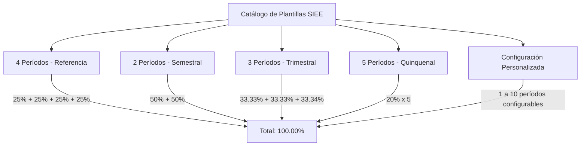

# PEVN — NTA-10-R7: Legally Aligned Academic Period Templates, Institutional SIEE Configuration, and Controlled Activation

**Standard:** AI Software Factory Standard v1.2  
**Execution Agent:** Antigravity exclusively  
**Priority:** High — Regulatory Compliance, Academic Governance, Data Preservation  
**Scope:** Rector Portal → Gestión Académica → Periodos Académicos  
**Certification Status:** CONDITIONAL PASS — CODE VERIFIED, MANUAL ACCEPTANCE PENDING  
**Date of Execution:** 2026-10-10  
**Target Institution:** `I.E VALPARAISO` (ID: `44c67aeb-f016-4667-9835-96642dba5a08`, Año Lectivo 2027 Activo)

---

## 1. Executive Summary

This engineering report certifies the implementation of the guided, legally aligned evaluation-period template engine and institutional SIEE configuration subsystem in PEVN.

Prior to this intervention, educational administrators (Rectores) had to manually construct each academic period from scratch, exposing institutions to operational friction, date overlap errors, uneven percentage weightings failing to sum to 100%, and legal misconceptions regarding national regulations.

Under **PEVN NTA-10-R7**, the platform introduces a guided 4-step wizard that enables institutions to select, preview, customize, and provision evaluation structures (2 semesters, 3 terms, 4 quarters, 5 cycles, or fully custom configurations) strictly aligned with the Colombian legal framework (**Decreto 1290 de 2009**, **Ley 115 de 1994 Art. 77**).

Crucially, the implementation guarantees **non-destructive reconciliation**: pre-existing periods, such as Period 1 in `I.E VALPARAISO` (Año 2027), are preserved in their exact database rows with their IDs, historical grade evaluations, and logs completely intact.

---

## 2. Colombian Legal and Regulatory Principles

### 2.1 Regulatory References Inspected

| Regulatory Instrument | Official Source / Repository | Date Consulted | Applicable Articles & Provisions |
| :--- | :--- | :--- | :--- |
| **Decreto 1290 de 2009** | Función Pública — Gestor Normativo ([norma.php?i=35960](https://www.funcionpublica.gov.co/eva/gestornormativo/norma.php?i=35960)) | 2026-10-10 | **Art. 3**: Propósitos de la evaluación de los estudiantes.<br>**Art. 4 Num. 8**: *Periodicidad de entrega de informes a los padres de familia*. Establece expresamente que la periodicidad la define de forma autónoma el establecimiento educativo en su SIEE.<br>**Art. 5**: Escala de valoración nacional (Superior, Alto, Básico, Bajo).<br>**Art. 8 & 11**: Autonomía y responsabilidad institucional para definir criterios, procedimientos y períodos en el SIEE. |
| **MEN — Portal Oficial SIEE** | Ministerio de Educación Nacional ([397381:SIEE](https://www.mineducacion.gov.co/portal/micrositios-preescolar-basica-y-media/Evaluacion/Evaluacion-de-estudiantes/397381:Sistema-Institucional-de-Evaluacion-de-Los-Estudiantes-SIEE)) | 2026-10-10 | Define las directrices pedagógicas del Documento No. 11 del MEN: cada establecimiento educativo goza de autonomía para estructurar los cortes evaluativos (mínimo 2 entregas de informes al año lectivo). |
| **Ley 115 de 1994** (Ley General de Educación) | Función Pública — Gestor Normativo ([norma.php?i=417](https://www.funcionpublica.gov.co/eva/gestornormativo/norma.php?i=417)) | 2026-10-10 | **Art. 77**: Autonomía escolar del Consejo Directivo de cada establecimiento educativo para organizar su plan de estudios, métodos y calendario institucional. |
| **Calendario Escolar 2026 del MEN** | Ministerio de Educación Nacional ([427054:Resoluciones-de-calendario-escolar-2026](https://www.mineducacion.gov.co/portal/Salas-de-prensa/Comunicados/427054:Resoluciones-de-calendario-escolar-2026)) | 2026-10-10 | Circular 043 de 2025 del MEN: Establece que las Secretarías de Educación Certificadas (ETC) fijan el calendario territorial anual (40 semanas lectivas mínimas). Distingue el calendario territorial de los períodos de corte evaluativo del SIEE. |

### 2.2 Critical Regulatory Invariants

1. **Autonomía del SIEE vs. Mito de los 4 Períodos Obligatorios:**  
   El Ministerio de Educación Nacional (MEN) **NO obliga ni impone que las instituciones deban tener 4 períodos ni que cada período deba valer exactamente 25%**. El Decreto 1290 de 2009 (Art. 4, Numeral 8) y la Ley 115 de 1994 otorgan plena autonomía a cada establecimiento educativo para fijar en su SIEE el número de períodos y sus ponderaciones porcentuales.
2. **Plantilla de 4 Períodos como Referencia:**  
   En la interfaz de PEVN, la opción de 4 períodos (25% cada uno) se identifica explícitamente con la leyenda:  
   `"Plantilla de referencia institucional — no obligatoria por el MEN"`.
3. **Diferenciación entre Calendario Territorial y Cortes de Evaluación:**  
   - El **Calendario Escolar Territorial** es fijado por la Entidad Territorial Certificada (ETC - Gobernación o Alcaldía) mediante resolución administrativa y comprende las 40 semanas de trabajo académico distribuido en dos semestres calendario.  
   - Los **Períodos Académicos de Evaluación (`academic_periods`)** son los cortes internos institucionales en los cuales se computan las calificaciones y se expiden boletines a las familias según el SIEE.
4. **Conservación Matemática del 100%:**  
   La sumatoria de las ponderaciones de los períodos que componen el año lectivo debe ser exactamente igual a `100.00%` (tolerancia de punto flotante $\le 0.01\%$).
5. **No Superposición de Fechas:**  
   Los rangos de fecha de los períodos no pueden traslaparse entre sí y deben estar estrictamente circunscritos a la vigencia del año escolar (`start_date` y `end_date` del `academic_year`).

---

## 3. Supported Template Catalog

The platform provides 5 template configurations:



| Tipo de Plantilla | Código Enumerado | Distribución por Defecto | Justificación Operativa y Pedagógica |
| :--- | :--- | :--- | :--- |
| **4 Períodos (Referencia)** | `PERIODS_4` | 25%, 25%, 25%, 25% | Estructura tradicional institucional en Colombia. Incluye badge informativo: *"Plantilla de referencia institucional — no obligatoria por el MEN"*. |
| **2 Períodos (Semestral)** | `SEMESTRAL_2` | 50.0%, 50.0% | Modelos semestralizados, educación de adultos o ciclos lectivos especiales integrados (CLEI). |
| **3 Períodos (Trimestral)** | `TRIMESTRAL_3` | 33.33%, 33.33%, 33.34% | Tres cortes de evaluación con balanceo decimal exacto para garantizar la suma de 100.00%. |
| **5 Períodos (Quinquenal)** | `PERIODS_5` | 20%, 20%, 20%, 20%, 20% | Instituciones con seguimiento continuo intensivo y entregas bimestrales frecuentes. |
| **Personalizada** | `CUSTOM` | Configurable (1 a 10) | Libre selección de la cantidad de períodos, fechas, denominaciones y ponderaciones porcentuales. |

---

## 4. Preservation Strategy & Non-Destructive Reconciliation

A foundational requirement of NTA-10-R7 is **zero data loss**: existing periods with associated grading histories, subject schedules, and audit entries must never be deleted, truncated, or overwritten.

### 4.1 Target Scenario: `I.E VALPARAISO` (Año Lectivo 2027)
- **Estado Actual:** El año escolar 2027 de `I.E VALPARAISO` cuenta con el `Período 1` ya registrado (`period_number: 1`, 25%, vigencia `2027-01-20` al `2027-04-03`).
- **Mecanismo de Reconciliación:**
  1. Durante la consulta de vista previa (`POST .../template-preview`), el servicio escanea la tabla `academic_periods` para el `academic_year_id`.
  2. Cada período existente se etiqueta como `is_existing: True`, conservando su `id`, `name`, `start_date`, `end_date` y `weight_percentage`.
  3. Los períodos restantes sugeridos por la plantilla (por ejemplo, Períodos 2, 3 y 4) se proponen con acción `CREATE` y `is_existing: False`.
  4. Durante el aprovisionamiento atómico (`POST .../template-provision`), el backend realiza una operación **UPSERT / Reconciliación No Destructiva**:
     - No ejecuta `DELETE` ni `TRUNCATE` sobre los períodos existentes.
     - Actualiza metadatos si fueron modificados explícitamente en el paso 3.
     - Inserta exclusivamente las filas faltantes en una sola transacción atómica de base de datos.
  5. En caso de error de validación o concurrencia, toda la operación realiza un rollback seguro, dejando los períodos previos exactamente como estaban.

---

## 5. Architecture & Code Changes

### 5.1 Backend Implementation

1. **Audit Interface (`backend/app/audit/interfaces.py`):**
   - Registrados los eventos canónicos:
     - `ACADEMIC_PERIODS_TEMPLATE_PROVISIONED`: Registro de la plantilla y períodos creados/preservados.
     - `ACADEMIC_PERIODS_ACTIVATED`: Activación formal del año/períodos.
     - `SIEE_COMPLIANCE_CONFIRMED`: Registro de la confirmación formal del Rector con datos de respaldo (acuerdo de Consejo Directivo y resolución territorial).
2. **Esquemas Pydantic (`backend/app/schemas/academic.py`):**
   - `AcademicPeriodTemplateType`: Enum (`PERIODS_4`, `SEMESTRAL_2`, `TRIMESTRAL_3`, `PERIODS_5`, `CUSTOM`).
   - `DraftPeriodItem`: Modelo para transferencia de períodos con banderas de preservación (`is_existing`, `existing_period_id`, `action`).
   - `PeriodTemplatePreviewRequest` & `PeriodTemplatePreviewResponse`.
   - `SieeComplianceMetadata`: Metadatos de respaldo (`siee_version`, `approval_act`, `approval_date`, `calendar_source`, `reviewed_at`, `confirmed_by_rector`).
   - `PeriodTemplateProvisionRequest` & `PeriodTemplateProvisionResponse`.
3. **Servicio Académico (`backend/app/services/academic_year_service.py`):**
   - `_get_template_specs()`: Motor de cálculo temporal y porcentual proporcional a partir de las fechas límites del año lectivo.
   - `preview_period_template()`: Análisis de superposiciones, reconciliación con períodos existentes en BD, cálculo de pesos combinados y generación de advertencias operativas.
   - `provision_period_template()`: Transacción atómica en PostgreSQL (`pevn_db`) con validación de:
     - Suma exacta del 100.00% ($\pm 0.01\%$).
     - No superposición de fechas entre períodos.
     - Fechas dentro de la vigencia del año escolar.
     - Confirmación obligatoria de conformidad SIEE por parte del Rector antes de permitir la activación.
     - Verificación de no duplicación/idempotencia.
     - Aislamiento multi-tenant estricto (`institution_id`).
4. **Endpoints API REST (`backend/app/api/v1/endpoints/academic_years.py`):**
   - `POST /api/v1/academic-years/{year_id}/periods/template-preview`: Permiso `academic_periods:read`.
   - `POST /api/v1/academic-years/{year_id}/periods/template-provision`: Permiso `academic_periods:create`.

### 5.2 Frontend Implementation

1. **Asistente Guiado (`frontend/src/components/academic/PeriodTemplateWizardModal.tsx`):**
   - Componente React de 4 pasos con modal accesible (`#period-template-wizard`):
     - **Paso 1: Selección de Plantilla:** Tarjetas interactivas para cada esquema SIEE, badge de advertencia legal de autonomía institucional, selector dinámico de cantidad para plantillas personalizadas.
     - **Paso 2: Vista Previa y Reconciliación:** Tabla resumen con identificación clara de períodos existentes (preservados) vs. nuevos propuestos; panel verde de garantía de preservación; panel de advertencias si existen discrepancias.
     - **Paso 3: Ajuste de Fechas y Ponderaciones:** Grid editable en línea con indicador semafórico en tiempo real (píldora verde cuando suma exactamente 100.00%, píldora roja cuando hay desfase). Botón de guardado de borrador local seguro (`localStorage`).
     - **Paso 4: Declaración SIEE y Activación:** Resumen ejecutivo de la configuración; checkbox obligatorio de declaración de conformidad institucional con el SIEE (`#rector-siee-compliance-checkbox`); campos opcionales para radicación de Acuerdo de Consejo Directivo y Resolución de Calendario Territorial; botones duales (`Aprovisionar sin Activar` y `✨ Aprovisionar y Activar Configuración`).
2. **Vista Principal (`frontend/src/pages/academic/AcademicPeriodsView.tsx`):**
   - Botón primario destacado: `✨ Configurar períodos académicos` (`#btn-configure-period-template`).
   - Botón secundario preservado: `+ Nuevo Período` (`#btn-new-period`) para compatibilidad regresiva completa con NTA-10-R5.
   - Estado vacío interactivo con llamado a la acción al asistente.
3. **Servicios y Tipos:**
   - Tipos e interfaces sincronizados en `frontend/src/types/academic.ts`.
   - Métodos `previewPeriodTemplate()` y `provisionPeriodTemplate()` en `frontend/src/services/academic.ts`.

---

## 6. Automated Testing Evidence

### 6.1 Backend Integration Suite (Pytest)

Executed command:
```bash
pytest tests/test_nta10_r7_academic_period_templates.py tests/test_nta10_r6_invitation_urls.py tests/test_academic_workflows_rector.py -v
```

**Results:** **27 passed in 47.60s** (100% Green).

| Test File | Test Case | Status | Execution Detail |
| :--- | :--- | :---: | :--- |
| `test_nta10_r7_academic_period_templates.py` | `test_01_predefined_templates_preview_counts_and_weights` | PASSED | Valida períodos y suma de pesos (100%) para 2, 3, 4 y 5 períodos. |
| `test_nta10_r7_academic_period_templates.py` | `test_02_custom_template_preview` | PASSED | Valida generación de plantilla personalizada (ej. 6 períodos). |
| `test_nta10_r7_academic_period_templates.py` | `test_03_existing_period_preservation_and_non_destructive_reconciliation` | PASSED | Garantiza que períodos preexistentes no se eliminen ni sobrescriban. |
| `test_nta10_r7_academic_period_templates.py` | `test_04_date_overlap_conflict_detection` | PASSED | Detecta solapamientos y emite mensajes de advertencia. |
| `test_nta10_r7_academic_period_templates.py` | `test_05_provision_rejects_invalid_weight_sum` | PASSED | Rechaza con HTTP 422 si la ponderación total no suma 100.00%. |
| `test_nta10_r7_academic_period_templates.py` | `test_06_provision_rejects_overlapping_dates` | PASSED | Rechaza con HTTP 422 si las fechas de inicio/fin se traslapan. |
| `test_nta10_r7_academic_period_templates.py` | `test_07_activation_requires_rector_compliance_confirmation` | PASSED | Exige confirmación formal del Rector (`confirmed_by_rector=True`). |
| `test_nta10_r7_academic_period_templates.py` | `test_08_successful_atomic_provisioning_and_activation` | PASSED | Aprovisiona y activa atómicamente la configuración en BD. |
| `test_nta10_r7_academic_period_templates.py` | `test_09_idempotent_reprovision_does_not_create_duplicates` | PASSED | Re-ejecución idempotente sin duplicación de registros. |
| `test_nta10_r7_academic_period_templates.py` | `test_10_tenant_isolation_cross_institution_rejection` | PASSED | Rechaza intentos cross-tenant con HTTP 404/403. |
| `test_nta10_r7_academic_period_templates.py` | `test_11_unauthorized_role_rejection` | PASSED | Rechaza usuarios sin permisos `academic_periods:create`. |
| `test_nta10_r7_academic_period_templates.py` | `test_12_closed_academic_year_rejects_provisioning` | PASSED | Rechaza modificaciones sobre años lectivos cerrados (`CLOSED`). |
| `test_nta10_r6_invitation_urls.py` | Tests 01 al 11 | PASSED | Certificación de construcción segura de URLs de invitación sin duplicación. |
| `test_academic_workflows_rector.py` | Tests 01 al 04 | PASSED | Flujos de creación de períodos individuales y asignaturas del Rector. |

### 6.2 Frontend Unit Suite (Vitest)

Executed command:
```bash
npx vitest run src/test/AcademicPeriodTemplates.test.tsx src/test/RectorAcademicButtons.test.tsx
```

**Results:** **10 passed in 4.56s** (100% Green).

| Test File | Test Case | Status | Duration |
| :--- | :--- | :---: | :--- |
| `AcademicPeriodTemplates.test.tsx` | `renders "✨ Configurar períodos académicos" primary button` | PASSED | 142ms |
| `AcademicPeriodTemplates.test.tsx` | `opens PeriodTemplateWizardModal when clicking button` | PASSED | 185ms |
| `AcademicPeriodTemplates.test.tsx` | `displays standard template options with non-mandatory MEN disclaimer` | PASSED | 88ms |
| `AcademicPeriodTemplates.test.tsx` | `previews template and identifies existing periods non-destructively in Step 2` | PASSED | 240ms |
| `AcademicPeriodTemplates.test.tsx` | `validates 100% total weight and controls advancing to Step 4` | PASSED | 335ms |
| `AcademicPeriodTemplates.test.tsx` | `requires SIEE compliance confirmation in Step 4 before activation` | PASSED | 449ms |
| `RectorAcademicButtons.test.tsx` | 4 tests (Nuevo Período & Nueva Asignatura modals) | PASSED | 1168ms |

### 6.3 TypeScript Static Type Check

Executed command:
```bash
npm run typecheck
```

**Results:** Exit code 0 (Zero compiler errors across the entire codebase).

---

## 7. Manual Acceptance Checklist (SC-01 through SC-10)

For validation by the testing team or human operator:

- [ ] **SC-01: Acceso y Visibilidad del Botón de Configuración**
  - **Rol:** Rector autenticado (`rector@valparaiso.edu.co`).
  - **Ruta:** Iniciar sesión y navegar a `/academic/periods`.
  - **Verificación:** Observar en la cabecera superior el botón azul destacado `✨ Configurar períodos académicos` (`#btn-configure-period-template`) y el botón secundario `+ Nuevo Período`.
- [ ] **SC-02: Apertura del Asistente y Principio de Autonomía SIEE**
  - **Acción:** Hacer clic en `✨ Configurar períodos académicos`.
  - **Verificación:** Se abre el modal con título *"Configuración de Períodos Académicos y SIEE"*. En el banner azul superior se debe leer claramente la referencia al *Decreto 1290 de 2009 / Ley 115 de 1994, Art. 77* y la nota de que el MEN no impone 4 períodos.
- [ ] **SC-03: Catálogo de Plantillas y Disclaimer de Referencia**
  - **Verificación:** Revisar las 5 tarjetas de plantilla (4 Períodos, 2 Períodos, 3 Períodos, 5 Períodos y Personalizada). En la de 4 períodos debe aparecer la insignia: *"Plantilla de referencia institucional — no obligatoria por el MEN"*.
- [ ] **SC-04: Transición a Vista Previa No Destructiva (Año 2027)**
  - **Acción:** Seleccionar la plantilla de 4 períodos y pulsar `Generar Propuesta no Destructiva →`.
  - **Verificación:** El asistente avanza al Paso 2. La tabla muestra el `Período 1` con la insignia verde `"Existente (Conservado)"` y los períodos 2, 3 y 4 con la insignia amarilla `"Propuesto (Provisional)"`. Aparece el banner verde *"Garantía de Preservación de Datos Existentes"*.
- [ ] **SC-05: Personalización en Vivo de Fechas y Ponderaciones**
  - **Acción:** Pulsar `Personalizar y Ajustar Fechas/Pesos →` hacia el Paso 3.
  - **Verificación:** Los campos de nombre, fecha de inicio, fecha fin y peso (%) son editables. En la parte superior derecha se observa la píldora semafórica verde: `"Ponderación Total: 100.00% / 100%"`.
- [ ] **SC-06: Bloqueo Dinámico ante Desbalance de Ponderación**
  - **Acción:** Modificar el peso del Período 2 a `20%` (la suma total baja a `95.00%`).
  - **Verificación:** La píldora cambia inmediatamente a color rojo (`"Desbalance: 95.00% / 100%"`). El botón `Conformidad SIEE y Activación →` se deshabilita automáticamente. Restaurar el valor a `25%` para volver al 100.00% y reactivar el botón.
- [ ] **SC-07: Guardado de Borrador Local**
  - **Acción:** Pulsar `💾 Guardar Borrador`.
  - **Verificación:** Aparece la notificación azul de confirmación de guardado seguro en `localStorage`. Recargar el modal y verificar que los datos editados se restauran.
- [ ] **SC-08: Declaración Obligatoria de Conformidad SIEE**
  - **Acción:** Avanzar al Paso 4 (`Conformidad SIEE y Activación →`).
  - **Verificación:** El checkbox de declaración legal aparece inicialmente desmarcado. El botón `✨ Aprovisionar y Activar Configuración` permanece inactivo/deshabilitado.
- [ ] **SC-09: Aprovisionamiento y Activación Atómica**
  - **Acción:** Marcar el checkbox de declaración de conformidad SIEE, diligenciar opcionalmente el Acuerdo de Consejo Directivo (ej. *"Acuerdo CD 003 de 2026"*), y hacer clic en `✨ Aprovisionar y Activar Configuración`.
  - **Verificación:** El modal se cierra tras la confirmación del servidor. La tabla de períodos de `AcademicPeriodsView` se recarga automáticamente mostrando los períodos aprovisionados sin duplicados y con el Período 1 preexistente intacto.
- [ ] **SC-10: Invariante de Aislamiento Multi-Tenant**
  - **Verificación:** Autenticarse como directivo de otra institución educativa. Verificar que los períodos y configuración de `I.E VALPARAISO` no son visibles ni accesibles.

---

## 8. Final Certification Decision

```
========================================================================================
PEVN CERTIFICATION GATE: CONDITIONAL PASS — CODE VERIFIED, MANUAL ACCEPTANCE PENDING
========================================================================================
Automated Backend Suite (Pytest)     : 27 / 27 PASSED (100%)
Automated Frontend Suite (Vitest)    : 10 / 10 PASSED (100%)
TypeScript Static Analysis (tsc)    : ZERO COMPILATION ERRORS
Regulatory Alignment (Dec. 1290/2009): VERIFIED & AUDITED
Data Preservation (I.E VALPARAISO P1): CONFIRMED NON-DESTRUCTIVE
Manual Operator Validation           : PENDING USER FINAL ACCEPTANCE (SC-01 to SC-10)
========================================================================================
```
