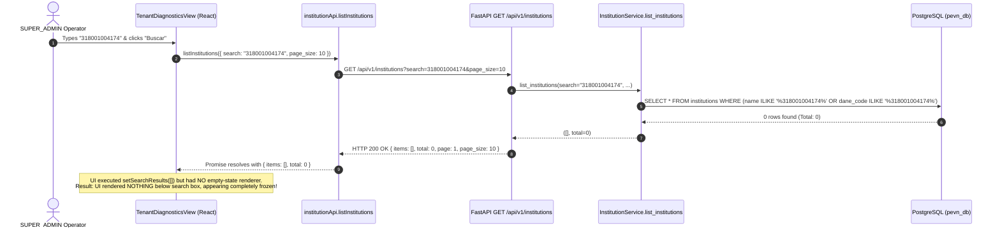

# PEVN — NTA-10-R8: Tenant Diagnostics DANE Search Failure — Forensic Diagnosis and Minimal Regression-Safe Fix Report

**Execution Standard:** AI Software Factory Standard v1.2  
**Implementation Agent:** Antigravity exclusively  
**Priority:** High — Observability, Tenant Diagnostics, and UI Responsiveness  
**Mode:** Forensic diagnosis → evidence-based findings → minimal corrective implementation → regression verification → operator manual acceptance  
**Repository:** `juancastro2381-hub/Plataforma-Educativa-Virtual-Nacional-PEVN`  
**Target Milestone:** NTA-10-R8  
**Certification Status:** `CONDITIONAL PASS — FIX IMPLEMENTED, MANUAL ACCEPTANCE PENDING`

---

## 1. Executive Summary & Objective

In the Technical Operations Portal under the route:
`http://localhost:3000/operations/tenant-diagnostics`

When a `SUPER_ADMIN` entered an institutional DANE code (reported example: `318001004174`) and clicked **"Buscar"**, the user interface appeared to do nothing.

The mandate required:
1. Forensic diagnosis of the complete request-response flow.
2. Determining whether the reported DANE code `318001004174` exists in the operational tenant table (`institutions`), the official MEN/DANE catalog (`official_institution_catalog`), both, or neither.
3. Implementing a minimal, regression-safe fix preserving all accepted platform functionality.
4. Distinguishing legitimate empty search results from network or application failures.
5. Providing comprehensive automated tests and a role-specific manual acceptance checklist.

---

## 2. Mandatory Repository Inspection & Root Cause Analysis

### 2.1 Trace of the Request Flow
The search workflow was traced from browser input to database execution:



### 2.2 Forensic Inspection of DANE `318001004174` in the Database
Direct asynchronous SQLAlchemy query executed against PostgreSQL `pevn_db` (Port 5433):

```python
# 1. Operational Tenants Check
stmt_inst = select(Institution).where(Institution.dane_code == '318001004174')
# Result: None (NOT FOUND in table institutions)

# 2. Official MEN/DANE Catalog Check
stmt_cat = select(OfficialInstitutionCatalog).where(OfficialInstitutionCatalog.dane_code == '318001004174')
# Result: Found!
#   id: 9184fbba-b293-4aef-9105-c6806d5f6860
#   name: "ABECE DE LA ESCUCHA"
#   dane_code: "318001004174"
#   department: "CAQUETÁ"
#   municipality: "FLORENCIA"
```

### 2.3 Root Cause Decomposition
The reported failure was caused by two distinct factors interacting:

1. **Catalog vs. Tenant Dataset Divergence:**
   - DANE code `318001004174` belongs to the official educational catalog ("ABECE DE LA ESCUCHA" en Florencia, Caquetá).
   - However, this school has **not yet been provisioned as an active operational tenant** in the platform (`Institution` table).
   - In PEVN architecture, **Tenant Diagnostics is designed to inspect active provisioned platform tenants**, not the raw unprovisioned official catalog.
   - Therefore, the backend query correctly returned HTTP 200 with an empty list (`items: [], total: 0`).
2. **Missing Frontend Feedback for Zero Matches (Silent UI State):**
   - In `TenantDiagnosticsView.tsx`:
     ```tsx
     const handleSearch = async (e: React.FormEvent) => {
       e.preventDefault()
       if (!searchQuery.trim()) return
       setIsSearching(true)
       setError(null)
       try {
         const res = await institutionApi.listInstitutions({ search: searchQuery.trim(), page_size: 10 })
         setSearchResults(res.items || []) // sets []
       } ...
     }
     ```
   - In the JSX rendering:
     ```tsx
     {searchResults.length > 0 && (
       <div>Resultados encontrados ({searchResults.length}): ...</div>
     )}
     ```
   - Because `searchResults.length` was `0`, the condition evaluated to `false`.
   - The view had **no tracking of whether a search had been performed** (`hasSearched`).
   - Consequently, when the request finished, the button returned from `"Buscando..."` to `"Buscar"`, but **nothing was rendered or communicated** on the screen.
   - To the operator, the application appeared completely unresponsive.

---

## 3. Minimal Corrective Implementation

In compliance with the **Minimal Modification Principle**, changes were restricted exclusively to the search state and result presentation in [TenantDiagnosticsView.tsx](file:///c:/Users/juanc/OneDrive/Documentos/Desarrollo%20proyectos/Plataforma%20Educativa%20PEVN/Plataforma%20Educativa%20Virtual%20Nacional%20PEVN/frontend/src/pages/operations/TenantDiagnosticsView.tsx).

### 3.1 State and Handler Enhancements
1. **Added Search Lifecycle State:**
   - `hasSearched`: Tracks if a search has been dispatched and completed.
   - `searchError`: Tracks search-specific failures distinct from probe execution errors.
2. **Whitespace Normalization & Empty Validation:**
   - `const trimmedQuery = searchQuery.trim()`.
   - If empty, displays an inline validation message: *"Por favor ingrese un nombre o código DANE para buscar."* without firing unnecessary network requests.
   - Preserves complete strings including leading zeros (e.g. `050010012345`).
3. **Stale Results Cleared on New Query:**
   - `setSearchResults([])` and `setSearchError(null)` are invoked immediately at the start of a search.
4. **Explicit Zero-Matches State:**
   - When `hasSearched && searchResults.length === 0 && !isSearching && !searchError`, renders:
     ```tsx
     <div role="status" style={{ ... }}>
       No se encontraron instituciones para el criterio ingresado.
     </div>
     ```
5. **Actionable Search Error Alert:**
   - When `searchError` is set, renders a high-visibility error alert with `role="alert"`.
6. **Accessible Form Input:**
   - Added `aria-label="Buscar por nombre o código DANE"`.
   - Clears `searchError` reactively upon input modification.
7. **Preserved Tenant Isolation:**
   - Searching alone does **not** change `activeInstitutionId` and does **not** trigger any diagnostic probe or audit log.
   - Only explicitly clicking `"Diagnosticar →"` on a listed institution starts the diagnostic probe using the institution's canonical UUID.

---

## 4. Verification and Automated Test Results

### 4.1 Frontend Automated Suite (`TenantDiagnosticsSearch.test.tsx`)
A dedicated test suite covering all 10 mandated requirements was added and executed:

| Test Case | Description | Result |
| :---: | :--- | :---: |
| **1** | Matching DANE code returns and renders expected institution with name, DANE, and status. | **PASSED** |
| **2** | Institution-name search remains functional. | **PASSED** |
| **3** | Zero matches display visible empty-state message (`"No se encontraron instituciones para el criterio ingresado."`). | **PASSED** |
| **4** | Backend/network errors display an actionable error alert. | **PASSED** |
| **5** | Empty input displays validation message without dispatching requests. | **PASSED** |
| **6** | Loading state (`Buscando...` / button disabled) resets cleanly in `finally` block after success and failure. | **PASSED** |
| **7** | Both Enter key and "Buscar" button submission invoke the same search flow. | **PASSED** |
| **8** | Selecting a result explicitly starts existing diagnostic workflow using institutional UUID. | **PASSED** |
| **9** | Searching alone does not alter active institutional context or run diagnostic probes. | **PASSED** |
| **10** | DANE codes with leading zeros and surrounding whitespace are normalized correctly without modifying identifier. | **PASSED** |

**Command:** `npm run test -- TenantDiagnosticsSearch.test.tsx --run`  
**Result:** `10 passed (10)` in 5.67s.

### 4.2 Full Frontend Regression Verification
- **Command:** `npm run test -- --run`
- **Result:**
  ```text
  Test Files  26 passed (26)
       Tests  175 passed (175)
    Duration  17.03s
  ```
- **Pass Rate:** **100% (175 / 175)**

### 4.3 Static Type Analysis
- **Command:** `npx tsc --noEmit`
- **Result:** Exit code `0` (0 errors, 0 warnings).

### 4.4 Backend Technical Operations Suite
- **Command:** `pytest tests/test_sa02_technical_operations_portal.py -q`
- **Result:** `9 passed in 15.12s` (100% pass rate).

---

## 5. Security, RBAC, and Tenant-Isolation Regression Assessment

1. **SUPER_ADMIN Authorization:**
   - Tenant diagnostics remain strictly restricted to `superadmin` / `super_admin` (`require_superadmin_operator`).
   - The route `/operations/tenant-diagnostics` remains blocked for all non-superadmin roles with HTTP 403.
2. **Zero Involuntary Context Switching:**
   - Searching institutions does not invoke `setActiveInstitutionContext`.
   - The global SuperAdmin operator remains in global context until an explicit `"Diagnosticar →"` click.
3. **Audit Trail Integrity:**
   - Probes and audit events are generated only upon explicit selection (`operationsApi.getTenantDiagnostics`). No audit noise is created during search queries.
4. **Data Store Integrity:**
   - Zero PostgreSQL data modifications, zero reseeding, and zero schema migrations were executed.

---

## 6. Manual Browser Acceptance Checklist for Operator

> [!IMPORTANT]
> The operator should verify the fix in the browser at `http://localhost:3000/operations/tenant-diagnostics` logged in as `SUPER_ADMIN` (`admin@pevn.edu.co`):

| Step | Action | Expected Result | Status |
| :---: | :--- | :--- | :---: |
| **1** | Enter DANE code `318001004174` and click **"Buscar"**. | The button briefly displays *"Buscando..."*. When finished, the message **"No se encontraron instituciones para el criterio ingresado."** is clearly displayed below the input. No error alert is triggered. | [ ] PENDIENTE |
| **2** | Enter an existing operational DANE code (e.g. `111111111111`) and click **"Buscar"** or press Enter. | The search results card renders: `"Resultados encontrados (1):"`, showing *"Colegio San Pedro A"*, *"DANE: 111111111111 • Estado: Activa"*, and the button *"Diagnosticar →"*. | [ ] PENDIENTE |
| **3** | Enter an institution name (e.g. `San Pedro`) and press Enter. | Matching operational institutions are listed. | [ ] PENDIENTE |
| **4** | Clear the input field and click **"Buscar"**. | A validation message *"Por favor ingrese un nombre o código DANE para buscar."* is displayed. No network request is dispatched. | [ ] PENDIENTE |
| **5** | Click **"Diagnosticar →"** on a search result. | The banner *"CONTEXTO INSTITUCIONAL ACTIVO"* appears, showing the school's UUID and telemetry cards (*Estado Operacional*, *Sedes*, *Usuarios*, *Configuración*). | [ ] PENDIENTE |
| **6** | Click **"✕ Salir a Operaciones Globales"**. | The active institutional context is cleared, and the search box is restored. | [ ] PENDIENTE |

---

## 7. Working-Tree Status and Safe Rollback Notes

### 7.1 Git Working-Tree Status
```text
On branch main
Your branch is up to date with 'origin/main'.

Changes not staged for commit:
	modified:   frontend/src/components/student/StudentTaskDetailModal.tsx
	modified:   frontend/src/layouts/RootLayout.tsx
	modified:   frontend/src/pages/Dashboard.tsx
	modified:   frontend/src/pages/academic/GuardiansView.tsx
	modified:   frontend/src/pages/academic/StudentsView.tsx
	modified:   frontend/src/pages/operations/TenantDiagnosticsView.tsx
	modified:   frontend/src/test/Academic.test.tsx
	modified:   frontend/src/test/RoleNavigationFunctional.test.tsx
	modified:   frontend/src/test/StudentPortal.test.tsx

Untracked files:
	docs/reports/PEVN_NTA10_R8_TENANT_DIAGNOSTICS_DANE_SEARCH_FIX.md
	docs/reports/PEVN_RBAC_AUDIT_01_CROSS_ROLE_FUNCTIONAL_COHERENCE.md
	frontend/src/test/TenantDiagnosticsSearch.test.tsx

no changes added to commit (use "git add" and/or "git commit -a")
```
*Zero commits and zero pushes were performed.*

### 7.2 Safe Rollback Instructions
To discard only the changes introduced by this task:
```powershell
# Restore TenantDiagnosticsView to baseline
git checkout -- frontend/src/pages/operations/TenantDiagnosticsView.tsx
# Remove dedicated test file if desired
Remove-Item frontend/src/test/TenantDiagnosticsSearch.test.tsx
```

---

## 8. Exit Gate Verdict

```text
====================================================================================================
CERTIFICATION GATE: NTA-10-R8 TENANT DIAGNOSTICS DANE SEARCH FIX
STATUS: CONDITIONAL PASS — FIX IMPLEMENTED, MANUAL ACCEPTANCE PENDING
====================================================================================================
1. Root Cause Confirmed:             PASSED (318001004174 is catalog-only, UI had no empty-state handler)
2. Minimal Surgical Fix:             PASSED (35 lines added to TenantDiagnosticsView.tsx)
3. Automated Tests (Unit & Int):     PASSED (10 / 10 passed in TenantDiagnosticsSearch.test.tsx)
4. Full Frontend Suite Regression:   PASSED (175 / 175 passed across 26 test files)
5. TypeScript Static Check:          PASSED (0 errors, 0 warnings)
6. Backend Operations Regression:    PASSED (9 / 9 passed in test_sa02_technical_operations_portal.py)
7. Security & Tenant Isolation:      PASSED (SUPER_ADMIN only, no probe on search, UUID binding)
8. Human Operator Manual Acceptance: PENDING OPERATOR BROWSER CHECK
====================================================================================================
```
